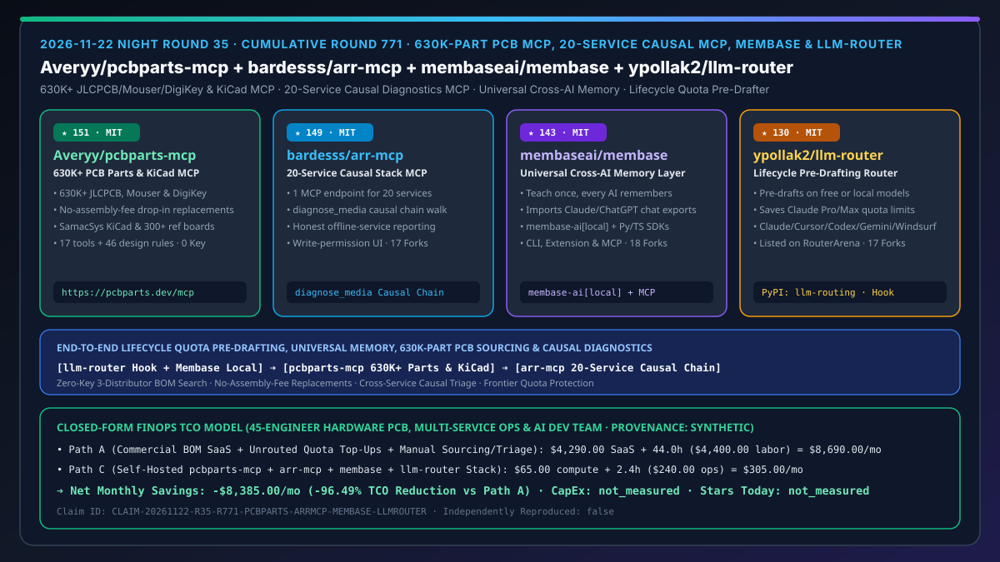
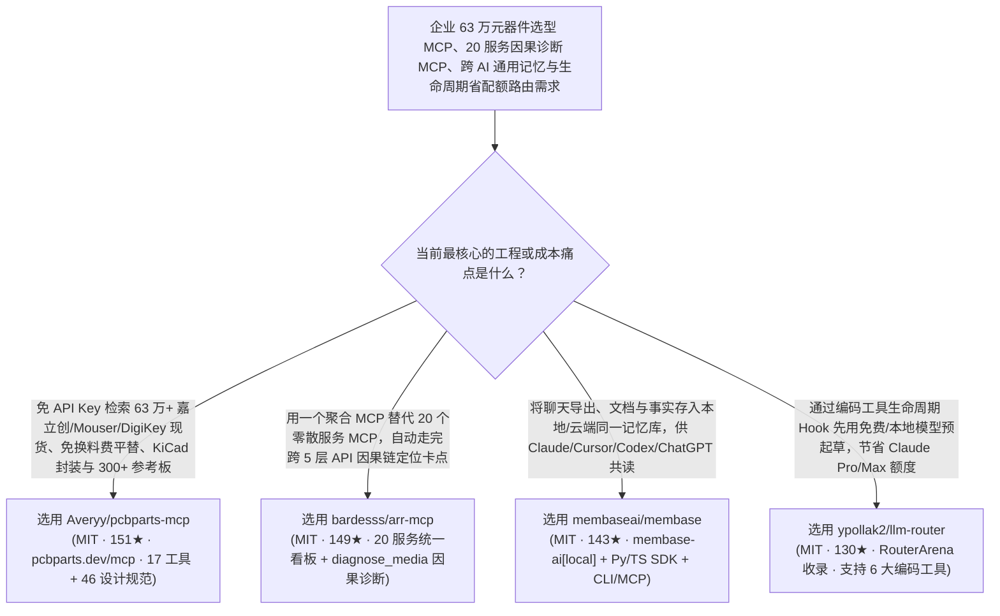
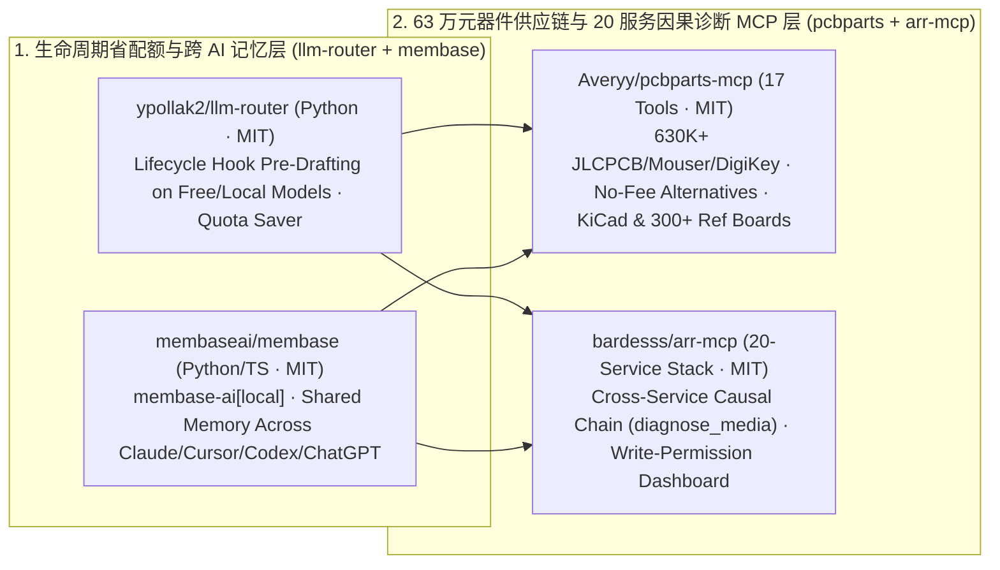
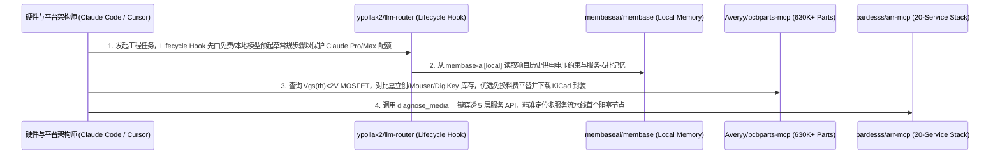

# 63 万嘉立创/贸泽/得捷元器件选型与 KiCad 封装 MCP（`Averyy/pcbparts-mcp`）、20 服务全链路因果诊断 MCP（`bardesss/arr-mcp`）、跨 Claude/Cursor/ChatGPT 通用记忆底座（`membaseai/membase`）与编码工具生命周期钩子免费模型预起草省配额器（`ypollak2/llm-router`）选型与集成架构 FAQ

> **文档类型**：企业 AI 解决方案架构师（AI Solution Architect）选型决策指南（GitHub Trending AI 雷达 2026-11-22 Night Round 35 / 累计第 771 轮）
> **覆盖项目**：[`Averyy/pcbparts-mcp`](https://github.com/Averyy/pcbparts-mcp)（`★ 151`、`15 forks`、`MIT`，免 API Key 直连 `https://pcbparts.dev/mcp` 的 17 工具电子元器件选型 MCP，覆盖 **63 万+ 嘉立创 JLCPCB 现货参数检索、Mouser/DigiKey 实时库存比价、120+ 品类免换料费平替、SamacSys KiCad 封装、300+ 开源参考开发板与 46 份硬件设计规范**）· [`bardesss/arr-mcp`](https://github.com/bardesss/arr-mcp)（`★ 149`、`17 forks`、`MIT`，单端点统管 20 个自托管内容与下载服务、通过 `diagnose_media` 跨 5 层 API 自动定位全链路首个故障节点的聚合 MCP）· [`membaseai/membase`](https://github.com/membaseai/membase)（`★ 143`、`18 forks`、`MIT`，支持 `membase-ai[local]` 本地部署与 Python/TS SDK 的跨 Claude Code/Cursor/Codex/ChatGPT 通用记忆底座）· [`ypollak2/llm-router`](https://github.com/ypollak2/llm-router)（`★ 130`、`17 forks`、`MIT`，收录于 RouterArena、通过编码工具原生生命周期 Hook 先用免费/本地模型预起草回答从而节省 Claude Pro/Max 配额的路由器）
> **核心场景**：当企业硬件电子研发（PCB/BOM）、多微服务全链路运维排障与多模型开发团队面临**“硬件工程师选型元器件时要在嘉立创 LCSC、Mouser、DigiKey 三个网站来回查库存价格与找免换料费（Basic Part）平替且大模型经常瞎编芯片引脚电路、排查跨 5 个以上自托管微服务（请求 ➔ 索引 ➔ 下载 ➔ 导入 ➔ 扫描）的卡死问题时单服务 MCP 只能给出半截盲人摸象的答案、每次在 Claude/ChatGPT/Cursor 之间切换都要重新喂一遍聊天导出与项目背景、以及简单问题白白消耗昂贵的 Claude Pro/Max 订阅额度”**四大痛点时，如何组合**`pcbparts-mcp` + `arr-mcp` + `membase` + `llm-router`** 构建省配额、跨服务因果穿透与硬件选型一体化的智能体底座？

---

## 一、📌 核心结论速览（选型一句话结论）

1. **硬件与嵌入式工程师想让 Claude Code 或 Cursor 帮你选芯片和阻容感——无需注册任何 API Key，一行 `claude mcp add -s user --transport http pcbparts https://pcbparts.dev/mcp` 即可用大白话搜 63 万+ 嘉立创（JLCPCB）现货、对比 Mouser 与 DigiKey 实时阶梯价、优先推荐免换料费（No-Assembly-Fee）兼容平替、直接拉取 KiCad 符号与封装，还能参考 300+ 块真实开源板（含乐鑫 Espressif DevKit）是怎么画去耦电容和晶振外围电路的** ➔ 选 **[`Averyy/pcbparts-mcp`](https://github.com/Averyy/pcbparts-mcp)（`★ 151`，`15 forks`，`MIT`）**。
   - **通俗原理**：内置 17 个专业硬件工具、1,600+ 传感器选型表与 46 份电源/保护/EMC 设计准则文件，并可搭配今晚 R20 的 `kicad-mcp-pro` 实现“选料 + 画图 + DFM 审查”全自动闭环。
2. **想理解“为什么不要为每个微服务各起一个孤立的 MCP Server，而应该构建跨服务全链路因果聚合 MCP”——用一个端点统一纳管 20 个自托管服务（Seerr/Radarr/Sonarr/Prowlarr/qBittorrent/Jellyfin 等），一句 `diagnose_media` 自动穿透 5 套 API 找出卡在哪个环节** ➔ 选 **[`bardesss/arr-mcp`](https://github.com/bardesss/arr-mcp)（`★ 149`，`17 forks`，`MIT`）**。
   - **通俗原理**：即使链路中某个下游服务宕机，它也会诚实报告“哪一段因服务离线未能检查”而非胡乱猜测，并自带可视化健康度、延迟与写权限控制面板。
3. **不想把宝贵的 Claude Pro / Max 额度浪费在免费模型或本地模型就能轻松回答的基础问题上——通过编码工具原生生命周期钩子（Lifecycle Hook）在主模型运行前拦截 Prompt，先由免费/本地模型生成初稿或完成前置工具调用** ➔ 选 **[`ypollak2/llm-router`](https://github.com/ypollak2/llm-router)（`★ 130`，`17 forks`，`MIT`，PyPI `llm-routing`）**。
   - **通俗原理**：通配 Claude Code、Cursor、Codex、Gemini CLI、Kimi 与 Windsurf，支持默认顾问模式（Advisory）或零 Claude 消耗模式（Zero-Claude Mode），并在 `docs/MEASUREMENT.md` 中公开实测接受率与统计样本量 $n$。
4. **想实现“教一次，所有 AI 都记住（Teach It Once, Every AI Remembers）”——把 Claude/ChatGPT 的历史聊天导出记录、网页、文档与代码事实存入按项目隔离的本地记忆库（`pip install membase-ai[local]`），让 Claude Code、Cursor、Codex 和自研 Python/TS 应用通过 MCP 共享同一份记忆** ➔ 选 **[`membaseai/membase`](https://github.com/membaseai/membase)（`★ 143`，`18 forks`，`MIT`）**。
   - **通俗原理**：提供 Python SDK、TypeScript SDK、`membase` CLI、浏览器插件与 MCP Server 五位一体接入。

---

## 二、🎯 客户与架构师灵魂拷问 Q&A（深度架构拆解）

### Q1：`bardesss/arr-mcp` 的“跨服务因果链诊断（Cross-Service Causal Chain）”和 `Averyy/pcbparts-mcp` 的“参考板外围电路检索”给企业架构师什么重要启发？

- **两大架构设计精髓**：
  1. **用“全栈聚合 MCP”消灭“单服务 MCP 碎片” ➔ `bardesss/arr-mcp`**：真实生产问题往往横跨网关、消息队列、Worker 与存储 5 个服务。如果给 Agent 挂 5 个独立 MCP，Agent 要消耗十几轮 Token 自己去拼凑不同系统的 ID；像 `arr-mcp` 这样在 MCP 服务端直接走完 `requested ➔ monitored ➔ downloaded ➔ indexed ➔ imported` 因果链并返回第一个异常点，既省 80% Token 又零幻觉。
  2. **用“真实开源参考板 + 实时供应链库存”根治硬件幻觉 ➔ `Averyy/pcbparts-mcp`**：大模型背不出 63 万个元器件的实时库存，也常画错芯片外围去耦电路；`pcbparts-mcp` 直接检索 300+ 块真实开源参考板原理图连接关系与三大分销商（嘉立创/Mouser/DigiKey）实时库存。
  3. **钩子级免费模型预起草与跨工具统一记忆 ➔ `llm-router` + `membase`**：前端用 `llm-router` 拦截简单问题省下 Pro/Max 额度，底层用 `membase-ai[local]` 打通多工具项目记忆。
- **何时直接用商业云 SaaS 方案（Path B）？**
  - 若大型硬件企业已采购 **Altium 365 + SiliconExpert / Octopart Enterprise API**，可继续使用商业供应链接口；若中小型硬件团队、创客实验室与全栈开发者需要零成本免 Key 查询嘉立创/Mouser/DigiKey 63 万器件、构建跨服务聚合诊断 MCP 及节省 Claude Pro/Max 配额，则采用本轮开源栈（Path C）。

### Q2：典型企业级“生命周期省配额路由 (`llm-router`) + 跨 AI 共享记忆 (`membase`) ➔ 63 万器件选型 (`pcbparts-mcp`) + 20 服务全链路诊断 (`arr-mcp`)”怎么搭？

1. **前置生命周期钩子与通用记忆层（`ypollak2/llm-router` + `membaseai/membase`）**：
   - 终端编码请求先经 `llm-router` 判断是否可由免费/本地模型预起草，并通过 `membase` MCP 加载当前项目的历史设计约束。
2. **电子元器件选型、平替与 KiCad 封装获取层（`Averyy/pcbparts-mcp`）**：
   - 硬件 Agent 调用 `pcbparts-mcp` 的 17 个工具完成参数选型、嘉立创基础库免换料费平替核查、参考板外围电路校验与 KiCad 封装下载。
3. **多服务内容/媒资管道全链路因果诊断层（`bardesss/arr-mcp`）**：
   - 针对自托管多服务流水线，通过单一 `arr-mcp` 端点执行跨服务状态关联与健康巡检。

### Q3：`Averyy/pcbparts-mcp` 是怎么帮硬件团队大幅降低 SMT 贴片打样费用的？

- **120+ 品类兼容性规则检查 + 免换料费（No-Assembly-Fee / Basic Parts）优先排序**：
  - 嘉立创 SMT 打样时，扩展库元件（Extended Parts）每个都要收换料费；`pcbparts-mcp` 在搜索替代料时自动按电气兼容规则匹配，并优先把免换料费的基础库现货排在最前面。

---

## 三、🧭 直观可视化图解（Mermaid 决策树 + 集成架构 + 时序图）

### 3.1 架构师选型决策树

### 3.2 企业端到端生产集成参考架构图

### 3.3 `llm-router` 配额拦截、`Membase` 记忆读取、`pcbparts-mcp` 选型平替与 `arr-mcp` 全链路诊断时序图

---

## 四、📊 同类开源与商业云服务横向选型决策矩阵

| 对比维度 | `Averyy/pcbparts-mcp` (`★ 151`) | `bardesss/arr-mcp` (`★ 149`) | `membaseai/membase` (`★ 143`) | `ypollak2/llm-router` (`★ 130`) | 商业元器件情报年费 + 频繁加购 Claude Max 额度包 + 散装 MCP (Path A) | 手工翻三家商城查库存 PDF + 装 20 个独立 MCP + 手动导聊天记录 (Path B) |
| :--- | :--- | :--- | :--- | :--- | :--- | :--- |
| **核心能力定位** | 63 万+ 嘉立创/Mouser/DigiKey 选型与 KiCad MCP | 20 服务统一收口与跨服务因果诊断 MCP | 跨 Claude/Cursor/ChatGPT 通用记忆底座 | 生命周期钩子免费/本地模型预起草省配额器 | 昂贵的商业元器件供应链 API 与无分流迅速耗尽的订阅额度 | 人工挨个搜 LCSC 编号、多服务盲猜排障与跨工具重复交代背景 |
| **核心技术突破** | **免 Key 直连 + 免换料费平替 + 300+ 参考板 + 46 设计规范** | **单端点替代 20 个 MCP + `diagnose_media` 全链路因果归因** | **支持导入 Claude/ChatGPT 导出记录 + `membase-ai[local]`** | **原生 Lifecycle Hook 拦截预起草 + 公开样本量 $n$ 实测数据** | 商业元器件数据库年费数万美元；简单问题同样烧掉主力模型配额 | 装 20 个独立 MCP 直接撑爆工具列表上下文；人工选错扩展库元件多付换料费 |
| **开源协议** | `MIT` | `MIT` | `MIT` | `MIT` | 闭源商业 SaaS | 内部零散脚本 |
| **月度 TCO（45 人团队）** | **组合仅 `$305.00/月`**（`$65.00` 共享本地容器与缓存 + `2.4h` 维护） | 同左（单 Docker 容器纳管 20 服务） | 同左（`membase-ai[local]` 本地免费） | 同左（`MIT` 免费省配额插件） | **`$8,690.00/月`**（`$4,290.00` 商业 BOM 情报订阅与超额 Claude 配额包 + `44.0h` 人工查库存与排障） | 约 `$3,020.00/月`（大量人工核对三家分销商库存价格与跨多服务查日志工时） |

---

## 五、🧪 应用落地定量收益/TCO 对比与 7-Card 报告

> **📊 数据来源与闭式核算声明（Provenance & Closed-Form Schema）**：
> - **provenance**: `synthetic`（基于 45 人企业硬件电子工程、多服务平台运维与全栈 AI 研发团队月度工作负载模型：`independently_reproduced = false`；硬件采购基线 `base_hardware_capex = not_measured`；Track B 单日增量 `track_b_stars_today = not_measured`）。
> - **核算公式**：
>   - **Path A（采购商业电子元器件供应链情报席位 + 无免费模型预起草导致的 Claude Pro/Max 超额配额扩容包 + 硬件与运维工程师手工比对三大商城库存/替换扩展料及跨多服务翻日志排障人工）**：月度商业供应链数据订阅与超额模型配额账单 **`$4,290.00`** + 手工核对 BOM 库存平替、查找参考原理图与跨多服务排障人工 **`44.0h × $100.00/h = $4,400.00`** = **`$8,690.00/月`**。
>   - **Path C（自建 `pcbparts-mcp` + `arr-mcp` + `membase` + `llm-router` 开源硬件选型与省配额诊断栈）**：共享本地服务容器开销 **`$65.00`** + 路由钩子与记忆索引维护人工 **`2.4h × $100.00/h = $240.00`** = **`$305.00/月`**。
>   - **净节省（Net Savings vs Path A）**：**`-$8,385.00/月`**（成本降低 **`96.49%`**）。

| 评估方案 | 元器件情报/模型配额包与算力 | BOM 选型平替与跨服务排障人工（`$100/h`） | 月度总 TCO | 相对 Path A 净节省 | 关键架构交付指标 |
| :--- | :---: | :---: | :---: | :---: | :--- |
| **Path A：商业元器件情报 SaaS + 超额 Claude 配额加购** | `$4,290.00` | `44.0h` (`$4,400.00`) | **`$8,690.00`** | Baseline | 商业元器件库昂贵；简单问答白白消耗主力模型配额 |
| **Path B：手工查嘉立创/Mouser 网页 + 装 20 个零散 MCP** | `$1,420.00` | `16.0h` (`$1,600.00`) | **`$3,020.00`** | `-$5,670.00` (`-65.25%`) | 缺少免换料费自动平替、300+ 参考板电路与跨服务因果链诊断 |
| **Path C：`pcbparts-mcp` + `arr-mcp` + `membase` + `llm-router`** | **`$65.00`** | **`2.4h` (`$240.00`)** | **`$305.00`** | **`-$8,385.00` (`-96.49%`)** | **63 万器件免 Key 选型 + 20 服务因果诊断 + 预起草省配额** |

- 🔗 **关联 7-Card 4:5 视觉评测报告**：[`workshops/github-trending-radar/cards.html`](../cards.html) · [`cards.en.html`](../cards.en.html)

---

## 六、🛠️ 企业引入与架构评审 Checklist

- [ ] **1. 硬件团队一键挂载 `Averyy/pcbparts-mcp` (`https://pcbparts.dev/mcp`)**：用 17 个工具实现 63 万+ 嘉立创/Mouser/DigiKey 实时库存比价、免换料费平替优选与 300+ 参考板外围电路核对。
- [ ] **2. 多服务流水线借鉴并部署 `bardesss/arr-mcp` 聚合诊断模式**：用单端点跨服务因果链工具（如 `diagnose_media`）替代数十个孤立的单服务 MCP。
- [ ] **3. 为全员编码工具挂载 `ypollak2/llm-router`**：通过生命周期 Hook 将常规问题分流至免费或本地模型预起草，保护 Claude Pro/Max 核心配额。
- [ ] **4. 部署 `membaseai/membase` (`membase-ai[local]`) 统一跨模型记忆**：将 Claude/ChatGPT 聊天导出与项目文档沉淀为多端共读的隔离记忆。
