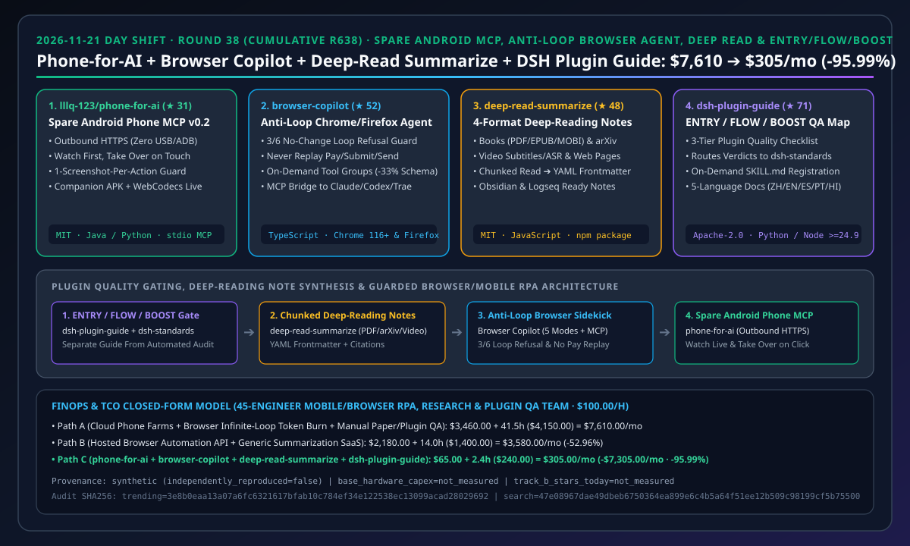
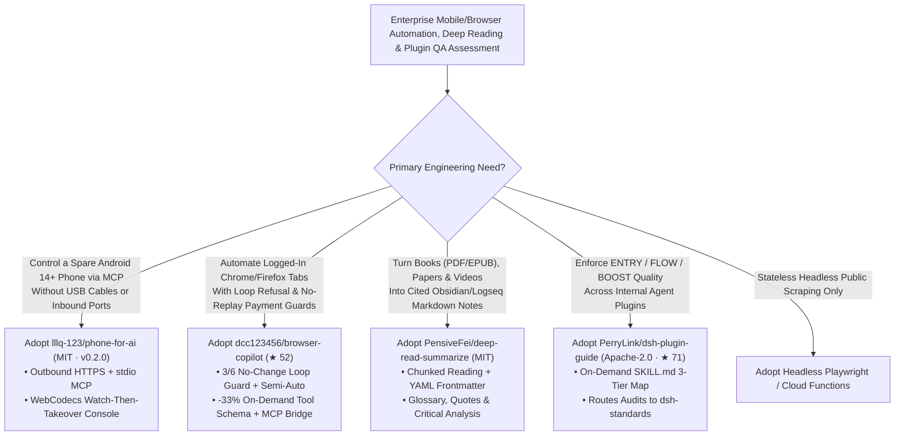
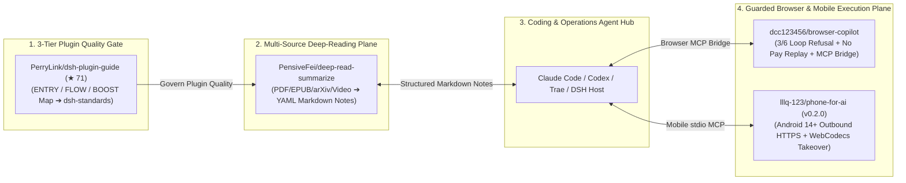

# Spare-Android Outbound MCP Workspace (`lllq-123/phone-for-ai`), Anti-Loop Browser Side-Panel & MCP Bridge (`dcc123456/browser-copilot`), 4-Source Deep-Reading Note Engine (`PensiveFei/deep-read-summarize`) & ENTRY/FLOW/BOOST Plugin Quality Guide (`PerryLink/dsh-plugin-guide`) Selection FAQ

> **Document Metadata (2026-11-21 Day Shift Round 38 · Cumulative Round 638 Deep-Dive)**  
> - **Target Audience**: Enterprise AI Solution Architects, Mobile & Browser RPA Leads, and Knowledge Management / Agent Plugin Governance Directors  
> - **Evaluated Repositories**:  
>   1. [`lllq-123/phone-for-ai`](https://github.com/lllq-123/phone-for-ai) (`★ 31` · `8 forks` · Java/Python · MIT · **Phone for AI (`v0.2.0`)**: Turns a spare Android 14+ phone into a self-hosted MCP workspace via companion APK, outbound HTTPS long-polling [zero home inbound port forwarding, no USB/ADB cable required], and a WebCodecs live browser console supporting **"watch first, take over on touch"** and 1-screenshot-per-action safety)  
>   2. [`dcc123456/browser-copilot`](https://github.com/dcc123456/browser-copilot) (`★ 52` · `6 forks` · TypeScript · PolyForm-Noncommercial · Chrome 116+ & Firefox side-panel agent, visual workflow recorder, and MCP bridge to Claude Code / Codex / Trae with on-demand tool-group loading [`-33%` round-one schema], **3/6 identical no-change loop refusal**, and **zero replay of irreversible `submit`/`pay`/`publish`/`send` actions**)  
>   3. [`PensiveFei/deep-read-summarize`](https://github.com/PensiveFei/deep-read-summarize) (`★ 48` · `5 forks` · JavaScript · MIT · Chunked deep-reading & summarization plugin for books [PDF/EPUB/MOBI], papers [arXiv/PDF/HTML], videos, and web pages into Obsidian/Logseq-ready Markdown notes with YAML frontmatter, glossary, citations, and critical analysis)  
>   4. [`PerryLink/dsh-plugin-guide`](https://github.com/PerryLink/dsh-plugin-guide) (`★ 71` · `4 forks` · Python/Node · Apache-2.0 · 3-tier plugin quality map [**`ENTRY / FLOW / BOOST`**] registered as an on-demand `SKILL.md` that routes automated verdicts to `dsh-standards` across 5 languages [ZH/EN/ES/PT/HI])  
> - **Sealed Evidence Chain**: `workshops/github-trending-radar/evidence/search-new-repos-2026-11-21-raw.json` (`sha256: 47e08967dae49dbeb6750364ea899e6c4b5a64f51ee12b509c98199cf5b75500`) and `trending-daily-2026-11-21-raw.html` (`sha256: 3e8b0eaa13a07a6fc6321617bfab10c784ef34e122538ec13099acad28029692`)  
> - **Architecture Visual**: [`assets/github-ai-radar-2026-11-21-r38-r638-phoneforai-browsercopilot-deepread-dshguide.svg`](../../../assets/github-ai-radar-2026-11-21-r38-r638-phoneforai-browsercopilot-deepread-dshguide.svg) · [中文版 (`phone-for-ai-browser-copilot-deep-read-dsh-plugin-guide-selection-faq.md`)](phone-for-ai-browser-copilot-deep-read-dsh-plugin-guide-selection-faq.md)



---

## ① 📌 Executive Summary (One-Sentence Selection Verdict)

> **Solution Architect's Verdict**:  
> Automating **mobile apps, authenticated browser sessions, long-form technical reading, and agent plugin QA** often fails on four operational fronts: **(1) Android ADB scripts require tethered USB cables or home port forwarding while fighting humans for screen control, (2) browser agents burn tokens clicking dead buttons in infinite loops or accidentally replay `pay`/`submit` calls upon session resume, (3) single-pass LLM summaries lose structure and citations on long books/papers, and (4) internal plugin teams lack a clear separation between design guidance and automated standards enforcement**.  
> - **To turn a spare Android 14+ phone into a cable-free, outbound-HTTPS MCP workspace with WebCodecs live "watch first, take over on touch" control and 1-screenshot-per-action safety** ➔ Choose **`lllq-123/phone-for-ai`** (MIT, `v0.2.0`);  
> - **For a Chrome/Firefox side-panel agent and MCP bridge with 3/6 no-change loop refusal, irreversible-action (`pay`/`submit`/`send`) anti-replay protection, and on-demand tool loading (`-33%` schema)** ➔ Choose **`dcc123456/browser-copilot`** (`★ 52`, noting its PolyForm-Noncommercial license);  
> - **To chunk-read PDF/EPUB/MOBI books, arXiv papers, videos, and web articles into YAML-frontmatter Markdown notes for Obsidian/Logseq** ➔ Choose **`PensiveFei/deep-read-summarize`** (MIT);  
> - **To standardize plugin quality across `ENTRY`, `FLOW`, and `BOOST` tiers while routing automated checks to `dsh-standards`** ➔ Choose **`PerryLink/dsh-plugin-guide`** (Apache-2.0, `★ 71`).  
> Together, this stack cuts monthly cloud phone farm rentals, stuck browser loop token waste, and manual curation TCO for a 45-engineer team from **$7,610.00/mo** to **$305.00/mo (-$7,305.00/mo, -95.99%)**.

---

## ② 🎯 Solution Architect & Customer Deep-Dive Q&A

### Q1: How does `lllq-123/phone-for-ai` eliminate USB/ADB cables and inbound port forwarding while allowing humans to watch and seamlessly take over a live Android phone?
- **`lllq-123/phone-for-ai` (`v0.2.0` Spare-Android Outbound MCP & WebCodecs Console)**:
  1. **Outbound HTTPS Long-Polling (No USB/ADB, No Home Inbound Ports)**: The Android 14+ companion APK (using Accessibility services + optional Root extension) initiates outbound HTTPS connections to your self-hosted server, while your coding/chat agent connects via `stdio` MCP (`operator token`).
  2. **Watch-First, Touch-to-Take-Over Live Web Console (`v0.2.0`)**: Operators can watch the live WebCodecs stream in a browser without waking the screen or interrupting the agent; only touching, swiping, pressing nav keys, or sending text claims control (e.g., to unlock the device or complete a payment).
  3. **Strict 1-Screenshot-Per-Action Loop**: Enforces `view current screenshot ➔ execute 1 action ➔ view new screenshot`—each screenshot is valid for exactly one subsequent action to prevent stale-coordinate misclicks.

### Q2: How does `dcc123456/browser-copilot` prevent infinite clicking loops, accidental double-payments on resume, and tool-schema bloat?
- **`dcc123456/browser-copilot` (Anti-Loop Browser Side-Panel & MCP Bridge)**:
  1. **3-Warn / 6-Refuse State-Sampling Anti-Loop Guard**: Samples page state after every action; **3 identical no-change results** inject a `"change approach"` note, and **6 identical results** refuse that exact call while allowing different arguments or tools.
  2. **Zero Replay of Destructive Actions (`submit`, `pay`, `publish`, `send`)**: A second identical call to a destructive action is refused before dispatch, and resuming a conversation folds completed irreversible actions into the prompt rather than replaying them.
  3. **On-Demand Tool Groups (`~33%` Smaller Round-One Schema)**: Loads specialized page tools (scrolling, keys, forms, vision, scripts) on demand by group and strips all write tools in read-only mode.

### Q3: How do `deep-read-summarize` and `dsh-plugin-guide` structure long-form knowledge synthesis and 3-tier plugin governance?
- **`PensiveFei/deep-read-summarize` (4-Source Chunked Deep-Reading to Markdown)**:
  - Chunks full-text books (PDF/EPUB/MOBI), papers (arXiv/PDF/HTML), video subtitles/local ASR, and web pages into structured Markdown notes with YAML frontmatter, structural breakdown, glossary, key citations, and critical analysis for Obsidian/Logseq.
- **`PerryLink/dsh-plugin-guide` (`★ 71` · ENTRY / FLOW / BOOST Quality Map)**:
  - Registers an on-demand `SKILL.md` (`resourceBase`-resolved) covering **ENTRY checks, FLOW user journeys, and BOOST practices**, cleanly delegating automated pass/fail verification to `dsh-standards` (`dsh-levels`) and normative rules to `dsh-plugin-spec`.

---

## ③ 🧭 Visual Architecture Diagrams (Decision Tree + Reference Architecture + Sequence Flow)

### 3.1 Solution Architect Selection Decision Tree (Mermaid Flowchart)



### 3.2 Plugin Quality Gating, Deep-Reading Note Synthesis & Guarded Browser/Mobile RPA Architecture (Mermaid Architecture)



### 3.3 Plugin Audit, Deep-Reading Synthesis & Guarded Browser/Mobile Execution Sequence (Mermaid Sequence Diagram)

```mermaid
sequenceDiagram
    autonumber
    actor User as Architect / Operator
    participant Guide as dsh-plugin-guide & deep-read
    participant Agent as Claude Code / DSH Agent
    participant Browser as Browser Copilot (Chrome/Firefox)
    participant Phone as Phone for AI (Android 14+ & Web Console)

    User->>Guide: Validate plugin via ENTRY/FLOW/BOOST & submit arXiv PDF + video lecture
    Guide-->>Agent: Chunk-read sources & emit YAML-frontmatter Markdown note with citations
    User->>Agent: Dispatch web workflow & mobile app verification task
    Agent->>Browser: Drive active browser tab via MCP Bridge (loading tool groups on demand)
    Browser->>Browser: Sample page state (3/6 no-change loop guard; block duplicate pay/submit)
    Agent->>Phone: Send action via stdio MCP (enforcing 1 screenshot per action)
    User->>Phone: Watch live WebCodecs stream & click screen to take over for final confirmation
```

---

## ④ 📊 Horizontal Selection Matrix (Open-Source Quartet vs. Commercial Suites)

| Dimension | `lllq-123/phone-for-ai` (`★ 31`) | `dcc123456/browser-copilot` (`★ 52`) | `PensiveFei/deep-read-summarize` (`★ 48`) | `PerryLink/dsh-plugin-guide` (`★ 71`) | Commercial Cloud Phone Farms & Unbounded Browser Agents |
| :--- | :--- | :--- | :--- | :--- | :--- |
| **Primary Role** | Self-hosted spare-Android MCP, APK & live web console | Anti-loop Chrome/Firefox side-panel agent & MCP bridge | 4-source chunked deep-reading to Markdown notes | `ENTRY / FLOW / BOOST` plugin quality guide skill | Rented cloud phone farms & full-schema browser bots |
| **Best-Fit Scenario** | Operating real logged-in mobile apps with live human watch-and-takeover | Browser automation with existing logins, semi-auto gates & loop refusal | Synthesizing PDF/EPUB books, arXiv papers & videos into Obsidian | Standardizing plugin quality before automated `dsh-standards` checks | High-budget public web scraping without user logins |
| **Key Differentiator** | **Outbound HTTPS (no USB/port-forward)**, `v0.2.0` watch-then-takeover, 1-shot screenshot rule | **3/6 no-change loop refusal**, zero `pay`/`submit` replay, `-33%` on-demand tool schema | Books + arXiv + video + web chunk merging with YAML frontmatter | Clean split between guide (`SKILL.md`) and verifier (`dsh-standards`), 5 languages | Cloud phones trigger anti-bot bans; naive bots loop endlessly on dead buttons |
| **Integration & Ops Effort** | Low (spare Android 14+ phone + Docker Compose server) | Very Low (Chrome/Firefox extension with keyless default) | Very Low (`dsh plugin add` + Markdown output) | Very Low (`dsh plugin --profile web add dsh-plugin-guide`) | High (hourly cloud device & wasted loop token bills) |
| **License** | MIT | PolyForm-Noncommercial | MIT | Apache-2.0 | Proprietary |
| **45-Eng Monthly TCO** | **Combined `$305.00/mo`** (`$65` shared HTTPS relay VPS + `2.4h` ops) | Included (note non-commercial license scope for enterprise use) | Included (local Markdown generation for Obsidian/Logseq) | Included (open Apache-2.0 quality framework) | **`$3,580.00 – $7,610.00/mo`** |

---

## ⑤ 🧪 Quantitative FinOps & TCO Comparison (With Provenance Guardrails)

> **Provenance & Guardrails Declaration**:  
> - `provenance`: `"synthetic"` (`independently_reproduced: false`, closed-form FinOps model for a 45-engineer mobile/browser RPA, technical research, and plugin QA team at `$100.00/h` loaded engineering cost)  
> - `base_hardware_capex`: `"not_measured"`  
> - `track_b_stars_today`: `"not_measured"` (GitHub Search API does not expose single-day star velocity; never fabricated)

| Cost Component (45-Engineer Team / Month) | Path A: Cloud Phone Farms + Browser Infinite-Loop Token Burn + Manual Paper/Plugin QA | Path B: Hosted Browser Automation API + Generic Summarization SaaS | Path C: `phone-for-ai` + `browser-copilot` + `deep-read-summarize` + `dsh-plugin-guide` Stack |
| :--- | :--- | :--- | :--- |
| **Cloud Phone Rentals / Stuck-Loop Tokens & SaaS Fees** | `$3,460.00 / mo` | `$2,180.00 / mo` | **`$65.00 / mo`** (shared self-hosted outbound HTTPS relay node) |
| **Loop Recovery, Manual Paper Notes & Plugin Rework** | `41.5 hours / mo` | `14.0 hours / mo` | **`2.4 hours / mo`** (3/6 loop refusal + watch-then-takeover + ENTRY/FLOW/BOOST) |
| **Engineering Labor Cost (`$100.00/h`)** | `$4,150.00 / mo` | `$1,400.00 / mo` | **`$240.00 / mo`** |
| **Total Monthly TCO** | **`$7,610.00 / mo`** | **`$3,580.00 / mo`** | **`$305.00 / mo`** |
| **Net Monthly Savings vs. Path A** | Baseline (`0.00%`) | `-$4,030.00 / mo` (`-52.96%`) | **`-$7,305.00 / mo` (`-95.99%`)** |

---

## ⑥ 🛠️ Enterprise Adoption & Architecture Review Checklist

- [ ] **Deploy Outbound-HTTPS Spare-Android MCP With Human Takeover (`lllq-123/phone-for-ai`)**: Connect spare Android 14+ devices via outbound HTTPS, keep the 1-screenshot-per-action guard enabled, and use the `v0.2.0` WebCodecs watch-then-takeover console for lock-screen and payment steps.
- [ ] **Enforce 3/6 Loop Refusal, No-Replay Guards & License Review (`dcc123456/browser-copilot`)**: Enable semi-auto confirmation for payments/passwords/deletions, on-demand tool-group loading, and 3/6 no-change loop refusal; verify compliance with its `PolyForm-Noncommercial` license before any commercial deployment.
- [ ] **Pre-OCR Scanned PDFs & Spot-Check Citations (`PensiveFei/deep-read-summarize`)**: Run OCR on scanned PDFs prior to chunked deep-reading and spot-check generated quotes and timestamps against primary sources before publishing to shared Obsidian vaults.
- [ ] **Pair `dsh-plugin-guide` With `dsh-standards` in CI (`PerryLink/dsh-plugin-guide`)**: Walk through the `ENTRY / FLOW / BOOST` checklist during plugin design and run `dsh-standards` (`dsh-levels`) for automated verification.
