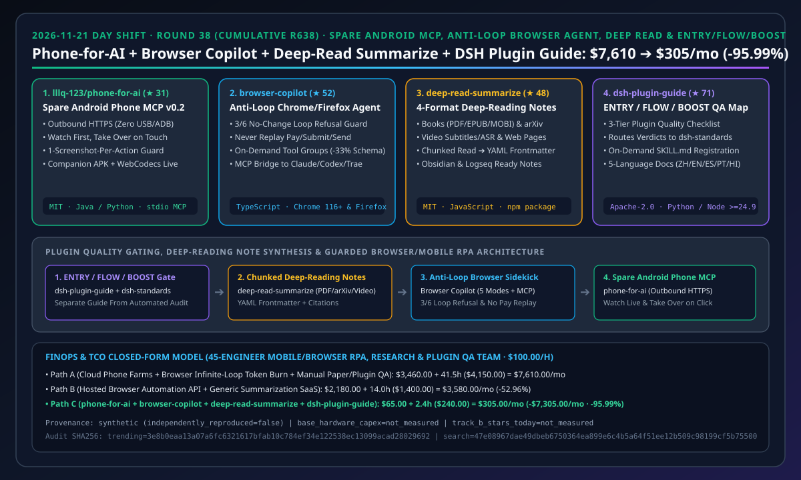
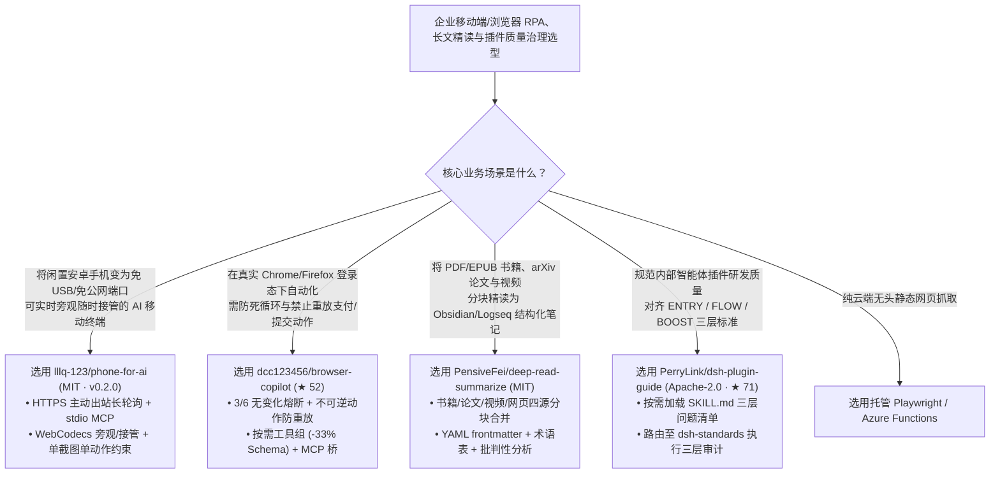
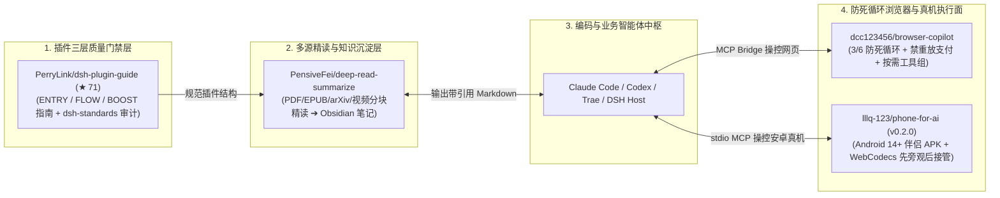
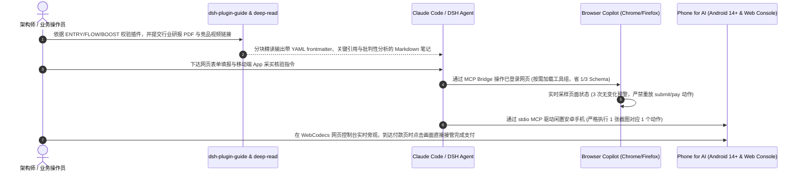

# 闲置安卓手机免公网入站 MCP 工作台（`lllq-123/phone-for-ai`）、防死循环与防重复扣款浏览器副驾（`dcc123456/browser-copilot`）、四源长文精读结构化笔记插件（`PensiveFei/deep-read-summarize`）与 ENTRY/FLOW/BOOST 三层插件质量指南（`PerryLink/dsh-plugin-guide`）选型 FAQ

> **文档元数据（2026-11-21 白班 Day Round 38 · 累计第 638 轮深潜专题）**  
> - **面向对象**：企业 AI 解决方案架构师（AI Solution Architect）、移动端与浏览器 RPA 负责人、企业知识管理与智能体插件生态治理总监  
> - **本轮核心评估对象**：  
>   1. [`lllq-123/phone-for-ai`](https://github.com/lllq-123/phone-for-ai)（`★ 31` · `8 forks` · Java/Python · MIT · **给 AI 一台手机 `v0.2.0`**：将闲置 Android 14+ 手机变为自托管 MCP 工作台，手机通过 HTTPS 主动长轮询自建服务端[免家庭公网端口映射、免常插 USB/ADB 线]，支持 WebCodecs 网页实时投屏**“先旁观、点按即接管”**与单截图单动作防误点约束）  
>   2. [`dcc123456/browser-copilot`](https://github.com/dcc123456/browser-copilot)（`★ 52` · `6 forks` · TypeScript · PolyForm-Noncommercial · Chrome/Firefox 侧边栏智能体、录制工作流与 Claude Code/Codex/Trae MCP 桥接器：按需分组加载工具省 1/3 Schema Token、**3 次无变化提醒 / 6 次拒绝防死循环**、以及 **`submit`/`pay`/`publish`/`send` 破坏性动作永不重放保护**）  
>   3. [`PensiveFei/deep-read-summarize`](https://github.com/PensiveFei/deep-read-summarize)（`★ 48` · `5 forks` · JavaScript · MIT · 面向 DSH 的书籍[PDF/EPUB/MOBI]、论文[arXiv/PDF/HTML]、视频字幕/转写与网页长文分块精读插件，自动合成带 YAML frontmatter、术语表与关键引用的 Obsidian/Logseq 笔记）  
>   4. [`PerryLink/dsh-plugin-guide`](https://github.com/PerryLink/dsh-plugin-guide)（`★ 71` · `4 forks` · Python/Node · Apache-2.0 · DSH 插件质量三层地图 **`ENTRY / FLOW / BOOST`** 指南技能包，明确将“问对问题”的指南层与负责自动化判定的 `dsh-standards` 解耦，提供中/英/西/葡/印五语文档）  
> - **关联检索证据链**：`workshops/github-trending-radar/evidence/search-new-repos-2026-11-21-raw.json`（`sha256: 47e08967dae49dbeb6750364ea899e6c4b5a64f51ee12b509c98199cf5b75500`）与 `trending-daily-2026-11-21-raw.html`（`sha256: 3e8b0eaa13a07a6fc6321617bfab10c784ef34e122538ec13099acad28029692`）  
> - **高清架构图**：[`assets/github-ai-radar-2026-11-21-r38-r638-phoneforai-browsercopilot-deepread-dshguide.svg`](../../../assets/github-ai-radar-2026-11-21-r38-r638-phoneforai-browsercopilot-deepread-dshguide.svg) · [English Version (`phone-for-ai-browser-copilot-deep-read-dsh-plugin-guide-selection-faq.en.md`)](phone-for-ai-browser-copilot-deep-read-dsh-plugin-guide-selection-faq.en.md)

---

## ① 📌 核心结论速览（选型一句话结论）

> **架构师一句话选型结论**：  
> 在企业落地**手机 App 自动化、浏览器侧边栏操作、长篇论文/书籍精读以及智能体插件开发准入**时，最容易踩中四个工程深坑：**（1）手机自动化依赖插着 USB 跑 ADB 或要开公网入站端口，人机还抢屏幕控制权、（2）浏览器 Agent 遇到失效按钮无限连点死循环，或者会话中断重连时把“付款/提交”动作重放一遍、（3）长文档直接丢给模型摘要变成无引用的流水账、（4）内部开发的插件没有统一的准入（ENTRY）、主流程（FLOW）与体验增强（BOOST）验收标准**。  
> - **需要把闲置 Android 14+ 手机变成免 USB/ADB、免家庭公网端口、支持网页实时画面“先旁观、点按即接管”的 MCP 移动终端** ➔ 选 **`lllq-123/phone-for-ai`**（MIT，`v0.2.0`）；  
> - **需要在真实 Chrome/Firefox 登录态下运行具备“3 次无变化警告 / 6 次拒绝死循环拦截 + 支付/发布动作严禁重放 + 按需分组加载省 1/3 Schema”的侧边栏 Agent 与 MCP 桥** ➔ 选 **`dcc123456/browser-copilot`**（`★ 52`）；  
> - **需要将 PDF/EPUB/MOBI 书籍、arXiv 论文、视频与网页分块精读为带 YAML frontmatter、术语表与批判性分析的 Obsidian/Logseq 笔记** ➔ 选 **`PensiveFei/deep-read-summarize`**（MIT）；  
> - **需要用 `ENTRY / FLOW / BOOST` 三层问题清单规范智能体插件研发并将自动化判定路由至 `dsh-standards`** ➔ 选 **`PerryLink/dsh-plugin-guide`**（Apache-2.0，`★ 71`）。  
> 四者组合可将 45 人移动/网页 RPA、技术情报精读与插件治理团队的商业云手机租赁、死循环 Token 浪费与人工评审总成本从 **$7,610.00/月** 降至 **$305.00/月（节省 $7,305.00/月，降幅 95.99%）**。

---

## ② 🎯 客户与架构师灵魂拷问 Q&A（业务痛点 · 架构集成 · 边界取舍）

### Q1：传统 Android ADB 脚本一旦拔掉数据线或离开局域网就断联，且人类想插手输个支付密码极容易和 AI 撞车。`lllq-123/phone-for-ai` 是怎么设计的？
- **`lllq-123/phone-for-ai`（`v0.2.0` 闲置安卓手机自托管 MCP 工作台）的三大工程巧思**：
  1. **手机主动 HTTPS 出站连接（免家庭公网入站端口、免日常 USB/ADB）**：Android 伴侣 APK（基于 Android 14+ 无障碍服务 + 可选 Root 扩展）主动向用户自建的 HTTPS 服务端发起连接/长轮询；AI 智能体在本地通过 `stdio MCP`（持 `operator token`）下发指令，彻底摆脱数据线束缚。
  2. **“先旁观，再接管”的人机协同 WebCodecs 控制台（`v0.2.0`）**：用户在支持 WebCodecs 的浏览器打开实时投屏时，默认处于不干扰、不强制常亮的**旁观模式**，Agent 可继续操作淘宝/美团/小红书等已登录官方 App；一旦人类在网页画面上点按、滑动、按导航键或发送文字，**控制权立即平滑移交给人**（例如由人手解开锁屏密码或确认实付账单）。
  3. **“一张截图只准驱动一个动作”防误点铁律**：每次操作严格遵循“看当前截图 ➔ 做一个动作 ➔ 看动作后的新截图”，每张截图只能用于后续唯一一个动作，坐标按真实屏幕尺寸换算，大幅降低页面异步跳转后的盲点误触。

### Q2：浏览器自动化 Agent 最怕两件事——对着点不动的按钮死磕到底，以及断点恢复时把“确认付款/发送邮件”再点一次！`dcc123456/browser-copilot` 如何从机制上拦截？
- **`dcc123456/browser-copilot`（Chrome 116+ / Firefox 侧边栏智能体与 MCP Bridge）的三大护栏**：
  1. **3/6 级页面状态采样防死循环熔断**：每次动作后对页面状态采样——若连续 **3 次**相同动作页面毫无变化，向模型注入 `"change approach"`（更换策略）提示；若达到 **6 次**，直接拒绝该完全相同的调用（但允许换参数或换工具继续尝试）。
  2. **破坏性动作（`submit` / `pay` / `publish` / `send`）永不重放**：对于提交、支付、发布、发送等不可逆动作，第二次完全相同的调用在派发前即被直接拒绝；会话中断恢复（Resume）时，系统将“目标、已完成步骤与已执行的不可逆动作”折叠进 Prompt，而**绝不重放历史动作序列**。
  3. **按需加载工具组（首轮 Schema 缩减约 1/3）**：将滚动、按键、表单控件、视觉、脚本等专用工具按组按需挂载，只读模式（Read-Only）直接剥离全部写工具，首轮工具 Schema 体积直降约 **33%**。

### Q3：如何把几百页的书籍/论文沉淀为可回查的内部知识库，并用统一标准治理团队开发的插件？`deep-read-summarize` 与 `dsh-plugin-guide` 怎么配合？
- **`PensiveFei/deep-read-summarize`（四源分块精读转 Markdown 笔记）**：
  - 支持书籍（PDF/EPUB/MOBI）、论文（arXiv/PDF/HTML）、视频（优先字幕，无字幕可走本地转写）与网页全文分块精读，合并生成包含**概述、结构拆解、术语表、关键引用、批判性分析与应用思考**的 YAML frontmatter Markdown 笔记（直接放入 Obsidian 或 Logseq），并在文档中诚实披露扫描版 PDF 需先 OCR、关键引用需人工对照原文的边界。
- **`PerryLink/dsh-plugin-guide`（`★ 71` · ENTRY / FLOW / BOOST 三层插件质量指南）**：
  - 将插件质量拆解为 **ENTRY（准入基本功）**、**FLOW（核心用户旅程）** 与 **BOOST（体验与性能增强）** 三层问题清单，注册为按需加载的 `SKILL.md`（通过 `resourceBase` 解析文档），并与执行检查的 `dsh-standards`、规范文本 `dsh-plugin-spec`、脚手架 `dsh-primer` 形成清晰职责分离。

---

## ③ 🧭 直观可视化图解（选型决策树 + 企业集成架构 + 业务流时序图）

### 3.1 架构师选型决策树（Mermaid Flowchart）

### 3.2 插件质量门禁、长文精读沉淀与受控跨端（Browser + Android）执行架构图（Mermaid Architecture）

### 3.3 插件准入核验、长文精读及浏览器/手机协同执行时序图（Mermaid Sequence Diagram）

---

## ④ 📊 同类开源与商业云服务横向选型决策矩阵

| 评估维度 | `lllq-123/phone-for-ai` (`★ 31`) | `dcc123456/browser-copilot` (`★ 52`) | `PensiveFei/deep-read-summarize` (`★ 48`) | `PerryLink/dsh-plugin-guide` (`★ 71`) | 商业云手机群控 + 无护栏网页 Agent |
| :--- | :--- | :--- | :--- | :--- | :--- |
| **核心定位** | 闲置安卓手机自托管 MCP、伴侣 APK 与网页实时接管台 | 防死循环、防重复扣款的 Chrome/Firefox 侧边栏 Agent 与 MCP 桥 | 书籍/论文/视频/网页分块精读转结构化 Markdown 笔记插件 | DSH 插件 `ENTRY / FLOW / BOOST` 三层质量指南与审计路由包 | 按分钟计费云手机与全量注入 Schema 的浏览器 Agent |
| **最适用场景** | 需要在真实手机已登录官方 App 中执行受控日常操作并随时人工接管 | 复用浏览器真实登录态填表/巡检且严防死循环与重复提交 | 架构师与研究员精读长篇 PDF/EPUB/arXiv 论文并沉淀至 Obsidian | 团队规模化开发内部 Agent 插件时的三层准入与体验自检 | 无需登录态的公开网页批量爬虫 |
| **关键差异化机制** | **手机主动 HTTPS 出站免公网端口**、`v0.2.0` 先旁观再点按接管、单截图单动作 | **3/6 无变化熔断**、不可逆动作（`pay`/`submit`）禁重放、按需工具组省 `33%` Schema | 四源全文分块合并、YAML frontmatter + 术语表 + 批判性分析、诚实标注局限 | 指南（`dsh-plugin-guide`）与判定工具（`dsh-standards`）职责解耦、五语支持 | 云手机极易触发 App 风控封号；普通网页 Agent 断线重连易重复提交订单 |
| **集成与运维成本** | 低（1 台闲置 Android 14+ 手机 + Docker Compose 服务端） | 极低（浏览器扩展即装即用，默认内置免 Key Pollinations） | 极低（`dsh plugin add` 一键安装） | 极低（`dsh plugin --profile web add dsh-plugin-guide`） | 高（高额云手机小时费与死循环 Token 账单） |
| **开源协议** | MIT | PolyForm-Noncommercial（注意非商业条款） | MIT | Apache-2.0 | 商业专有 |
| **45 人团队月均 TCO** | **组合方案 `$305.00/月`**（含共享 HTTPS 中继轻量云主机 `$65` + 运维 `2.4h`） | 同左（注意企业商业用途需核查 PolyForm-Noncommercial 授权或仅作个人研发辅助） | 同左（本地分块生成 Markdown 零 SaaS 订阅费） | 同左（开源插件质量标准零费用） | **`$3,580.00 ~ $7,610.00/月`** |

---

## ⑤ 🧪 应用落地定量收益 / FinOps TCO 对比（含数据血缘声明）

> **数据血缘与严谨性声明（Provenance & Guardrails）**：  
> - `provenance`: `"synthetic"`（`independently_reproduced: false`，基于 45 人移动端/网页自动化、技术情报精读与插件研发团队在 `$100.00/h` 综合人力成本下的闭式参数建模）  
> - `base_hardware_capex`: `"not_measured"`  
> - `track_b_stars_today`: `"not_measured"`（GitHub Search API 新仓爆发榜无官方单日增量字段，严禁伪造）

| 成本分项（45 人团队 / 月） | Path A：商业云手机租赁 + 网页 Agent 死循环 Token 浪费 + 人工写精读笔记与插件排查 | Path B：托管浏览器自动化 API + 通用文档摘要 SaaS | Path C：`phone-for-ai` + `browser-copilot` + `deep-read-summarize` + `dsh-plugin-guide` 栈 |
| :--- | :--- | :--- | :--- |
| **云手机租赁 / 死循环重复请求 Token 与摘要 SaaS 账单** | `$3,460.00 / 月` | `$2,180.00 / 月` | **`$65.00 / 月`**（共享自建 HTTPS 手机中继轻量节点） |
| **处理网页卡死重放事故、手工整理长论文与插件返工工时** | `41.5 小时 / 月` | `14.0 小时 / 月` | **`2.4 小时 / 月`**（3/6 死循环熔断 + 先旁观后接管 + ENTRY/FLOW/BOOST 自检） |
| **折算工程人力成本（`$100.00/h`）** | `$4,150.00 / 月` | `$1,400.00 / 月` | **`$240.00 / 月`** |
| **月度总拥有成本（Total Monthly TCO）** | **`$7,610.00 / 月`** | **`$3,580.00 / 月`** | **`$305.00 / 月`** |
| **相对 Path A 净节省额与降幅** | 基准线（`0.00%`） | `-$4,030.00 / 月`（`-52.96%`） | **`-$7,305.00 / 月`（`-95.99%`）** |

---

## ⑥ 🛠️ 企业引入与架构评审 Checklist

- [ ] **部署免公网入站闲置安卓 MCP 与“先旁观后接管”门禁（`lllq-123/phone-for-ai`）**：用闲置 Android 14+ 手机通过 HTTPS 主动连接内网/云端服务，严格保留“1 张截图仅允许 1 个后续动作”与锁屏/支付由人工在 WebCodecs 网页台点按接管的双保险。
- [ ] **启用浏览器动作采样防死循环与不可逆动作禁重放策略（`dcc123456/browser-copilot`）**：在半自动（Semi-Auto）模式下对支付/密码/删除/发送强制弹窗确认，开启 3/6 级无变化死循环拦截与按需工具组加载；**合规注意**：由于其采用 `PolyForm-Noncommercial` 协议，企业商业化生产环境需单独获取授权或仅用于非商业研究。
- [ ] **建立书籍/论文分块精读与原文字段核验流程（`PensiveFei/deep-read-summarize`）**：对扫描版 PDF 先执行外部 OCR，再通过 `deep-read-summarize` 生成带 YAML frontmatter 的 Obsidian 笔记，并对关键引文与时间戳执行抽样溯源核对。
- [ ] **将 `ENTRY / FLOW / BOOST` 三层清单接入插件研发流水线（`PerryLink/dsh-plugin-guide`）**：在开发内部智能体插件前先用 `dsh-plugin-guide` 走查三层设计问题，再调用 `dsh-standards`（`dsh-levels`）执行自动化合规判定。
