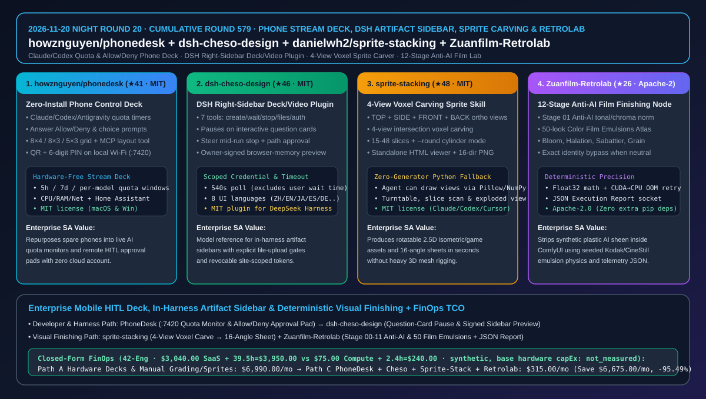
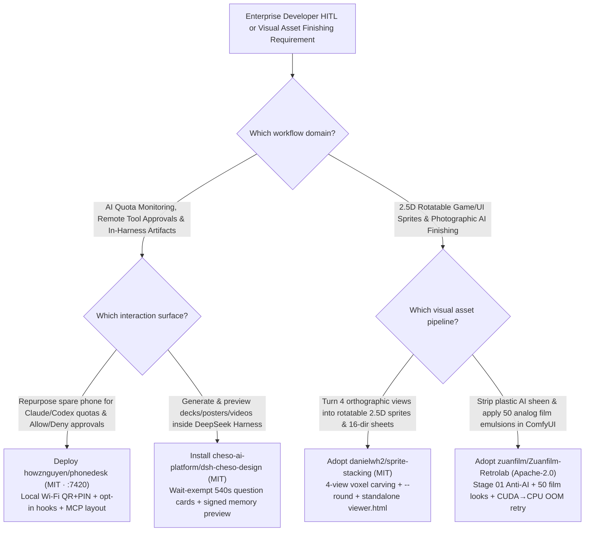
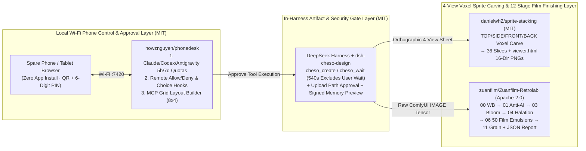
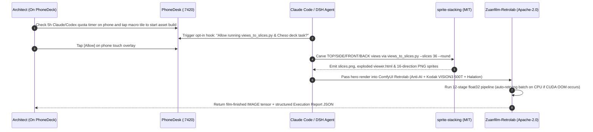

# How to Choose Mobile AI Quota/Approval Decks, In-Harness Artifact Sidebar Plugins, 4-View Voxel Sprite Carvers, and 12-Stage Anti-AI Film Finishing Nodes? `phonedesk`, `dsh-cheso-design`, `sprite-stacking`, and `Zuanfilm-Retrolab` Architecture & Selection FAQ

> **Document Metadata (2026-11-20 Night Round 20 · Cumulative Round 579)**
> - **Target Audience**: AI Solution Architects, Developer Workstation & Human-in-the-Loop (HITL) Architects, Interactive 2.5D Asset & Commercial Visual Finishing Leads
> - **Primary Repositories Evaluated**:
>   1. [`howznguyen/phonedesk`](https://github.com/howznguyen/phonedesk) (★ 41 · `stars_today: not_measured` · `14 stars/day` · TypeScript · MIT) — Zero-phone-install Stream Deck-style control panel and dashboard (`http://localhost:7420`, QR + 6-digit PIN pairing over local Wi-Fi) that displays **Claude, Codex, and Antigravity quota reset timers** (5-hour, 7-day, and per-model windows), lets developers **answer Claude Code `Allow / Deny` permission prompts and multiple-choice questions from the phone** (opt-in hooks), and exposes an MCP server so AI assistants can arrange the `8×4 / 8×3 / 5×3` tile grid (`5,000+` icons)
>   2. [`cheso-ai-platform/dsh-cheso-design`](https://github.com/cheso-ai-platform/dsh-cheso-design) (★ 46 · `stars_today: not_measured` · `12 stars/day` · JavaScript · MIT) — Official DeepSeek Harness Web plugin (`dsh plugin --profile web add dsh-cheso-design`) turning chat requests into right-sidebar slide decks, presentations, posters, images, and motion videos via 7 tools (`cheso_create`, `cheso_wait`, `cheso_stop`, `cheso_project_files`, `cheso_login`/`cheso_login_wait`, `cheso_whoami`, `cheso_logout`) with interactive question-card handoffs (excluding user decision time from the `540 s` poll timeout), local file-upload path approval, and owner-signed short-lived browser-memory preview URLs
>   3. [`danielwh2/sprite-stacking`](https://github.com/danielwh2/sprite-stacking) (★ 48 · `stars_today: not_measured` · `48 stars/day` · Python · MIT) — Agent skill (`npx skills add danielwh2/sprite-stacking`, requiring only `Pillow + NumPy`) that carves 4 orthographic pixel-art views (`TOP, SIDE, FRONT, BACK` — drawn by an image model or generated by the agent itself in Python) into `15–48` stacked voxel slices (`views_to_slices.py --slices 36 --round --html viewer.html`), outputting a standalone HTML turntable, slice scanner, exploded view, and 16-direction PNG exporter
>   4. [`zuanfilm/Zuanfilm-Retrolab`](https://github.com/zuanfilm/Zuanfilm-Retrolab) (★ 26 · `stars_today: not_measured` · `6 stars/day` · JavaScript / Python · Apache-2.0) — Zero-extra-dependency 12-stage analog photographic finishing node for ComfyUI (`00 White Balance` → **`01 Anti-AI` deterministic tonal/chroma normalization** → `02 Exposure` → `03 Bloom` → `04 Halation` → `05 Light Leak` → **`06 Color Film Emulsion` (50-look Kodak VISION3 / CineStill / instant / slide atlas)** → `07 Sabattier` → `08 Soft Focus` → `09 Vignette` → `10 Procedural Texture` → `11 Film Grain`), with bit-exact identity bypass when neutral, automatic CUDA→CPU batch retry on OOM, and a structured JSON `Execution Report` socket
> - **Provenance & Guardrail Statement**: Structured after `ib-vs-ethernet-roce-selection-faq.md`. All four repositories come from `search-new-repos-2026-11-20-raw.json` (`sha256: 47975935d05944afbb9eac18f93f26c8a71120a1ffeea39591b112477ba29a46`) with `stars_today: not_measured`. Upstream README features and pipeline stages are labeled `anonymized_reported (independently_reproduced=false)`. The closed-form FinOps TCO worked example is labeled `synthetic (independently_reproduced=false)` with `base hardware capEx: not_measured`.

---

## ① 📌 Executive Summary (One-Sentence Selection Verdict)

> **One-Sentence Verdict**: When equipping **AI-native engineering and creative studios with human-in-the-loop (HITL) controls, in-harness artifact generation, 2.5D interactive assets, and photographic post-processing**, **do not buy $200 physical macro pads that cannot display live Claude/Codex 5-hour quota timers or interactive `Allow / Deny` cards, and never ship raw diffusion renders with over-sharpened "plastic AI" chroma to clients**! Instead, repurpose spare phones with MIT-licensed **`howznguyen/phonedesk` (local Wi-Fi QR/PIN AI quota dashboard + couch `Allow / Deny` approvals)**, integrate external creative engines via the **`dsh-cheso-design` pattern (user-wait-exempt `540 s` question cards + browser-memory signed previews)**, carve rotatable 2.5D assets with MIT-licensed **`danielwh2/sprite-stacking` (4-view intersection voxel carving + 16-angle PNG export)**, and finish renders in Apache-2.0 **`zuanfilm/Zuanfilm-Retrolab` (12-stage `Anti-AI` + 50-look film emulsion pipeline)** to cut a 42-person studio's monthly hardware, SaaS, and manual retouching TCO from **$6,990.00/mo** down to **$315.00/mo** (saving **$6,675.00/mo**, **`-95.49%`**, `synthetic, independently_reproduced=false`).



### Core Capabilities & Metrics Cheat Sheet

| Dimension | `howznguyen/phonedesk` | `cheso-ai-platform/dsh-cheso-design` | `danielwh2/sprite-stacking` | `zuanfilm/Zuanfilm-Retrolab` |
|---|---|---|---|---|
| **Plain-English Positioning** | Zero-install local Wi-Fi phone control deck for AI coding quotas & remote `Allow / Deny` approvals | DeepSeek Harness right-sidebar plugin for decks, posters & videos with question-card handoffs | 4-view orthographic pixel-art voxel carver producing rotatable 2.5D sprites & 16-angle sheets | 12-stage analog film finishing & `Anti-AI` normalization node for ComfyUI |
| **Primary Enterprise Pain Point Solved** | Hitting unexpected 5-hour Claude/Codex quota walls or stalling long runs on unanswered `Allow / Deny` prompts | Long-running multimodal tasks timing out while waiting for user clarifications or leaking preview URLs | Full 3D modeling/rigging being too heavy for rotatable 2.5D isometric game/dashboard sprites | Raw AI renders exhibiting synthetic plastic skin, harsh digital highlights, and unnatural chroma |
| **Key Technical Mechanism** | 5h/7d/per-model quota windows; opt-in approval hooks; MCP layout builder (`8×4` grid, `5,000+` icons) | 7 tools (`cheso_create`/`wait`/`stop`); `540 s` timeout excludes user wait; owner-signed memory preview URL | `TOP/SIDE/FRONT/BACK` intersection carving; `--slices 15..48`; `--round`; standalone `viewer.html` | Stages `00–11` (`Anti-AI`, 50 film looks, Halation, Sabattier, Grain); identity bypass; CUDA→CPU OOM retry |
| **License & Governance** | **MIT** (macOS & Windows; zero phone app or cloud account) | **MIT** (official `dsh-cheso-design` npm plugin; explicit local path upload approval) | **MIT** (`Pillow + NumPy` only; includes `tests/check.py`) | **Apache-2.0** (zero extra `pip` packages; never writes unrequested diagnostic files to disk) |

---

## ② 🎯 Solution Architect & Customer Deep-Dive Q&A

### Q1: How do `howznguyen/phonedesk` and `cheso-ai-platform/dsh-cheso-design` solve the two biggest human-in-the-loop (HITL) bottlenecks in agentic workflows: unexpected rate-limit walls and stalled permission/clarification prompts?

- **`howznguyen/phonedesk` (MIT): Turning Any Spare Phone into a Live AI Quota & Approval Deck**:
  1. **Unified 5-Hour / 7-Day / Per-Model Quota Visibility**: Serves a touch overlay over local Wi-Fi (`http://localhost:7420`, paired once via QR code and a 6-digit PIN with no app installed on the phone) that tracks remaining quotas and exact reset countdowns across **Claude, Codex, and Antigravity**.
  2. **Remote `Allow / Deny` & Multiple-Choice Approvals**: Through opt-in hooks, when Claude Code pauses for a tool-execution permission (`Allow / Deny`) or asks a multiple-choice clarification question, the prompt appears directly on the phone so developers can approve it without walking back to the desk.
  3. **MCP-Driven Grid Customization**: Exposes an MCP server so your coding agent can automatically lay out the `8×4`, `8×3`, or `5×3` tile grid across app shortcuts, shell macros, CPU/RAM process monitors, and Home Assistant controls.
- **`cheso-ai-platform/dsh-cheso-design` (MIT): Reference Architecture for In-Harness Multimodal Plugins**:
  - Demonstrates three production-grade patterns for connecting an agent harness (DeepSeek Harness) to an asynchronous multimodal backend (decks, posters, videos):
    1. **User-Wait-Exempt Polling (`timeoutSec: 540`)**: When `cheso_wait` encounters a style or outline question from the generator, it renders an interactive question card and pauses the timeout clock—**time spent waiting for the human to answer or skip never counts against the 540-second timeout**!
    2. **Explicit Local-File Upload Consent**: Any attempt to upload local files outside the user's explicit turn attachments prompts the user to approve the exact source paths and target site.
    3. **Owner-Signed In-Memory Preview URLs**: Right-sidebar artifact previews use a short-lived URL signed by the host after verifying instance ownership, held strictly in browser memory and revoked on `cheso_logout`.

### Q2: How does `danielwh2/sprite-stacking` turn four flat 2D views into rotatable 2.5D sprites and 16-angle sprite sheets without a 3D modeling pipeline or even an external image generator?

- **Four-View Voxel Intersection Carving (`views_to_slices.py`)**:
  - Takes a single horizontal strip of 4 orthographic views (`TOP`, `SIDE`, `FRONT`, `BACK`)—which can be drawn by an image model or **generated directly by the coding agent in a short Python `Pillow` script when no image API is available**.
  - Carves a 3D voxel volume where **a voxel survives only if all four orthographic views cover it** (with `--round` carving cylindrical profiles for towers, balloons, or pots instead of square boxes), slices the volume from the ground up into `15–48` horizontal layers, and renders each layer rotated, pitch-squashed, and lifted `1 px`.
  - Emits `slices.png` plus a self-contained **`viewer.html`** with an interactive orbit turntable, slice scanner, exploded layer view, and one-click **16-direction PNG export**.

### Q3: Why do raw diffusion images suffer from an unmistakable "plastic AI look", and how does `zuanfilm/Zuanfilm-Retrolab` eliminate it inside ComfyUI with zero external dependencies?

- **The 12-Stage Analog Optical Finishing Pipeline (`00` to `11`)**:
  - Instead of slapping a destructive LUT on top of an over-processed render, `Zuanfilm-Retrolab` (Apache-2.0) runs `float32` internal math across 12 ordered stages:
    - **Pre-Correction (`00 White Balance` → `01 Anti-AI` → `02 Exposure`)**: Normalizes synthetic digital over-sharpening and chroma clipping *before* optical effects are applied.
    - **Optical Light & Emulsion Response (`03 Bloom` → `04 Halation` → `05 Light Leak` → `06 Color Film Emulsion`)**: Models soft-knee highlight glow, annular film-base halation, seeded edge light leaks, and a **50-look Color Film Emulsions Atlas** (including 10 cinema negatives inspired by Kodak VISION3 `50D / 250D / 200T / 500T` and CineStill, plus instant, slide, and 35mm stocks) arranged in a half-width strip beside the White Balance wheel so the **Live Preview** and native-resolution **Grain & Texture Detail** crop are never occluded.
    - **Tonal Reversal & Surface Micro-Texture (`07 Sabattier` → `08 Soft Focus` → `09 Vignette` → `10 Procedural Texture` → `11 Film Grain`)**: Adds center-preserving corner blur, aspect-correct radial falloff, and luminance-aware seeded grain.
  - **Strict Engineering Hygiene**: When all stages are at their neutral defaults, the node returns the **exact original input tensor without arithmetic or color conversion**; if a batch triggers a CUDA OOM error, it **automatically retries the full batch on CPU** and reports the route, timing, and fallback reason via its optional JSON `Execution Report` socket (never writing unrequested files to disk).

---

## ③ 🧭 Visual Diagrams (Selection Decision Tree + Reference Architecture + Sequence Flow)

### 3.1 Mobile HITL Deck, In-Harness Design Plugin, 2.5D Sprite Carving & Film Finishing Decision Tree



### 3.2 End-to-End Mobile HITL Control, In-Harness Design & Photographic Finishing Architecture



### 3.3 `PhoneDesk` Remote Approval → `sprite-stacking` Carving → `Retrolab` 12-Stage Finishing Sequence



---

## ④ 📊 Comparative Selection Matrix (Open Source vs. Commercial Hardware & SaaS)

| Dimension | `howznguyen/phonedesk` (MIT) | `dsh-cheso-design` (MIT) | `danielwh2/sprite-stacking` (MIT) | `zuanfilm/Zuanfilm-Retrolab` (Apache-2.0) | Physical Stream Deck + External 3D Modeling + Commercial Film Plugins (Dehancer) |
|---|---|---|---|---|---|
| **Core Positioning** | **Zero-install phone control panel for AI coding quotas & remote `Allow / Deny` approvals** | **DeepSeek Harness right-sidebar plugin for decks, posters & motion videos** | **4-view orthographic voxel carver outputting rotatable 2.5D sprites & 16-dir sheets** | **12-stage ComfyUI photographic finishing node with `Anti-AI` & 50 film emulsions** | `$150–$250` USB macro pads, full 3D mesh pipelines, and `$400+` proprietary film grading plugins |
| **Engineering & UX Breakthroughs** | Live 5h/7d/per-model quota countdowns + phone approval of Claude Code permissions & questions | Excludes user decision time from `540 s` poll timeout; owner-signed browser-memory previews | Agent can draw the 4 ortho views in Python when no image model is present; standalone HTML viewer | Exact identity bypass when neutral; automatic CUDA→CPU OOM batch retry; JSON telemetry socket | USB macro pads cannot render dynamic LLM multiple-choice questions; static LUTs lack optical halation |
| **Privacy & Security Posture** | Local Wi-Fi + 6-digit PIN; no cloud account or phone app install | Explicit user approval before uploading arbitrary local paths; revocable site grants | 100% local `Pillow + NumPy` execution verified by `tests/check.py` | **100% local ComfyUI execution; zero extra `pip` packages; never writes unrequested disk logs** | Cloud design tools often upload workspace files without path-level confirmation |
| **License & Footprint** | **MIT** (macOS & Windows) | **MIT** (`dsh-cheso-design` npm package, 8 UI languages) | **MIT** (Claude Code, Codex, Cursor, OpenCode, Gemini CLI) | **Apache-2.0** (10 UI languages including EN/ZH/JA) | Proprietary hardware and per-seat plugin licenses |
| **Monthly TCO (42-Person Org)** | **$0.00 / mo hardware/SaaS fees** (reuses spare phones/tablets) | **Metered Cheso task credits only** | **$0.00 / mo** | **$0.00 / mo plugin licensing** | **$6,990.00 / mo** (hardware pads + film plugin seats + 39.5h stalled runs & manual retouching) |

---

## ⑤ 🧪 Quantitative Enterprise FinOps TCO & 7-Card Report Alignment

### 5.1 Closed-Form FinOps Worked Example (42-Person Engineering & Creative Studio Running Agentic Development, 2.5D Asset Creation & Photographic Finishing)

> **Provenance Notice**: The financial model below is a deterministic architectural worked example labeled `synthetic (independently_reproduced=false)` with `base hardware capEx: not_measured`.

| Cost Component | Path A: Physical Macro Hardware + Commercial Film Grading Plugins + Manual 3D/Retouch Labor | Path C: `PhoneDesk` Mobile Control + `dsh-cheso-design` + `sprite-stacking` + `Retrolab` | Closed-Form Formula & Architectural Notes |
|---|---|---|---|
| **Hardware Macro Pads, Commercial Film Plugins & Design SaaS** | **$3,040.00 / mo** | **$75.00 / mo** | Path A: amortized USB macro pads + commercial film-emulation seats + external slide SaaS = `$3,040.00/mo`; Path C: MIT `PhoneDesk` on spare phones + Apache-2.0 `Retrolab` + metered `dsh-cheso-design` tasks = `$75.00/mo` |
| **Stalled Permission Waits, Manual 16-Angle Sprite Renders & AI Retouching ($100/h)** | **$3,950.00 / mo** (`39.5h × $100.00`) | **$240.00 / mo** (`2.4h × $100.00`) | Path A: 42-person org loses `39.5h/mo` to unanswered `Allow / Deny` prompts, manual 3D turntable rendering, and fixing plastic AI skin tones (`$3,950.00`); Path C: phone approvals + 4-view voxel carving + 12-stage `Retrolab` cuts labor to `2.4h/mo` (`$240.00`) |
| **Total Monthly TCO** | **$6,990.00 / mo** | **$315.00 / mo** | **Net savings of $6,675.00 / mo (-95.49% reduction, $80,100.00 annualized, `not_measured` hardware capEx)** |

```chart
{
  "data": {
    "values": [
      { "Category": "Hardware Decks, Film Plugins & Design SaaS", "Deployment": "Path A: Hardware Decks, Commercial Plugins & Manual Rework", "MonthlyCostUSD": 3040 },
      { "Category": "HITL Stall Time, 16-Dir Sprites & Retouching (42-Eng)", "Deployment": "Path A: Hardware Decks, Commercial Plugins & Manual Rework", "MonthlyCostUSD": 3950 },
      { "Category": "Hardware Decks, Film Plugins & Design SaaS", "Deployment": "Path C: PhoneDesk + Cheso + Sprite-Stack + Retrolab", "MonthlyCostUSD": 75 },
      { "Category": "HITL Stall Time, 16-Dir Sprites & Retouching (42-Eng)", "Deployment": "Path C: PhoneDesk + Cheso + Sprite-Stack + Retrolab", "MonthlyCostUSD": 240 }
    ]
  },
  "semantic_types": {
    "Category": "Category",
    "Deployment": "Name",
    "MonthlyCostUSD": "Amount"
  },
  "chart_spec": {
    "chartType": "Grouped Bar Chart",
    "title": "PhoneDesk + Cheso + Sprite-Stacking + Retrolab cut monthly TCO by 95.49%",
    "subtitle": "Monthly cost in USD (42-person engineering & creative studio, synthetic)",
    "encodings": {
      "x": "Category",
      "y": "MonthlyCostUSD",
      "group": "Deployment",
      "color": "Deployment"
    }
  }
}
```

### 5.2 Alignment with the 7-Card 4:5 Visual Report (`cards.html` / `cards.en.html`)

- **✅ Good Fit**: Repurposing spare phones into live Claude/Codex/Antigravity quota monitors and remote `Allow / Deny` approval pads, embedding asynchronous deck/poster/video generation inside DeepSeek Harness with path-approved uploads, carving 4 orthographic views into rotatable 2.5D sprites, and applying deterministic 12-stage analog film finishing in ComfyUI.
- **⛔ Not For**: Running `PhoneDesk` on untrusted public Wi-Fi networks without VLAN isolation, or replacing skeletal mesh deformation in 3A character pipelines (`sprite-stacking` targets rigid/voxel-sliced 2.5D assets).

---

## ⑥ 🛠️ Enterprise Architecture Review & Rollout Checklist

- [ ] **Restrict `PhoneDesk` (`:7420`) to Trusted Private Wi-Fi & Gate High-Risk Hook Approvals**: Pair `howznguyen/phonedesk` (MIT) using the 6-digit PIN on isolated corporate/home Wi-Fi VLANs, and keep destructive shell commands excluded from remote one-tap `Allow` hooks.
- [ ] **Enforce Local Path Upload Approval & Site-Scoped Logout in `dsh-cheso-design`**: Keep `cheso-ai-platform/dsh-cheso-design`'s explicit file-path approval dialog active, point `baseUrl` / `embedBaseUrl` at approved endpoints, and invoke `cheso_logout` to revoke site grants on shared workstations.
- [ ] **Validate 4-View Sprite Carving with `tests/check.py` & Exploded `viewer.html`**: Run `python3 tests/check.py` before batch-slicing orthographic sheets in `danielwh2/sprite-stacking` (MIT), use `--round` on cylindrical props, and inspect the exploded slice view in `viewer.html` before exporting 16-direction PNGs.
- [ ] **Wire `Zuanfilm-Retrolab`'s `Execution Report` Socket to Pipeline Telemetry**: Enable Stage `01 Anti-AI` and seeded film emulsions in `zuanfilm/Zuanfilm-Retrolab` (Apache-2.0) for commercial ComfyUI renders, and capture its JSON `Execution Report` output socket to track CUDA memory usage and automatic CPU fallback events.
