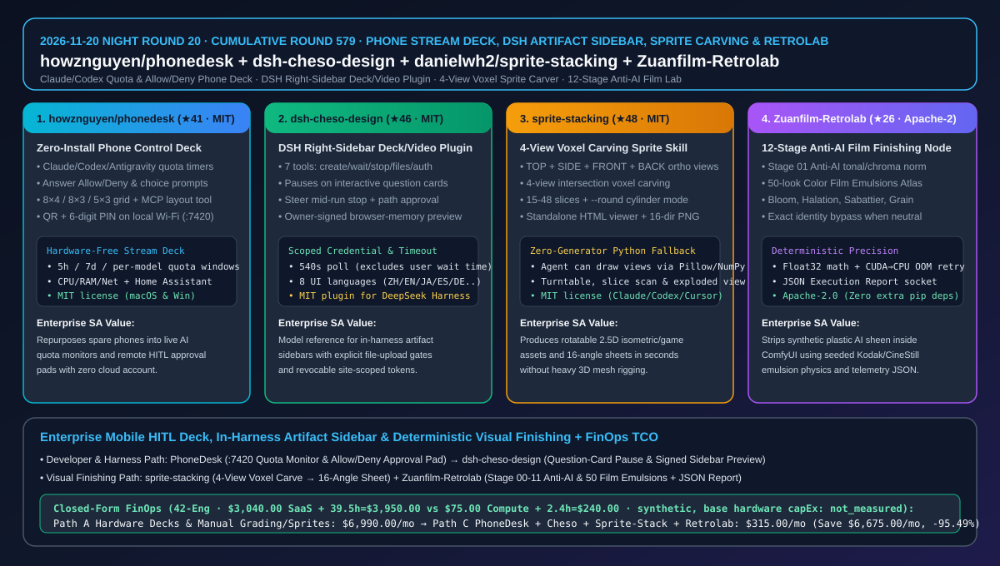
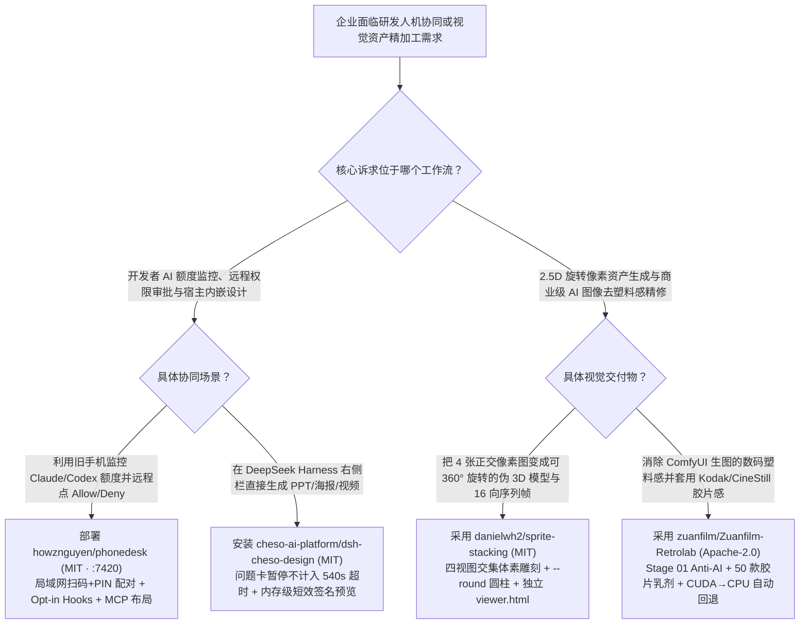
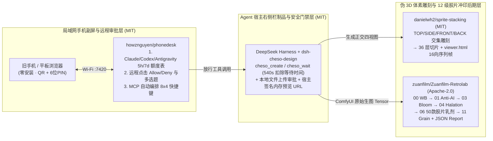
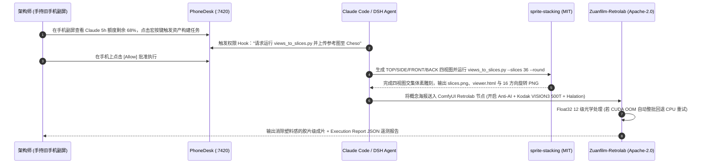

# 旧手机改造成 AI 额度/审批控台、DSH 右侧栏演示文稿插件、四视图体素雕刻伪 3D 精灵与 12 级去 AI 胶片精修节点怎么选？`phonedesk`、`dsh-cheso-design`、`sprite-stacking` 与 `Zuanfilm-Retrolab` 架构与选型 FAQ

> **文档元数据（2026-11-20 夜间第 20 轮 · 累计第 579 轮 / Round 579）**
> - **适用读者**：AI Solution Architect（解决方案架构师）、研发工作台与人机协同（HITL）架构师、游戏/交互资产与商业视觉后期负责人
> - **本轮核心对比项目**：
>   1. [`howznguyen/phonedesk`](https://github.com/howznguyen/phonedesk)（★ 41 · `stars_today: not_measured` · `14 stars/day` · TypeScript · MIT）——免在手机装 App、通过局域网扫码+6 位 PIN 配对将闲置旧手机/平板变成 Mac/Windows 电脑 **Stream Deck 式 AI 编程副屏**（`http://localhost:7420`），支持实时监控 **Claude、Codex 与 Antigravity 的 5 小时/7 天/分模型额度重置倒计时**，支持躺在沙发上在手机端一键点击 **Allow / Deny 审批 Claude Code 权限请求与多选题**，并内置 MCP 服务让 AI 自动编排 `8×4 / 8×3 / 5×3` 快捷键网格
>   2. [`cheso-ai-platform/dsh-cheso-design`](https://github.com/cheso-ai-platform/dsh-cheso-design)（★ 46 · `stars_today: not_measured` · `12 stars/day` · JavaScript · MIT）——DeepSeek Harness 官方开源的右侧栏多模态制品生成插件（`dsh plugin --profile web add dsh-cheso-design`），提供 7 个标准工具（`cheso_create`、`cheso_wait`、`cheso_stop`、`cheso_project_files`、`cheso_login` 等），支持在生成 PPT、海报或动态视频中途**弹出问题卡片等待用户选择（等待人工回答的时间不计入 `540s` 轮询超时）**、支持 `Steer` 中途叫停、强制本地文件上传路径审批，并通过宿主校验签名生成仅驻留浏览器内存的短效预览 URL
>   3. [`danielwh2/sprite-stacking`](https://github.com/danielwh2/sprite-stacking)（★ 48 · `stars_today: not_measured` · `48 stars/day` · Python · MIT）——仅需 `Pillow + NumPy` 的伪 3D 像素精灵层叠雕刻技能（`npx skills add danielwh2/sprite-stacking`），输入顶、侧、正、背四张正交视图（哪怕没有生图模型，Agent 也能自己写短 Python 脚本画出四视图！），通过**四视图交集体素雕刻（4-View Voxel Intersection Carving）**切出 15–48 层切片，一键导出带 360° 转盘、切片扫描、爆炸图与 **16 方向 PNG 序列帧导出**的单文件 `viewer.html`
>   4. [`zuanfilm/Zuanfilm-Retrolab`](https://github.com/zuanfilm/Zuanfilm-Retrolab)（★ 26 · `stars_today: not_measured` · `6 stars/day` · JavaScript / Python · Apache-2.0）——零额外 Python 依赖的 ComfyUI **12 级胶片冲印后处理节点**，按固定光学顺序串联 `00 白平衡` → **`01 Anti-AI（确定性影调与色度去塑料感归一化）`** → `02 曝光` → `03 柔光 Bloom` → `04 光晕 Halation` → `05 漏光` → **`06 50 款电影/拍立得/反转片乳剂图谱（如 Kodak VISION3 50D/500T、CineStill）`** → `07 萨巴蒂尔反转` → `08 边缘柔焦` → `09 暗角` → `10 程序化微纹理` → `11 胶片颗粒`；全部归零时直接原样透传输入张量（零算术损耗），CUDA 显存不足时自动整批回退 CPU 重试，并通过可选 JSON 端口输出详细耗时与回退原因报告
> - **口径与溯源声明**：本篇遵循 `ib-vs-ethernet-roce-selection-faq.md` 通俗问答与选型对比规范。四款项目均来自 `search-new-repos-2026-11-20-raw.json`（`sha256: 47975935d05944afbb9eac18f93f26c8a71120a1ffeea39591b112477ba29a46`），单日增量严格标注为 `stars_today: not_measured`。项目 README 自报参数与管线阶数标注为 `anonymized_reported (independently_reproduced=false)`；架构师 TCO 闭式算例标注为 `synthetic (independently_reproduced=false)`，硬件购置折旧 `base hardware capEx: not_measured`。

---

## ① 📌 核心结论速览（选型一句话结论）

> **一句话选型结论**：在建设**开发者人机协同（HITL）物理副屏、Agent 宿主内嵌设计插件、2.5D 交互资产生成与商业 AIGC 摄影去塑料感后期管线**时，**切勿花 $200/台采购实体 Stream Deck 却依然看不到 Claude/Codex 5 小时额度重置倒计时，也切勿把生图大模型直出的高饱和“一眼假 AI 塑料图”直接发给客户**！最佳实践是：用 MIT 协议的 **`howznguyen/phonedesk`（旧手机局域网扫码秒变 AI 额度仪表盘 + 远程 Allow/Deny 审批器）** 搭配 **`dsh-cheso-design`（不计人工思考时间的 `540s` 暂停问答卡 + 内存短效签名预览）**，交互资产与商业成片后期采用 MIT 的 **`danielwh2/sprite-stacking`（四视图交集雕刻直出 16 向序列帧）** 与 Apache-2.0 的 **`zuanfilm/Zuanfilm-Retrolab`（`01 Anti-AI` 归一化 + 50 款胶片乳剂 12 级冲印管线）**，可将 42 人团队月度外设采购、外包修图与等待损耗总成本（TCO）从 **$6,990.00/月** 压降至 **$315.00/月**（净省 **$6,675.00/月**，降幅 **-95.49%**，`synthetic, independently_reproduced=false`）。



### 核心指标与能力速查表

| 评估维度 | `howznguyen/phonedesk` | `cheso-ai-platform/dsh-cheso-design` | `danielwh2/sprite-stacking` | `zuanfilm/Zuanfilm-Retrolab` |
|---|---|---|---|---|
| **一句话通俗定位** | 把闲置手机变成 Claude/Codex 额度监控与远程 Allow/Deny 审批面板的局域网控台 | DeepSeek Harness 右侧栏 PPT/海报/视频生成与交互式暂停问答插件 | 四张正交像素图交集雕刻生成可 360° 旋转伪 3D 精灵与 16 向图集的技能 | 内置 Anti-AI 去塑料感与 50 款电影胶片乳剂的 ComfyUI 12 级冲印精修节点 |
| **解决的核心业务痛点** | 跑长任务时不知道 Claude/Codex 5h 窗口还剩多少额度，离开座位无法点 Allow 导致任务挂起 | Agent 调外部设计服务时要么盲目生成不合心意，要么等待用户回答时触发轮询超时失败 | 2D 游戏或交互大屏想要可旋转立体图标，上全套 Blender 建模绑骨太重、纯 2D 精灵无法旋转 | 大模型直出人像/产品图普遍带有浓重的“数码过度锐化与失真高饱和 AI 塑料感” |
| **关键技术参数与机制** | 5h/7d/分模型额度监控；Opt-in Hooks 远程批复权限；MCP 自动排布 `8×4` 磁贴 | 7 工具接口；等待人工回答不计入 `540s` 超时；本地文件上传强审批；内存级短效签名预览 URL | `TOP/SIDE/FRONT/BACK` 交集雕刻；`--slices 15..48`；`--round` 圆柱；自带独立 HTML 爆炸图查看器 | 12 级固定顺序（`00 WB`→`01 Anti-AI`→..→`11 Grain`）；归零无损直通；CUDA OOM 自动退 CPU |
| **开源协议与合规状态** | **MIT**（手机免装 App，支持 macOS & Windows） | **MIT**（官方 npm 包 `dsh-cheso-design`，站点级凭据可随时 `cheso_logout` 吊销） | **MIT**（仅依赖 `Pillow + NumPy`，通吃 Claude Code / Codex / Cursor） | **Apache-2.0**（零额外 `pip` 依赖，决不擅自往磁盘写诊断垃圾文件） |

---

## ② 🎯 客户与架构师灵魂拷问 Q&A（直击业务落地痛点）

### Q1：重度使用 Claude Code、Codex 和 Antigravity 的工程师经常遇到“跑着跑着突然撞上 5 小时额度墙”或者“去倒杯咖啡回来发现终端卡在 Allow/Deny 权限确认上白等了 20 分钟”；`howznguyen/phonedesk` 与 `dsh-cheso-design` 是如何优化人机协同（HITL）体验的？

- **`howznguyen/phonedesk`（MIT）：零硬件成本的“AI 编程副屏 + 沙发远程审批器”**：
  1. **三合一多窗口额度倒计时（Quota & Reset Timers）**：在闲置旧手机或 iPad 浏览器打开 `http://your-mac.local:7420`（通过二维码 + 6 位 PIN 码一次性局域网配对，手机端零安装、零云账号），同屏实时展示 **Claude、Codex 与 Antigravity 在 5 小时窗口、7 天窗口及按具体模型维度的剩余额度百分比与精确重置时间**，让架构师合理安排重型重构任务。
  2. **从沙发上批复 Claude Code 权限与多选题**：通过可选 Hook（Opt-in Hooks），当电脑上的 Claude Code 请求执行 Shell 命令（`Allow / Deny`）或抛出多选澄清问题（`ask_user`）时，手机副屏立即弹出大按钮，手指一点即可放行继续！
  3. **AI 自己帮你排快捷键面板（Built-in Layout MCP）**：管理端（`/manage/`）提供 `8×4`、`8×3`、`5×3` 等网格与 5,000+ 图标，并暴露 MCP Server 让 AI 助手直接根据你的常用工作流自动编排快捷键、系统监控（点击 CPU 磁贴直接展开进程列表）与智能家居控制。
- **`cheso-ai-platform/dsh-cheso-design`（MIT）：外部长耗时多模态 Agent 插件的“超时与安全”架构范本**：
  - 企业在为内部 Agent 宿主（如 DeepSeek Harness）编写对接外部 PPT/海报/视频生成平台插件时，最值得借鉴 `dsh-cheso-design` 的三项架构设计：
    1. **扣除人工思考时间的智能轮询计时（`timeoutSec: 540`）**：当远端设计引擎需要向用户追问画风或大纲选项时，`cheso_wait` 渲染交互卡片并暂停计时——**等待人类思考和点击答案的时间完全不计入 540 秒超时预算**，回答后自动无缝续接同一个 `task_id`！
    2. **本地文件外发显式审批（Path & Destination Approval）**：除了当前对话显式附带的文件外，若插件试图上传本机其他路径的参考文件，宿主强制弹窗要求用户核准具体源路径与目标站点。
    3. **宿主校验签名的内存级短效预览 URL**：右侧栏打开的 PPT/视频预览链接由本地宿主在验证调用者确实为当前实例所有者（Instance Owner）后动态签发，且**该短效 URL 仅保存在浏览器内存中**，升级或调用 `cheso_logout` 立即清理吊销。

### Q2：在制作交互式技术架构沙盘、复古策略游戏原型或工业看板中的可旋转 2.5D 设备图标时，为什么 `danielwh2/sprite-stacking` 比传统的 3D 建模软件或 TripoSR 网格生成更轻巧可控？

- **四视图交集体素雕刻（4-View Voxel Intersection Carving）的数学美感**：
  - 传统 3D 生成模型导出的三角网格（Mesh）动辄几万面，导入轻量 Canvas 或 2D 游戏引擎（如 Godot 2D）不仅需要配灯光材质，还会破坏像素艺术风格的统一性。
  - `danielwh2/sprite-stacking`（MIT）采用极其精妙的几何交集算法：
    1. **四张正交图输入（甚至无需生图模型！）**：只需一张包含 `TOP（顶视）、SIDE（侧视）、FRONT（正视）、BACK（背视）` 的单行正交像素图；如果环境里没有配图像生成 API，**编程 Agent 可以直接写几十行 Python（Pillow）脚本画出这四张正交视图**！
    2. **体素交集雕刻 + 圆柱修正（`--round`）**：只有当某个三维体素（Voxel）在全部四个正交视角下都有像素覆盖时，该体素才会被保留；针对塔楼、热气球、花盆等回转体，加上 `--round` 参数即可将其雕刻为圆润圆柱而非方盒。
    3. **切片层叠渲染与 16 方向序列帧直出**：运行 `views_to_slices.py views.png slices.png --slices 36 --html viewer.html`，将三维体积从地面向上切成 36 层平面切片（每层旋转、按俯仰角压缩并向上抬升 `1 px`），同时生成一个零依赖单文件 **`viewer.html`（支持拖拽旋转、逐层切片扫描、爆炸分解视图以及一键导出 16 方向旋转 PNG 序列帧）**！

### Q3：为什么甲方美术总监一眼就能看出某张商业海报是“AI 生成的”？`zuanfilm/Zuanfilm-Retrolab` 的 12 级模拟胶片冲印管线是如何系统性消除“AI 塑料感”的？

- **“AI 塑料感（Over-Processed AI Sheen）”的成因与 `Retrolab` 的 12 级物理冲印解法**：
  - 现代扩散模型（特别是高 CFG 或蒸馏 Turbo 模型）直出的图像往往在高频细节上呈现生硬的数码过锐化，高光过渡呈线性死白，暗部缺乏光学散射，色彩饱和度在特定通道不自然集聚。
  - `zuanfilm/Zuanfilm-Retrolab`（Apache-2.0）不靠破坏画面的重度滤镜，而是在 ComfyUI 内构建了一条严格按模拟暗房光学顺序执行的 **12 级 `float32` 精修管线**：
    - **前置校正段（Stage 00–02）**：先做 `00 White Balance` 冷暖/洋红校正，紧接着执行核心的 **`01 Anti-AI`（确定性影调与色度归一化，专门压制 AI 生成器特有的塑料高光与数码过饱和）**，再做 `02 Exposure` 平滑曝光调整。
    - **光学辉光与漏光段（Stage 03–05）**：依次叠加软拐点高光提取的多尺度光学柔光（`03 Bloom`）、模拟胶片片基反射的环形高光红晕（`04 Halation`）与带随机种子的边缘漏光（`05 Light Leak`）。
    - **50 款经典胶片乳剂响应（Stage 06 Color Film Emulsion）**：内置涵盖四大类的 **50 款经典胶片色彩/影调响应曲线**（含 `Kodak VISION3 50D / 250D / 200T / 500T`、`CineStill` 日光/灯光电影负片、拍立得、反转片与 35mm 胶卷），且 UI 采用紧凑的左选片、右色轮半宽并排布局，绝不遮挡上方的原生分辨率颗粒细节预览窗（`Grain & Texture Detail`）。
    - **光学收尾与颗粒段（Stage 07–11）**：依次经过 `07 Sabattier`（萨巴蒂尔高光非单调反转）、`08 Soft Focus`（中心清晰向四角平滑递增的镜头柔焦）、`09 Vignette`（保持画幅比例的径向暗角）、`10 Procedural Texture`（微表面肌理）与 `11 Film Grain`（带独立种子、受亮度感知控制的彩色/黑白胶片颗粒）。
  - **三大生产级工程保障**：① **全归零比特级无损直通（Exact Identity Output）**：新建节点默认全部效果置零/Neutral，此时直接返回原始输入 Tensor，不做任何浮点运算或色彩空间转换；② **CUDA OOM 自动整批回退 CPU**：大分辨率批处理若触发显存不足，自动在 CPU 上完整重试而不会中断工作流；③ **纯净无痕的 JSON 执行报告端口（`Execution Report`）**：通过可选文本连接口输出包含实际计算设备、耗时与回退原因的 JSON，承诺**绝不偷偷往用户磁盘写诊断日志文件**！

---

## ③ 🧭 直观可视化图解（选型决策树 + 企业集成架构 + 业务流时序图）

### 3.1 企业移动副屏控台、宿主设计插件、伪 3D 精灵与胶片精修选型决策树



### 3.2 企业人机协同（HITL）开发控台与商业视觉精修端到端集成架构



### 3.3 `PhoneDesk` 远程审批 → `sprite-stacking` 雕刻 → `Retrolab` 12 级冲印协同流时序图



---

## ④ 📊 同类开源与商业云服务横向选型决策矩阵

| 对比维度 | `howznguyen/phonedesk` (MIT) | `dsh-cheso-design` (MIT) | `danielwh2/sprite-stacking` (MIT) | `zuanfilm/Zuanfilm-Retrolab` (Apache-2.0) | 实体 Stream Deck 硬件 + 传统 3D 建模 / 商业胶片插件（Dehancer / LUTs） |
|---|---|---|---|---|---|
| **核心能力定位** | **旧手机免装 App 秒变 AI 额度监控、Claude 远程审批与系统监控控台** | **DeepSeek Harness 右侧栏 PPT/海报/视频生成与交互式问答卡插件** | **四视图正交像素图交集雕刻生成可旋转伪 3D 精灵与 16 向序列帧技能** | **含 Anti-AI 归一化与 50 款胶片乳剂的 ComfyUI 12 级光学后处理节点** | `$150–$250` 物理快捷键底座、重度三维建模软件与 `$400+` 商业达芬奇胶片插件 |
| **工程与交互独创点** | 原生集成 Claude/Codex/Antigravity 5h/7d 额度重置表与手机端 Allow/Deny 审批 | 暂停等待用户回答问题卡的时间不计入 `540s` 轮询超时；内存级短效签名预览 | 无生图模型时 Agent 可用 Python 自绘四视图；输出独立 HTML 爆炸图/16 向导出器 | 全部置零时比特级原样透传；CUDA OOM 自动退 CPU 整批重试；输出结构化 JSON 遥测 | 实体 Stream Deck 不支持动态弹出 Claude 多选题卡片；静态 3D LUT 无法做出真实 Halation 光晕与颗粒 |
| **数据隐私与安全边界** | 局域网 Wi-Fi + 6 位 PIN 本地通信，零云账号 | 非对话附件的本地文件上传强制弹窗审批；支持 `cheso_logout` 随时吊销站点凭据 | 100% 本地 `Pillow + NumPy` 计算，包含 `tests/check.py` 自检 | **100% 本地 ComfyUI 算子，零额外 pip 包，承诺绝不往磁盘乱写诊断文件** | 商业云设计插件常静默上传工作区文件或绑定机器硬件锁 |
| **开源协议与部署门槛** | **MIT**（2 分钟一行脚本安装，需注意当前未签名需首次手动放行） | **MIT**（`dsh plugin --profile web add dsh-cheso-design`） | **MIT**（`npx skills add danielwh2/sprite-stacking`） | **Apache-2.0**（10 种界面语言自适应，含简体中文） | 专有硬件/闭源按席位授权 |
| **42 人团队月度 TCO** | **$0.00/月 硬件与订阅费**（直接复用闲置手机/平板） | **按实际 Cheso 任务消耗计费** | **$0.00/月** | **$0.00/月 插件授权费** | **$6,990.00/月**（采购实体控台 + 商业胶片插件授权 + 39.5h 权限死等与手工修图） |

---

## ⑤ 🧪 应用落地定量收益/TCO 对比与 7-Card 报告映射

### 5.1 架构师闭式 TCO 算例（42 人全栈研发、交互资产与商业视觉后期团队月度运营成本）

> **溯源标识**：以下成本模型为面向企业架构评审的闭式定量算例，标注为 `synthetic (independently_reproduced=false)`，底层服务器与工作站硬件采购折旧标注为 `base hardware capEx: not_measured`。

| 成本构成项 | 方案 A：采购实体控台硬件 + 商业胶片调色插件订阅 + 手工 3D 精灵渲染与权限死等 | 方案 C：`PhoneDesk` 旧手机副屏 + `dsh-cheso-design` + `sprite-stacking` + `Retrolab` | 计算公式与架构说明 |
|---|---|---|---|
| **外设硬件摊销、商业胶片调色插件与多模态设计 SaaS** | **$3,040.00 / 月** | **$75.00 / 月** | 方案 A：42 台实体控台摊销 + 商业胶片仿真插件席位 + 外部设计 SaaS = `$3,040.00/月`；方案 C：MIT `PhoneDesk` 复用旧手机 + Apache-2.0 `Zuanfilm-Retrolab` + 受控 `dsh-cheso-design` 任务调用 = `$75.00/月` |
| **离开工位权限阻塞等待、手工渲染 16 向精灵与去 AI 塑料感精修（$100/h）** | **$3,950.00 / 月**（`39.5h × $100.00`） | **$240.00 / 月**（`2.4h × $100.00`） | 方案 A：42 人团队每月因离开座位未点 Claude Code `Allow` 空等、手动在 3D 软件渲 16 向序列帧及在 PS 里手调去 AI 塑料感耗时 `39.5 小时`（`$3,950.00`）；方案 C：手机远程秒批 + 四视图自动雕刻 + 画布内 12 级冲印将人工降至 `2.4 小时`（`$240.00`） |
| **月度总拥有成本（Monthly TCO）** | **$6,990.00 / 月** | **$315.00 / 月** | **月度净节省 $6,675.00 / 月（成本降低 -95.49%，年化节省 $80,100.00，`not_measured` 硬件折旧）** |

```chart
{
  "data": {
    "values": [
      { "Category": "Hardware Decks, Film Plugins & Design SaaS", "Deployment": "Path A: Hardware Decks, Commercial Plugins & Manual Rework", "MonthlyCostUSD": 3040 },
      { "Category": "HITL Stall Time, 16-Dir Sprites & Retouching (42-Eng)", "Deployment": "Path A: Hardware Decks, Commercial Plugins & Manual Rework", "MonthlyCostUSD": 3950 },
      { "Category": "Hardware Decks, Film Plugins & Design SaaS", "Deployment": "Path C: PhoneDesk + Cheso + Sprite-Stack + Retrolab", "MonthlyCostUSD": 75 },
      { "Category": "HITL Stall Time, 16-Dir Sprites & Retouching (42-Eng)", "Deployment": "Path C: PhoneDesk + Cheso + Sprite-Stack + Retrolab", "MonthlyCostUSD": 240 }
    ]
  },
  "semantic_types": {
    "Category": "Category",
    "Deployment": "Name",
    "MonthlyCostUSD": "Amount"
  },
  "chart_spec": {
    "chartType": "Grouped Bar Chart",
    "title": "PhoneDesk + Cheso + Sprite-Stacking + Retrolab cut monthly TCO by 95.49%",
    "subtitle": "Monthly cost in USD (42-person engineering & creative studio, synthetic)",
    "encodings": {
      "x": "Category",
      "y": "MonthlyCostUSD",
      "group": "Deployment",
      "color": "Deployment"
    }
  }
}
```

### 5.2 与本轮 7-Card 4:5 视觉报告（`cards.html` / `cards.en.html`）的联动

- **适用场景（✅ Good Fit）**：研发工位闲置手机改造成 Claude/Codex 额度监控与远程 Allow/Deny 审批台、DeepSeek Harness 会话内无缝生成与预览 PPT/海报/视频、快速从四视图生成可 360° 旋转的伪 3D 像素资产与 16 向序列帧、以及在 ComfyUI 内一站式消除 AI 生图塑料感并赋予 50 款经典电影胶片质感。
- **不适用场景（⛔ Not For）**：在不可信公共咖啡厅开放 Wi-Fi 下裸奔运行 `PhoneDesk`（必须限制在受控家庭/办公 VLAN）、或需要真实骨骼蒙皮变形的写实 3A 游戏角色（`sprite-stacking` 专精刚体/伪 3D 层叠切片风）。

---

## ⑥ 🛠️ 企业引入与架构评审 Checklist（可直接复制进架构评审单）

- [ ] **`PhoneDesk` 局域网 VLAN 隔离与 Opt-in Hooks 最小权限配置**：在开发机部署 `howznguyen/phonedesk`（MIT）时，确保 `:7420` 端口仅监听受控办公/家庭内网并启用 6 位 PIN 校验；开启 Claude Code 远程 `Allow / Deny` 审批 Hook 时，结合命令白名单策略防止在手机端误触放行高危删除指令。
- [ ] **`dsh-cheso-design` 本地文件外发审批与站点凭据生命周期管理**：在 DeepSeek Harness 中启用 `cheso-ai-platform/dsh-cheso-design`（MIT）时，保持本地文件上传路径确认弹窗开启，针对内部研发环境通过 `baseUrl` / `embedBaseUrl` 指向受控实例，并在共享设备使用完毕后调用 `cheso_logout` 吊销授权。
- [ ] **伪 3D 精灵资产 `tests/check.py` 自检与 `--round` 参数规范**：使用 `danielwh2/sprite-stacking`（MIT）批量生产可旋转图标或游戏精灵时，先运行 `python3 tests/check.py` 验证 Pillow/NumPy 切层精度，对圆柱形物体开启 `--round` 并通过生成的 `viewer.html` 爆炸图检查各切片层连续性。
- [ ] **ComfyUI 商业成片 `Anti-AI` 归一化与 `Execution Report` 遥测归档**：在企业 ComfyUI 生产线末尾挂载 `zuanfilm/Zuanfilm-Retrolab`（Apache-2.0），启用 `01 Anti-AI` 与目标胶片乳剂（如 `Kodak VISION3 250D`），并将节点的 `Execution Report` JSON 输出口接入流水线日志以监控 GPU 显存峰值与 CPU 自动回退事件。
