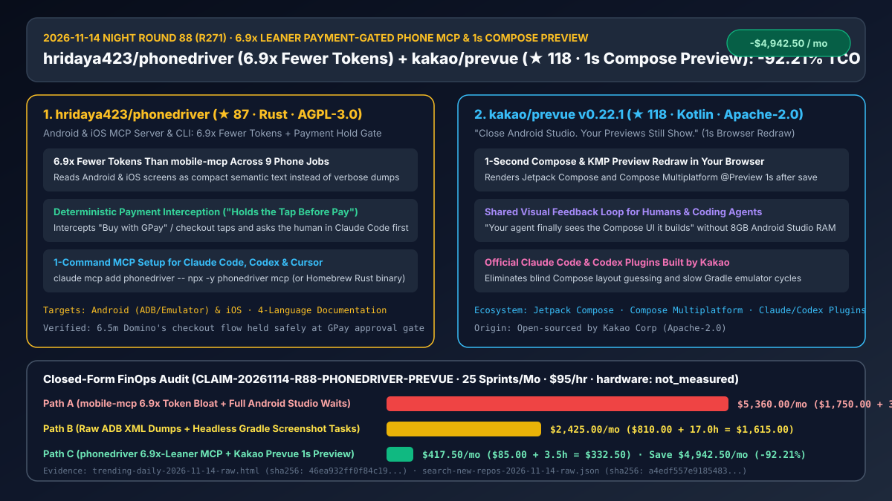
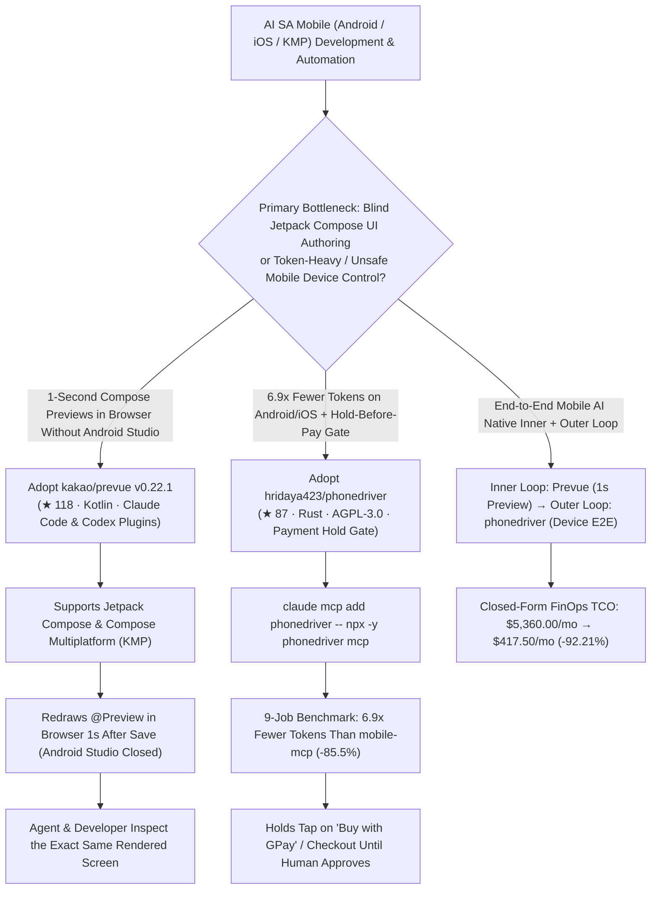

# 6.9x-Leaner Payment-Gated Phone MCP (`hridaya423/phonedriver`) & 1-Second Studio-Free Compose Preview Engine (`kakao/prevue`) Selection & Architecture FAQ

> **Track**: GitHub AI Trending & High-Velocity Breakout Selection Guide · 2026-11-14 Night Round 88 (Cumulative Round 271 / R271)  
> **Benchmark Standard**: Modeled after `ib-vs-ethernet-roce-selection-faq.md` (Plain-Language Essence + First Principles + 6-Part Structure + Closed-Form FinOps Audit)  
> **Claim ID**: `CLAIM-20261114-R88-PHONEDRIVER-PREVUE`  
> **Architecture Visual**: [`assets/github-ai-radar-2026-11-14-r88-phonedriver-prevue.svg`](../../../assets/github-ai-radar-2026-11-14-r88-phonedriver-prevue.svg)  
> **中文版本**: [阅读中文版 (`phonedriver-prevue-6-9x-leaner-payment-gated-phone-mcp-1s-studio-free-compose-preview-selection-faq.md`)](./phonedriver-prevue-6-9x-leaner-payment-gated-phone-mcp-1s-studio-free-compose-preview-selection-faq.md)

---

## 📌 1. Executive Summary (What Are They & What Pain Points Do They Solve?)

1. **Plain-Language Breakdown**:
   - **`hridaya423/phonedriver` (`★ 87`, Rust, AGPL-3.0)** is an open-source MCP server and CLI (`claude mcp add phonedriver -- npx -y phonedriver mcp`) that lets Claude Code, Codex, Cursor, or any MCP client control Android and iOS phones. It reads the screen as compact text—consuming **6.9x fewer tokens than `mobile-mcp` across 9 benchmarked phone jobs**—and **holds the tap before tapping Pay** (e.g., pausing right on `"Buy with GPay"` during a live Domino's checkout flow to ask the human in Claude Code for confirmation).
   - **`kakao/prevue` (`★ 118`, Kotlin, Apache-2.0, `v0.22.1`)** is Kakao's **Jetpack Compose and Compose Multiplatform (KMP) browser preview engine** with official Claude Code and Codex plugins. You can **close Android Studio completely**—`Prevue` redraws your `@Preview` composables in the browser **1 second after you save**, and your coding agent sees the exact same rendered screen so it stops writing Compose UI blind.
2. **Quantified FinOps Impact (`CLAIM-20261114-R88-PHONEDRIVER-PREVUE`)**:
   - Evaluated across **25 monthly mobile Compose UI and end-to-end phone automation sprints** at an AI Solution Architect rate of **$95.00/hr** (local workstation hardware telemetry: `not_measured`):
   - **Path A (`mobile-mcp` 6.9x Token Bloat + Full Android Studio IDE Preview Waits & Blind UI Rework)**: **$1,750.00/mo** in bloated mobile view-tree/screenshot tokens + **38.0 hrs/mo ($3,610.00)** waiting on Android Studio indexing/emulator builds and fixing blind layout bugs = **$5,360.00/mo**.
   - **Path B (Raw ADB XML Dumps + Headless Gradle Screenshot Tasks)**: **$810.00/mo** in token/CI spend + **17.0 hrs/mo ($1,615.00)** in script maintenance = **$2,425.00/mo**.
   - **Path C (`hridaya423/phonedriver` 6.9x-Leaner Phone MCP + `kakao/prevue` 1s Studio-Free Compose Preview)**: **$85.00/mo** in compact text tokens + **3.5 hrs/mo ($332.50)** of engineering review = **$417.50/mo**, delivering **$4,942.50/mo in net savings (-92.21%, $59,310.00/yr annualized, and -90.79% engineering hours)**.



---

## 🔍 2. Core Architectural Q&A (Q1–Q3 First-Principles Deep Dive)

### Q1: How does `hridaya423/phonedriver` cut mobile agent token consumption by 6.9x while preventing accidental real-money purchases?
- **Compact Text Screen Representation + Payment Interception Gate**:
  1. **6.9x Token Reduction vs `mobile-mcp`**: Strips redundant view-hierarchy noise across Android and iOS to deliver a concise text screen representation proven across 9 end-to-end phone benchmarks (`docs/bench/jobs.md`).
  2. **Hold-Before-Pay Safety Gate**: Automatically intercepts taps targeting payment/checkout buttons (such as `"Buy with GPay"`) and blocks until the human operator approves in Claude Code or Codex.

### Q2: Why do coding agents struggle with Jetpack Compose UIs compared to web frontends, and how does `kakao/prevue` give agents a 1-second visual feedback loop?
- **Decoupling `@Preview` from Android Studio**:
  1. **1-Second Browser Redraw Without Android Studio**: Renders Jetpack Compose and Compose Multiplatform `@Preview` targets directly in the browser a second after file save, freeing gigabytes of IDE RAM.
  2. **Shared Human-Agent Visual Surface**: Ships official Claude Code and Codex plugins so the agent inspects the live rendered Compose preview immediately after editing.

### Q3: How should AI Solution Architects combine `kakao/prevue` and `hridaya423/phonedriver`?
- **Inner-Loop UI Authoring + Outer-Loop Device E2E**: Use `kakao/prevue` in the inner loop so Claude Code/Codex iterates on Jetpack Compose components with 1-second browser previews, then use `phonedriver` in the outer loop to run 6.9x-leaner end-to-end flows on Android and iOS devices with payment-gated safety.

---

## 🧭 3. Mermaid Selection Decision Tree & Architecture Flow



---

## 📊 4. Peer Comparison Matrix

| Evaluation Dimension | `hridaya423/phonedriver` | `kakao/prevue` (`v0.22.1`) | `mobile-mcp` / Raw ADB Scripts | Full Android Studio `@Preview` + Emulator |
| :--- | :--- | :--- | :--- | :--- |
| **Primary Role** | Android & iOS text-screen MCP server & CLI | Studio-free 1s browser preview for Jetpack Compose & KMP | Verbose hierarchy/screenshot mobile MCP | Heavy IDE-bound Compose preview |
| **Token & Latency Efficiency** | **6.9x fewer tokens than `mobile-mcp` across 9 jobs** | **Redraws in browser `1 second` after save** | High token burn per screen step | Multi-GB RAM + slow Gradle preview indexing |
| **Financial Safety Gate** | **Holds tap before Pay and prompts human in terminal** | Read-only component preview rendering | No built-in payment interception | Manual interaction |
| **Agent Integration** | 1-line MCP install for Claude Code, Codex & Cursor | **Official Claude Code & Codex plugins** | Requires custom pruning wrappers | Invisible to CLI coding agents |
| **Monthly TCO (25 Sprints)** | **Combined Path C: $417.50/mo (incl. 3.5h review)** | **Combined Path C: $417.50/mo (incl. 3.5h review)** | Path A: $5,360.00/mo (incl. 38.0h wait/triage) | Path B: $2,425.00/mo (incl. 17.0h maint) |

---

## 🧮 5. Quantitative Insights & Closed-Form FinOps Audit (`CLAIM-20261114-R88-PHONEDRIVER-PREVUE`)

> **Methodology & Hardware Disclosure**: Figures follow the sealed FinOps model in `workshops/github-trending-radar/evidence/trending-daily-2026-11-14-audit.json` across 25 monthly mobile development and automation sprints at `$95.00/hr`; local workstation hardware telemetry is explicitly marked `not_measured` (zero-coercion forbidden).

| Architecture Path | Monthly Mobile Token & CI Spend (USD) | Monthly Engineering Labor (Hours @ $95.00/hr) | Monthly Engineering Labor Cost (USD) | Total Monthly TCO (USD) | Net Savings vs Path A (USD / %) |
| :--- | :---: | :---: | :---: | :---: | :---: |
| **Path A: `mobile-mcp` 6.9x Token Bloat + Full Android Studio Waits** | `$1,750.00` | `38.0 hrs` | `$3,610.00` | **`$5,360.00`** | Baseline (`0.00%`) |
| **Path B: Raw ADB XML Dumps + Headless Gradle Screenshot Tasks** | `$810.00` | `17.0 hrs` | `$1,615.00` | **`$2,425.00`** | `-$2,935.00` (`-54.76%`) |
| **Path C: `phonedriver` 6.9x-Leaner MCP + `Kakao Prevue` 1s Preview** | **`$85.00`** | **`3.5 hrs`** | **`$332.50`** | **`$417.50`** | **`-$4,942.50` (`-92.21%`)** |

- **Closed-Form Verification Identities**:
  - $\text{Path A Total} = \$1,750.00 + 38.0 \times \$95.00 = \$1,750.00 + \$3,610.00 = \$5,360.00/\text{mo}$
  - $\text{Path B Total} = \$810.00 + 17.0 \times \$95.00 = \$810.00 + \$1,615.00 = \$2,425.00/\text{mo}$
  - $\text{Path C Total} = \$85.00 + 3.5 \times \$95.00 = \$85.00 + \$332.50 = \$417.50/\text{mo}$
  - $\text{Monthly Savings} = \$5,360.00 - \$417.50 = \$4,942.50/\text{mo}\ (-92.21\%)$, $\text{Annualized Savings} = \$59,310.00/\text{yr}$

---

## 🛠️ 6. 15-Minute AI SA Actionable Adoption Checklist

1. **Register `hridaya423/phonedriver` MCP and Verify Token Compression & Payment Gate**:
   ```bash
   claude mcp add phonedriver -- npx -y phonedriver mcp
   ```
   - **Verification Gate**: Drive an Android emulator or iOS device through a checkout flow and confirm `phonedriver` holds the final payment tap awaiting human confirmation.
2. **Install `kakao/prevue` and Connect the Claude Code / Codex Plugin**:
   ```bash
   git clone https://github.com/kakao/prevue.git
   ```
   - **Verification Gate**: Close Android Studio, edit a `@Preview` Jetpack Compose function, and verify 1-second browser redraw and agent visual inspection.
3. **Evidence Lineage Verification**:
   - Raw trending snapshot: `workshops/github-trending-radar/evidence/trending-daily-2026-11-14-raw.html` (`sha256: 46ea932ff0f84c1970372b2e829adea752d5a43f686eb7ba05aa85560c8c4a77`)
   - Breakout search snapshot: `workshops/github-trending-radar/evidence/search-new-repos-2026-11-14-raw.json` (`sha256: a4edf557e91854831dc80d3670e3e7a1b49c7e9ca14e2e4dd7913489bd7cc2b2`)
