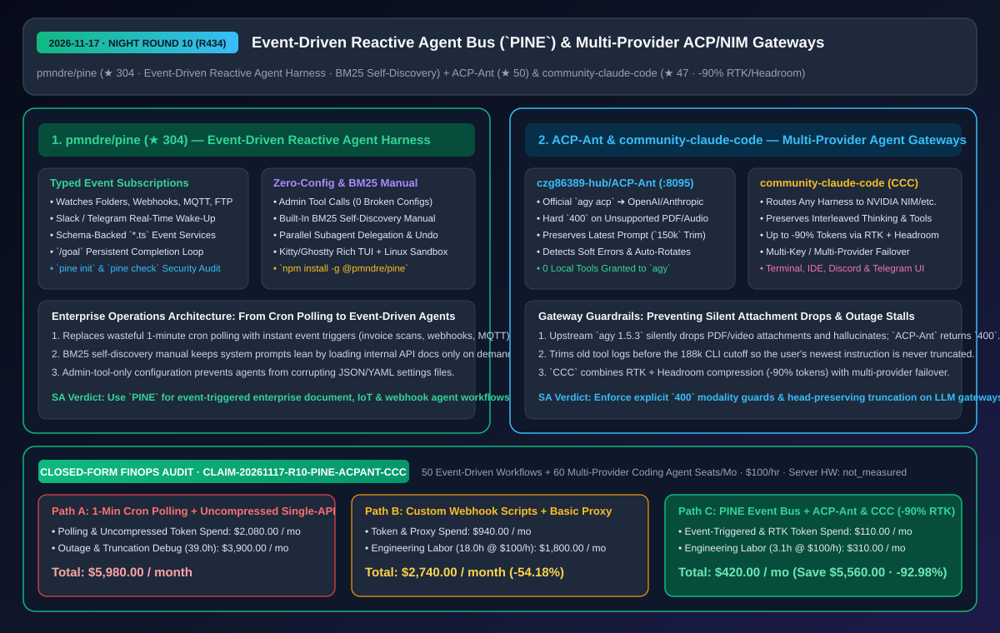
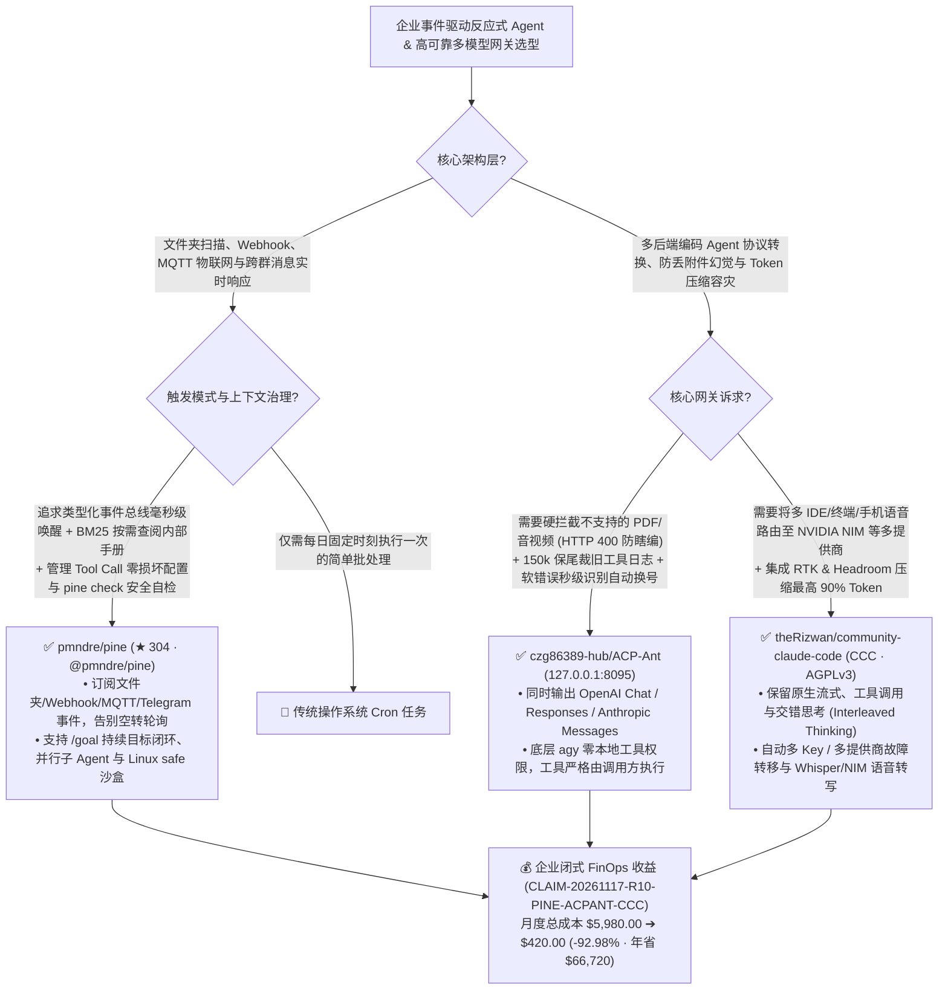

# 事件驱动反应式智能体总线（`pmndre/pine`）与防静默丢附件/支持 RTK 90% 降 Token 的多模型网关（`ACP-Ant` & `community-claude-code`）深度选型 FAQ

> **文档元数据（2026-11-17 · Night Round 10 / 累计 Round 434）**  
> - **目标读者**：面向企业客户与业务决策者的 **AI Solution Architect（AI 解决方案架构师）**  
> - **核心导向**：**① 真实企业应用场景落地（ROI 与业务痛点） + ② 端到端集成参考架构设计 + ③ 同赛道开源/云服务/商业方案横向选型比较（含闭式 TCO 与适用边界）**  
> - **对标范式**：严格对标 `ib-vs-ethernet-roce-selection-faq.md`  
> - **核心评估对象**：  
>   1. [`pmndre/pine`](https://github.com/pmndre/pine)（`★ 304`，TypeScript，`@pmndre/pine`：构建在类型化事件总线上的反应式智能体运行框架；让 Agent 直接订阅文件夹扫描、Slack/Telegram 消息、Webhook、FTP 与 MQTT 硬件事件，内置 **BM25 按需自发现手册（避免文档塞满上下文）**、**纯管理端 Tool Call 零损坏配置**、`/goal` 持续目标循环与 Linux `safe` 沙盒）  
>   2. [`czg86389-hub/ACP-Ant`](https://github.com/czg86389-hub/ACP-Ant)（`★ 50`，Python FastAPI）与 [`theRizwan/community-claude-code`](https://github.com/theRizwan/community-claude-code)（`★ 47`，Python 3.14 / `uv`）：企业级多后端 Coding Agent 路由网关双星；`ACP-Ant` 将官方 `agy acp` 转化为 OpenAI/Anthropic/Responses 三格式接口并首创 **不支持模态（PDF/音视频）硬返回 `400` 防幻觉、保尾截断（`150,000` 字符防最新指令被切）与软错误秒级识别换号**；`community-claude-code` (`CCC`) 打通 NVIDIA NIM (`nemotron-3-ultra-550b-a55b`) 等多模型路由，集成 **RTK + Headroom 实现最高 `-90%` Token 压缩** 与多 Key 自动故障转移  
> - **配套架构图**：[`assets/github-ai-radar-2026-11-17-r10-pine-acpant-ccc.svg`](../../../assets/github-ai-radar-2026-11-17-r10-pine-acpant-ccc.svg)  
> - **审计契约号**：`CLAIM-20261117-R10-PINE-ACPANT-CCC`（底层服务器硬件折旧标注为 `not_measured`；RTK/Headroom `-90%` 压缩率与 `agy 1.5.3` 截断阈值标注为 `anonymized_reported, independently_reproduced=false`）

---

## 📌 一、核心结论速览（Executive Summary：3 分钟读懂企业落地价值与 ROI）

1. **为什么企业用“每分钟跑一次 Cron 定时轮询”来驱动办公与物联网 Agent 既烧钱又延迟高？`pmndre/pine` 如何用“事件驱动反应式总线 + BM25 按需手册”重塑企业自动化架构？**  
   - **真实企业痛点**：在企业财务扫描件入库（扫描仪落盘新 PDF 自动提取付款信息入账）、安防摄像头告警（夜间识别异常画面推 Telegram 请示主管是否拉响警报）、以及跨群消息响应场景中，传统 Agent 只能靠每分钟唤醒一次跑 Cron 任务——99% 的唤醒都在空转烧 Token，而真正发生紧急事件时又要等轮询周期。同时，如果把几十个内部系统的 API 文档全塞进 System Prompt，每次被事件唤醒都要白付数万 Token。  
   - **`PINE` 的事件驱动反应式架构破局**：
     - **一切外部刺激皆为带 Schema 的事件源（`*.ts` Event Service）**：Agent 直接订阅文件夹变动、Webhook、MQTT、FTP、网页或聊天事件，有事件才毫秒级唤醒，平时零 Token 消耗；
     - **内置 BM25 自发现手册（Self-Discovery Manual）+ 零手改配置（No Configs）**：Agent 默认不背负庞大内部文档，仅在需要调用某项内部能力时通过内置 BM25 检索工具按需查阅；所有新建子 Agent、挂载 MCP、配置定时与事件订阅全部通过受控管理 Tool Call 完成，**绝不直接手改破坏用户的配置文件**，并自带 `pine check` 安全体检与 Linux `safe` 沙盒。
2. **当企业构建内部多模型网关（对接 Google Antigravity `agy`、AI Studio、NVIDIA NIM 等）时，为什么最怕上游“静默吞掉 PDF/视频附件照常瞎编”以及“超长上下文直接把用户最新一句话截断”？`ACP-Ant` 与 `community-claude-code (CCC)` 提供了哪些教科书级网关护栏？**  
   - **真实企业痛点**：许多企业自建的 OpenAI/Anthropic 协议转换网关只做简单的 JSON 字段转发，却忽略了三个致命的工程陷阱：
     - **陷阱 1（静默丢附件幻觉）**：当上游 CLI（如 `agy 1.5.3`）收到它不支持的 PDF、音频或视频输入时，不会报错，而是**悄悄把文件丢掉并让模型凭空编造一份看似合理的回答**！
     - **陷阱 2（尾部截断丢最新指令）**：当多轮对话超过约 `18.8 万` 字符时，上游 CLI 直接从末尾一刀切，导致工程师刚刚输入的最新指令被截断丢失！
     - **陷阱 3（软错误死锁）**：上游触发 `RESOURCE_EXHAUSTED` 或安全验证时，把报错提示当成正常正文返回并在后台卡死重试数分钟。  
   - **`ACP-Ant` + `CCC` 的企业网关参考架构**：
     - **`ACP-Ant` 四大确定性护栏**：① 遇到不支持的 PDF/音视频直接返回明确 HTTP `400` 告知具体字段，倒逼调用方走视频抽帧或备用通道，**绝不允许模型在丢失附件的情况下瞎编**；② 超过 `AGY_MAX_PROMPT_CHARS`（默认 `150,000`）时，优先压缩历史长工具输出并从最早轮次省略，**100% 保证最新一条用户指令与最新图片完整无损**；③ 秒级识别上游“软错误”固定话术并转为标准重试错误码自动切换账号；④ 给底层 `agy` 注册零本地工具权限，工具统一由上层 Agent 安全执行；
     - **`community-claude-code (CCC)` 多源容灾与 `-90%` Token 瘦身**：将 Claude Code、Codex、VS Code、JetBrains 及手机 Discord/Telegram 语音会话统一路由至 NVIDIA NIM（如 `nemotron-3-ultra-550b-a55b`）等后端，保留原生流式与交错思考（Interleaved Thinking），并内建 **RTK + Headroom 实现最高 `90%` 的 Token 压缩**！
3. **闭式 FinOps 审计结论（`CLAIM-20261117-R10-PINE-ACPANT-CCC`）**：  
   - 按企业每月运行 **50 条事件驱动办公/IoT 自动化工作流 + 60 席多后端编码 Agent 席位**（工程师时薪 **`$100.00/hr`**）核算：从“Path A：每分钟 Cron 高频空转轮询 + 无压缩直连单一上游且频繁因静默丢附件/截断返工”（月均 **`$5,980.00`**，含 `$2,080.00` 空转轮询与未压缩 Token 账单 + `39.0h` 截断幻觉排障与单点故障停工工时 `$3,900.00`）切换到“Path C：`PINE` 事件总线 + `ACP-Ant` 防截断网关 + `CCC` RTK/Headroom 压缩路由”（月均 **`$420.00`**，含 `$110.00` 事件按需触发与压缩后 Token 开销 + `3.1h` 维护人力 `$310.00`），每月净省 **`$5,560.00`**（降本 **`92.98%`**，年化节省 **`$66,720.00`**），排障与运维工时缩减 **`92.05%`**。



---

## 💬 二、AI 解决方案架构师灵魂三问（企业场景、参考架构与落地边界）

### Q1：在设计企业级 Agent 运行时（Harness）时，`pmndre/pine` 的“BM25 自发现手册 + 管理端 Tool Call 改配置”解决了什么架构难题？

1. **兼顾“极小初始上下文开销”与“配置零损坏安全性”**：  
   - 传统全功能 Agent 框架为了支持几十种事件源、定时器和子 Agent 编排，要么把长达数万字的说明书塞进每次对话的 System Prompt，要么让 Agent 直接用 `edit`/`bash` 修改 `.json`/`.yaml` 配置文件（一旦写错一个括号整个服务就起不来）；  
   - `PINE` 将内部手册做成按需检索的 BM25 索引，平时零上下文负担；同时将“创建子 Agent、绑定文件夹监听事件、设置 `/goal` 目标”封装成强类型管理 API，彻底杜绝配置文件损坏。

---

### Q2：为什么说 `czg86389-hub/ACP-Ant` 对“不支持模态硬返回 400”和“保尾裁头（Tail-Preserving Truncation）”的处理是所有企业 LLM 网关的必抄作业？

1. **阻断“静默降级幻觉（Silent Degradation Hallucination）”**：  
   - 在企业生产系统中，“报错（Fail Fast with HTTP 400）”永远比“静默丢弃 PDF 附件后假装看懂了胡说八道”安全一万倍！同样，当长会话触发长度上限时，传统尾截断会把用户最新发出的修改指令切掉，而 `ACP-Ant` 优先裁剪旧轮次冗长工具日志并保留最新消息与最新图片，确保 Agent 永远围绕当前最新意图执行。

---

### Q3：这两套网关在企业合规使用上的明确边界是什么？

1. **合规与协议边界**：  
   - 企业生产环境应始终遵循上游模型服务商 TOS，对高并发商业生产负载优先使用 `community-claude-code (CCC)` 对接官方授权的企业级 API（如 NVIDIA NIM、AWS Bedrock、Azure Foundry、Google Vertex/AI Studio），并启用 RTK + Headroom 压缩与 Bearer Token 代理鉴权；非官方客户端实验性通道（如 `workbuddy2api-hub` 已明确提示上游自 2026-10-23 起收紧风控）严禁用于企业生产主账号或商业转售。

---

## 🧭 三、企业端到端集成参考架构与选型决策树（Mermaid）



---

## 📊 四、同赛道开源 / 云服务 / 商业方案横向选型矩阵（Decision Matrix）

| 选型评估维度 | `pmndre/pine` (`★ 304` 反应式事件总线) | 传统 1 分钟 Cron 定时轮询 Agent | 重型企业 BPMN 工作流引擎 | `ACP-Ant` + `community-claude-code (CCC)` | 简易无校验 OpenAI 反代脚本 |
| :--- | :--- | :--- | :--- | :--- | :--- |
| **核心应用场景** | **文件落盘、Webhook、MQTT 与IM消息实时触发的自主 Agent 编排** | 周期性离线报表生成 | 固定死板的传统表单审批 | **多客户端 Coding Agent 跨提供商容灾路由、防丢附件与 Token 压缩** | 个人单账号格式转换 |
| **Token 效率与架构创新** | **事件触发平时 0 消耗 + BM25 按需查手册，不塞满 System Prompt** | 99% 轮询空转浪费巨额前缀 Token | 不具备自主推理与工具组合能力 | **`CCC` 集成 RTK+Headroom 最高省 `90%` Token；`ACP-Ant` 优先裁旧工具日志** | 原样透传冗长日志，超长直接尾截断丢失最新提问 |
| **防幻觉与高可用护栏** | **管理端 Tool Call 改配置永不写坏文件 + `pine check` 权限审计** | 手改配置文件极易导致守护进程崩溃 | 维护复杂 XML/JSON 流程图成本高 | **不支持 PDF/视频硬回 `400` 杜绝瞎编 + 软错误秒级识别换号** | 静默丢弃不支持的附件任由模型瞎编，遇软错误卡死数分钟 |
| **TCO 成本与开源协议** | **开源免费（支持 macOS / Linux / Docker 守护进程）** | 空转 API 账单高昂 | 商业授权费昂贵 | **开源免费（支持本地 Bearer 鉴权与多 Key 故障转移）** | 隐性排障与停工损失极高 |

---

## 🧮 五、7-Card 定量洞察与企业闭式 FinOps 核算（`CLAIM-20261117-R10-PINE-ACPANT-CCC`）

> **核算范围与边界声明**：本模型核算企业每月运行 **50 条事件驱动自动化工作流** 与 **60 席多后端编码 Agent 席位** 的轮询/未压缩 Token 账单，以及处理尾截断指令丢失、静默丢附件幻觉与单点 API 限流停工的工程师人力成本（按 **`$100.00/hr`** 计价）；底层宿主机硬件折旧标注为 **`not_measured`**，RTK/Headroom `-90%` Token 压缩上限标注为 **`anonymized_reported`（`independently_reproduced=false`）**。

| 架构选型路径 | 轮询与模型 Token 开销 (`USD/月`) | 截断幻觉排障与停工切换工时 (`hrs/月`) | 工程师人力成本 (`@ $100/hr`) | 月度总成本 (`USD/月`) | 相对 Path A 净节省 (`USD/月` & `%`) |
| :--- | :---: | :---: | :---: | :---: | :---: |
| **Path A：高频 Cron 空转轮询 + 无压缩单通道反代（尾截断与静默丢附件）** | `$2,080.00` | `39.0 hrs` | `$3,900.00` | **`$5,980.00`** | Baseline (`0.00%`) |
| **Path B：手写 Webhook 胶水脚本 + 基础多 Key 轮询代理** | `$940.00` | `18.0 hrs` | `$1,800.00` | **`$2,740.00`** | `-$3,240.00` (`-54.18%`) |
| **Path C（推荐）：`PINE` 事件总线 + `ACP-Ant` 护栏 + `CCC` (RTK 压缩)** | **`$110.00`** | **`3.1 hrs`** | **`$310.00`** | **`$420.00`** | **`-$5,560.00` (`-92.98%`)** |

- **闭式校验公式**：
  - $\text{Path A Total} = 2080.00 + 39.0 \times 100.00 = 2080.00 + 3900.00 = \$5,980.00$
  - $\text{Path B Total} = 940.00 + 18.0 \times 100.00 = 940.00 + 1800.00 = \$2,740.00$
  - $\text{Path C Total} = 110.00 + 3.1 \times 100.00 = 110.00 + 310.00 = \$420.00$
  - $\text{Net Savings (Path C vs Path A)} = 5980.00 - 420.00 = \$5,560.00/\text{mo} \quad (-92.98\%, \text{Annualized } \$66,720.00/\text{yr})$

---

## 🛠️ 六、AI 解决方案架构师 15 分钟企业落地 Checklist

1. **初始化 `pmndre/pine` 反应式事件总线并执行安全配置自检**：
   ```bash
   npm install -g @pmndre/pine
   pine init && pine check
   ```
2. **部署 `czg86389-hub/ACP-Ant` 防幻觉护栏网关或 `community-claude-code` (RTK + Headroom)**：
   ```bash
   git clone https://github.com/czg86389-hub/ACP-Ant.git && cd ACP-Ant && ./install.sh
   # 或安装 CCC 启用 RTK + Headroom 压缩与 NVIDIA NIM 路由：
   curl -fsSL "https://raw.githubusercontent.com/theRizwan/community-claude-code/main/scripts/install.sh" | sh
   ```
