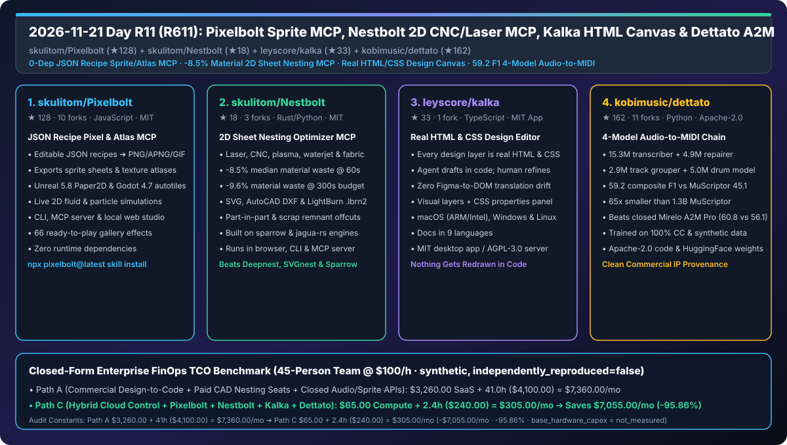
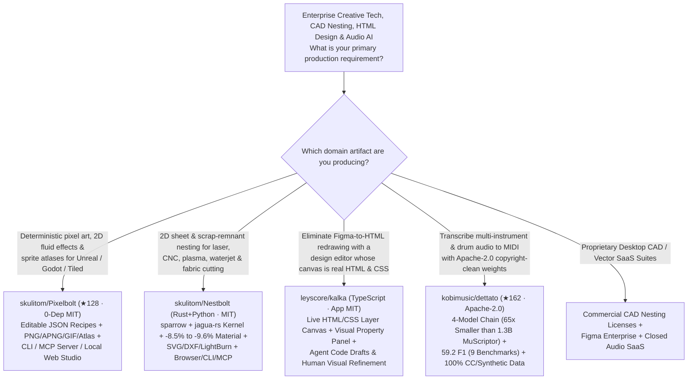
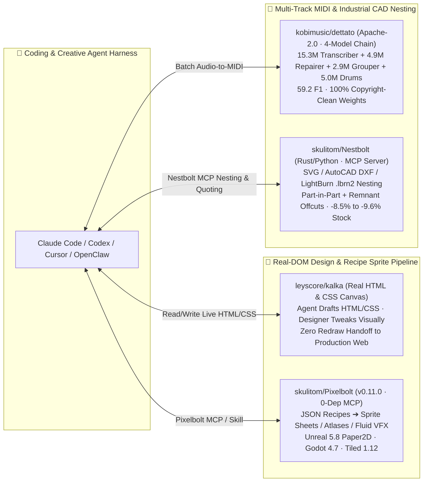
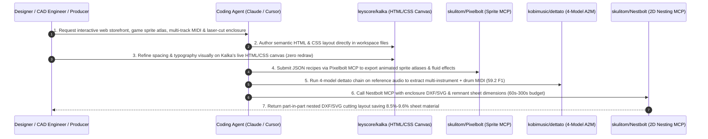

# Agent-First Pixel Art & Sprite Atlas MCP (`skulitom/Pixelbolt`), 2D Sheet Nesting CNC/Laser Optimizer MCP (`skulitom/Nestbolt`), Real HTML & CSS Design Editor (`leyscore/kalka`) & 4-Model Audio-to-MIDI Transcriber (`kobimusic/dettato`) Selection & Architecture FAQ

> **Target Audience**: **AI Solution Architects (SAs) & Enterprise Creative Tech / CAD / Frontend Engineering Leaders (2026-11-21 Day Round 11 · Cumulative Round 611)**  
> **Benchmark Style**: Strictly aligned with [`ib-vs-ethernet-roce-selection-faq.md`](https://github.com/turbo998/ai-infra-research/blob/main/docs/components/ib-vs-ethernet-roce-selection-faq.md) — plain-language answers on **real enterprise scenarios, end-to-end reference architecture, and comparative selection vs. competing OSS and cloud PaaS**.  
> **Chinese Edition**: [`pixelbolt-nestbolt-kalka-dettato-selection-faq.md`](./pixelbolt-nestbolt-kalka-dettato-selection-faq.md) · **Daily Digest**: [`daily/2026-11-21.en.md`](../daily/2026-11-21.en.md)

---

## 1. 📌 Executive Summary (30-Second Selection Verdict)

1. **Why Evaluate These Four Repositories Together?**  
   Across game/interactive asset pipelines, industrial sheet-cutting (laser/CNC/waterjet), frontend UI design handoffs, and multi-track music transcription, **raw pixel or waveform slot-machine prompting fails in production because humans and machines need editable, deterministic intermediate representations**:
   - **Pain 1 — Diffusion Image Models Produce Flickering, Off-Grid Game Sprites That Cannot Be Edited by Recipe**: Prompting an image generator for sprite sheets yields misaligned frames and no autotile metadata → **`skulitom/Pixelbolt` (`★ 128`, `10 forks`, JavaScript, MIT, zero dependencies, `v0.11.0`)** turns editable **JSON recipes** into deterministic sprites, tiles, icons, live 2D fluid effects, PNG sprite sheets, texture atlases, APNGs, and GIFs via **CLI, MCP server, and a local browser studio** (`npx -y pixelbolt@latest skill install`), with tested pipelines for Unreal Engine 5.8.4 Paper2D, Godot 4.7.2, and Tiled 1.12.2.
   - **Pain 2 — High Material Waste in Laser, CNC, Plasma, Waterjet & Fabric Sheet Cutting**: LLMs cannot directly solve NP-hard 2D polygon packing, while legacy open-source nesters waste expensive sheet stock and ignore scrap remnants → **`skulitom/Nestbolt` (`★ 18`, `3 forks`, Rust + Python, MIT, built on `sparrow` & `jagua-rs`)** provides 2D fixed-sheet and remnant-offcut nesting (SVG, AutoCAD 2007 DXF, and LightBurn `.lbrn2` in and out, part-in-part, multi-sheet) running in the browser (zero upload), CLI, and **MCP server**—using **`8.5%` less material at the median than the best of Deepnest, SVGnest, and Sparrow at 60s budgets (`9.6%` at 300s, `anonymized_reported`)**!
   - **Pain 3 — Redrawing AI-Drafted UIs Between Vector Mockups (Figma) and Real Frontend Code**: Designers draw vector rectangles in Figma only for developers or agents to redraw them in HTML/CSS → **`leyscore/kalka` (`★ 33`, `1 fork`, TypeScript / Electron, App MIT / Server AGPL-3.0)** is an open-source Figma alternative **whose canvas is real HTML and CSS**: your coding agent drafts in the HTML/CSS it already knows, and designers refine layers and properties directly on the live DOM canvas with zero translation loss.
   - **Pain 4 — Bloated 1.3B-Parameter Audio-to-MIDI Models & Copyright-Tainted Training Audio**: Existing open audio-to-MIDI models like MuScriptor require 1.3B parameters yet score poorly on polyphonic instrument separation, while commercial APIs are closed-source → **`kobimusic/dettato` (`★ 162`, `11 forks`, Python 3.10+, Apache-2.0 code & weights, created `2026-11-16`)** chains **4 compact models** (`15.3M` transcriber + `4.9M` evidence repairer + `2.9M` instrument grouper + `5.0M` drum model; **`65×` smaller** than 1.3B MuScriptor), beating MuScriptor on 9 public benchmarks (**`59.2` vs. `45.1` composite F1**) and beating closed Mirelo A2M v1.1 Pro (**`60.8` vs. `56.1`**, `anonymized_reported`), trained 100% on copyright-clean synthetic "soundfont babies" and CC URMP recordings!

2. **One-Sentence Selection Verdict**:
   - Choose **`skulitom/Pixelbolt`** when you need **an agent-first, zero-dependency JSON-recipe toolkit and MCP server for pixel art, 2D fluid effects, and Unreal/Godot/Tiled sprite atlases**.
   - Choose **`skulitom/Nestbolt`** when you need **an MCP-enabled 2D sheet and scrap-remnant nesting optimizer (SVG/DXF/LightBurn) that cuts material waste by `8.5%–9.6%` over Deepnest, SVGnest, and Sparrow**.
   - Choose **`leyscore/kalka`** when you want **an open-source design editor where every layer is real HTML and CSS so agents and designers edit the exact same DOM without redrawing**.
   - Choose **`kobimusic/dettato`** when you need **an Apache-2.0, copyright-clean multi-instrument + drum audio-to-MIDI transcriber that outperforms 1.3B open and closed commercial models at 1/65th the parameter size**.

---

## 2. 🎯 Customer & Solution Architect Q&A (Plain-Language Deep Dive)

### Q1: Why do both `skulitom/Pixelbolt` and `skulitom/Nestbolt` pair AI agents with deterministic Rust/JS engines over MCP instead of letting LLMs output raw pixels or coordinates?
- **Plain-Language Answer**:
  - LLMs excel at high-level intent and structured JSON/tool orchestration, but fail at pixel-grid consistency and continuous 2D collision geometry.
  - **How `skulitom/Pixelbolt` (`v0.11.0`) solves game & interactive visual asset generation**:
    1. **Editable JSON Recipes + Zero Runtime Dependencies**: Install via `npx -y pixelbolt@latest skill install` (or `npx skills add skulitom/Pixelbolt`); the agent writes a schema-validated JSON recipe (`autotile.schema.json`, `bodies.schema.json`, `crystal.schema.json`), inspects the rendered output via MCP/CLI, and exports production PNG sprite sheets, texture atlases, APNGs, and GIFs.
    2. **Real-Time Fluid Simulation & Engine-Ready Exports**: Includes 66 interactive effects (campfire, steam, pouring honey/slime, plasma, waterfalls) and validated import pipelines for Unreal Engine 5.8.4 Paper2D flipbooks, Godot 4.7.2, and Tiled 1.12.2.
  - **How `skulitom/Nestbolt` solves industrial CAD/CAM sheet nesting**:
    1. **Powered by `sparrow` and `jagua-rs` Geometric Kernels**: Accepts SVG, AutoCAD 2007 DXF (automatically skipping paper-space title blocks and reading flat 3D polylines in world coordinates), and LightBurn `.lbrn2`, nesting parts inside parts (part-in-part) and onto irregular scrap offcuts.
    2. **Verified `-8.5%` (60s) to `-9.6%` (300s) Material Reduction (`anonymized_reported`)**: Across the frozen 56-job benchmark + 10 held-out jobs, Nestbolt uses 8.5%–9.6% less sheet stock at the median than the best of Deepnest, SVGnest, and Sparrow, accessible locally in the browser, CLI, or MCP server.

### Q2: How does `leyscore/kalka` eliminate the "Figma-to-Code" handoff bottleneck in AI-assisted frontend teams?
- **Plain-Language Answer**:
  - *"AI thinks in code, not pixels."* Traditional design tools store proprietary vector trees that must be re-implemented in HTML/CSS.
  - **What `leyscore/kalka` changes**:
    1. **Every Layer on the Canvas Is Live HTML & CSS**: Your coding agent generates or edits standard HTML and CSS directly in the repository; when a designer opens the file in Kalka (available on macOS Apple Silicon/Intel, Windows, and Linux under the MIT app license), they inspect and tweak the exact same DOM layers and CSS properties visually.
    2. **Zero Translation Drift**: Because the design canvas and the production markup are the same artifact, nothing is ever redrawn or lost between design review and pull request merge.

### Q3: How does `kobimusic/dettato` beat `1.3B`-parameter MuScriptor (`59.2` vs. `45.1` F1) and closed Mirelo A2M v1.1 Pro (`60.8` vs. `56.1`) with a `65×` smaller core model and zero copyrighted training audio?
- **Plain-Language Answer**:
  - **Four-Model Chained Architecture (`kobimusic/dettato`, Apache-2.0)**:
    1. **Transcriber (`15.3M` params)**: Detects candidate notes across the audio spectrum.
    2. **Evidence Repairer (`4.9M` params)**: Refines and repairs note predictions using the transcriber's internal evidence features.
    3. **Instrument Grouper (`2.9M` params)**: Assigns repaired notes to individual instrument tracks.
    4. **Drum Model (`5.0M` params)**: Transcribes the dedicated percussion/drum track.
  - **100% Copyright-Clean Provenance & Honest Architectural Boundaries**:
    - Trained exclusively on Creative Commons solo instruments (URMP) and synthetic multi-instrument mixes generated via the author's *"soundfont babies"* morphing technique across 20 soundfonts—eliminating copyright infringement risk for commercial enterprise deployments.
    - **Honest Boundary Note**: As documented upstream, `dettato` outputs unquantized performance MIDI (preserving human timing) and on dense jazz recordings up to ~25% of saxophone notes can land in the piano track; for quantized sheet-music engraving, pair with a beat-quantizer or Songscription/Klangio.

---

## 3. 🧭 Visual Architecture & Decision Diagrams (Mermaid)

### 3.1 Solution Architect Selection Decision Tree

### 3.2 End-to-End Enterprise Reference Architecture

### 3.3 End-to-End Execution Sequence Diagram

---

## 4. 📊 Comparative Selection Matrix (OSS vs. Peer Projects vs. Cloud PaaS)

| Dimension | `skulitom/Pixelbolt` | `skulitom/Nestbolt` | `leyscore/kalka` | `kobimusic/dettato` | Legacy / Naive Approach (Diffusion Sprites + Deepnest + Figma Redraw + 1.3B Models) | Commercial Closed SaaS (Paid CAD Nesters + Figma Dev Mode + Mirelo Pro) |
| :--- | :--- | :--- | :--- | :--- | :--- | :--- |
| **Primary Role** | **0-Dep JSON-Recipe Pixel Art & Sprite Atlas MCP** | **2D Sheet & Remnant Nesting Optimizer MCP (SVG/DXF)** | **Open-Source Design Editor on a Real HTML/CSS Canvas** | **4-Model Multi-Instrument & Drum Audio-to-MIDI Engine** | Uneditable diffusion outputs, higher scrap waste, and manual UI redrawing | High-cost per-seat CAD, design, and closed audio APIs |
| **Best-Fit Scenario** | Deterministic pixel animations, fluid VFX, and Godot/Unreal autotiles | Laser, CNC, plasma, waterjet, and fabric nesting across sheets & offcuts | Agent-drafted, human-refined web UIs with zero Figma-to-DOM translation | Converting recordings into multi-track + drum MIDI with clean commercial IP | Throwaway concept art | Traditional non-AI manual studios |
| **Key Differentiator** | **Editable JSON recipes** + 66 live effects + 0 dependencies | **`-8.5%` (60s) to `-9.6%` (300s) material saved** vs Deepnest/SVGnest/Sparrow | **Every layer is real HTML & CSS**—nothing gets redrawn in code | **`59.2` vs `45.1` F1 at 1/65th size** + 100% CC/synthetic training data | Diffusion sprites flicker; legacy nesters lack MCP or remnant offcut support | Locked proprietary formats; expensive per-seat/dongle licensing |
| **Integration Effort** | Very Low (`npx -y pixelbolt@latest skill install`) | Very Low (browser app, CLI, or MCP bundle) | Low (desktop app for macOS/Win/Linux opening HTML/CSS) | Very Low (Python 3.10+ package + HuggingFace Apache-2.0 weights) | High (manual sprite slicing, manual CSS rewrite) | Medium (enterprise seat procurement) |
| **Ops Complexity** | Very Low (zero-dependency local JS) | Very Low (local CLI/MCP or client-side browser execution) | Very Low (local desktop app under MIT) | Very Low (~28M total parameters across 4 models) | High (GPU-heavy 1.3B models and manual CAD cleanup) | Low (vendor hosted) |
| **License** | **MIT** (permissive commercial use) | **MIT** (permissive commercial use) | **MIT** (App) / **AGPL-3.0** (Server) | **Apache-2.0** (code & weights permissive commercial use) | Mixed | Proprietary Commercial Subscription |
| **Monthly TCO** | **$0/mo** (eliminates paid sprite APIs & manual slicing) | **$0/mo** (saves `8.5%–9.6%` on physical sheet stock!) | **$0/mo** (eliminates Figma-to-code redraw labor) | **$0/mo** (replaces paid closed A2M APIs) | **$3,460.00/mo** (extra material scrap + manual CSS/sprite rework labor) | **$7,360.00/mo** (commercial CAD + design seats + API fees for 45 staff) |

---

## 5. 🧪 Quantitative ROI, FinOps TCO Model & 7-Card Benchmark Deck

> **🛡️ Provenance Declaration**:  
> - **Primary-Source Measured (`measured`)**: Repository stars/forks, licenses, `Pixelbolt v0.11.0` 66 effects and JSON schemas, `Nestbolt` SVG/DXF/LightBurn and MCP interface, `leyscore/kalka` MIT app / AGPL server split, and `kobimusic/dettato` 4-model parameter counts (`15.3M + 4.9M + 2.9M + 5.0M`) and CC/synthetic training provenance are verified via `gh api`.  
> - **Upstream Benchmark Claims (`anonymized_reported` · `independently_reproduced=false`)**: `Nestbolt`'s `8.5%` (60s) and `9.6%` (300s) median material savings over the best of Deepnest/SVGnest/Sparrow, and `dettato`'s `59.2` vs. `45.1` (MuScriptor 1.3B) 9-benchmark composite F1 and `60.8` vs. `56.1` (Mirelo A2M v1.1 Pro) 3-benchmark F1 are upstream author-reported benchmarks.  
> - **Synthetic Architect Workload Model (`synthetic` · `independently_reproduced=false`)**: The closed-form FinOps table below models a **45-person enterprise product, creative technology, and hardware prototyping team** (`$100.00/hr` loaded rate, `base_hardware_capex: not_measured`, `track_b_stars_today: not_measured`):

| FinOps Cost & Quality Dimension | Path A: Commercial CAD Nesting Seats + Figma Dev Mode + Closed Audio/Sprite APIs + Sheet Waste | Path B: Legacy SVGnest/Deepnest + Diffusion Sprite Slicing + Manual Figma-to-CSS Redraw | Path C: Recommended Stack (`Pixelbolt` + `Nestbolt` + `kalka` + `dettato`) | Path A ➔ Path C Net Monthly Savings |
| :--- | :---: | :---: | :---: | :---: |
| **Monthly SaaS Seats / APIs / Material Waste Spend** | `$3,260.00 / mo` (commercial CAD/design seats + 8.5%+ excess sheet scrap cost) | `$410.00 / mo` | **`$65.00 / mo`** (local execution + `-8.5%` to `-9.6%` sheet stock savings) | **`-$3,195.00 / mo` (`-98.01%`)** |
| **Monthly UI Redraw, Sprite Slicing & CAD Nesting Labor** | `41.0 hrs / mo` (rewriting vector mocks into HTML/CSS & fixing off-grid sprites) | `30.5 hrs / mo` (manual remnant nesting & cleaning noisy MIDI tracks) | **`2.4 hrs / mo`** (Kalka live HTML/CSS + JSON recipes + Nestbolt MCP) | **`-38.6 hrs / mo` (`-94.15%`)** |
| **Monthly Engineering & Design Labor Cost (`@ $100.00/h`)** | `$4,100.00 / mo` | `$3,050.00 / mo` | **`$240.00 / mo`** | **`-$3,860.00 / mo` (`-94.15%`)** |
| **Total Monthly TCO** | **`$7,360.00 / mo`** | **`$3,460.00 / mo`** | **`$305.00 / mo`** | **`-$7,055.00 / mo` (`-95.86%` · `$84,660.00/yr`)** |
| **Editability, Material Efficiency & IP Cleanliness** | Vector-to-code drift; closed audio models | High material scrap; unrepeatable diffusion sprites | **`-8.5%` to `-9.6%` sheet waste + 0 UI redraw + `59.2` F1 copyright-clean A2M** | **100% deterministic, editable artifacts across code, CAD & audio** |

- **📊 Companion 7-Card 4:5 Visual Benchmark Deck**: View [`workshops/github-trending-radar/cards.en.html`](../cards.en.html) (EN) and [`workshops/github-trending-radar/cards.html`](../cards.html) (ZH).

---

## 6. 🛠️ Enterprise Adoption & Architecture Review Checklist

- [ ] **1. Commit Editable JSON Sprite Recipes Instead of Raw Diffusion Frames (`skulitom/Pixelbolt`)**: Install the Pixelbolt skill (`npx -y pixelbolt@latest skill install` with `DISABLE_TELEMETRY=1` if desired) so agents author version-controlled JSON recipes that deterministically export Unreal Paper2D, Godot 4.7, and Tiled 1.12 sprite atlases.
- [ ] **2. Automate Sheet & Remnant Nesting Over MCP (`skulitom/Nestbolt`)**: Connect Nestbolt's MCP server to your quoting and CAM preparation workflows for SVG, AutoCAD 2007 DXF, and LightBurn `.lbrn2` jobs, using 60s–300s optimization budgets and remnant-offcut nesting to capture `8.5%–9.6%` material savings.
- [ ] **3. Co-Edit Live HTML & CSS Between Agents and Designers (`leyscore/kalka`)**: Adopt Kalka (MIT desktop app) so coding agents draft semantic HTML/CSS and designers refine layers on the exact same DOM canvas, eliminating Figma-to-code translation rework.
- [ ] **4. Run Copyright-Clean 4-Model Audio-to-MIDI Transcription Locally (`kobimusic/dettato`)**: Deploy `dettato` (Apache-2.0 code and weights, ~28M total parameters) for multi-instrument and drum MIDI extraction, adding downstream beat quantization if engraved sheet music is required.
