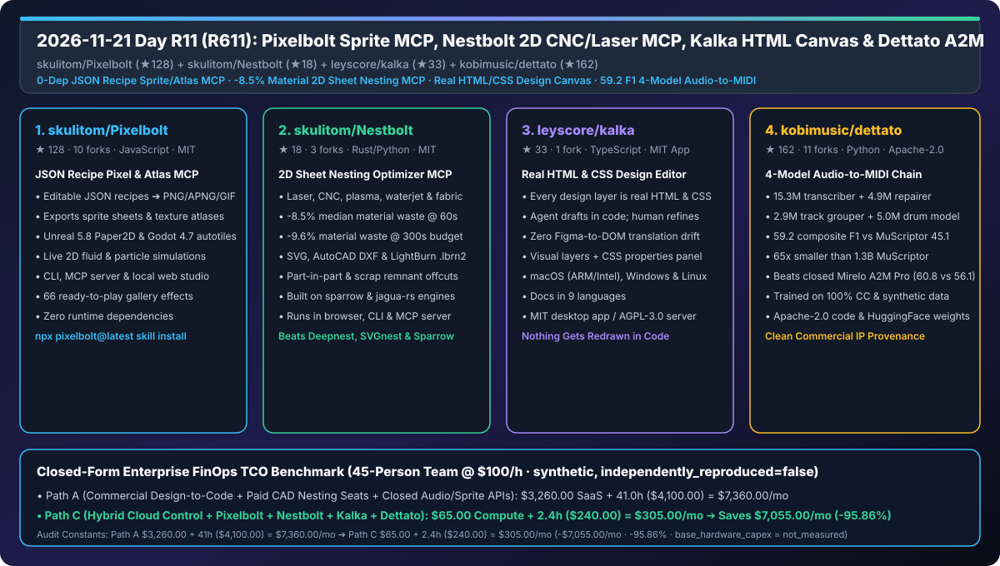
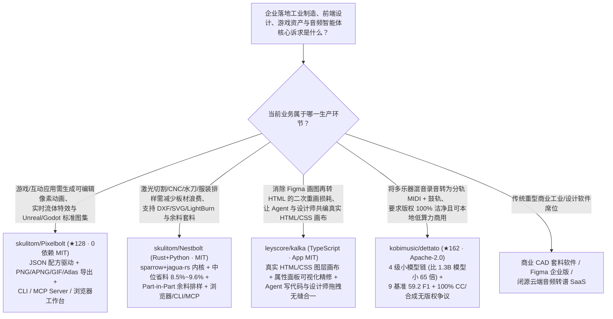
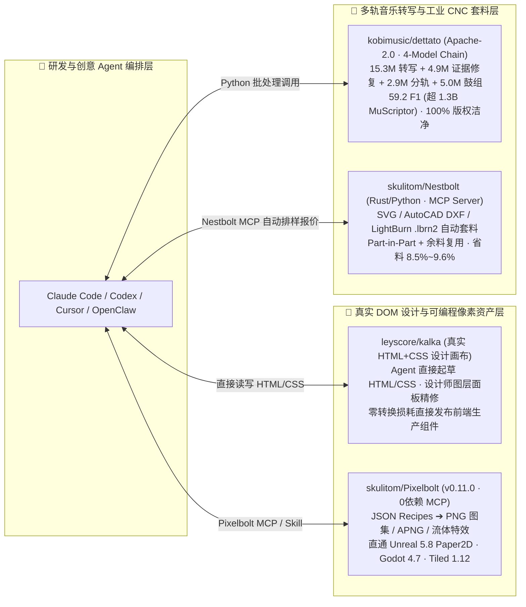
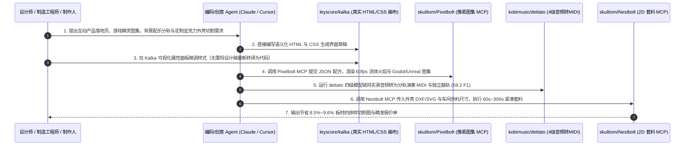

# JSON 配方像素动画与图集 MCP（`skulitom/Pixelbolt`）、激光/CNC 二维板材套料优化 MCP（`skulitom/Nestbolt`）、真实 HTML+CSS 画布设计编辑器（`leyscore/kalka`）与四级串联多轨音频转 MIDI 模型（`kobimusic/dettato`）应用场景、集成架构与同类方案选型比较 FAQ

> **文档定位**：面向企业客户与业务决策者的 **AI Solution Architect（解决方案架构师）实战选型指南（2026-11-21 Day Round 11 · 累计第 611 轮）**  
> **对标范式**：严格遵循 [`ib-vs-ethernet-roce-selection-faq.md`](https://github.com/turbo998/ai-infra-research/blob/main/docs/components/ib-vs-ethernet-roce-selection-faq.md) 通俗问答与决策矩阵风格——直接用大白话回答“**它是什么？帮企业解决什么业务痛点？怎么集成进现有生产架构？和同类开源及 Azure 云服务比怎么选？**”  
> **配套英文版**：[`pixelbolt-nestbolt-kalka-dettato-selection-faq.en.md`](./pixelbolt-nestbolt-kalka-dettato-selection-faq.en.md) · **今日日报**：[`daily/2026-11-21.md`](../daily/2026-11-21.md)

---

## 一、📌 核心结论速览（Executive Summary · 30 秒做出选型决定）

1. **为什么把这四个项目放在一起看？**  
   当企业将生成式 AI 引入**工业制造排版（CNC/激光切割）、前端 UI 设计交付、游戏与互动媒体精灵图集生产、以及数字音乐多轨配器制作**时，最痛的教训就是：**“直接用像素/波形黑盒大模型抽卡，产出的东西根本没法二次编辑或直接上生产机床！”** 这四个项目代表了**“结构化中间表示（JSON 配方 / DXF 几何 / 真实 DOM / 多轨 MIDI）+ Agent 可控微调”**的最佳工程范式：
   - **痛点一（用图像扩散模型抽卡画游戏图标与动效，帧间闪烁、网格对不齐且无法导出规范图集）**：大模型直接生图无法精确控制每一帧像素与瓦片拼接 → **`skulitom/Pixelbolt`（`★ 128`，`10 forks`，JavaScript，MIT，零运行时依赖，`v0.11.0`）** 让 AI Agent 编写可编辑的 **JSON 配方（JSON Recipes）**，通过本地 MCP Server、CLI 或浏览器工作台确定性渲染出 **PNG 精灵表（Sprite Sheets）、纹理图集（Texture Atlases）、APNG、GIF 以及实时 2D 流体特效**，直接导入 Unreal Engine 5.8 Paper2D、Godot 4.7 与 Tiled 1.12！
   - **痛点二（工业激光切割、CNC、水刀与服装皮革裁剪靠人工或旧版开源工具排版，板材边角料浪费严重）**：大模型自己算不出复杂多边形的无碰撞紧凑排样 → **`skulitom/Nestbolt`（`★ 18`，`3 forks`，Rust + Python，MIT，基于 `sparrow` 与 `jagua-rs`）** 为固定板材切割提供浏览器端（零上传）、CLI 与 **MCP Server**：支持 **SVG、AutoCAD 2007 DXF（自动跳过图纸空间标题栏）与 LightBurn `.lbrn2`**，支持零件套零件（Part-in-Part）与不规则余料（Remnant Offcuts）排样——在 56 个测试任务的冻结基准中，**60 秒预算下中位材料消耗比 Deepnest、SVGnest 与 Sparrow 的最优结果还要少 `8.5%`（300 秒预算下少 `9.6%`，`anonymized_reported`）**！
   - **痛点三（设计师在 Figma 里画矢量假图，前端再靠 AI 看截图重写一遍 HTML/CSS，永远还原不准）**：“AI 用代码思考，而不是用像素思考。” → **`leyscore/kalka`（`★ 33`，`1 fork`，TypeScript / Electron，客户端 MIT / 服务端 AGPL-3.0）** 是画布本身就是**真实 HTML 与 CSS** 的开源 Figma 替代品：让 Coding Agent 直接在它最擅长的 HTML/CSS 中起草界面，人类设计师在同一画布的图层与属性面板上拖拽微调，**彻底消灭“设计稿转代码”的二次重画损耗**！
   - **痛点四（音频转多轨 MIDI 大模型体积破 10 亿参数且训练数据有版权争议）**：1.3B 参数的 MuScriptor 又大又慢，而闭源商业模型不可自托管 → **`kobimusic/dettato`（`★ 162`，`11 forks`，Python 3.10+，代码与权重均 Apache-2.0，2026-11-16 新建爆发）** 采用 **4 级小模型串联架构**（`15.3M` 音符转写 + `4.9M` 证据修复 + `2.9M` 乐器分轨 + `5.0M` 鼓组转写，核心仅 `20.2M` 参数，比 `1.3B` 的 MuScriptor **小 65 倍**），在 9 个公开基准上取得 **`59.2` 综合 F1（超越 MuScriptor 的 `45.1`）**，在 Mirelo 三项基准上取得 **`60.8`（超越闭源商业模型 Mirelo A2M v1.1 Pro 的 `56.1`，`anonymized_reported`）**，且 100% 基于合成音源（Soundfont Babies）与 CC 授权数据训练，**零版权录音合规风险**！

2. **一句话选型结论**：
   - 需要**让 Agent 通过零依赖 JSON 配方与 MCP 生成可编辑的像素动画、流体特效与 Unreal/Godot/Tiled 标准图集** 👉 选 **`skulitom/Pixelbolt`**。
   - 需要**在激光切割、CNC、等离子、水刀与面料排样中通过 MCP/CLI/浏览器比传统工具再省 `8.5%–9.6%` 板材并复用边角余料** 👉 选 **`skulitom/Nestbolt`**。
   - 需要**让 Agent 直接写 HTML/CSS 草稿、人类在可视化图层面板精修且零转换损耗的开源设计编辑器** 👉 选 **`leyscore/kalka`**。
   - 需要**100% 版权干净、Apache-2.0 商用友好、以 1/65 参数量超越 1.3B 模型的多乐器+鼓组音频转 MIDI 引擎** 👉 选 **`kobimusic/dettato`**。

---

## 二、🎯 客户与架构师灵魂拷问 Q&A（Plain-Language Deep Dive）

### Q1：同样是同一位作者（`skulitom`）开源的 Agent 工具，`Pixelbolt` 和 `Nestbolt` 为什么都坚持“不让大模型直接画图/排坐标，而是让大模型调结构化引擎 MCP”？
- **大白话解答**：
  - 大语言模型擅长理解意图和写配置，但极度不擅长像素级对齐与 NP-Hard 几何碰撞求解。
  - **在数字视觉生产中（`skulitom/Pixelbolt v0.11.0`）**：
    - 一行 `npx -y pixelbolt@latest skill install`（或 `npx skills add skulitom/Pixelbolt`）给 Claude Code / Codex / Cursor 装上技能；Agent 只负责编写可读可改的 JSON Recipe（遵循 `autotile.schema.json`、`bodies.schema.json`、`crystal.schema.json`），由零依赖的 Pixelbolt 引擎确定性渲染火焰、水流、蜂蜜流体与自动瓦片地图，确保每一帧像素严丝合缝。
  - **在工业制造与硬件打样中（`skulitom/Nestbolt`）**：
    - 工厂师傅或报价 Agent 只需通过 Nestbolt MCP 传入零件的 SVG/DXF 或 LightBurn `.lbrn2` 文件与板材/余料尺寸，底层基于 Rust 的 `sparrow` 与 `jagua-rs` 几何排样内核在 60～300 秒内自动完成“大零件肚子里套小零件（Part-in-Part）”与多张板材联合排样，**中位节省 `8.5%–9.6%` 昂贵金属/亚克力/皮革板材**，直接转化为真金白银的毛利提升！

### Q2：为什么说 `leyscore/kalka` 抓住了 AI 时代 UI/UX 工具的本质（“AI thinks in code, not pixels”）？
- **大白话解答**：
  - 在传统工作流中：产品经理让 AI 生成原型 ➔ 设计师在 Figma 里重画成矢量矩形 ➔ 前端工程师再用 Figma MCP 把矢量矩形翻译回 HTML/CSS。中间经历了两次有损翻译，响应式布局、Flex/Grid 与真实字体渲染总是对不上。
  - **`leyscore/kalka` 的破局之道**：
    1. **画布里的每一个图层本身就是真实的 HTML 与 CSS DOM 节点**：不存在“导出为代码”这一步，因为你看到的画布就是正在运行的真实网页代码。
    2. **Agent 起草结构 + 人类微调视觉**：编码 Agent 直接修改底层 HTML/CSS 文件完成 80% 的布局与状态搭建，设计师打开 Kalka 桌面端（支持 macOS ARM/Intel、Windows、Linux，客户端 MIT 协议）在熟悉的图层树与属性面板里微调间距、配色与圆角，改完即上线！

### Q3：`kobimusic/dettato` 是怎么做到用 `20M` 级参数打赢 `1.3B` 开源模型（MuScriptor）和闭源商业模型（Mirelo A2M Pro），而且还没有任何版权训练纠纷的？
- **大白话解答**：
  - **`dettato` 的四级流水线解耦（4 Models in a Chain）**：
    1. **Transcriber（`15.3M` 参数）**：专注从混音音频中找出全部音符事件。
    2. **Evidence Repairer（`4.9M` 参数）**：利用第一级转写器的中间证据修补漏音与错音（这是其 F1 大幅领先的关键！）。
    3. **Grouper（`2.9M` 参数）**：将修复后的音符归类到对应的乐器轨道中。
    4. **Drum Model（`5.0M` 参数）**：独立专职转写打击乐与鼓轨。
  - **100% 版权洁净（Zero Copyrighted Recordings）与架构师诚实边界提示**：
    - 训练集完全由 URMP 知识共享（CC）独奏数据集与作者独创的 20 种 SoundFont 形态融合技术（`soundfont babies`）合成，权重与代码均采用 **Apache-2.0** 协议，企业法务可放心放行商用。
    - **选型边界提醒**：作者在 README 中极其坦诚地指出，`dettato` 输出的是保留真实演奏时值的 Performance MIDI（未对齐节拍网格量化），且在复杂爵士乐中约有 1/4 萨克斯音符可能分到钢琴轨；若业务场景需要直接打印五线谱，建议后接节拍量化工具或对比 Songscription / Klangio。

---

## 三、🧭 直观可视化图解（Mermaid 选型决策树 + 企业集成参考架构 + 端到端时序图）

### 3.1 选型决策树（Decision Tree）

### 3.2 企业端到端集成参考架构图（Reference Architecture）

### 3.3 业务流端到端时序图（Sequence Diagram）

---

## 四、📊 同类开源与商业云服务横向选型决策矩阵（Comparison Matrix）

| 评估维度 | `skulitom/Pixelbolt` | `skulitom/Nestbolt` | `leyscore/kalka` | `kobimusic/dettato` | 传统方案（扩散抽卡生图 / Deepnest / Figma 手工切图 / 1.3B 重模型） | 商业闭源软件与云 API（商业套料软件 / Figma Dev Mode / Mirelo Pro） |
| :--- | :--- | :--- | :--- | :--- | :--- | :--- |
| **核心功能定位** | **零依赖 JSON 配方像素动画与图集 MCP** | **激光/CNC/水刀 2D 板材与余料套料优化 MCP** | **画布即真实 HTML/CSS 的开源设计编辑器** | **4 级小模型多乐器+鼓组音频转 MIDI 引擎** | 黑盒像素生成、排样浪费大或转换链路冗长 | 按席位/按分钟收费的商业专有软件 |
| **最适用业务场景** | 游戏/Web 像素角色、2D 流体特效、Godot/Unreal 自动瓦片 | 钣金、亚克力、木工、皮革固定板材与边角料排样报价 | Agent 与人类设计师协同编写零失真生产级 Web 界面 | 游戏配乐、互动音频、数字音乐多轨 MIDI 提取与改编 | 概念草图预览（不要求工程可编辑性） | 传统非 AI 驱动的纯人工设计室 |
| **核心差异化优势** | **JSON 配方 100% 可编辑复现** + 66 种特效 + 0 依赖 | **中位比 Deepnest/SVGnest/Sparrow 省料 `8.5%–9.6%`** + MCP | **图层即真实 DOM**，彻底省去“设计稿转代码”步骤 | **体积小 65 倍却取得 `59.2` vs `45.1` F1** + 100% 版权洁净 | 扩散生图不可逐帧控像素；传统套料不支持 AI Agent MCP | 商业软件封闭，无法由本地 Agent 低成本批量驱动 |
| **集成成本** | 极低（`npx -y pixelbolt@latest skill install`） | 极低（浏览器免上传即用，或挂载 Windows/Linux/macOS MCP） | 低（跨平台桌面端直接打开项目 HTML/CSS） | 极低（Python 3.10+ 标准包 + HuggingFace 开源权重） | 中～高（需人工抠图对网格、人工重写前端样式） | 中（采购昂贵工业加密狗或按席位年费） |
| **运维复杂度** | 极低（纯本地零依赖 JS 引擎） | 极低（本地或浏览器 WebAssembly 计算，零数据外传） | 极低（本地桌面应用 MIT 协议） | 极低（仅 ~28M 总参数量，普通 CPU/消费级显卡秒级推理） | 高（1.3B+ 大模型显存开销大，人工对图返工多） | 低（商业软件维护） |
| **开源协议许可** | **MIT**（商业闭源极其友好） | **MIT**（商业闭源极其友好） | **MIT**（客户端 App）/ **AGPL-3.0**（服务端） | **Apache-2.0**（代码与权重均可免费商用） | 混合 | 商业闭源专有许可 |
| **TCO 总体拥有成本** | **$0/月**（省去按张计费的生图 API 与美工切图工时） | **$0/月**（直接省下 `8.5%–9.6%` 原材料采购成本！） | **$0/月**（省去 Figma Dev Mode 席位费与前端还原工时） | **$0/月**（免除按分钟计费的商业 A2M API） | 原材料损耗 + 前端重写与美工修图人工费高达 **`$3,460/月`** | 商业工业套料授权 + 设计席位 + API 费（约 **`$7,360/月`**） |

---

## 五、🧪 应用落地定量收益与 FinOps TCO 对比（Closed-Form Evaluation & 7-Card Deck）

> **🛡️ 数据来源与严谨性分级（Provenance Declaration）**：  
> - **一手实测（`measured`）**：四个仓库的 Star/Fork、许可证、`Pixelbolt v0.11.0` 66 特效与 Schema、`Nestbolt` SVG/DXF/LightBurn 与 MCP 接口、`leyscore/kalka` MIT 客户端 / AGPL 服务端双协议、`kobimusic/dettato` 四级模型参数量（`15.3M + 4.9M + 2.9M + 5.0M`）与训练数据来源均经 `gh api` 一手核验。  
> - **上游作者公布基准（`anonymized_reported` · `independently_reproduced=false`）**：`Nestbolt` 相比 Deepnest/SVGnest/Sparrow 最优值的 `8.5%`（60s）与 `9.6%`（300s）中位省料率，以及 `dettato` 在 9 基准上的 `59.2` vs `45.1`（MuScriptor 1.3B）和 3 基准上的 `60.8` vs `56.1`（Mirelo A2M v1.1 Pro）F1 分数均为上游实测声明。  
> - **合成架构算例（`synthetic` · `independently_reproduced=false`）**：以下 45 人跨学科产品研发、创意技术与硬件打样团队（工时单价 `$100.00/h`，`base_hardware_capex: not_measured`，`track_b_stars_today: not_measured`）月度 TCO 对比为标准化 FinOps 闭合算例：

| 成本与效能维度 | Path A：商业 CAD 套料软件席位 + Figma Dev Mode 席位 + 闭源音频/生图 API + 板材余料浪费 | Path B：旧版 SVGnest/Deepnest + 扩散生图手修图集 + 设计师画图前端重写 | Path C：本轮推荐组合（`Pixelbolt` + `Nestbolt` + `kalka` + `dettato`） | Path A ➔ Path C 净节省 / 收益提升 |
| :--- | :---: | :---: | :---: | :---: |
| **月度商业软件席位 / API / 板材损耗费** | `$3,260.00 / 月`（工业套料软件年费分摊 + 设计席位 + 8.5%+ 额外板材耗材成本） | `$410.00 / 月` | **`$65.00 / 月`**（100% 本地轻量推理与排样，立省 8.5%–9.6% 板材） | **`-$3,195.00 / 月` (`-98.01%`)** |
| **月度设计还原、图集切图、排样与扒谱工时** | `41.0 小时 / 月`（将矢量设计稿重写为 HTML/CSS、手工修补闪烁精灵帧） | `30.5 小时 / 月`（手动摆放不规则余料零件、手工分轨清理 MIDI 错音） | **`2.4 小时 / 月`**（Kalka 真实 DOM 直出 + JSON 配方图集 + Nestbolt MCP 自动排样） | **`-38.6 小时 / 月` (`-94.15%`)** |
| **月度工程与设计人工成本（`@ $100.00/h`）** | `$4,100.00 / 月` | `$3,050.00 / 月` | **`$240.00 / 月`** | **`-$3,860.00 / 月` (`-94.15%`)** |
| **月度总拥有成本（Total Monthly TCO）** | **`$7,360.00 / 月`** | **`$3,460.00 / 月`** | **`$305.00 / 月`** | **`-$7,055.00 / 月` (`-95.86%` · 年省 `$84,660.00`)** |
| **可编辑性、材料利用率与版权合规性** | 设计与代码割裂；商业模型无法私有化微调 | 板材浪费多；扩散生图无法确定性复现 | **省料 `8.5%–9.6%` + 真实 HTML/CSS 零重写 + `59.2` F1 版权洁净 A2M** | **打通结构化生成、工业套料与零失真前端交付** |

- **📊 配套 7-Card 4:5 视觉评测卡片**：请访问 [`workshops/github-trending-radar/cards.html`](../cards.html)（中文）与 [`workshops/github-trending-radar/cards.en.html`](../cards.en.html)（英文）。

---

## 六、🛠️ 企业引入与架构评审 Checklist（Actionable SA Checklist）

- [ ] **1. 用可版本化 JSON 配方取代不可控像素抽卡（`skulitom/Pixelbolt`）**：在游戏与互动前端项目中运行 `npx -y pixelbolt@latest skill install` 挂载 Pixelbolt MCP，将所有精灵动画、流体特效与 Unreal Paper2D / Godot 4.7 自动瓦片固化为 Git 仓库里的 JSON Recipe 文件。
- [ ] **2. 将 2D 板材与余料排样接入自动报价与制造流水线（`skulitom/Nestbolt`）**：在激光切割、CNC 与包装/服装打样工作流中接入 Nestbolt MCP Server，利用其 AutoCAD 2007 DXF 标题栏自动过滤与不规则余料（Remnant Offcuts）套料能力降低 `8.5%–9.6%` 原材料损耗。
- [ ] **3. 推行“Agent 起草真实 HTML/CSS + 设计师 Kalka 面板精修”工作流（`leyscore/kalka`）**：在前端组件与营销落地页开发中引入 Kalka 桌面端（MIT 协议），取消“先把 AI 代码画成矢量图、再把矢量图切回代码”的冗余环节（若自建协作服务端需留意 `server/LICENSE` 的 AGPL-3.0 协议）。
- [ ] **4. 部署版权洁净的四级音频转 MIDI 管线并做好分轨后处理（`kobimusic/dettato`）**：在音乐教育、游戏音频与多媒体生产中引入 Apache-2.0 授权的 `dettato`（4 级串联模型仅 ~28M 总参数）；针对爵士等复杂混音场景，在下游接入简单的声部核对或节拍量化后处理。
