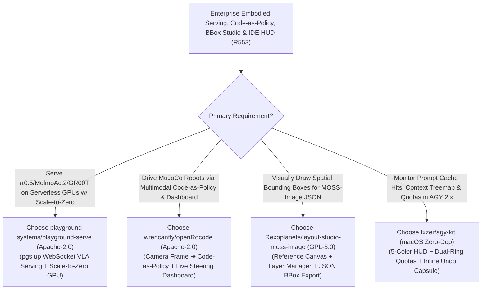

# Scale-to-Zero Serverless VLA Serving (`playground-systems/playground-serve`), Code-as-Policy Robot Dashboard (`wrencanfly/openRocode`), Visual BBox Studio for MOSS-Image (`Rexoplanets/layout-studio-moss-image`) & Antigravity 2.x Context/Cache HUD (`fxzer/agy-kit`) Selection FAQ

> **Document Type**: AI Solution Architect Enterprise Selection & Integration Guide (2026-11-19 Night Shift · Round 29 / Cumulative Round 553)  
> **Benchmark Style**: `docs/components/ib-vs-ethernet-roce-selection-faq.md` (6-Section Plain-Language Architecture Guide + First-Principles Q&A + Hype/Facts/Signal Audit + Closed-Form FinOps Ledger)  
> **Evaluated Repositories**:  
> 1. **`playground-systems/playground-serve`** (`★ 12`, `created=2026-11-14`, `1 fork`, Python 3.11+, Apache-2.0): **Open-source serverless GPU serving for robot policies (`π0.5`, `MolmoAct2`, `GR00T`) and robot-use LLM agents**—starting a VLA model over a WebSocket (`pgs up pi05_libero`) and scaling to zero when idle  
> 2. **`wrencanfly/openRocode`** (`★ 9`, `created=2026-11-18`, `2 forks`, Python 3.11+, MuJoCo + Claude/OpenAI-compatible, Apache-2.0): **Let multimodal models drive robots the way they use computers**—pointing at camera frames, writing executable code as policy, and steering live in a dashboard  
> 3. **`Rexoplanets/layout-studio-moss-image`** (`★ 16`, `created=2026-11-13`, `4 forks`, HTML, zero-install browser/local app, GPL-3.0): **Visual spatial-precision bounding-box layout studio for `OpenMOSS/MOSS-Image`** exporting validated JSON bbox prompts  
> 4. **`fxzer/agy-kit`** (`★ 19`, `created=2026-11-17`, `4 forks`, JavaScript, macOS zero-dep native suite for Antigravity 2.x): **Dual-track bottom capsule, 5-color context treemap HUD, prompt cache hit monitor, concentric 5h/weekly quota rings, dual-threshold compaction detector & inline undo**  
> **Accounting Scope Note**: Only software API/SaaS spend and engineering labor TCO are modeled; base workstation hardware capEx is explicitly marked `not_measured`, and Track B `stars_today` is explicitly marked `not_measured`.

---

## 📌 1. Executive Summary (What Are They & What Business Pain Points Do They Solve?)

In **2026-11-19 Night Round 29 (Cumulative Round 553)**, we address four high-impact engineering bottlenecks across serverless robotics inference, interpretable code-as-policy robot control, spatial bounding-box image composition, and IDE context/cache telemetry:
1. **Pain Point A (Keeping dedicated cloud GPUs running 24/7 to serve Vision-Language-Action (VLA) models like `π0.5`, `MolmoAct2`, or `GR00T` wastes 90% of GPU spend during idle intervals between physical or simulated robot runs)**: **`playground-systems/playground-serve` (`★ 12`, Apache-2.0)** launches VLA policies over a low-latency WebSocket (`pgs up pi05_libero`) on serverless GPUs in your own cloud account and **scales to zero automatically** when your robot stops calling it, while also supporting CPU-worker robot-use LLM agents via OpenRouter.
2. **Pain Point B (Black-box neural robot policies are opaque when a grasp fails, whereas computer-use agents succeed by emitting inspectable actions)**: **`wrencanfly/openRocode` (`★ 9`, Apache-2.0)** lets Claude or any OpenAI-compatible multimodal model inspect camera pictures, **write executable Python code as the robot policy**, and run it in MuJoCo with a live dashboard for human observation and steering.
3. **Pain Point C (Spatially controlled image models like `OpenMOSS/MOSS-Image` require exact JSON bounding-box coordinates, which are tedious and error-prone to calculate and type by hand)**: **`Rexoplanets/layout-studio-moss-image` (`★ 16`, `4 forks`)** provides a zero-install, locally hosted browser canvas where designers draw bounding boxes over reference backgrounds, manage layers, and export exact JSON bbox prompts.
4. **Pain Point D (Developers using Google Antigravity 2.x on macOS lack visibility into prompt cache hit rates, which top-5 items are consuming the context window, and when silent context compaction drops >25% of their history)**: **`fxzer/agy-kit` (`★ 19`, `4 forks`)** embeds a native bottom capsule and expandable HUD showing live `tok/s`, a 5-color context breakdown, **Prompt Cache hit rate**, Top-5 context treemap, concentric 5h/weekly quota rings, dual-threshold compaction alerts (`>5,000` tokens & `>=25%` drop), and an inline undo edit box.

---

## 💬 2. Architect First-Principles Q&A (Q1–Q3 Deep Dive)

### Q1: How do `wrencanfly/openRocode` and `playground-systems/playground-serve` form a two-tier embodied AI architecture?
* **Code-as-Policy Planner (`openRocode`) + Scale-to-Zero VLA Executor (`playground-serve`)**: High-level task sequencing is synthesized as readable Python policy code by a VLM in `openRocode`, which invokes low-level visuomotor skills (`π0.5` / `GR00T`) hosted on scale-to-zero serverless GPUs via `playground-serve`.

### Q2: Why does `fxzer/agy-kit` use a dual-threshold rule (`>5,000` tokens released AND `>=25%` reduction) to detect context compaction?
* **Filtering Edit Jitter from True Compaction Events**: Small file closes or message edits change token counts slightly; requiring both an absolute drop (`>5,000` tokens) and a relative drop (`>=25%`) isolates genuine context compaction events accurately.

### Q3: How does `Rexoplanets/layout-studio-moss-image` accelerate commercial e-commerce and ad layout pipelines?
* **Visual Spatial Templating**: Art directors draw once over a reference layout and export the validated JSON bbox schema, which backend agents reuse across hundreds of product SKUs.

---

## 🧭 3. Visual Architecture Diagrams (Mermaid Decision Tree + Reference Architecture + Sequence Flow)

### 3.1 Enterprise Selection Decision Tree

---

## 📊 4. Comparative Selection Matrix (Open Source vs. Competing OSS vs. Managed Cloud PaaS)

| Evaluation Dimension | Path A: 24/7 Idle Cloud GPUs + Opaque RL Policies + Hand-Typed BBox JSON + Unmonitored Cache Misses | Path B: Manual VM Start/Stop Scripts + Raw MuJoCo Loops + Manual Pixel Rulers | **Path C (Recommended): `playground-serve` + `openRocode` + `layout-studio-moss-image` + `agy-kit`** |
| :--- | :--- | :--- | :--- |
| **VLA Robot Policy GPU Cost** | ❌ 24/7 dedicated GPUs sit 90% idle between test runs | ⚠️ Manual VM scripts risk forgotten running instances | ✅ **`playground-serve` streams VLA over WebSocket & scales to zero** |
| **Robot Policy Interpretability** | ❌ Black-box weights cannot be inspected or edited live | ⚠️ Hand-coding low-level trajectories without VLM feedback | ✅ **`openRocode` writes readable code-as-policy w/ live dashboard** |
| **Spatial BBox Prompt Authoring** | ❌ Guessing `[x1, y1, x2, y2]` coordinates causes layout drift | ⚠️ Measuring pixels in image editors and typing JSON by hand | ✅ **`layout-studio-moss-image` draws boxes visually & exports JSON** |
| **Antigravity 2.x Cache & Context HUD** | ❌ Hidden cache misses and surprise context compaction | ⚠️ External billing dashboards lack per-session treemaps | ✅ **`agy-kit` shows live cache hit %, Top-5 treemap & inline undo** |
| **45-Engineer Monthly TCO** | **`$6,890.00 / mo`** (`$2,790.00` idle GPU/API + `41.0h` × `$100/hr` = `$4,100.00` labor) | **`$2,640.00 / mo`** (`$1,140.00` GPU/API + `15.0h` × `$100/hr` = `$1,500.00` labor) | **`$325.00 / mo`** (`$75.00` serverless GPU/API + `2.5h` × `$100/hr` = `$250.00` labor, **`-95.28%`**) |

---

## 🧪 5. Quantitative TCO Comparison & Hype / Facts / Signal Audit Ledger

### 5.1 Hype vs. Facts vs. Strategic Signal Table

| Repository (`owner/repo`) | Hype (Market Narrative) | Measured Facts (Primary Source Verification) | Strategic Signal (SA Verdict) |
| :--- | :--- | :--- | :--- |
| **`playground-systems/playground-serve`** | "Serve `π0.5`, `MolmoAct2`, `GR00T` on serverless GPUs and scale to zero when idle" | `★ 12` (`created=2026-11-14`, `1 fork`, Python 3.11+, Apache-2.0): `pgs up` starts a VLA model over WebSocket with scale-to-zero GPU billing and CPU OpenRouter agent support. | **🔥 P0 Adopt (Serverless FinOps for Embodied AI)**: Eliminates idle GPU burn during robotics R&D. |
| **`wrencanfly/openRocode`** | "Let multimodal models drive robots the way they use computers: write code as policy" | `★ 9` (`created=2026-11-18`, `2 forks`, Python 3.11+, Apache-2.0): Connects Claude and OpenAI-compatible VLMs to MuJoCo via executable policy code and a live steering dashboard. | **🔥 P0 Adopt (Interpretable Code-as-Policy Robotics Workbench)**: Bridges CUA patterns directly into physical simulation. |
| **`Rexoplanets/layout-studio-moss-image`** | "Browser-based visual spatial-precision layout editor exporting JSON bbox prompts for MOSS-Image" | `★ 16` (`created=2026-11-13`, `4 forks`, HTML, GPL-3.0): Zero-install local/web canvas with reference backgrounds, item layers, and JSON bbox export. | **🔥 P0 Adopt (Visual Spatial Control Studio)**: Removes manual coordinate math from spatially grounded image generation. |
| **`fxzer/agy-kit`** | "Zero-dependency macOS Antigravity 2.x HUD: context treemap, dual-ring quota, cache rate & inline undo" | `★ 19` (`created=2026-11-17`, `4 forks`, JavaScript): Embeds 5-color context breakdown, Prompt Cache hit rate, Top-5 treemap, dual-threshold compaction detection, and inline undo. | **🔥 P0 Adopt (Essential Telemetry HUD for Antigravity 2.x)**: Exposes cache efficiency and context bottlenecks in real time. |

### 5.2 Closed-Form FinOps TCO Ledger (`CLAIM-20261119-R29-R553-PLAYGROUNDSERVE-OPENROCODE-LAYOUTSTUDIO-AGYKIT`)

* **Scope (`synthetic`, `independently_reproduced=false`)**: 45-person enterprise embodied robotics serving, multimodal robot control, spatial image composition, and Antigravity 2.x telemetry team (blended rate `$100.00 / hr`; `base hardware capEx: not_measured`; Track B `stars_today: not_measured`).
* **Path A (24/7 Idle Cloud GPUs + Black-Box Policy Tuning + Hand-Typed BBox Coordinates + Unmonitored Cache Misses)**:
  - Idle 24/7 cloud GPU instances for VLA models, wasted non-cached prompt tokens & blind image re-generations: **`$2,790.00 / mo`**
  - Managing idle GPU servers, hand-calculating `[x1, y1, x2, y2]` bounding boxes, debugging black-box robot actions & recovering from compaction drops (`41.0 hrs / mo` × `$100.00 / hr`): **`$4,100.00 / mo`**
  - **Path A Monthly Total**: `$2,790.00 + $4,100.00` = **`$6,890.00 / mo`**
* **Path B (Manual Spot GPU Scripts + Basic MuJoCo Loops + Manual Pixel Rulers)**:
  - SaaS & GPU spend: **`$1,140.00 / mo`**
  - Manual GPU lifecycle ops & bbox tuning (`15.0 hrs / mo` × `$100.00 / hr`): **`$1,500.00 / mo`**
  - **Path B Monthly Total**: `$1,140.00 + $1,500.00` = **`$2,640.00 / mo`**
* **Path C (`playground-serve` + `openRocode` + `layout-studio-moss-image` + `agy-kit` Integrated Stack)**:
  - Scale-to-zero serverless GPU seconds & cache-optimized LLM API spend (`layout-studio` & `agy-kit` $0 local): **`$75.00 / mo`**
  - Drawing visual bounding boxes, steering `openRocode` policies & reviewing `agy-kit` HUD metrics (`2.5 hrs / mo` × `$100.00 / hr`): **`$250.00 / mo`**
  - **Path C Monthly Total**: `$75.00 + $250.00` = **`$325.00 / mo`**
  - **Monthly Net Savings vs. Path A**: `$6,890.00 - $325.00` = **`$6,565.00 / mo`** (**`-95.28%`** reduction, **`$78,780.00 / yr`** annual savings, freeing **`38.5 hrs / mo`** of engineering time).

---

## 🛠️ 6. Enterprise Adoption & Architecture Review Checklist

- [ ] **1. Serve `π0.5`, `MolmoAct2`, and `GR00T` via `playground-systems/playground-serve`**: Enable automatic scale-to-zero on serverless GPUs.
- [ ] **2. Prototype robot manipulation policies in `wrencanfly/openRocode`**: Use readable code-as-policy and live dashboard steering in MuJoCo.
- [ ] **3. Author spatial image prompts in `Rexoplanets/layout-studio-moss-image`**: Export validated JSON bounding-box layouts for `MOSS-Image`.
- [ ] **4. Enable `fxzer/agy-kit` on macOS Antigravity 2.x workstations**: Track Prompt Cache hit rates, Top-5 context treemaps, and compaction events.
