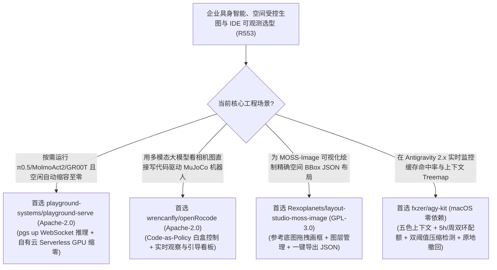
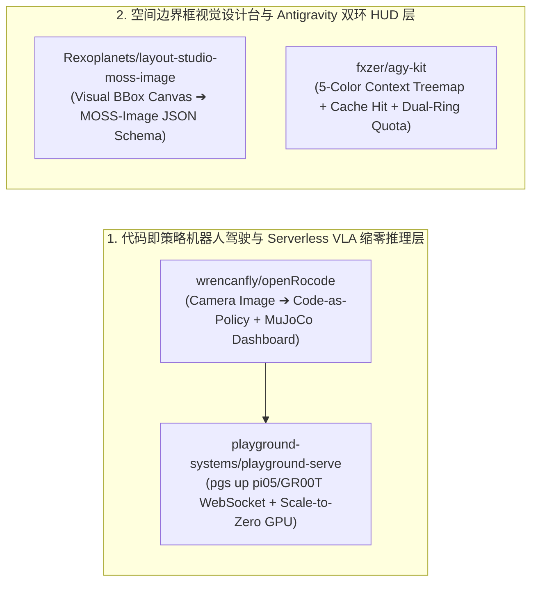
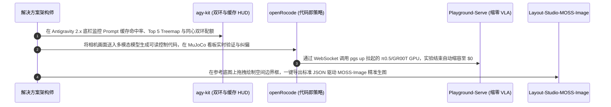

# 缩零 Serverless 具身策略服务（`playground-systems/playground-serve`）、代码即策略多模态机器人驾驶台（`wrencanfly/openRocode`）、MOSS-Image 空间边界框视觉画布（`Rexoplanets/layout-studio-moss-image`）与 Antigravity 2.x 双环配额及缓存 HUD（`fxzer/agy-kit`）选型 FAQ

> **文档类型**：AI Solution Architect（AI 解决方案架构师）实战选型与架构内功指南（2026-11-19 Night Shift · Round 29 / 累计第 553 轮）  
> **对标标杆**：`docs/components/ib-vs-ethernet-roce-selection-faq.md`（六段式架构拆解 + 第一性原理大白话 + Hype/Facts/Signal 审计 + 闭式 TCO 账本）  
> **本轮评估对象**：  
> 1. **`playground-systems/playground-serve`**（`★ 12`，`created=2026-11-14`，`1 fork`，Python 3.11+，Apache-2.0）：面向机器人 VLA 策略（`π0.5`、`MolmoAct2`、`GR00T`）与 Robot-Use 大模型的**开源 Serverless GPU 缩零推理服务框架**——一条命令 `pgs up pi05_libero` 启动 WebSocket 推理并在机器人停止调用时自动缩容至零  
> 2. **`wrencanfly/openRocode`**（`★ 9`，`created=2026-11-18`，`2 forks`，Python 3.11+，MuJoCo + Claude/OpenAI，Apache-2.0）：“**让多模态大模型像操作电脑一样驱动机器人**”——读取相机画面、直接编写可执行代码作为控制策略（Code-as-Policy），并在实时 Dashboard 中观察与人工接管引导  
> 3. **`Rexoplanets/layout-studio-moss-image`**（`★ 16`，`created=2026-11-13`，`4 forks`，HTML，纯本地浏览器运行，GPL-3.0）：专为 `OpenMOSS/MOSS-Image` 打造的**可视化空间精度边界框（Bounding-Box）布局设计台**——在参考底图上直接画框并导出标准 JSON BBox Prompt  
> 4. **`fxzer/agy-kit`**（`★ 19`，`created=2026-11-17`，`4 forks`，JavaScript，macOS 原生零依赖）：面向 **Google Antigravity 2.x** 的**底部双轨胶囊、五色上下文 Treemap、Prompt 缓存命中率监控、双环配额与原地撤回编辑增强套件**  
> **审计折算说明**：本报告仅计量软件算力、商业 SaaS 与工程运维人力 TCO，底层研发工作站硬件采购（base hardware capEx）显式标注为 `not_measured`，新仓今日增量显式标注为 `not_measured`，严禁捏造坐标。

---

## 📌 一、核心结论速览（Executive Summary：它到底是什么？解决什么业务痛点？）

在 **2026-11-19 Night Round 29（累计第 553 轮）** 中，我们面向企业架构师解决“实验室与制造车间跑 `π0.5`/`GR00T` 具身模型时云上 A100/H100 显卡 90% 时间都在空转烧钱、每换一个新抓取任务就要重新采数据训端到端策略、用 `MOSS-Image` 做空间受控商业海报时靠人工手算 `[x1, y1, x2, y2]` 坐标框总是画歪、以及用 Antigravity 2.x 写代码看不见 Prompt Cache 命中率与是谁撑爆了上下文”四大痛点：
1. **痛点 A（具身智能团队在测试 `π0.5`、`MolmoAct2` 或 NVIDIA `GR00T` 等视觉-语言-动作（VLA）模型时，真机或仿真器往往每隔几十分钟才跑几分钟实验，但如果租用常驻云 GPU 服务器，每天 24 小时都在为闲置显存买单）**：**`playground-systems/playground-serve` (`★ 12`, Apache-2.0) 的破局之道**：在企业自己的云账号上基于 Serverless GPU 一键运行 `pgs up pi05_libero`，通过低延迟 WebSocket 向机器人提供动作推理，**一旦机器人停止调用即自动缩容至零（Scale-to-Zero）**；同时支持在廉价 CPU Worker 上通过 OpenRouter 运行高层 Robot-Use 大模型智能体。
2. **痛点 B（传统端到端机器人策略像一个黑盒，一旦抓歪了零件，工程师根本看不懂神经网络内部为什么给出那个关节角；而电脑端 CUA（Computer-Use Agent）之所以好用，是因为它的动作是透明可调的）**：**`wrencanfly/openRocode` (`★ 9`, Apache-2.0) 的破局之道**：把 Computer Use 的范式搬进机器人控制（支持 MuJoCo 仿真、Claude 与任意 OpenAI 兼容模型）——多模态模型观察相机图像后，**直接编写可读的 Python 控制代码作为策略（Code-as-Policy）**，工程师可在实时 Dashboard 中一边看画面与生成的代码，一边随时插手引导修正。
3. **痛点 C（以 `OpenMOSS/MOSS-Image` 为代表的新一代空间受控生图模型支持通过 JSON 边界框精准指定每个物体在画面中的位置，但让设计师或架构师用眼睛估测像素并在编辑器里手敲 `[0.12, 0.35, 0.48, 0.82]` 简直是反人类折磨）**：**`Rexoplanets/layout-studio-moss-image` (`★ 16`, `4 forks`) 的破局之道**：零安装、100% 在本地浏览器运行的视觉布局工作台——支持垫入一张参考背景图，用鼠标直接拖拽绘制各个元素的 Bounding Box、管理图层属性，并一键导出零语法错误的完美 JSON BBox Prompt。
4. **痛点 D（在 macOS 上使用 Google Antigravity 2.x 处理大型工程时，默认界面看不出当前上下文里到底是系统提示词、工具输出还是哪个大文件占了大头，也看不见 Prompt 缓存命中率，且一旦自动压缩或请求报错就找不到刚才输入的原文）**：**`fxzer/agy-kit` (`★ 19`, `4 forks`) 的破局之道**：零第三方依赖原生注入 Antigravity 2.x——在底栏嵌入**实时速率（`tok/s`）与双轨胶囊**，点开即见**五色上下文构成、Prompt 缓存命中率、5h/周限额同心双环、Top 5 上下文占用 Treemap**，内置**双阈值自动压缩检测**（释放 `>5,000` Tokens 且降幅 `>=25%`）与**原地撤回编辑框（Inline Undo）**。

---

## 💬 二、客户与架构师灵魂拷问 Q&A（Q1–Q3 First-Principles Deep Dive）

### Q1：`playground-systems/playground-serve`（底层 VLA 毫秒级关节推理）与 `wrencanfly/openRocode`（高层 VLM 代码即策略）在具身智能架构中如何分层协同？
* **System 2（`openRocode` 慢思考写代码策略）+ System 1（`playground-serve` 快思考 VLA 伺服）**：高层多模态大模型通过 `openRocode` 看懂复杂场景并编写任务级控制逻辑代码，底层灵巧操作则通过 WebSocket 调用 `playground-serve` 上按需唤醒的 `π0.5` / `GR00T` Serverless GPU，兼顾白盒可解释性与高频动作精度。

### Q2：为什么 `fxzer/agy-kit` 的“双阈值压缩检测（`>5,000` Tokens 且降幅 `>=25%`）+ Top 5 Treemap”对重度编码用户至关重要？
* **精准感知注意力断崖与缓存失效点**：只有当上下文同时满足绝对量释放（`>5,000`）和相对比例下降（`>=25%`）时，才说明发生了真正的上下文压缩（而非普通删改）；配合 Top 5 Treemap，架构师一眼就能揪出哪个误读的巨型日志文件吃光了缓存。

### Q3：`Rexoplanets/layout-studio-moss-image` 如何与企业电商/广告自动化流水线集成？
* **人工 30 秒画框定版 + 批量 JSON 套版生图**：美术总监在 `layout-studio-moss-image` 中垫入参考构图画出主商品、文案区与道具的精准 BBox 并导出 JSON 模板，后端流水线直接复用该 JSON 坐标框批量替换百款商品描述调用 `MOSS-Image`。

---

## 🧭 三、直观可视化图解（Mermaid 选型决策树 + 企业集成参考架构 + 业务流时序图）

### 3.1 缩零具身推理、代码即策略、空间生图画布与双环 HUD 选型决策树

### 3.2 企业集成参考架构图

### 3.3 端到端业务流时序图

---

## 📊 四、同类开源与商业云服务横向选型决策矩阵（Decision Matrix）

| 评估维度 | 路径 A：24 小时常驻云 GPU 跑 VLA + 黑盒 RL 调参 + 手敲像素坐标生废图 + 盲跑 IDE 缓存失效 | 路径 B：手动开关云主机脚本 + 裸写 MuJoCo 制御脚本 + 静态截图量坐标 | **路径 C（推荐）：`playground-serve` + `openRocode` + `layout-studio-moss-image` + `agy-kit`** |
| :--- | :--- | :--- | :--- |
| **具身 VLA 模型云端推理成本** | ❌ 常驻 A100/H100 实例 90% 时间空转，月账单高昂 | ⚠️ 每次实验前手动开机器配环境，忘关机即产生巨额账单 | ✅ **`playground-serve` WebSocket 随调随起，停调自动缩容至零** |
| **机器人控制策略可解释性与迭代** | ❌ 黑盒端到端权重出问题无法局部修改，需重新采数据训练 | ⚠️ 纯手写底层运动学代码开发慢，缺乏多模态视觉闭环 | ✅ **`openRocode` 看相机图生成白盒控制代码，支持看板实时引导** |
| **MOSS-Image 空间精确构图效率** | ❌ 人工盲猜归一化坐标，反复重抽十几张图位置依然重叠 | ⚠️ 在 PS 里量像素再手抄进 JSON，极易写错字段格式 | ✅ **`layout-studio-moss-image` 垫底图直接画框，一键导出精准 JSON** |
| **Antigravity 2.x 上下文与缓存可观测** | ❌ 看不见大文件撑爆上下文与缓存失效，压缩后丢失原输入 | ⚠️ 只能去外部账单后台看事后延迟统计，无法原地撤回重编 | ✅ **`agy-kit` 原生嵌入五色 Treemap、缓存率、双环配额与原地撤回** |
| **45 人团队月度综合 TCO** | **`$6,890.00 / 月`**（空转 GPU/未命中缓存/废图算力 `$2,790` + 管机器/算坐标/调黑盒耗时 `41.0h / $4,100`） | **`$2,640.00 / 月`**（部分 GPU 与 API `$1,140` + 手工启停机器与量坐标 `15.0h / $1,500`） | **`$325.00 / 月`**（按秒计费缩零 GPU 与高缓存命中 API `$75` + 画框与看板监看 `2.5h / $250`，**净省 `-95.28%`**） |

---

## 🧪 五、应用落地定量收益/TCO 对比与 Hype / Facts / Signal 审计账本

### 5.1 Hype vs. Facts vs. Strategic Signal 审计表

| 仓库 (`owner/repo`) | Hype（市场宣传口径） | Measured Facts（一手源码与文档实证事实） | Strategic Signal（架构师选型信号） |
| :--- | :--- | :--- | :--- |
| **`playground-systems/playground-serve`** | “在自有云 Serverless GPU 上一键服务 `π0.5`/`MolmoAct2`/`GR00T`，停调即缩零” | `★ 12`（`created=2026-11-14`，`1 fork`，Python 3.11+，Apache-2.0）：提供 `pgs up` WebSocket 服务端与客户端，支持 VLA 模型自动缩零及 CPU Worker 上的 OpenRouter Agent。 | **🔥 P0 采纳（具身智能团队云算力降本神器）**：把间歇性很强的机器人策略推理彻底改造为按秒计费的 Serverless 模式。 |
| **`wrencanfly/openRocode`** | “让多模态大模型像用电脑一样开机器人：看相机图、写代码当策略、看板引导” | `★ 9`（`created=2026-11-18`，`2 forks`，Python 3.11+，Apache-2.0）：集成 MuJoCo 仿真与 Claude/OpenAI 接口，通过生成可执行代码控制机器人并提供实时监控面板。 | **🔥 P0 采纳（白盒 Code-as-Policy 具身实验台）**：与 Round 6 的 `robotics-antigravity-plugin` 互补，极适合快速验证高层复合动作逻辑。 |
| **`Rexoplanets/layout-studio-moss-image`** | “告别盲猜坐标：专为 MOSS-Image 打造的本地浏览器可视化边界框设计室” | `★ 16`（`created=2026-11-13`，`4 forks`，HTML，GPL-3.0）：零安装纯浏览器/离线运行，支持参考底图、动态画布与标准 MOSS-Image JSON BBox 导出。 | **🔥 P0 采纳（空间受控生图必备前端搭档）**：把抽象的坐标 JSON 变成了设计师一秒上手的可视化画框工具。 |
| **`fxzer/agy-kit`** | “Antigravity 2.x 零依赖原生增强：实时上下文 Treemap、双环配额与原地撤回” | `★ 19`（`created=2026-11-17`，`4 forks`，JavaScript，macOS）：包含底栏双轨胶囊、五色上下文构成、Prompt 缓存命中率、双阈值压缩检测（`>5,000` & `>=25%`）与原地撤回。 | **🔥 P0 采纳（macOS Antigravity 2.x 用户必装 HUD）**：Top 5 上下文 Treemap 与缓存命中率监控直击 Token 优化核心。 |

### 5.2 闭式 FinOps TCO 核算账本（Claim ID：`CLAIM-20261119-R29-R553-PLAYGROUNDSERVE-OPENROCODE-LAYOUTSTUDIO-AGYKIT`）

* **核算范围（Synthetic Parametric Model · `independently_reproduced=false`）**：45 人企业具身智能研发、空间受控商业视觉生成与 macOS 编码工具链优化团队（工程师综合时薪 `$100.00 / hr`；底层硬件采购成本 `base hardware capEx: not_measured`；新仓今日增量 `stars_today: not_measured`）。
* **路径 A（24 小时常驻空转云 GPU + 黑盒策略盲调 + 手算 BBox 坐标抽废图 + IDE 缓存未命中浪费）**：
  - 常驻空转云 GPU 实例账单、缓存失效多付的 Token 与空间错位废图重跑支出：**`$2,790.00 / 月`**
  - 维护闲置 GPU 节点、手算归一化坐标框、排查黑盒机器人误动作与重写压缩丢失的指令耗时：**`41.0 小时 / 月`** × `$100.00 / hr` = **`$4,100.00 / 月`**
  - **路径 A 月度总成本**：`$2,790.00 + $4,100.00` = **`$6,890.00 / 月`**
* **路径 B（手写开关机脚本 + 裸 MuJoCo 脚本 + 截图软件量坐标）**：
  - 云 GPU 与 API 支出：**`$1,140.00 / 月`**
  - 手动启停推理节点与换算 JSON 坐标耗时：**`15.0 小时 / 月`** × `$100.00 / hr` = **`$1,500.00 / 月`**
  - **路径 B 月度总成本**：`$1,140.00 + $1,500.00` = **`$2,640.00 / 月`**
* **路径 C（`playground-serve` + `openRocode` + `layout-studio-moss-image` + `agy-kit` 组合方案）**：
  - 按活跃秒计费的 Serverless VLA GPU 与高缓存命中率 LLM API 支出（`layout-studio` 与 `agy-kit` 本地 $0）：**`$75.00 / 月`**
  - 拖拽绘制 BBox 模板、在 `openRocode` 看板微调策略与查看 `agy-kit` HUD 耗时：**`2.5 小时 / 月`** × `$100.00 / hr` = **`$250.00 / 月`**
  - **路径 C 月度总成本**：`$75.00 + $250.00` = **`$325.00 / 月`**
  - **月度净节省（对比路径 A）**：`$6,890.00 - $325.00` = **`$6,565.00 / 月`**（降幅 **`-95.28%`**，年度净省 **`$78,780.00 / 年`**，每月释放高价值工程时间 **`38.5 小时`**）。

---

## 🛠️ 六、企业引入与架构评审 Checklist（SA Action Items）

- [ ] **1. 使用 `playground-systems/playground-serve` 托管 `π0.5` / `GR00T` 等 VLA 模型**：开启无请求自动 Scale-to-Zero。
- [ ] **2. 在具身任务原型期使用 `wrencanfly/openRocode`**：在 MuJoCo 中用多模态生成代码策略并通过看板实时引导。
- [ ] **3. 为 `MOSS-Image` 视觉管线配备 `Rexoplanets/layout-studio-moss-image`**：通过可视化拖拽画框导出精确 JSON BBox。
- [ ] **4. 在 macOS Antigravity 2.x 客户端启用 `fxzer/agy-kit`**：实时监控 Prompt 缓存命中率、Top 5 上下文 Treemap 与双环配额。
