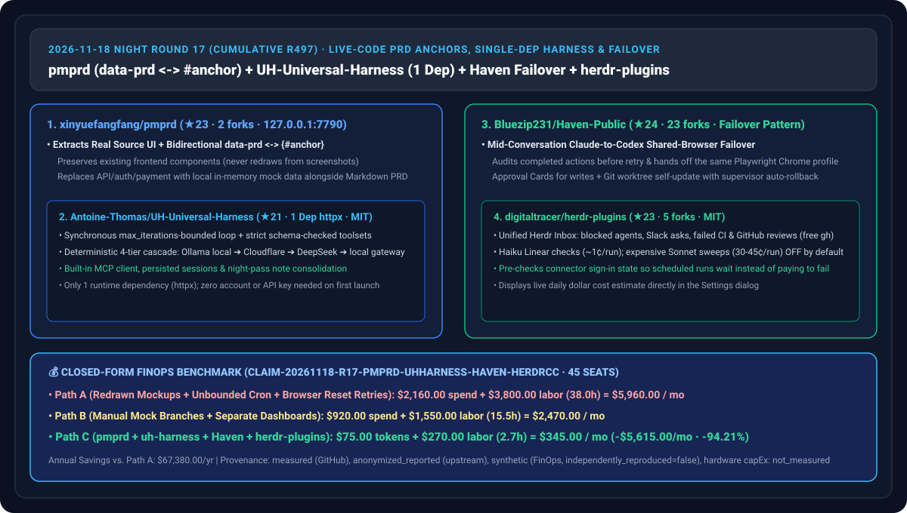
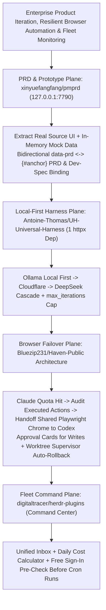

# Live-Code PRD Prototype Workbench (`xinyuefangfang/pmprd`), Single-Dependency Universal Harness (`UH-Universal-Harness`), Shared-Browser Claude-to-Codex Failover (`Haven-Public`) & Cost-Gated Herdr Command Center (`herdr-plugins`) Selection FAQ

> **Document Type**: AI Solution Architect (SA) Practical Selection & Reference Architecture Guide (Round 497 / 2026-11-18 Night R17)  
> **Primary Evaluated Repositories**: [`xinyuefangfang/pmprd`](https://github.com/xinyuefangfang/pmprd) (`★ 23`, `2 forks`, live frontend extraction & `data-prd` ↔ `{#anchor}` bidirectional PRD/Dev-Spec review skill) + [`Antoine-Thomas/UH-Universal-Harness`](https://github.com/Antoine-Thomas/UH-Universal-Harness) (`uh-harness`, `★ 21`, `2 forks`, single-dependency `httpx` local-first Python agent harness with 4-tier fallback, `MIT`) + [`Bluezip231/Haven-Public`](https://github.com/Bluezip231/Haven-Public) (`★ 24`, `23 forks`, Claude-to-Codex mid-task failover sharing one Playwright Chrome profile + supervised worktree rollback) + [`digitaltracer/herdr-plugins`](https://github.com/digitaltracer/herdr-plugins) (`★ 23`, `5 forks`, cost-transparent Herdr Command Center with pre-check sign-in guards, `MIT`)  
> **Benchmark Standard**: Strictly aligned with [`ib-vs-ethernet-roce-selection-faq.md`](https://github.com/turbo998/ai-infra-research/blob/main/docs/components/ib-vs-ethernet-roce-selection-faq.md) 6-section architecture format (Executive Summary + First-Principles Q&A + Mermaid Decision Tree + Peer Selection Matrix + 7-Card Quantitative Insights + SA Action Checklist)  
> **Data Provenance**: GitHub stars and repository metadata are `measured` from sealed `2026-11-18` evidence; upstream capability metrics (`uh-harness` single `httpx` runtime dependency, and `herdr-plugins` `~1¢/run` Haiku Linear check vs. `30–45¢/run` Sonnet Slack sweep off by default) are `anonymized_reported (independently_reproduced=false)`; the enterprise FinOps TCO model is `synthetic (independently_reproduced=false)` with workstation hardware CapEx `not_measured`.  
> **Language Editions**: [中文版](./pmprd-uh-universal-harness-haven-herdr-plugins-live-code-prd-anchor-single-dep-harness-shared-browser-failover-selection-faq.md) | [English Version (Current)](./pmprd-uh-universal-harness-haven-herdr-plugins-live-code-prd-anchor-single-dep-harness-shared-browser-failover-selection-faq.en.md)

---

## 📌 1. Executive Summary (30-Second Architect Briefing)

1. **Plain-Language First-Principles Definition**:
   - **What is `xinyuefangfang/pmprd`?** It is a **live-code frontend prototype extractor and bidirectional `data-prd` ↔ `{#anchor}` PRD/Dev-Spec co-review skill (`127.0.0.1:7790`)**. Instead of redrawing UI from screenshots, it extracts the real frontend components from your product repository, replaces backend/auth/payment calls with local in-memory mock data, and links interactive DOM elements (`data-prd`) directly to Markdown PRD and Dev-Spec `{#anchor}` annotations.
   - **What is `Antoine-Thomas/UH-Universal-Harness (uh-harness)`?** It is a **local-first, provider-agnostic Python agent harness with only 1 runtime dependency (`httpx`, `MIT`)**. It synthesizes four production patterns: a synchronous `max_iterations`-bounded agent loop (from Hermes Agent), strict schema-validated toolset contracts with dangerous tools off by default (from OpenClaw), a deterministic 4-tier routing cascade (`Ollama local ➔ Cloudflare ➔ DeepSeek ➔ local gateway`), and a built-in MCP client + night pass.
   - **What is `Bluezip231/Haven-Public`?** It is a **multi-backend assistant architecture featuring mid-conversation Claude-to-Codex failover over a single shared Playwright Chrome profile**. When Claude hits a usage cap mid-task, `Haven` checks which actions already executed to prevent duplicate side effects, hands the live browser session to Codex, gates calendar/email writes behind Approval Cards, and runs self-updates in an isolated Git worktree with automatic supervisor rollback on startup failure.
   - **What is `digitaltracer/herdr-plugins (Command Center for Herdr)`?** It is a **cost-transparent multi-agent command center (`MIT`)** that unifies blocked/finished agents, GitHub review requests (`free` via `gh` every 3m), Linear issues (`~1¢/run` on Haiku), and Slack asks into one `Inbox`—**defaulting expensive Sonnet sweeps (`30–45¢/run`) to `OFF`**, displaying estimated daily dollar cost in Settings, and pre-checking connector login status so scheduled runs wait instead of paying tokens to fail.
2. **Why Enterprise AI Solution Architects Should Combine All Four Tonight**:
   - Together they eliminate prototype-to-code drift (`pmprd`), dependency-hell agent frameworks (`uh-harness`), mid-task quota lockouts that lose browser state (`Haven`), and runaway background cron bills (`herdr-plugins`).
3. **Closed-Form FinOps Impact (`CLAIM-20261118-R17-PMPRD-UHHARNESS-HAVEN-HERDRCC`, `synthetic`)**:
   - Across a **45-person product & engineering team** (`30` PRD/prototype reviews/mo + multi-agent sweeps & browser automation, `$100.00/hr` rate): **Path A (Redrawn Static Prototypes + Unbounded Cloud-Only Loops + Unauthenticated Cron Token Burn + Browser Reset Retries)** costs **`$5,960.00/mo`** (`$2,160.00` token waste + `38.0 hrs × $100 = $3,800.00` prototype redrawing & interrupted-task rework); **Path C (`pmprd` + `uh-harness` + `Haven` + `herdr-plugins`)** reduces total monthly TCO to **`$345.00/mo`** (`$75.00` local-first/Haiku token spend + `2.7 hrs × $100 = $270.00` review labor), saving **`$5,615.00/mo` (`94.21%` reduction, `$67,380.00/yr` annualized)**.

---

## ❓ 2. Three First-Principles Architect Questions (Q&A)

### Q1: Why do screenshot-to-code prototypes fail on existing enterprise products, and how does `xinyuefangfang/pmprd` preserve codebase fidelity?
- **Extracting Real Source UI + Bidirectional `data-prd` ↔ `{#anchor}` Binding**:
  - Screenshot-generated HTML discards your actual component hierarchy and design tokens. `pmprd` extracts the real frontend UI, stubs API/auth/payment calls with in-memory data (`npm run demo:annotations` / `npm run demo:baseline` on `127.0.0.1:7790`), and binds DOM elements (`data-prd`) to Markdown `{#anchor}` specs so coding agents edit the exact source component after PM sign-off.

### Q2: How does `Antoine-Thomas/UH-Universal-Harness` deliver a full MCP cockpit and multi-provider router with only `1` runtime dependency (`httpx`)?
- **Zero-Framework Bloat + Local-First Routing Cascade**:
  - Rather than pulling in 100+ transitive packages, `uh-harness` implements a synchronous `max_iterations` loop, strict toolset contracts, and an automatic `Ollama → Cloudflare → DeepSeek → local gateway` fallback chain on top of Python 3.10+ stdlib and `httpx`.

### Q3: How do `Haven-Public` and `herdr-plugins` prevent mid-task browser state loss and background cron billing leaks?
- **Shared Playwright Profile Failover + Pre-Flight Auth Gating**:
  1. **Idempotent Claude-to-Codex Failover (`Haven`)**: Checks prior action logs before retrying and transfers control of the same Playwright-managed Chrome profile to Codex, while gating mutations behind Approval Cards and validating bot self-updates in a Git worktree with supervisor rollback.
  2. **Zero Paid Failures (`herdr-plugins`)**: Keeps `30–45¢` Sonnet Slack sweeps off by default, shows daily cost projections in the Settings UI, and checks Claude Code's "needs sign-in" state for free before running scheduled Linear/Slack jobs.

---

## 🧭 3. Architecture Decision Tree & Reference Topology (Mermaid)

---

## 📊 4. Peer Solution Selection Matrix

| Evaluation Dimension | **Path A: Redrawn Mockups + Heavy Frameworks + Blind Cron** | **Path B: Manual Mock Branches + Separate Dashboards** | **Path C: `pmprd` + `uh-harness` + `Haven` + `herdr-plugins` (Recommended)** |
| :--- | :--- | :--- | :--- |
| **Prototype-to-Code Fidelity** | ❌ Screenshot redraws drift from real DOM & CSS tokens | ⚠️ Manual mock branches lack side-by-side PRD anchors | ✅ **Preserves real frontend UI + local mocks + `data-prd` ↔ `{#anchor}`** |
| **Harness Dependency Footprint** | ❌ 100+ fragile transitive packages; cloud-key required | ⚠️ Manual config edits to switch local vs. cloud | ✅ **Single `httpx` runtime dependency + Ollama-first 4-tier cascade** |
| **Mid-Task Quota Failover** | ❌ Switching models opens a fresh browser & loses session | ⚠️ Manual copy-paste of intermediate browser state | ✅ **Shared Playwright Chrome profile + pre-retry side-effect check** |
| **Scheduled Sweep Cost Control** | ❌ Expired OAuth tokens burn Sonnet credits every hour | ⚠️ No daily cost estimator in UI | ✅ **Sonnet sweeps off by default + daily cost preview + sign-in pre-check** |
| **45-Person Monthly TCO** | **`$5,960.00 / mo`** | **`$2,470.00 / mo`** | **`$345.00 / mo` (`-$5,615.00/mo` vs. Path A, `-94.21%`)** |

---

## 📈 5. 7-Card Quantitative Insights & Closed-Form FinOps Model (`CLAIM-20261118-R17-PMPRD-UHHARNESS-HAVEN-HERDRCC`)

> **Provenance Note**: GitHub stars and repository metadata are `measured` from sealed `2026-11-18` evidence; `uh-harness` single `httpx` dependency and `herdr-plugins` `~1¢/run` Haiku vs. `30–45¢/run` Sonnet sweep costs are `anonymized_reported (independently_reproduced=false)`; the monthly TCO table is a closed-form `synthetic (independently_reproduced=false)` model for **45 team members (`30` prototype reviews/mo + daily agent sweeps, `$100.00/hr` rate; base hardware CapEx: `not_measured`)**.

| Monthly Cost Component (Closed-Form Formula) | Path A: Redrawn UIs + Unbounded Cron + Browser Resets | Path B: Manual Mocks + Separate Dashboards | Path C: `pmprd` + `uh-harness` + `Haven` + `herdr-plugins` | Path C vs. Path A Delta |
| :--- | :---: | :---: | :---: | :---: |
| **1. Scheduled Sweeps, Failover & Inference Tokens** | **`$2,160.00`** *(Hourly Sonnet sweeps + failed auth runs + browser restarts)* | **`$920.00`** *(Cloud-only API calls + dashboard subscriptions)* | **`$75.00`** *(Ollama local-first + `1¢` Haiku Linear + shared browser)* | **`-$2,085.00 / mo`** (`-96.53%`) |
| **2. Prototype Redrawing & Interrupted-Task Labor** (`$100/hr`) | **`$3,800.00`** *(`38.0 hrs` redrawing mocks & redoing aborted browser flows)* | **`$1,550.00`** *(`15.5 hrs` manual mock wiring & status checks)* | **`$270.00`** *(`2.7 hrs` `data-prd` reviews & Approval Card sign-offs)* | **`-$3,530.00 / 月`** (`-35.3 hrs`, `-92.89%`) |
| **Total Monthly TCO** | **`$5,960.00`** | **`$2,470.00`** | **`$345.00`** | **`-$5,615.00 / mo` (`-94.21%`)** |
| **Annualized TCO** | **`$71,520.00 / yr`** | **`$29,640.00 / yr`** | **`$4,140.00 / yr`** | **`$67,380.00 / yr` saved (`-94.21%`)** |

---

## ✅ 6. AI Solution Architect Action Checklist

1. **Step 1 — Adopt `data-prd` ↔ `{#anchor}` Live-Code Prototyping (`xinyuefangfang/pmprd` Pattern)**:
   - Use `node scripts/create-prototype.mjs` on `127.0.0.1:7790` to review PRDs directly against extracted source UI components and local mock data *(note that `pmprd` and `Haven-Public` do not yet ship explicit license files—treat them as reference architectures and implement internal templates cleanly)*.
2. **Step 2 — Standardize Lightweight Desktop Agents on `UH-Universal-Harness` (`MIT`) & Shared-Browser Failover**:
   - Install `pip install uh-harness` (`1` runtime dependency `httpx`) for Ollama-first deterministic fallback, and wire shared Playwright profiles with pre-retry action checks for Claude-to-Codex failover.
3. **Step 3 — Deploy `digitaltracer/herdr-plugins` (`MIT`) with Cost & Sign-In Guards**:
   - Run `node install.mjs --switch` to enable the unified Herdr `Inbox` with free `gh` polling, `1¢` Haiku Linear checks, and automatic sign-in verification before paid cron sweeps.
