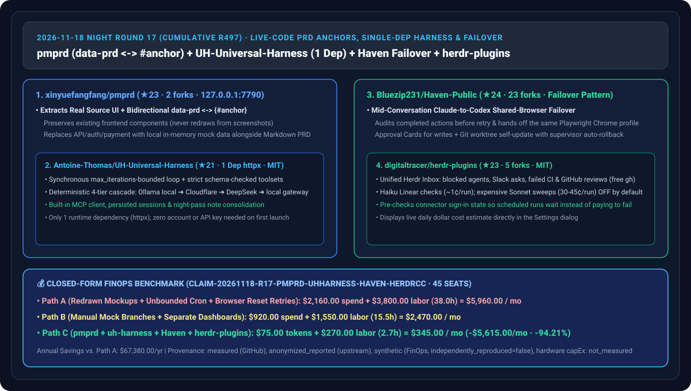
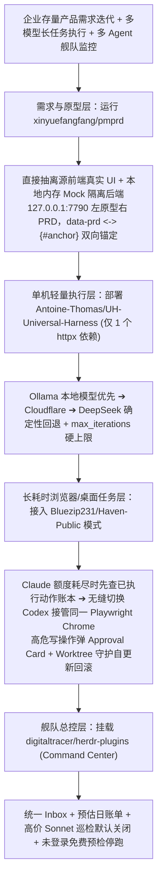

# 存量前端抽离可运行 PRD 批注台（`xinyuefangfang/pmprd`）、单依赖本地优先通用 Harness（`UH-Universal-Harness`）、共享浏览器跨模型无损故障切换（`Haven-Public`）与成本透明多智能体指挥舱（`herdr-plugins`）选型 FAQ

> **文档类型**：AI Solution Architect (SA) 实战选型与参考架构指南（Round 497 / 2026-11-18 Night R17）  
> **核心评估对象**：[`xinyuefangfang/pmprd`](https://github.com/xinyuefangfang/pmprd)（`★ 23`，`2 forks`，从真实产品前端抽离本地假数据可运行原型并双向锚定 `data-prd` ↔ `{#anchor}` 的需求评审技能） + [`Antoine-Thomas/UH-Universal-Harness`](https://github.com/Antoine-Thomas/UH-Universal-Harness)（`uh-harness`，`★ 21`，`2 forks`，仅 1 个 `httpx` 运行时依赖、本地 Ollama 优先四级回退的通用桌面 Harness，`MIT`） + [`Bluezip231/Haven-Public`](https://github.com/Bluezip231/Haven-Public)（`★ 24`，`23 forks`，共享 Playwright 浏览器会话的 Claude-to-Codex 热切换与 Worktree 守护自更新助手） + [`digitaltracer/herdr-plugins`](https://github.com/digitaltracer/herdr-plugins)（`★ 23`，`5 forks`，预估日账单且未登录自动停跑防白扣费的 Herdr 多智能体总控插件，`MIT`）  
> **对标范式**：严格遵循 [`ib-vs-ethernet-roce-selection-faq.md`](https://github.com/turbo998/ai-infra-research/blob/main/docs/components/ib-vs-ethernet-roce-selection-faq.md) 六段式结构（核心结论速览 + 三大灵魂拷问 + Mermaid 决策树 + 选型对比矩阵 + 7-Card 定量洞察 + SA 落地 Checklist）  
> **数据溯源分级（Provenance）**：GitHub 星标与目录元数据为 `measured`；上游特性参数（如 `uh-harness` 仅 `1` 个 `httpx` 运行时依赖、`herdr-plugins` Linear 巡检 `~1¢/次` vs Slack 巡检 `30–45¢/次` 默认关闭）标注为 `anonymized_reported (independently_reproduced=false)`；企业 FinOps 成本算例为 `synthetic (independently_reproduced=false)`，硬件折旧 `not_measured`。  
> **语言版本**：[中文版 (当前)](./pmprd-uh-universal-harness-haven-herdr-plugins-live-code-prd-anchor-single-dep-harness-shared-browser-failover-selection-faq.md) | [English Version](./pmprd-uh-universal-harness-haven-herdr-plugins-live-code-prd-anchor-single-dep-harness-shared-browser-failover-selection-faq.en.md)

---

## 📌 一、核心结论速览（Executive Summary — 30 秒看懂）

1. **大白话本质定义**：
   - **`xinyuefangfang/pmprd` 是什么？** 它是 **终结“产品经理用画图工具重画一套跟线上代码完全脱节的高保真原型”的存量代码抽离与双向锚定 PRD 技能**。它直接把产品现有的前端仓库与本技能一起喂给 AI，自动剥离真实后端/登录/支付并替换为本地内存假数据，在 `127.0.0.1:7790` 启动**左侧真实可交互原版 UI + 右侧 Markdown PRD/研发规格书**的双栏工作台，并通过 DOM 上的 `data-prd` 属性与文档里的 `{#anchor}` 实现精准双向定位批注。
   - **`Antoine-Thomas/UH-Universal-Harness (uh-harness)` 是什么？** 它是 **整个运行时只有 `1` 个第三方依赖（`httpx`）、集齐 Hermes 同步受控循环（硬 `max_iterations` 上限）+ OpenClaw 强契约工具集（高危工具默认关闭）+ UHB 四级确定性回退路由（`本地 Ollama ➔ Cloudflare ➔ DeepSeek ➔ 本地网关`）+ 原生 MCP 客户端与夜间复盘通道（Night Pass）的极简 Python 智能体底座**。
   - **`Bluezip231/Haven-Public` 是什么？** 它是 **解决“Claude 干活干到一半触发额度限制（Rate Limit），切换给 Codex 时浏览器登录态全丢、还会把刚才已经执行过的副作用重复跑一遍”的双后端热接力与自愈工作台**。它让 Claude 与 Codex 共享同一个 Playwright Chrome 配置文件，切换时先核查哪些动作已执行完毕再续跑，高危写操作（发邮件/改日历）强制弹审批卡，且支持在独立 Git Worktree 中测试自身升级并在启动超时后由 Supervisor 自动回滚。
   - **`digitaltracer/herdr-plugins (Command Center for Herdr)` 是什么？** 它是 **面向多 Agent 并发调度的“防破产总控面板”**。它把阻塞待审的 Agent、免费 `gh` 轮询的 GitHub Review、Linear 任务（Haiku 约 `1¢/次`）和 Slack 请求收拢进统一 `Inbox`；最关键的是：**高成本定时任务（Sonnet 跑 Slack `30–45¢/次`、晚间站会草稿 `~25¢/次`）新装默认全部关闭，设置面板实时预估每日美元账单，且在检测到连接器未登录时自动挂起等待、绝不花钱跑失败请求**！
2. **为什么企业 AI 解决方案架构师（SA）今晚要把这四款工具组合进“产研全流程防失真与防失控体系”？**
   - **`pmprd` 让需求评审直接长在真实前端代码上 ➔ `uh-harness` 用单依赖 `httpx` + 本地模型优先路由兜底日常推理 ➔ `Haven` 保证主力模型限流时共享浏览器无感切换 Codex ➔ `herdr-plugins` 统一监控多 Agent 状态并锁死定时巡检账单**！
3. **闭式 FinOps 量化收益（`CLAIM-20261118-R17-PMPRD-UHHARNESS-HAVEN-HERDRCC`，`synthetic`）**：
   - 以 **45 人企业产研协同与多 Agent 运营团队**（月均 30 次需求原型评审 + 多 Agent 定时巡检与浏览器自动化，时薪 `$100.00/hr`）计：**Path A（手绘失真原型 + 纯云端高价模型裸跑 + 未登录定时任务空转扣费 + 限流中断重跑）** 月均总成本 **`$5,960.00`**（空转巡检与中断重试 Token `$2,160.00` + 重画原型与重跑中断任务人工 `38.0h × $100 = $3,800.00`）；**Path C（`pmprd` + `uh-harness` + `Haven` + `herdr-plugins`）** 月均总成本降至 **`$345.00`**（本地优先与 `1¢` Haiku 巡检 Token `$75.00` + 评审人工 `2.7h × $100 = $270.00`），**净省 `$5,615.00/月`（降幅 `94.21%`，年化节省 `$67,380.00`）**。

---

## ❓ 二、三大灵魂拷问（First-Principles Q&A）

### Q1：为什么用截图转代码（Screenshot-to-Code）做产品原型在存量迭代中完全不可用？`xinyuefangfang/pmprd` 的“抽离真实前端 + `data-prd` 双向锚点”好在哪？
- **第一性原理：存量迭代改的是现有组件树，按截图重画出来的代码跟原工程 DOM 与样式体系 100% 割裂**：
  - `pmprd` 明确铁律：**“保留源前端 UI，绝不按截图重新绘制”**。它直接从真实业务仓库抽离页面与交互，把 API、登录、支付全部替换为纯本地内存假数据（零生产污染、零品牌/凭据泄露），并在左侧真实组件上打上 `data-prd` 属性与右侧 Markdown 文档的 `{#anchor}` 联动——产品经理在右侧改完批注，Coding Agent 直接顺着 `data-prd` 锚点就能定位到原仓库的精确组件文件完成开发！

### Q2：为什么很多开源 Agent 框架装完 `pip list` 出来 150 个包、过两个月就依赖冲突跑不起来？`UH-Universal-Harness` 是怎么只用 `1` 个 `httpx` 实现完整生态的？
- **减法工程哲学（One Runtime Dependency: `httpx`）**：
  - `uh-harness` 摒弃了臃肿的 LangChain/LlamaIndex 依赖树，仅靠标准库 + `httpx` 就实现了：① 带硬 `max_iterations` 预算的同步工具循环；② 拒绝未知参数、默认关闭危险工具的严格 Schema 契约；③ **本地优先确定性路由（优先自动发现本机 Ollama 模型，再依次回退 Cloudflare / DeepSeek / 本地网关）**，保证在断网或无云端 Key 时依然开箱即用。

### Q3：`Haven-Public` 的“跨模型共享浏览器切换”与 `herdr-plugins` 的“未登录预检停跑”分别堵住了哪两个生产级工程漏洞？
- **堵住“带副作用任务重试翻车”与“鉴权过期定时任务烧钱”**：
  1. **Haven 的幂等故障切换 + Worktree 守护升级**：当 Claude 跑到第 4 步触发额度上限切向 Codex 时，如果让 Codex 从头重跑就会把第 2 步点过的提交按钮再点一次；如果新开浏览器又会丢失已登录 Cookie。`Haven` 在切换前先核对已执行动作账本，并把同一个 Playwright Chrome Profile 直接移交给 Codex 接着点；而自更新代码先在独立 Git Worktree 编译测试，由外部 Supervisor 确认连上 Discord 后才切流，超时即刻自动回滚。
  2. **Herdr Command Center 的“零付费失败（Zero Paid Failures）”**：许多团队配了每小时跑一次的云端 Agent 巡检，结果 Slack/Linear OAuth Token 过期后，Agent 每小时依然拉起 Sonnet 模型对着报错重试，月底白烧上百美元。`herdr-plugins` 先用免费检查确认连接器登录态——**一旦未登录直接挂起定时任务并提示重连，绝不花一分钱 Token 去跑注定失败的巡检**。

---

## 🧭 三、架构师选型决策树与端到端参考架构（Mermaid）

---

## 📊 四、同类方案横向选型对比矩阵（Peer Selection Matrix）

| 评估维度 | **Path A：截图重画原型 + 150 包重框架 + 盲目重试/巡检** | **Path B：手工搭 Mock 分支 + 独立监控面板** | **Path C：`pmprd` + `uh-harness` + `Haven` + `herdr-plugins`（推荐）** |
| :--- | :--- | :--- | :--- |
| **存量前端原型与代码一致性** | ❌ 按截图重画，DOM 结构与原工程完全脱节 | ⚠️ 手工注释后端接口耗时且无右侧 PRD 锚点联动 | ✅ **100% 保留源前端 UI + 本地假数据隔离 + `data-prd` 双向锚定** |
| **Agent 底座依赖体积与本地优先** | ❌ 动辄百余个传递依赖，无云端 API Key 即报错退出 | ⚠️ 需手动改配置文件切换本地/云端模型 | ✅ **仅 `1` 个 `httpx` 运行时依赖 + Ollama 本地优先四级确定性回退** |
| **主力模型限流时的浏览器任务接力** | ❌ 换模型即重开无痕浏览器，丢失登录态或重复提交表单 | ⚠️ 人工介入手动复制进度 | ✅ **核对已执行动作 + Claude 与 Codex 无缝接力同一 Playwright Profile** |
| **多 Agent 定时巡检成本护栏** | ❌ OAuth 过期后定时任务仍每小时拉起大模型烧钱报错 | ⚠️ 无实时日成本预估面板 | ✅ **高价 Sonnet 巡检默认关闭 + 日账单预估 + 未登录免费预检停跑** |
| **45 人团队月均总拥有成本 (TCO)** | **`$5,960.00 / 月`** | **`$2,470.00 / 月`** | **`$345.00 / 月`（较 Path A 净省 `$5,615.00/月`，`-94.21%`）** |

---

## 📈 五、7-Card 定量洞察与闭式 FinOps 算例（`CLAIM-20261118-R17-PMPRD-UHHARNESS-HAVEN-HERDRCC`）

> **Provenance 声明**：GitHub 星标与目录元数据源自 `2026-11-18` 封存证据（`measured`）；`uh-harness` 单 `httpx` 依赖与 `herdr-plugins` `~1¢/次` Haiku vs `30–45¢/次` Sonnet 巡检定价源自上游文档（`anonymized_reported`, `independently_reproduced=false`）；月度 TCO 为面向 **45 人产研团队（月均 30 次原型评审与日常多 Agent 巡检）** 的闭式合成模型（`synthetic`, `independently_reproduced=false`；宿主机硬件折旧 CapEx：`not_measured`）。

| 成本构成项（月度闭式公式） | Path A：重画原型 + 盲目巡检扣费 + 限流重跑 | Path B：手工搭 Mock + 独立看板订阅 | Path C：`pmprd` + `uh-harness` + `Haven` + `herdr-plugins` | Path C 对比 Path A 净变化 |
| :--- | :---: | :---: | :---: | :---: |
| **1. 定时巡检、故障切换与日常推理 Token** | **`$2,160.00`** *(Sonnet 全天盲扫 + 未登录空转 + 限流从头重跑)* | **`$920.00`** *(纯云端 API 调用 + 看板工具费)* | **`$75.00`** *(Ollama 本地优先 + `1¢` Haiku 巡检 + 无损切换)* | **`-$2,085.00 / 月`** (`-96.53%`) |
| **2. 重画高保真原型与中断任务返工人工** (`$100/hr`) | **`$3,800.00`** *(`38.0 hrs`：手工重画原型与排查重复提交事故)* | **`$1,550.00`** *(`15.5 hrs`：手工剥离后端接口与对齐 PRD)* | **`$270.00`** *(`2.7 hrs`：一键抽离原型与 Approval Card 审批)* | **`-$3,530.00 / 月`** (`-35.3 hrs`, `-92.89%`) |
| **月度总拥有成本 (Monthly Total TCO)** | **`$5,960.00`** | **`$2,470.00`** | **`$345.00`** | **`-$5,615.00 / 月` (`-94.21%`)** |
| **年化总拥有成本 (Annualized TCO)** | **`$71,520.00 / 年`** | **`$29,640.00 / 年`** | **`$4,140.00 / 年`** | **年省 `$67,380.00` (`-94.21%`)** |

---

## ✅ 六、AI 解决方案架构师（SA）实战落地 Checklist

1. **Step 1 — 用 `xinyuefangfang/pmprd` 将存量前端仓库转化为双向锚定 PRD 原型**：
   - 运行 `node scripts/create-prototype.mjs ./my-prototype` 并在 `127.0.0.1:7790` 启动评审壳（注意该仓暂未声明开源协议文件，建议参考其 `data-prd` ↔ `{#anchor}` 双栏协议在企业内部模板中实现）。
2. **Step 2 — 部署 `uh-harness` 极简单依赖底座与 `Haven` 共享浏览器故障切换模式**：
   - 执行 `pip install uh-harness` 启用 `Ollama → Cloudflare → DeepSeek` 本地优先回退；在浏览器自动化流水线中实现 `Haven` 的“先核查已执行动作、再将同一 Playwright Chrome Profile 移交备用模型”机制。
3. **Step 3 — 挂载 `digitaltracer/herdr-plugins` 锁死多 Agent 定时巡检预算**：
   - 运行 `node install.mjs --switch` 启用统一 `Inbox`，保持高价 Sonnet 定时任务默认关闭，仅开启免费 `gh`（每 3 分钟）与 `1¢` Haiku Linear 同步，并依赖未登录免费预检杜绝空转账单。
