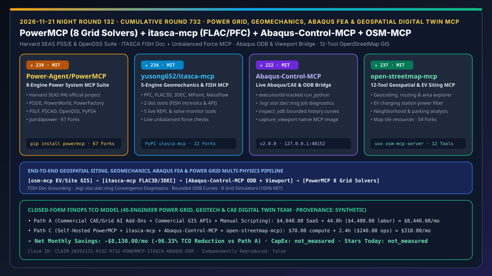
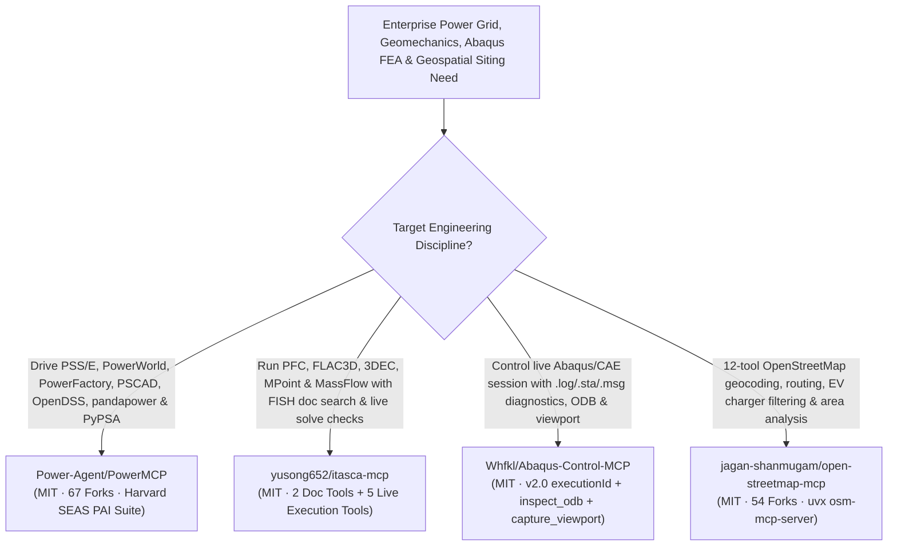
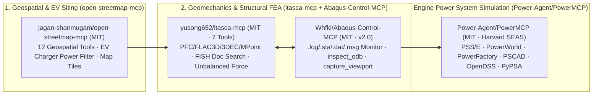
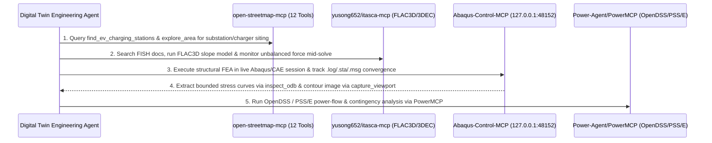

# 8-Engine Power Grid Simulation MCP (`Power-Agent/PowerMCP`), ITASCA Geomechanics & FISH MCP (`yusong652/itasca-mcp`), Abaqus/CAE Live ODB & Viewport Bridge (`Whfkl/Abaqus-Control-MCP`) & 12-Tool OpenStreetMap Geospatial MCP (`jagan-shanmugam/open-streetmap-mcp`) Selection & Architecture FAQ

> **Document Type**: Enterprise AI Solution Architect Selection & Integration Guide (GitHub Trending AI Radar — 2026-11-21 Night Round 132 / Cumulative Round 732)
> **Covered Repositories**: [`Power-Agent/PowerMCP`](https://github.com/Power-Agent/PowerMCP) (`★ 239`, `67 forks`, `MIT` — Harvard SEAS Power and AI Initiative's collection of MCP servers for **PSS/E, PowerWorld, PowerFactory, PSLF, PSCAD, OpenDSS, pandapower & PyPSA**) · [`yusong652/itasca-mcp`](https://github.com/yusong652/itasca-mcp) (`★ 234`, `22 forks`, `MIT` — 7-tool MCP server connecting AI agents to ITASCA geomechanics engines **PFC, FLAC, 3DEC, MPoint & MassFlow** with 2 doc/FISH lookup tools & 5 live execution/unbalanced-force monitoring tools) · [`Whfkl/Abaqus-Control-MCP`](https://github.com/Whfkl/Abaqus-Control-MCP) (`★ 222`, `22 forks`, `MIT` — `v2.0.0` local socket bridge for Abaqus/CAE with `executionId` tracking, `.log/.sta/.dat/.msg` solver diagnostics, `inspect_odb` & `capture_viewport`) · [`jagan-shanmugam/open-streetmap-mcp`](https://github.com/jagan-shanmugam/open-streetmap-mcp) (`★ 237`, `54 forks`, `MIT` — 12-tool OpenStreetMap MCP server for geocoding, routing, EV charging station power filtering & neighborhood site analysis)
> **Core Scenario**: How energy grid planners, civil/geotechnical engineers, and CAE finite-element analysis (FEA) teams build an **Industrial Digital Twin & Multi-Physics Engineering Simulation** stack: **screening infrastructure sites and EV charging corridors (`open-streetmap-mcp`)**, **running slope/tunnel geomechanics simulations with live unbalanced-force tracking (`itasca-mcp`)**, **controlling live Abaqus/CAE sessions with `.log/.sta/.dat/.msg` diagnostics, ODB curve extraction, and viewport contour capture (`Abaqus-Control-MCP`)**, and **coordinating transmission/distribution power-flow simulations across 8 grid solvers (`PowerMCP`)**.

---

## 1. 📌 Executive Summary (One-Line Selection Verdict)

1. **Need a unified collection of MCP servers (`pip install powermcp && powermcp install`, maintained by Harvard SEAS PAI) to drive PSS/E, PowerWorld, PowerFactory, PSLF, PSCAD, OpenDSS, pandapower, and PyPSA from natural language** ➔ Choose **[`Power-Agent/PowerMCP`](https://github.com/Power-Agent/PowerMCP) (`★ 239`, `67 forks`, `MIT`)**.
   - **Plain-English Mechanism**: Standardizes AI agent access across 8 commercial and open-source transmission, distribution, and electromagnetic transient (EMT) power-system simulators for automated power-flow, contingency, and grid-interconnection studies.
2. **Need to connect AI agents to ITASCA's geotechnical & geomechanics engines (`PFC`, `FLAC/FLAC3D`, `3DEC`, `MPoint`, `MassFlow`) with built-in FISH/Python documentation search and live unbalanced-force monitoring without stopping a running solve** ➔ Choose **[`yusong652/itasca-mcp`](https://github.com/yusong652/itasca-mcp) (`★ 234`, `22 forks`, `MIT`)**.
   - **Plain-English Mechanism**: Splits operations into **2 bridge-free documentation tools** (searching engine commands, Python APIs, and **FISH intrinsics** so the LLM never hallucinates syntax) and **5 live execution tools** (REPL, task submission, mid-solve unbalanced-force progress checks, interruption, and history).
3. **Need a real-time local MCP bridge (`127.0.0.1:48152`, MCP `2026-07-28`) for an open Abaqus/CAE session that runs CAE Python (`executionId`-tracked), synthesizes `.log/.sta/.dat/.msg` solver diagnostics, queries `.odb` field/history curves, and captures native 3D viewport contour images** ➔ Choose **[`Whfkl/Abaqus-Control-MCP`](https://github.com/Whfkl/Abaqus-Control-MCP) (`★ 222`, `22 forks`, `MIT`)**.
   - **Plain-English Mechanism**: Runs a lightweight GUI-thread plugin inside Abaqus/CAE exposing `run_python`, `monitor_job_status` (combining `.log`, `.sta`, `.dat`, and `.msg` evidence with `terminate=true` kill confirmation), `inspect_odb` (summarizing steps/frames/sets without dumping multi-GB `.odb` files into context), and `capture_viewport` (returning native MCP image blocks).
4. **Need a 12-tool OpenStreetMap MCP server (`uvx osm-mcp-server`) with styled map tile resources, routing, neighborhood livability analysis, and EV charging station discovery filtered by connector and power rating** ➔ Choose **[`jagan-shanmugam/open-streetmap-mcp`](https://github.com/jagan-shanmugam/open-streetmap-mcp) (`★ 237`, `54 forks`, `MIT`)**.
   - **Plain-English Mechanism**: Provides `location://place/{query}` and `location://map/{style}/{z}/{x}/{y}` resources alongside 12 geospatial tools (`find_ev_charging_stations`, `get_route_directions`, `analyze_commute`, `analyze_neighborhood`, `find_parking_facilities`) with zero commercial GIS API fees.

---

## 2. 🎯 Architect & Customer Deep-Dive Q&A

### Q1: Why do unassisted LLMs fail miserably at writing Abaqus, ITASCA FISH, and PSS/E simulation scripts—and how does this four-project stack make industrial CAE and grid simulation reliable?

- **Three Engineering Simulation Breakthroughs**:
  1. **Doc-First Syntax Grounding (`yusong652/itasca-mcp` + `Power-Agent/PowerMCP`)**: Domain languages like ITASCA FISH or PSS/E scripting are sparsely represented in generic LLM training sets. `itasca-mcp` gives the agent 2 dedicated documentation search tools over FISH intrinsics and Python APIs before executing commands in the 5 solver tools, while `PowerMCP` wraps 8 grid simulators in typed MCP interfaces.
  2. **Multi-Log Convergence Diagnostics + Bounded ODB & Viewport Loops (`Whfkl/Abaqus-Control-MCP`)**: Instead of blindly waiting for a finite-element job to crash, `monitor_job_status` fuses `.log`, `.sta`, `.dat`, and `.msg` files in real time; `inspect_odb` extracts bounded history curves; and `capture_viewport` lets multimodal models inspect mesh distortion and stress contours visually.
  3. **Geospatial-to-Grid Co-Simulation (`open-streetmap-mcp` + `PowerMCP`)**: Couples real-world EV charging and substation site discovery (`find_ev_charging_stations`) directly with distribution feeder load-flow analysis (`OpenDSS` / `pandapower`).
- **When to Choose Managed Cloud Services (Path B)**:
  - For consumer turn-by-turn fleet navigation at scale, use **Azure Maps**; for driving licensed desktop solvers (`Abaqus/CAE`, `FLAC3D`, `PSS/E`), these local MCP bridges are purpose-built.

### Q2: How do we wire an end-to-end Multi-Physics Infrastructure & Energy Digital Twin architecture?

1. **Geospatial & EV Infrastructure Siting Layer (`jagan-shanmugam/open-streetmap-mcp`)**:
   - Use the 12 OSM tools to evaluate candidate sites, road networks, and existing EV charger capacity.
2. **Geotechnical & Foundation Stability Layer (`yusong652/itasca-mcp`)**:
   - Run `FLAC3D`, `3DEC`, `PFC`, or `MPoint` simulations to verify slope safety factors and tunnel stability while monitoring unbalanced forces mid-solve.
3. **Structural FEA & Visual Viewport Loop Layer (`Whfkl/Abaqus-Control-MCP`)**:
   - Drive Abaqus/CAE over `127.0.0.1:48152` with `executionId` tracking, `.log/.sta/.dat/.msg` monitoring, `inspect_odb` numerical queries, and `capture_viewport` contour inspection.
4. **Transmission & Distribution Grid Simulation Layer (`Power-Agent/PowerMCP`)**:
   - Execute power-flow and transient stability checks across `PSS/E`, `PowerWorld`, `PowerFactory`, `PSCAD`, `OpenDSS`, `pandapower`, or `PyPSA`.

### Q3: What are the engineering safety boundaries of this stack?

- **Key Strengths**:
  - **100% `MIT` Open Source** across all four repositories.
- **Engineering Governance**:
  - Every simulation model, boundary condition, and grid contingency result generated via `run_python`, ITASCA REPL, or `PowerMCP` must undergo licensed human engineer verification before physical construction or grid dispatch.

---

## 3. 🧭 Visual Architecture & Decision Diagrams

### 3.1 Solution Architect Selection Decision Tree

### 3.2 End-to-End Enterprise Reference Architecture

### 3.3 GIS EV Siting, FLAC3D Safety Factor, Abaqus ODB/Viewport Loop & Grid Power-Flow Verification Sequence

---

## 4. 📊 Peer Open-Source vs Commercial Cloud Selection Matrix

| Dimension | `Power-Agent/PowerMCP` (`★ 239`) | `yusong652/itasca-mcp` (`★ 234`) | `Abaqus-Control-MCP` (`★ 222`) | `open-streetmap-mcp` (`★ 237`) | Commercial CAE/Grid AI Add-Ons + Commercial GIS APIs (Path A) | Manual Scripting & Manual Log/ODB Inspection (Path B) |
| :--- | :--- | :--- | :--- | :--- | :--- | :--- |
| **Core Role** | 8-engine power system simulation MCP suite | 7-tool ITASCA geomechanics & FISH MCP | Live Abaqus/CAE control, ODB & viewport MCP | 12-tool OpenStreetMap & EV charger MCP | Vendor-locked CAE AI add-ons + metered GIS APIs | Manual FISH, Abaqus Python & PSS/E scripting |
| **Architectural Edge** | **Unifies PSS/E, PowerWorld, PSCAD, OpenDSS, PyPSA (`67 forks`)** | **2 doc/FISH lookup tools + mid-solve unbalanced force checks** | **`executionId` + `.log/.sta/.dat/.msg` fusion + `inspect_odb` + viewport** | **12 GIS tools + EV charger power filtering with zero API fees** | Expensive annual vendor add-ons that cannot span multi-vendor solvers | High syntax error rate on FISH/Abaqus scripts & slow manual log checks |
| **License** | `MIT` | `MIT` | `MIT` | `MIT` | Proprietary Add-Ons | Manual Engineering |
| **Monthly TCO (45-Eng Team)** | **`$310.00/mo` combined** (`$70.00` bridge compute + `2.4h` ops) | Included in `$310.00/mo` stack | Included in `$310.00/mo` stack | Included in `$310.00/mo` stack | **`$8,440.00/mo`** (`$4,040.00` add-ons/GIS + `44.0h` manual scripting) | `~$2,950.00/mo` (manual script debugging & ODB extraction) |

---

## 5. 🧪 Quantitative ROI / FinOps TCO Model & 7-Card Report

> **📊 Provenance & Closed-Form Audit Declaration**:
> - **Provenance**: `synthetic` (45-engineer enterprise power systems, geotechnical simulation & CAE structural analysis workload model; `independently_reproduced = false`; `base_hardware_capex = not_measured`; `track_b_stars_today = not_measured`).
> - **Closed-Form Equations**:
>   - **Path A (Commercial CAE/Grid Vendor AI Copilot Add-On Seats + Metered Commercial GIS APIs + Manual FISH/Abaqus/PSS/E Scripting & Convergence Log Debugging Labor)**: Monthly vendor add-on & GIS API fees **`$4,040.00`** + manual solver scripting & `.sta/.msg/.odb` inspection labor **`44.0h × $100.00/h = $4,400.00`** = **`$8,440.00/mo`**.
>   - **Path C (Self-Hosted `Power-Agent/PowerMCP` + `yusong652/itasca-mcp` + `Whfkl/Abaqus-Control-MCP` + `jagan-shanmugam/open-streetmap-mcp`)**: Shared local bridge & OSM cache compute **`$70.00`** + simulation template maintenance **`2.4h × $100.00/h = $240.00`** = **`$310.00/mo`**.
>   - **Net Savings vs Path A**: **`-$8,130.00/mo`** (**`96.33%`** cost reduction).

| Architecture Option | API / SaaS / Compute | Simulation & CAE Scripting Labor (`$100/h`) | Total Monthly TCO | Net Savings vs Path A | Key Architectural Outcome |
| :--- | :---: | :---: | :---: | :---: | :--- |
| **Path A: Commercial CAE/Grid AI Add-Ons + Commercial GIS** | `$4,040.00` | `44.0h` (`$4,400.00`) | **`$8,440.00`** | Baseline | Siloed per-vendor add-ons; high GIS & seat licensing costs |
| **Path B: Raw LLM Script Generation + Manual GUI Copy-Paste** | `$1,350.00` | `16.0h` (`$1,600.00`) | **`$2,950.00`** | `-$5,490.00` (`-65.05%`) | Frequent FISH/Abaqus API syntax errors; blind to ODB/viewport |
| **Path C: `PowerMCP` + `itasca` + `Abaqus` + `osm`** | **`$70.00`** | **`2.4h` (`$240.00`)** | **`$310.00`** | **`-$8,130.00` (`-96.33%`)** | **8 grid solvers + 5 geotech engines + Abaqus ODB/viewport loop** |

- 🔗 **7-Card 4:5 Visual Report**: [`workshops/github-trending-radar/cards.en.html`](../cards.en.html) · [`cards.html`](../cards.html)

---

## 6. 🛠️ Enterprise Adoption & Architecture Review Checklist

- [ ] **1. Unify Grid Simulators with `Power-Agent/PowerMCP`**: Run `powermcp install` to connect AI agents to PSS/E, PowerWorld, PowerFactory, PSCAD, OpenDSS, pandapower, and PyPSA.
- [ ] **2. Ground Geotechnical Scripting with `yusong652/itasca-mcp`**: Require agents to query the 2 built-in FISH/Python doc tools before running `PFC`, `FLAC3D`, `3DEC`, `MPoint`, or `MassFlow` simulations.
- [ ] **3. Close the FEA Loop with `Whfkl/Abaqus-Control-MCP` (`v2.0.0`)**: Use `monitor_job_status` (`.log/.sta/.dat/.msg`), `inspect_odb`, and `capture_viewport` on `127.0.0.1:48152` under engineer supervision.
- [ ] **4. Automate Infrastructure Siting with `jagan-shanmugam/open-streetmap-mcp`**: Deploy `uvx osm-mcp-server` for zero-cost EV charging station filtering, routing, and site analysis.
