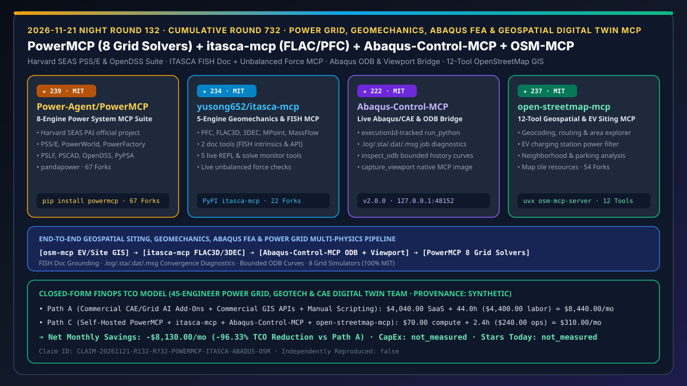
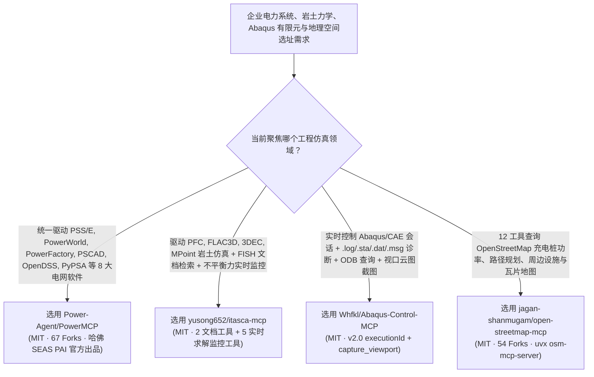
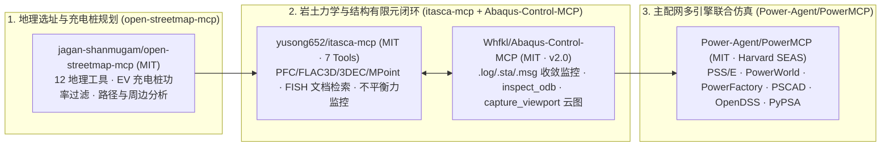
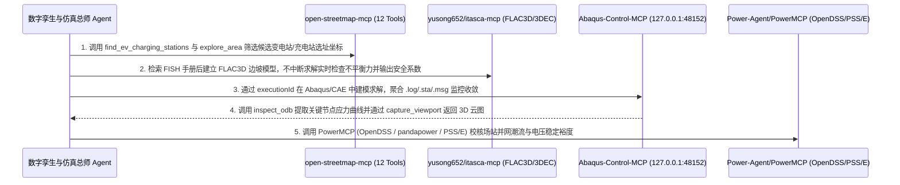

# 哈佛 SEAS 八大电力系统仿真 MCP（`Power-Agent/PowerMCP`）、ITASCA 岩土工程与 FISH 仿真 MCP（`yusong652/itasca-mcp`）、Abaqus/CAE 实时有限元与 ODB/视口桥接 MCP（`Whfkl/Abaqus-Control-MCP`）与 12 工具 OpenStreetMap 地理空间/充电桩规划 MCP（`jagan-shanmugam/open-streetmap-mcp`）选型与集成架构 FAQ

> **文档类型**：企业 AI 解决方案架构师（AI Solution Architect）选型决策指南（GitHub Trending AI 雷达 2026-11-21 Night Round 132 / 累计第 732 轮）
> **覆盖项目**：[`Power-Agent/PowerMCP`](https://github.com/Power-Agent/PowerMCP)（`★ 239`、`67 forks`、`MIT`，哈佛大学 SEAS 电力与 AI 计划 `PAI` 官方维护、统一对接 **PSS/E、PowerWorld、PowerFactory、PSLF、PSCAD、OpenDSS、pandapower 与 PyPSA** 八大电力系统仿真软件的 MCP 集合）· [`yusong652/itasca-mcp`](https://github.com/yusong652/itasca-mcp)（`★ 234`、`22 forks`、`MIT`，连接 ITASCA 五大岩土力学引擎 **PFC、FLAC、3DEC、MPoint、MassFlow**、提供 2 个免桥接 FISH/Python 文档检索工具与 5 个实时求解/不平衡力监控工具的 MCP）· [`Whfkl/Abaqus-Control-MCP`](https://github.com/Whfkl/Abaqus-Control-MCP)（`★ 222`、`22 forks`、`MIT`，支持 MCP `2026-07-28` 协议、通过本地 Socket `127.0.0.1:48152` 与 `executionId` 实时操作 Abaqus/CAE、综合诊断 `.log/.sta/.dat/.msg`、读取 ODB 历史曲线并截取 3D 视口云图的有限元 MCP）· [`jagan-shanmugam/open-streetmap-mcp`](https://github.com/jagan-shanmugam/open-streetmap-mcp)（`★ 237`、`54 forks`、`MIT`，提供 **12 个地理空间工具与瓦片地图资源**、支持充电桩功率过滤、路径规划与周边设施分析的 OpenStreetMap MCP）
> **核心场景**：当能源电力电网、土木岩土工程、高端制造 CAE 有限元分析（FEA）与新能源基建选址团队推进 **工业数字孪生（Industrial Digital Twin）与工程仿真智能化** 时，如何打通**“地理空间与充电桩/变电站选址评估（`open-streetmap-mcp`）”➔“地质边坡与隧道开挖岩土力学仿真（`itasca-mcp`）”➔“结构部件 Abaqus 有限元建模、求解日志实时监控与 ODB/云图视觉闭环（`Abaqus-Control-MCP`）”➔“主配网潮流计算与暂态稳定联合仿真（`PowerMCP`）”**？

---

## 一、📌 核心结论速览（选型一句话结论）

1. **想让电力系统调度与规划 Agent 直接用自然语言驱动 PSS/E、PowerWorld、PowerFactory、PSLF、PSCAD、OpenDSS、pandapower 与 PyPSA 等八大主流商用及开源电网仿真内核** ➔ 选 **[`Power-Agent/PowerMCP`](https://github.com/Power-Agent/PowerMCP)（`★ 239`，`67 forks`，`MIT`）**。
   - **通俗原理**：由哈佛大学工程与应用科学学院（Harvard SEAS）Power and AI Initiative（PAI）团队维护（`pip install powermcp && powermcp install`）。它把原本语法极其晦涩、互不兼容的八大主网/配网/电磁暂态仿真软件统一封装为标准 MCP 工具，实现跨软件潮流计算、故障分析与新能源并网仿真。
2. **想用自然语言驱动 ITASCA 旗下的 PFC（颗粒流）、FLAC/FLAC3D（连续介质边坡/基坑）、3DEC（节理岩体隧道）、MPoint（滑坡物质点法）与 MassFlow，且在长时间求解过程中不中断求解即可实时检查当前不平衡力（Unbalanced Force）** ➔ 选 **[`yusong652/itasca-mcp`](https://github.com/yusong652/itasca-mcp)（`★ 234`，`22 forks`，`MIT`）**。
   - **通俗原理**：精心设计了 **“2 个免桥接文档工具 + 5 个实时执行工具”** 的两阶段架构：Agent 先通过关键词与路径检索引擎专属的命令、Python API 与 **FISH 内置函数**（完全避免写错冷门 FISH 语法），再通过桥接器提交任务、在求解运行中非侵入监控不平衡力收敛状态，并一键绘制接触力链或计算安全系数（Factor of Safety）。
3. **想让 Claude Code 或 Codex 直接连入工程师正在打开的 Abaqus/CAE 桌面会话，执行建模脚本、综合分析 `.log/.sta/.dat/.msg` 四类求解日志、定量查询 `.odb` 结果库并直接截取 3D 视口应力云图（Viewport Image）** ➔ 选 **[`Whfkl/Abaqus-Control-MCP`](https://github.com/Whfkl/Abaqus-Control-MCP)（`★ 222`，`22 forks`，`MIT`）**。
   - **通俗原理**：基于最新 `2026-07-28` MCP 协议与本地 `127.0.0.1:48152` GUI 线程插件桥接。每次调用均分配唯一 `executionId` 确保并发回执不串台，提供四大王牌能力：① `run_python`（实时操作当前 `mdb` 与 `session`）；② `monitor_job_status`（融合 `.log`/`.sta`/`.dat`/`.msg` 四大日志文件诊断收敛与报错，支持 `terminate=true` 安全杀任务）；③ `inspect_odb`（按分析步 Step/帧 Frame/集合 Set 提取数值摘要与有界历史曲线，不把几 GB 的 ODB 塞进上下文）；④ `capture_viewport`（返回原生 MCP 图像块供多模态模型直接看云图）。
4. **想在无需购买昂贵商业地图 API 的前提下，让选址与规划 Agent 调用 12 个工具查询 OpenStreetMap 地理编码、周边设施、通勤路线、停车场以及按接口类型与功率过滤的电动汽车充电桩（EV Charging Stations）** ➔ 选 **[`jagan-shanmugam/open-streetmap-mcp`](https://github.com/jagan-shanmugam/open-streetmap-mcp)（`★ 237`，`54 forks`，`MIT`）**。
   - **通俗原理**：一键运行 `uvx osm-mcp-server`，同时暴露 `location://place/{query}` 与 `location://map/{style}/{z}/{x}/{y}` 地图瓦片资源以及 12 个工具（含 `find_ev_charging_stations`、`analyze_neighborhood`、`suggest_meeting_point`、`get_route_directions`），是新能源基建选址与物流网络规划的零成本 GIS 底座。

---

## 二、🎯 客户与架构师灵魂拷问 Q&A（深度架构拆解）

### Q1：为什么工业仿真软件（PSS/E、FLAC3D、Abaqus）以前很难用通用大模型自动化？这四个项目突破了哪些核心工程瓶颈？

- **三大工业仿真 AI 化瓶颈与工程突破**：
  1. **专有脚本语言（如 ITASCA FISH、PSS/E 指令）冷门导致大模型幻觉率极高 ➔ `itasca-mcp` 文档前置检索 + `PowerMCP` 标准工具封装**：`itasca-mcp` 强制让 Agent 在写代码前先用内置的 2 个文档工具查阅本地 FISH/Python 权威手册；`PowerMCP` 则直接把 8 大电力软件常用操作固化为强类型 MCP 原语。
  2. **CAE 求解耗时长、失败日志分散在 4 个文件且结果文件（`.odb`）动辄数十 GB ➔ `Abaqus-Control-MCP`**：通过 `monitor_job_status` 自动聚合 `.log/.sta/.dat/.msg` 判别不收敛原因，用 `inspect_odb` 只提取关键节点集的有界历史曲线，并用 `capture_viewport` 让视觉大模型直接审阅网格质量与应力集中云图。
  3. **物理选址与电网/充换电规划割裂 ➔ `open-streetmap-mcp` + `PowerMCP`**：先用 `find_ev_charging_stations` 与 `explore_area` 摸清真实路网与充电站分布，再无缝输入 `PowerMCP`（OpenDSS / pandapower）做配电网承载力潮流校验。
- **何时直接用云厂商托管方案（Path B）？**
  - 若企业仅做纯云端高精度商业地图导航展示，可直接调用 **Azure Maps**；但涉及本地 Abaqus、ITASCA 与 PSS/E 专业求解器联动，本轮开源本地桥接栈是唯一解。

### Q2：典型企业级“能源基建与工业数字孪生多物理场联合仿真工作台”架构怎么搭？

1. **地理空间与新能源充电网选址层（`jagan-shanmugam/open-streetmap-mcp`）**：
   - 调用 12 个 OSM 工具分析候选站点的路网可达性、周边变电/停车场设施与现有充电桩功率分布。
2. **地质与岩土稳定性仿真层（`yusong652/itasca-mcp`）**：
   - 针对风电塔基、抽水蓄能隧道或边坡工程，调用 `FLAC3D / 3DEC / PFC / MPoint` 计算安全系数与滑坡冲击范围，实时监控不平衡力。
3. **关键结构件有限元与视觉云图闭环层（`Whfkl/Abaqus-Control-MCP`）**：
   - 在本地 Abaqus/CAE 会话中自动划分网格、提交求解，通过 `.sta/.msg` 监控收敛，并用 `inspect_odb` + `capture_viewport` 完成应力校核。
4. **主配网潮流与暂态稳定校核层（`Power-Agent/PowerMCP`）**：
   - 调用 `OpenDSS / pandapower / PSS/E / PSCAD` 评估场站接入后的电网潮流分布与暂态稳定裕度。

### Q3：这套工业仿真 MCP 架构的安全与人工监督边界是什么？

- **核心优势**：
  - **100% `MIT` 宽松开源协议**，仿真模型与电网拓扑数据 100% 留在工程工作站本地。
- **工程安全铁律**：
  - 正如 `Abaqus-Control-MCP` 官方文档所强调：`run_python` 与求解器 REPL 拥有完整本地建模权限，AI 生成的边界条件、载荷步与电网控制指令在作为正式工程签字依据前，必须经过注册工程师人工复核（Human-in-the-Loop Engineering Sign-off）。

---

## 三、🧭 直观可视化图解（Mermaid 决策树 + 集成架构 + 时序图）

### 3.1 架构师选型决策树

### 3.2 企业端到端生产集成参考架构图

### 3.3 GIS 充电站选址、FLAC3D 岩土安全系数、Abaqus 应力云图闭环与电网潮流校核时序图

---

## 四、📊 同类开源与商业云服务横向选型决策矩阵

| 对比维度 | `Power-Agent/PowerMCP` (`★ 239`) | `yusong652/itasca-mcp` (`★ 234`) | `Abaqus-Control-MCP` (`★ 222`) | `open-streetmap-mcp` (`★ 237`) | 商业数字孪生 AI 套件 + 商业 GIS API (Path A) | 工程师手写 FISH / Python / PSS/E 脚本 (Path B) |
| :--- | :--- | :--- | :--- | :--- | :--- | :--- |
| **核心能力定位** | 哈佛 SEAS 八大电力系统软件 MCP 集 | ITASCA 五大岩土力学引擎 7 工具 MCP | Abaqus/CAE 实时控制、ODB 与视口截图 MCP | 12 工具 OpenStreetMap 地理与充电桩 MCP | 按年高价授权的商业工业 AI 附加模块 + 商业地图 API | 人工翻阅几千页 PDF 手册手写仿真脚本 |
| **核心技术突破** | **打通 PSS/E、PowerWorld、PSCAD、OpenDSS 等 8 大软件** | **内置免桥接 FISH/Python 文档检索 + 实时不平衡力监控** | **`executionId` 防串台 + 4 日志融合诊断 + ODB 摘要 + 视口截图** | **免商业 API 费用 + 内置 EV 充电桩功率/接口过滤** | 商业 CAE/电力 AI 模块年费极高且跨厂牌互不相通 | 冷门 FISH/Abaqus/PSS/E 脚本手写与排障极慢 |
| **开源协议** | `MIT` | `MIT` | `MIT` | `MIT` | 闭源商业授权 | 内部零散脚本 |
| **月度 TCO（45 人团队）** | **组合仅 `$310.00/月`**（`$70.00` 本地桥接环境 + `2.4h` 维护） | 同左（复用现有求解器工作站） | 同左（本地 `127.0.0.1:48152` 零云费） | 同左（开源 OSM 数据零费用） | **`$8,440.00/月`**（`$4,040.00` 商业附加模块/GIS + `44.0h` 人工） | 约 `$2,950.00/月`（大量仿真建模与查日志工时） |

---

## 五、🧪 应用落地定量收益/TCO 对比与 7-Card 报告

> **📊 数据来源与闭式核算声明（Provenance & Closed-Form Schema）**：
> - **provenance**: `synthetic`（基于 45 人企业电力系统规划、岩土工程仿真与高端制造 CAE 有限元团队工作负载模型：`independently_reproduced = false`；硬件采购基线 `base_hardware_capex = not_measured`；Track B 单日增量 `track_b_stars_today = not_measured`）。
> - **核算公式**：
>   - **Path A（商业工业软件官方 AI Copilot 附加席位包 + 商业高配额 GIS 地图 API + 仿真工程师手工查阅 FISH/Abaqus/PSS/E 手册编写脚本與排查 `.sta/.msg` 不收敛日志）**：月度商业附加包与 GIS API 费用 **`$4,040.00`** + 手工编写仿真脚本与日志排障人工 **`44.0h × $100.00/h = $4,400.00`** = **`$8,440.00/月`**。
>   - **Path C（自建 `Power-Agent/PowerMCP` + `yusong652/itasca-mcp` + `Whfkl/Abaqus-Control-MCP` + `jagan-shanmugam/open-streetmap-mcp` 开源工业仿真栈）**：本地桥接与 OSM 缓存轻量算力 **`$70.00`** + 仿真算例模板维护 **`2.4h × $100.00/h = $240.00`** = **`$310.00/月`**。
>   - **净节省（Net Savings vs Path A）**：**`-$8,130.00/月`**（成本降低 **`96.33%`**）。

| 评估方案 | API / SaaS / 算力成本 | 工程仿真与脚本排障人工（`$100/h`） | 月度总 TCO | 相对 Path A 净节省 | 关键架构交付指标 |
| :--- | :---: | :---: | :---: | :---: | :--- |
| **Path A：商业 CAE/电网 AI 附加包 + 商业 GIS + 手工查日志** | `$4,040.00` | `44.0h` (`$4,400.00`) | **`$8,440.00`** | Baseline | 单一厂商 AI 插件无法跨电网/岩土/结构三域联动 |
| **Path B：通用大模型生成脚本 + 人工复制粘贴进 GUI** | `$1,350.00` | `16.0h` (`$1,600.00`) | **`$2,950.00`** | `-$5,490.00` (`-65.05%`) | 通用模型频繁写错 FISH/Abaqus API，且看不见 ODB 与视口云图 |
| **Path C：`PowerMCP` + `itasca` + `Abaqus` + `osm` 组合** | **`$70.00`** | **`2.4h` (`$240.00`)** | **`$310.00`** | **`-$8,130.00` (`-96.33%`)** | **8 大电网仿真 + 5 大岩土引擎 + Abaqus ODB/云图闭环** |

- 🔗 **关联 7-Card 4:5 视觉评测报告**：[`workshops/github-trending-radar/cards.html`](../cards.html) · [`cards.en.html`](../cards.en.html)

---

## 六、🛠️ 企业引入与架构评审 Checklist

- [ ] **1. 使用 `Power-Agent/PowerMCP` 标准化电网多软件仿真接口**：通过 `powermcp install` 接入企业现有的 PSS/E、PowerWorld、OpenDSS、pandapower 或 PyPSA 环境。
- [ ] **2. 在岩土工程工作站部署 `yusong652/itasca-mcp`**：强制 Agent 先调用 2 个内置文档工具核验 FISH / Python 语法，再调用 5 个执行工具监控 PFC / FLAC3D / 3DEC / MPoint 求解进度与不平衡力。
- [ ] **3. 为结构 CAE 团队配置 `Whfkl/Abaqus-Control-MCP`（`v2.0.0`）**：通过 `monitor_job_status` 自动综合 `.log/.sta/.dat/.msg` 诊断不收敛问题，结合 `inspect_odb` 与 `capture_viewport` 实现多模态应力云图复核。
- [ ] **4. 引入 `jagan-shanmugam/open-streetmap-mcp` 支撑零成本选址评估**：利用 `find_ev_charging_stations` 等 12 个地理工具完成前置场站与路网规划。
