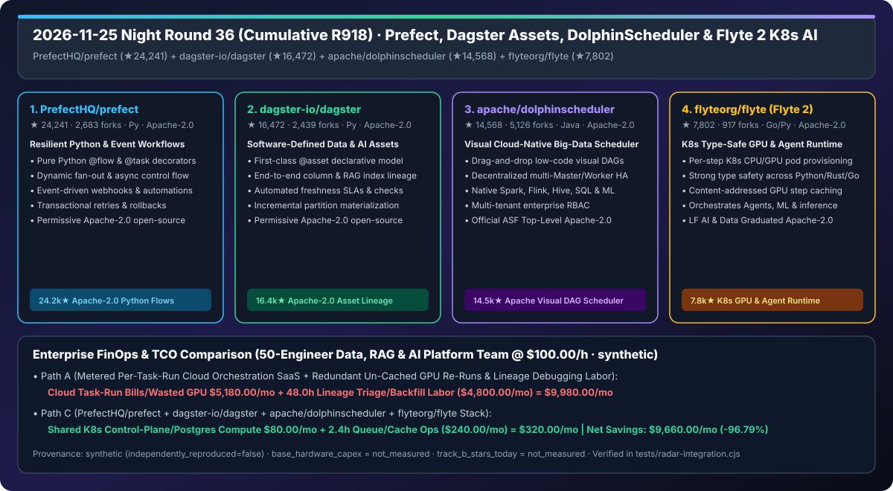
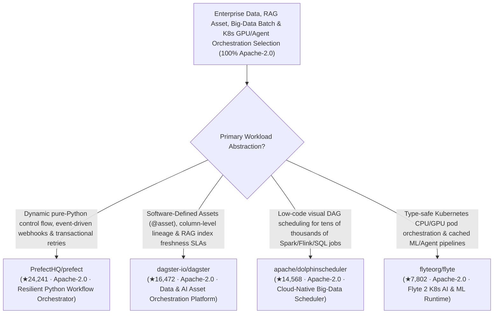
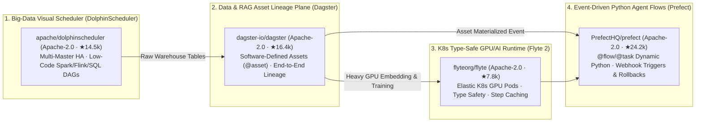
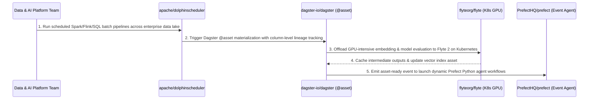

# Resilient Python Agent & Data Orchestration (`PrefectHQ/prefect`), Software-Defined Data & Vector Assets (`dagster-io/dagster`), Visual Cloud-Native Big-Data Scheduling (`apache/dolphinscheduler`) & K8s Type-Safe GPU/Agent Runtime (`flyteorg/flyte`) Selection & Integration Architecture FAQ

> **Document Type**: Enterprise AI Solution Architect Selection Decision Guide (GitHub Trending AI Radar — 2026-11-25 Night Round 36 / Cumulative Round 918)
> **Covered Repositories**: [`PrefectHQ/prefect`](https://github.com/PrefectHQ/prefect) (`★ 24,241`, `2,683 forks`, `Apache-2.0`, Python: workflow orchestration framework for building resilient, event-driven data and AI pipelines in pure Python) · [`dagster-io/dagster`](https://github.com/dagster-io/dagster) (`★ 16,472`, `2,439 forks`, `Apache-2.0`, Python: orchestration platform for the development, production, and lineage observation of Software-Defined Data & AI Assets) · [`apache/dolphinscheduler`](https://github.com/apache/dolphinscheduler) (`★ 14,568`, `5,126 forks`, `Apache-2.0`, Java: Apache Top-Level modern data orchestration platform for creating high-performance big-data and AI workflows with low-code visual DAGs) · [`flyteorg/flyte`](https://github.com/flyteorg/flyte) (`★ 7,802`, `917 forks`, `Apache-2.0`, Go/Python: LF AI & Data graduated platform [Flyte 2.0] for type-safe, distributed orchestration of AI agents, ML pipelines, and real-time inference on Kubernetes)
> **Core Enterprise Scenario**: Selecting and combining the **Four Premier `Apache-2.0` Data, ML & Agent Orchestration Engines**—matching low-code big-data batch scheduling (`apache/dolphinscheduler`), asset-centric RAG & feature lineage (`dagster`), Kubernetes-native heterogeneous CPU/GPU execution with strong typing (`flyte`), and dynamic event-driven Python agent workflows (`prefect`).

---

## 1. 📌 Executive Summary (One-Line Selection Verdict)

1. **Need an `Apache-2.0` Pythonic workflow engine where adding `@flow` and `@task` decorators turns standard dynamic Python/async code into resilient, event-driven pipelines with automatic retries, transactions, and webhook triggers** ➔ Choose **[`PrefectHQ/prefect`](https://github.com/PrefectHQ/prefect) (`★ 24,241`, `2,683 forks`, `Apache-2.0`)**.
   - **Plain-English Mechanism**: Lets Python engineers write unconstrained dynamic control flow (`if/else`, loops, dynamic fan-out) while Prefect tracks state transitions, concurrency limits, and failure rollbacks.
2. **Need an `Apache-2.0` asset-centric orchestrator (`@asset`) that models tables, feature stores, and RAG vector indexes as **Software-Defined Assets** with end-to-end column-level lineage and freshness SLAs** ➔ Choose **[`dagster-io/dagster`](https://github.com/dagster-io/dagster) (`★ 16,472`, `2,439 forks`, `Apache-2.0`)**.
   - **Plain-English Mechanism**: Shifts focus from "did a script run?" to "is this downstream RAG vector index up-to-date with its upstream source tables?", providing full data lineage and incremental materialization.
3. **Need a decentralized, multi-tenant `Apache-2.0` visual low-code workflow scheduler to orchestrate tens of thousands of daily Spark, Flink, Hive, SQL, and Python batch jobs across enterprise big-data clusters** ➔ Choose **[`apache/dolphinscheduler`](https://github.com/apache/dolphinscheduler) (`★ 14,568`, `5,126 forks`, `Apache-2.0`)**.
   - **Plain-English Mechanism**: Uses a multi-Master/multi-Worker architecture with zero single point of failure and a drag-and-drop web UI tailored for big-data ETL and backfill operations.
4. **Need a Kubernetes-native, type-safe distributed runtime (`Flyte 2.0`, `Apache-2.0`) that dynamically provisions per-step CPU and GPU pods, enforces strict data schemas, and caches expensive ML/agent intermediate outputs** ➔ Choose **[`flyteorg/flyte`](https://github.com/flyteorg/flyte) (`★ 7,802`, `917 forks`, `Apache-2.0`)**.
   - **Plain-English Mechanism**: Schedules each workflow step onto its exact required K8s hardware (`gpu="1"`, `mem="32Gi"`) and memoizes step outputs by content hash so retries never re-run costly GPU steps.

---

## 2. 🎯 Architect & Customer Deep-Dive Q&A

### Q1: How should an enterprise architect partition workloads across `DolphinScheduler`, `Dagster`, `Flyte`, and `Prefect` instead of paying per-task-run cloud orchestration bills?

- **Four-Tier Enterprise Data, Asset & Compute Orchestration Matrix (Path C)**:
  1. **L1 Enterprise Big-Data Batch Scheduling ➔ `apache/dolphinscheduler`**: Visual, multi-tenant scheduling for Spark, Flink, Hive, and data warehouse SQL pipelines.
  2. **L2 Declarative Data & RAG Vector Asset Lineage ➔ `dagster-io/dagster`**: Tracks upstream-to-downstream lineage and freshness across data tables and vector embeddings.
  3. **L3 Kubernetes Heterogeneous CPU/GPU AI Runtime ➔ `flyteorg/flyte` (Flyte 2)**: Allocates elastic K8s GPU pods with type safety and content-addressed step caching for fine-tuning, batch embedding, and heavy evals.
  4. **L4 Real-Time Event-Driven Python Agent Flows ➔ `PrefectHQ/prefect`**: Executes dynamic, event-triggered Python agent workflows with transactional rollback.
- **When to choose Metered Per-Task Cloud Orchestrators vs. Path C?**
  - Choose **Hosted Cloud SaaS** for small teams running a handful of daily jobs.
  - Choose **Path C** when high-frequency AI sub-tasks and thousands of daily asset materializations would trigger steep per-task-run cloud billing, and when **100% `Apache-2.0` self-hosted control** over VPC data warehouses and K8s GPU clusters is required.

### Q2: How do these four engines interoperate in a unified enterprise pipeline?

1. **Warehouse Batch to Asset Lineage (`DolphinScheduler` → `Dagster`)**:
   - `DolphinScheduler` completes nightly Spark/SQL ingestion; `Dagster` detects updated warehouse tables and materializes downstream feature and RAG document `@asset` graphs.
2. **Elastic K8s GPU Compute & Event-Driven Agent Delivery (`Dagster` → `Flyte` → `Prefect`)**:
   - Heavy GPU embedding/training steps are dispatched to `Flyte` on Kubernetes (with step-level caching), and upon completion an event triggers `Prefect` to run downstream Python notification and agentic reporting flows.

### Q3: What are the key production architecture guardrails?

- **Architect Redlines**:
  1. **Keep the orchestration control plane separate from the data plane**: Pass object-storage URIs (S3/MinIO) between tasks rather than serializing multi-gigabyte DataFrames or tensors into the orchestrator's metadata database.
  2. **Enable content-hashed step caching (`cache=True`) in `Flyte` and `Prefect` for GPU/LLM tasks**: Prevent failed downstream steps from re-executing expensive upstream LLM or GPU computations during retries.

---

## 3. 🧭 Visual Architecture Diagrams (Mermaid Decision Tree + Architecture + Sequence)

### 3.1 Architect Selection Decision Tree

### 3.2 End-to-End Enterprise Integration Architecture

### 3.3 End-to-End Execution Sequence

---

## 4. 📊 Horizontal Selection Matrix

| Dimension | `PrefectHQ/prefect` (`★ 24,241`) | `dagster-io/dagster` (`★ 16,472`) | `apache/dolphinscheduler` (`★ 14,568`) | `flyteorg/flyte` (`★ 7,802`) | Metered Per-Task-Run Cloud Orchestrators (Path A) | Unmanaged `crontab` Scripts + No Lineage or Caching (Path B) |
| :--- | :--- | :--- | :--- | :--- | :--- | :--- |
| **Primary Role** | `Apache-2.0` dynamic Python & event flows | `Apache-2.0` data & AI asset lineage | `Apache-2.0` low-code big-data scheduler | `Apache-2.0` K8s type-safe GPU/AI runtime | Per-task-run / per-slot commercial SaaS | Scattered server cron jobs & shell scripts |
| **Key Differentiator** | **Pure Python dynamic workflows + event-driven automations** | **First-class `@asset` lineage & incremental freshness SLAs** | **Decentralized multi-Master HA + drag-and-drop big-data UI** | **Per-task K8s GPU pod sizing + content-hashed step caching** | Managed control plane, but expensive per-task fees on fine-grained AI steps | Silent cron failures; expensive GPU steps re-run from scratch on error |
| **License** | **`Apache-2.0`** | **`Apache-2.0`** | **`Apache-2.0`** | **`Apache-2.0`** | Proprietary SaaS | Unstandardized |
| **Monthly TCO (50-Eng Team)** | **`$320.00/mo` combined** (`$80.00` control-plane/Postgres compute + `2.4h` ops) | Included in `$320.00/mo` stack | Included in `$320.00/mo` stack | Included in `$320.00/mo` stack | **`$9,980.00/mo`** (`$5,180.00` per-task cloud bills & un-cached GPU waste + `48.0h` lineage debugging labor) | `~$3,680.00/mo` (debugging stale data pipelines & manual GPU job restarts) |

---

## 5. 🧪 Quantitative FinOps & TCO Comparison (50-Engineer Data, RAG & AI Platform Team)

> **📊 Provenance & Closed-Form Schema**:
> - **provenance**: `synthetic` (`independently_reproduced = false`; `base_hardware_capex = not_measured`; `track_b_stars_today = not_measured`).
> - **Closed-Form Formula**:
>   - **Path A (Metered Per-Task-Run Cloud Orchestration SaaS + Redundant Un-Cached GPU Re-Runs & Manual Data-Lineage Troubleshooting Labor)**: **`$5,180.00`** monthly cloud orchestration and wasted GPU re-run bills + **`48.0h × $100.00/h = $4,800.00`** broken-lineage debugging and manual backfill labor = **`$9,980.00/mo`**.
>   - **Path C (`PrefectHQ/prefect` + `dagster-io/dagster` + `apache/dolphinscheduler` + `flyteorg/flyte` Stack)**: **`$80.00`** shared K8s control-plane and PostgreSQL metadata compute + **`2.4h × $100.00/h = $240.00`** queue and cache policy maintenance = **`$320.00/mo`**.
>   - **Net Savings vs. Path A**: **`-$9,660.00/mo`** (**`96.79%`** TCO reduction).

| Evaluation Path | Cloud Task-Run Bills / Wasted GPU & Compute | Lineage Triage, Backfills & Manual Restarts (`$100/h`) | Monthly Total TCO | Net Savings vs. Path A | Key Architectural Outcome |
| :--- | :---: | :---: | :---: | :---: | :--- |
| **Path A: Metered Per-Task Cloud Orchestrators + Un-Cached GPU Runs** | `$5,180.00` | `48.0h` (`$4,800.00`) | **`$9,980.00`** | Baseline | High per-task billing on granular AI steps; costly GPU re-runs |
| **Path B: Scattered `crontab` Scripts + Manual Dependency Tracking** | `$1,580.00` | `21.0h` (`$2,100.00`) | **`$3,680.00`** | `-$6,300.00` (`-63.13%`) | Stale downstream RAG indexes; full pipeline restarts on late-step errors |
| **Path C: `prefect` + `dagster` + `dolphinscheduler` + `flyte`** | **`$80.00`** | **`2.4h` (`$240.00`)** | **`$320.00`** | **`-$9,660.00` (`-96.79%`)** | **100% `Apache-2.0` unlimited runs + `@asset` lineage + K8s GPU step caching** |

- 🔗 **7-Card 4:5 Visual Benchmark Deck**: [`workshops/github-trending-radar/cards.en.html`](../cards.en.html) · [`cards.html`](../cards.html)

---

## 6. 🛠️ Enterprise Adoption & Architecture Review Checklist

- [ ] **Align Orchestrator Selection to Workload Semantics**: Use `DolphinScheduler` for low-code big-data batch, `Dagster` for `@asset` lineage, `Flyte` for K8s GPU tasks, and `Prefect` for dynamic Python agent flows.
- [ ] **Model RAG Vector Collections as `@asset` Nodes in `Dagster`**: Track upstream document freshness and column-level lineage automatically.
- [ ] **Enable Content-Addressed Caching (`cache=True`) in `Flyte` for GPU & LLM Steps**: Avoid re-computing completed expensive steps during workflow retries.
- [ ] **Offload Large Artifacts to Object Storage (S3/MinIO)**: Keep orchestrator metadata databases lightweight by passing only URI references between tasks.
