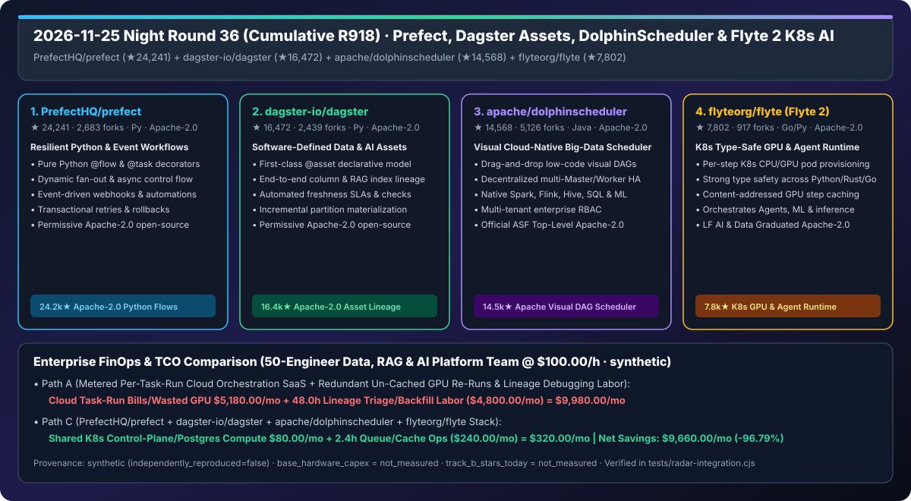
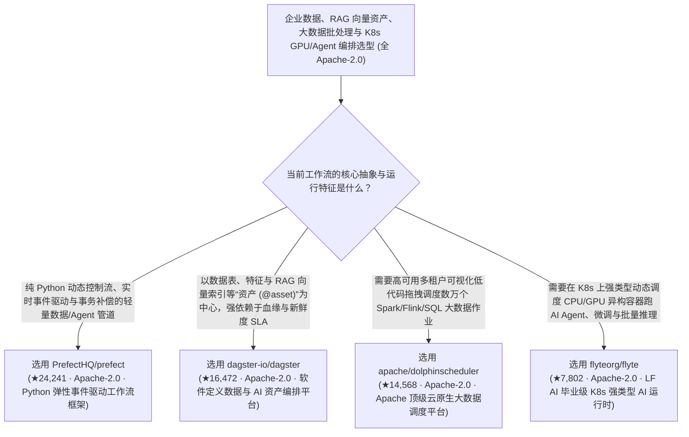
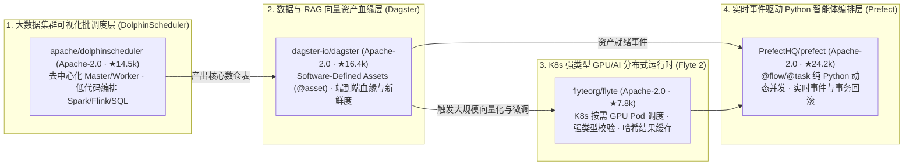
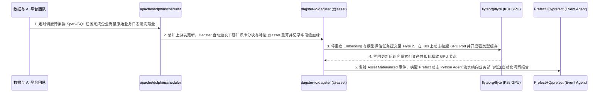

# Python 弹性智能体与数据流编排（`PrefectHQ/prefect`）、软件定义数据与向量资产编排（`dagster-io/dagster`）、Apache 可视化云原生大数据调度（`apache/dolphinscheduler`）与 K8s 强类型 GPU/AI 智能体分布式运行时（`flyteorg/flyte`）选型与集成架构 FAQ

> **文档类型**：企业 AI 解决方案架构师（AI Solution Architect）选型决策指南（GitHub Trending AI 雷达 2026-11-25 Night Round 36 / 累计第 918 轮）
> **覆盖项目**：[`PrefectHQ/prefect`](https://github.com/PrefectHQ/prefect)（`★ 24,241`、`2,683 forks`、`Apache-2.0`：2.4 万星 Python 弹性工作流编排框架，以极简 `@flow`/`@task` 装饰器、事件驱动与事务补偿驱动动态数据与 AI 管道）· [`dagster-io/dagster`](https://github.com/dagster-io/dagster)（`★ 16,472`、`2,439 forks`、`Apache-2.0`：1.6 万星面向数据与 AI 资产 [Software-Defined Assets] 的开发、生产编排与端到端血缘观测平台）· [`apache/dolphinscheduler`](https://github.com/apache/dolphinscheduler)（`★ 14,568`、`5,126 forks`、`Apache-2.0`：1.4 万星 Apache 顶级低代码高可用大数据与 AI 批处理调度平台）· [`flyteorg/flyte`](https://github.com/flyteorg/flyte)（`★ 7,802`、`917 forks`、`Apache-2.0`：LF AI & Data 毕业级项目，Flyte 2.0 基于 Kubernetes 的强类型分布式 AI Agents、大模型微调与实时推理运行时）
> **核心场景**：当企业数据工程与 AI 平台团队争论“我们的 RAG 向量更新流水线、数仓 ETL、GPU 模型微调任务与事件驱动 AI Agent 到底该选哪套 `Apache-2.0` 编排器？”时，最常陷入“拿一套工具硬套所有场景”的误区。本文一次性讲透四大开源编排巨头——**`Prefect`（Python 动态与事件驱动流）vs `Dagster`（数据与向量资产血缘）vs `Apache DolphinScheduler`（低代码可视化企业大数据批调度）vs `Flyte 2`（Kubernetes 强类型异构 GPU 与 Agent 算力编排）** 的黄金选型边界与组合架构。

---

## 一、📌 核心结论速览（选型一句话结论）

1. **团队是纯正的 Python / AI 应用工程师，讨厌写死板的静态 DAG 配置文件，希望在普通 Python 代码里加一行 `@flow` 和 `@task` 就能动态生成成百上千个并发子任务、响应实时 Webhook 事件并自带事务回滚** ➔ 选 **[`PrefectHQ/prefect`](https://github.com/PrefectHQ/prefect)（`★ 24,241`，`2,683 forks`，`Apache-2.0`）**。
   - **通俗原理**：不把你的代码绑架进受限的算子框架里，你的 Python `if/else`、`for` 循环和 `asyncio` 原样跑，Prefect 自动接管状态汇报、指数退避重试、并发限流与失败补偿。
2. **团队的核心交付物是“数据表、特征宽表与 RAG 向量索引等数据资产（Data Assets）”，最关心“上游哪张业务表变了导致下游哪个 RAG 向量库过期、整条链路的数据血缘（Lineage）与新鲜度 SLA 是多少”** ➔ 选 **[`dagster-io/dagster`](https://github.com/dagster-io/dagster)（`★ 16,472`，`2,439 forks`，`Apache-2.0`）**。
   - **通俗原理**：把传统“按动作（Task）思考”反转为“按资产（`@asset`）思考”；不仅能一键看清从原始文档 → 清洗宽表 → Embedding 向量表的完整血缘图，还能根据上游变更自动增量刷新下游向量资产。
3. **企业大数据中心有大量データ开发、ETL 工程师与分析师，需要通过“Web 浏览器拖拽式低代码画布 + 多租户权限 + 去中心化多 Master/Worker 高可用架构”每天稳定调度数万个 Spark、Flink、Hive、SQL 与 Python 批处理作业** ➔ 选 **[`apache/dolphinscheduler`](https://github.com/apache/dolphinscheduler)（`★ 14,568`，`5,126 forks`，`Apache-2.0`）**。
   - **通俗原理**：专为大规模企业数据中心设计的可视化调度平台，消灭了传统调度系统的单点故障，不懂复杂 Python 编程的 ETL 人员也能通过网页拖拽配置跨集群任务依赖与补数（Backfill）。
4. **平台运行在 Kubernetes 集群上，需要调度“既包含 CPU 轻量 Agent 节点、又包含需要动态申请 4 张 A100/H100 GPU 的模型训练/批量推理节点”的重算力异构流水线，且要求强类型数据契约与中间结果跨团队自动缓存复用** ➔ 选 **[`flyteorg/flyte`](https://github.com/flyteorg/flyte)（`★ 7,802`，`917 forks`，`Apache-2.0`，Flyte 2.0）**。
   - **通俗原理**：每个任务都可以用装饰器精确声明所需的 K8s `Resources(cpu="4", gpu="1", mem="32Gi")`；Flyte 自动在 K8s 上按需拉起对应规格 Pod，并对输入输出执行强类型校验与基于内容哈希的持久化缓存。

---

## 二、🎯 客户与架构师灵魂拷问 Q&A（深度架构拆解）

### Q1：面对企业内同时存在的“大数据批调度、RAG 数据资产血缘、K8s GPU 算力编排与事件驱动 Python Agent”，这四大 `Apache-2.0` 引擎该如何选型与分层协同？

- **四大编排引擎的精准定位与协同矩阵（Path C）**：
  1. **L1 企业数仓与跨集群低代码批调度层 ➔ `apache/dolphinscheduler`**：统一调度夜间 T+1 Spark/Flink/SQL 大数据宽表加工与传统 ETL。
  2. **L2 数据与 RAG 向量资产血缘治理层 ➔ `dagster-io/dagster`**：将核心特征表、知识库分块与向量索引声明为 `@asset`，掌控字段级血缘与新鲜度。
  3. **L3 K8s 异构 CPU/GPU 算力与微调/推理编排层 ➔ `flyteorg/flyte` (Flyte 2)**：在 K8s 上按需弹性调度高成本 GPU 容器执行批量 Embedding、模型微调与重度 Agent 评估。
  4. **L4 实时事件驱动 Python 业务与 Agent 流水线层 ➔ `PrefectHQ/prefect`**：响应业务 Webhook 与实时 API 事件，以纯 Python 代码灵活编排动态多步智能体工作流。
- **何时选商业云全托管编排服务（AWS MWAA / Astronomer Cloud / Prefect Cloud / Union Cloud 按任务槽或执行时长计费） vs 自建本轮 `Apache-2.0` 开源栈（Path C）？**
  - 若团队仅几个人且任务量极少，直接用免费/入门版云托管控制面即可。
  - **何时采用本轮 `Apache-2.0` 自建架构（Path C）？** 当企业每天运行数万次短任务或高频事件流（按 Task Run 计费的商业编排云会产生高昂调度税）、或涉及不能出内网的核心数仓与私有 GPU 集群时，Path C 可节省 **96%+** 的商业调度平台订阅与人工抢修成本。

### Q2：如何在不造成架构冗余的前提下在企业内部组合使用它们？

- **双核组合黄金范式**：
  - **数仓/数据资产团队（`DolphinScheduler` 或 `Dagster`）+ AI/算力团队（`Prefect` 或 `Flyte`）**：
  - 上游数据团队用 `DolphinScheduler` / `Dagster` 产出干净的业务宽表与文档资产，完成后发送标准 CloudEvents / Webhook 事件；下游 AI 团队用 `Prefect` 监听事件触发实时 Agent 动作，或触发 `Flyte` 在 K8s GPU 节点上执行大规模离线评测与微调。

### Q3：生产落地的架构红线是什么？

- **架构师避坑红线**：
  1. **严禁把 Orchestrator 控制面进程当成数据搬运工（Data Plane）**：在 `Prefect`、`Dagster` 或 `Flyte` 中传递大体积 DataFrame 或模型权重时，算子之间只传递对象存储（S3/MinIO）URI 引用或由 `Flyte` TypeEngine 自动卸载至对象存储，严禁把几 GB 数据直接塞进编排器元数据库。
  2. **为 K8s GPU 任务开启 `Flyte` 的 `cache=True, cache_version="1.0"`**：当长流水线在第 5 步因为网络抖动失败重跑时，前 4 步已经算完的昂贵 GPU 特征提取与推理直接命中缓存秒级跳过。

---

## 三、🧭 直观可视化图解（Mermaid 决策树 + 集成架构 + 时序图）

### 3.1 架构师选型决策树

### 3.2 企业端到端生产集成参考架构图

### 3.3 数仓批处理、RAG 资产血缘更新、K8s GPU 缓存计算与 Prefect 事件驱动 Agent 时序图

---

## 四、📊 同类开源与商业云服务横向选型决策矩阵

| 对比维度 | `PrefectHQ/prefect` (`★ 24,241`) | `dagster-io/dagster` (`★ 16,472`) | `apache/dolphinscheduler` (`★ 14,568`) | `flyteorg/flyte` (`★ 7,802`) | 商业云托管编排服务 (按 Task Run / Credit 计费) (Path A) | 服务器 `crontab` 跑脚本 + 无血缘无重试缓存 (Path B) |
| :--- | :--- | :--- | :--- | :--- | :--- | :--- |
| **核心能力定位** | `Apache-2.0` Python 动态与事件流编排 | `Apache-2.0` 软件定义数据与 AI 资产编排 | `Apache-2.0` 低代码高可用大数据调度 | `Apache-2.0` K8s 强类型 GPU/AI 运行时 | 按任务运行次数或槽位收费的商业调度云 | 散落在各台机器上的 Linux `crontab` |
| **核心技术突破** | **零框架束缚纯 Python 动态工作流 + 强大的事件触发器** | **以 `@asset` 资产与端到端数据血缘为一等公民** | **去中心化多 Master 高可用 + Web 拖拽低代码连接大数据生态** | **K8s 原生任务级 CPU/GPU 弹性声明 + 强类型持久化缓存** | 免维护控制面，但高频细粒度 AI 子任务按次计费账单高昂 | 脚本挂了没人知道；GPU 任务重跑从头算起白烧几小时算力 |
| **开源协议** | **`Apache-2.0`** | **`Apache-2.0`** | **`Apache-2.0`** | **`Apache-2.0`** | 闭源商业 SaaS | 无工程化管理 |
| **月度 TCO（50 人团队）** | **四件套按需合建仅 `$320.00/月`**（`$80.00` K8s 控制面容器与元数据 Postgres + `2.4h` 维护） | 同左（`Apache-2.0` 增量资产刷新省下 50% 冗余重算） | 同左（`Apache-2.0` 支撑每日数万批处理零按次抽成） | 同左（任务级缓存避免昂贵 GPU 节点重复计算） | **`$9,980.00/月`**（`$5,180.00` 按 Task Run 计费的商业调度云账单与冗余重算 GPU 费 + `48.0h` 血缘断层排障人工） | 约 `$3,680.00/月`（大量人工追查上游脏数据来源与手动重跑失败 GPU 任务工时） |

---

## 五、🧪 应用落地定量收益/TCO 对比与 7-Card 报告

> **📊 数据来源与闭式核算声明（Provenance & Closed-Form Schema）**：
> - **provenance**: `synthetic`（基于 50 人企业数据工程、RAG 资产治理与 K8s AI 平台团队月度工作负载模型：`independently_reproduced = false`；硬件采购基线 `base_hardware_capex = not_measured`；Track B 单日增量 `track_b_stars_today = not_measured`）。
> - **核算公式**：
>   - **Path A（采购按任务执行次数 [Per-Task-Run/Slot] 计费的商业编排云服务 + 因缺乏任务级哈希缓存导致的失败流水线重复消耗 GPU 算力账单 + 人工排查上下游数据资产血缘断层工时）**：月度商业编排云订阅与重复浪费的 GPU 算力账单 **`$5,180.00`** + 上下游脏数据血缘排查、手工补数与失败任务值守重跑人工 **`48.0h × $100.00/h = $4,800.00`** = **`$9,980.00/月`**。
>   - **Path C（基于 K8s 自建 `PrefectHQ/prefect` + `dagster-io/dagster` + `apache/dolphinscheduler` + `flyteorg/flyte` 全 `Apache-2.0` 协同编排底座）**：内网控制面容器与元数据 PostgreSQL 分摊 **`$80.00`** + 调度队列与缓存策略日常巡检人工 **`2.4h × $100.00/h = $240.00`** = **`$320.00/月`**。
>   - **净节省（Net Savings vs Path A）**：**`-$9,660.00/月`**（成本降低 **`96.79%`**）。

| 评估方案 | 商业编排云按次账单 / 冗余 GPU 算力与底座成本 | 血缘断层排障、手工补数与重跑值守（`$100/h`） | 月度总 TCO | 相对 Path A 净节省 | 核心业务交付收益 |
| :--- | :---: | :---: | :---: | :---: | :--- |
| **Path A：按次计费商业编排云 + 无跨步 GPU 缓存** | `$5,180.00` | `48.0h` (`$4,800.00`) | **`$9,980.00`** | Baseline | 高频细粒度 Agent 任务按步计费极贵 |
| **Path B：分散 `crontab` 脚本 + 人工肉眼查表依赖** | `$1,580.00` | `21.0h` (`$2,100.00`) | **`$3,680.00`** | `-$6,300.00` (`-63.13%`) | 上游表变更下游全然不知；GPU 任务半途报错需从头重跑 |
| **Path C：`prefect` + `dagster` + `dolphinscheduler` + `flyte`** | **`$80.00`** | **`2.4h` (`$240.00`)** | **`$320.00`** | **`-$9,660.00` (`-96.79%`)** | **100% `Apache-2.0` 无限次调度 + 资产血缘 + K8s GPU 强类型缓存** |

- 🔗 **关联 7-Card 4:5 视觉评测报告**：[`workshops/github-trending-radar/cards.html`](../cards.html) · [`cards.en.html`](../cards.en.html)

---

## 六、🛠️ 企业引入与架构评审 Checklist

- [ ] **按团队画像与工作负载精准选型，切忌“一刀切”**：大数据中心 ETL 选 `DolphinScheduler`，核心数据表与向量索引血缘选 `Dagster`，K8s 异构 GPU 训练/推理选 `Flyte 2`，实时事件驱动 Python Agent 选 `Prefect`。
- [ ] **在 `Dagster` 中将所有 RAG 知识库向量集合声明为 `@asset`**：绑定上游文档源新鲜度策略，杜绝向量库静默过期。
- [ ] **在 `Flyte` 中为所有 GPU 密集型步骤开启 `cache=True`**：确保流水线后半段调试或重试时零成本复用前半段已生成的中间产物。
- [ ] **配置编排器使用外部对象存储（S3/MinIO）作为 Artifact Store**：严禁通过元数据库直接传输大体积业务数据或模型文件。
