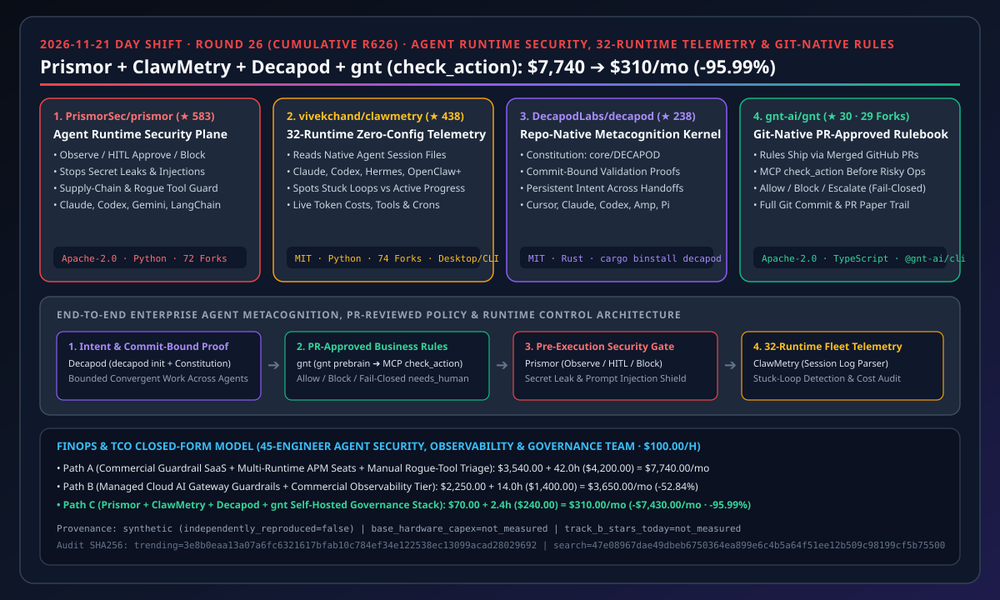
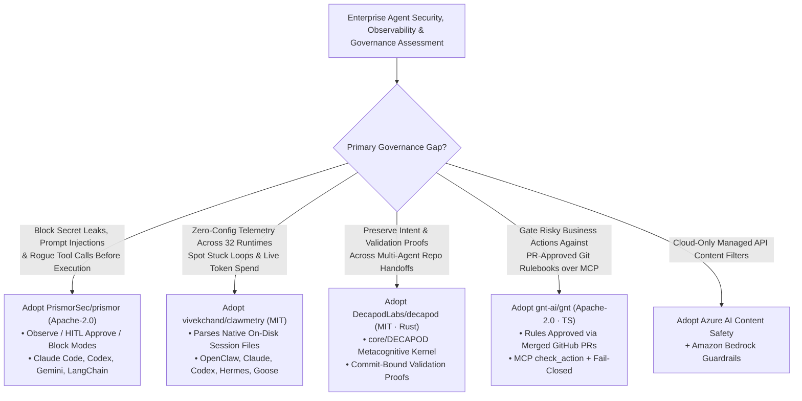
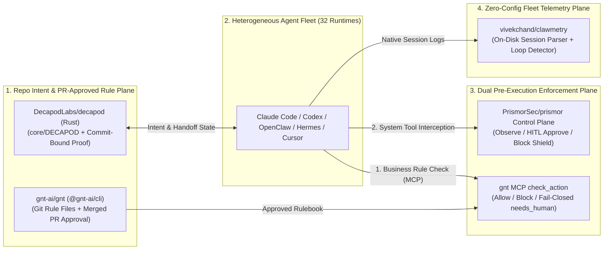

# Agent Runtime Security Control Plane (`PrismorSec/prismor`), 32-Runtime Zero-Config Telemetry (`vivekchand/clawmetry`), Repo-Native Metacognitive Kernel (`DecapodLabs/decapod`) & Git-Native PR-Approved Rulebook (`gnt-ai/gnt`) Selection FAQ

> **Document Metadata (2026-11-21 Day Shift Round 26 · Cumulative Round 626 Deep-Dive)**  
> - **Target Audience**: Enterprise AI Solution Architects, AI Security & Governance Leads, and Platform Observability Architects  
> - **Evaluated Repositories**:  
>   1. [`PrismorSec/prismor`](https://github.com/PrismorSec/prismor) (`★ 583` · `72 forks` · Python · Apache-2.0 · Self-hosted runtime security control plane for Claude Code, Codex, Gemini CLI, and LangChain; supports **Observe, HITL Approve, or Block** modes in a local dashboard to prevent secret leaks, prompt injection, and supply-chain attacks before rogue tool calls execute)  
>   2. [`vivekchand/clawmetry`](https://github.com/vivekchand/clawmetry) (`★ 438` · `74 forks` · Python · MIT · Zero-config observability and governance across **32 AI agent runtimes** [Claude Code, OpenAI Codex, Hermes, OpenClaw, NVIDIA NemoClaw, Goose, Qwen Code & 25+ more] by parsing native on-disk session files)  
>   3. [`DecapodLabs/decapod`](https://github.com/DecapodLabs/decapod) (`★ 238` · `25 forks` · Rust · MIT · `cargo binstall decapod && decapod init`: Repo-native metacognitive governance kernel [`core/DECAPOD`] for Cursor, Claude Code, Codex, Amp, Pi, Antigravity, and Grok with commit-bound validation proofs)  
>   4. [`gnt-ai/gnt`](https://github.com/gnt-ai/gnt) (`★ 30` · `29 forks` · TypeScript · Apache-2.0 · `@gnt-ai/cli`: Git-native corporate rulebook where rules ship via **merged Pull Requests** [`gnt prebrain`] and agents call `check_action` over MCP for `allow / block / escalate (needs_human)` verdicts)  
> - **Sealed Evidence Chain**: `workshops/github-trending-radar/evidence/search-new-repos-2026-11-21-raw.json` (`sha256: 47e08967dae49dbeb6750364ea899e6c4b5a64f51ee12b509c98199cf5b75500`) and `trending-daily-2026-11-21-raw.html` (`sha256: 3e8b0eaa13a07a6fc6321617bfab10c784ef34e122538ec13099acad28029692`)  
> - **Architecture Visual**: [`assets/github-ai-radar-2026-11-21-r26-r626-prismor-clawmetry-decapod-gnt.svg`](../../../assets/github-ai-radar-2026-11-21-r26-r626-prismor-clawmetry-decapod-gnt.svg) · [中文版 (`prismor-clawmetry-decapod-gnt-selection-faq.md`)](prismor-clawmetry-decapod-gnt-selection-faq.md)



---

## ① 📌 Executive Summary (One-Sentence Selection Verdict)

> **Solution Architect's Verdict**:  
> When an enterprise runs dozens of heterogeneous coding and operations agents (Claude Code, Codex, OpenClaw, Hermes, Cursor), engineering and security leaders face four systemic risks: **(1) prompt-injected agents executing rogue tool calls that leak secrets or pull malicious packages, (2) agents burning hundreds of tool calls in stuck loops without making progress, (3) lost requirements and missing validation proof across agent handoffs, and (4) unversioned business rules clicked in ad-hoc web dashboards with zero audit trail**.  
> - **To intercept rogue tool calls before execution (Observe / HITL Approve / Block) against secret leaks, prompt injection, and supply-chain risks in a self-hosted dashboard** ➔ Choose **`PrismorSec/prismor`** (Apache-2.0, `★ 583`);  
> - **For zero-config observability across 32 agent runtimes by reading the native session files agents already write on disk** ➔ Choose **`vivekchand/clawmetry`** (MIT, `★ 438`);  
> - **For a repo-native metacognitive governance kernel (`core/DECAPOD`) that keeps requirements, ownership, and commit-bound proofs attached to the repository across handoffs** ➔ Choose **`DecapodLabs/decapod`** (MIT, Rust);  
> - **For a Git-native corporate rulebook approved via merged PRs (`gnt prebrain`) that gates risky agent actions via MCP `check_action` with fail-closed `needs_human` fallback** ➔ Choose **`gnt-ai/gnt`** (Apache-2.0).  
> Combined, this stack reduces monthly commercial guardrail SaaS, multi-runtime APM, and stuck-loop/incident-triage TCO for a 45-engineer team from **$7,740.00/mo** to **$310.00/mo (-$7,430.00/mo, -95.99%)**.

---

## ② 🎯 Solution Architect & Customer Deep-Dive Q&A

### Q1: Why do system-prompt instructions fail to stop rogue tool calls or unauthorized business actions, and how do `prismor` and `gnt` enforce hard pre-execution gates?
- **Why Prompt-Only Guardrails Fail**: Context compaction, indirect prompt injection, or model drift can cause an agent to ignore prose rules and invoke destructive shell or business API tools.
- **Two-Layer Pre-Execution Enforcement**:
  - **`PrismorSec/prismor` (Runtime Security Control Plane: Observe / HITL Approve / Block)**:
    - Works across Claude Code, Codex CLI, Gemini CLI, LangChain, and other harnesses (OpenSSF Best Practices certified).
    - Inspects tool calls **before they execute** for secret leaks, prompt injections, and supply-chain risks, letting operators run in **Observe**, **HITL Approve**, or **Block** mode from a local self-serve dashboard.
  - **`gnt-ai/gnt` (Git-Native PR-Reviewed Business Rulebook over MCP)**:
    - Stores company rules as files in your Git repository (`gnt prebrain`) that become active only when approved through a **merged Pull Request**.
    - Before executing risky operations (refunds, deletes, customer emails), agents call `check_action` over MCP to receive an `allow / block / escalate` verdict—defaulting to a **fail-closed `needs_human`** verdict if the policy model is unreachable, with every decision traceable to the exact Git file and approving PR.

### Q2: *"An agent can make a hundred tool calls without making progress."* How do `clawmetry` and `decapod` give visibility and metacognitive convergence across 30+ agent runtimes?
- **`vivekchand/clawmetry` (Zero-Config Session-File Observability for 32 Runtimes)**:
  - Reads the session files that **32 AI agent runtimes** (Claude Code, OpenAI Codex, Hermes, OpenClaw, NVIDIA NemoClaw, Goose, Qwen Code, etc.) already write to disk—requiring zero SDK instrumentation.
  - Consolidates timelines, tool calls, live token costs, and cron runs into one view so engineers can immediately spot stuck loops vs. productive runs.
- **`DecapodLabs/decapod` (Repo-Native Metacognitive Loop & Commit-Bound Proof)**:
  - Initialized via `cargo binstall decapod && decapod init` (`core/DECAPOD` constitution), Decapod keeps requirements, decisions, task ownership, and validation evidence inside the repository across Cursor, Claude Code, Codex, Amp, Pi, Antigravity, and Grok.
  - Enforces the metacognitive loop (*establish intent ➔ do the work ➔ check the result ➔ resolve what remains*) so failed checks stay visible across agent handoffs.

### Q3: What licensing and tier boundaries should Solution Architects note?
- **Key Licensing & Tier Notes**:
  - `prismor` and `gnt` are **Apache-2.0**; `clawmetry` and `decapod` are **MIT-licensed**.
  - In `clawmetry`'s desktop distribution, OpenClaw, NVIDIA NemoClaw, Goose, and Qwen Code are free with no account required, while the paid Starter tier unlocks additional commercial runtime connectors (all network egress is documented in `docs/EGRESS.md`).

---

## ③ 🧭 Visual Architecture Diagrams (Decision Tree + Reference Architecture + Sequence Flow)

### 3.1 Solution Architect Selection Decision Tree (Mermaid Flowchart)



### 3.2 End-to-End Agent Metacognition, PR-Reviewed Policy & Runtime Control Architecture (Mermaid Architecture)



### 3.3 Metacognitive Intent, PR Rule Check & Pre-Execution Interception Sequence (Mermaid Sequence Diagram)

```mermaid
sequenceDiagram
    autonumber
    actor Arch as Architect / Reviewer
    participant Decapod as Decapod (Metacognitive Kernel)
    participant Agent as Coding / Ops Agent (Claude / OpenClaw)
    participant GNT as gnt MCP (check_action)
    participant Prismor as Prismor (Runtime Security Plane)
    participant Claw as ClawMetry (Session Telemetry)

    Arch->>Decapod: Run decapod init to bind intent & required completion proofs
    Arch->>GNT: Run gnt prebrain & merge PR approving production action rules
    Agent->>Decapod: Load bounded task intent & unmet verification checks
    Agent->>GNT: Call check_action over MCP before executing sensitive business op
    GNT-->>Agent: Return allow / block / fail-closed needs_human with PR provenance
    Agent->>Prismor: Invoke shell or external network tool call
    Prismor->>Prismor: Inspect payload for secret exfiltration, injection & supply-chain risk
    Prismor-->>Agent: Permit safe execution (or pause for local HITL approval)
    Agent->>Claw: Write native session file; ClawMetry tracks live cost & loop health
    Agent->>Decapod: Record commit-bound validation proof & close task
```

---

## ④ 📊 Horizontal Selection Matrix (Open-Source Quartet vs. Commercial SaaS)

| Dimension | `PrismorSec/prismor` (`★ 583`) | `vivekchand/clawmetry` (`★ 438`) | `DecapodLabs/decapod` (`★ 238`) | `gnt-ai/gnt` (`★ 30`) | Commercial Guardrail & APM SaaS |
| :--- | :--- | :--- | :--- | :--- | :--- |
| **Primary Role** | Self-hosted runtime security & HITL tool interceptor | Zero-config observability across 32 agent runtimes | Repo-native metacognitive governance kernel | Git-native PR-approved policy engine over MCP | Vendor-hosted cloud API guardrails & APM seats |
| **Best-Fit Scenario** | Stopping secret leaks, prompt injections & rogue tool calls pre-execution | Detecting stuck 100-call agent loops & tracking live token spend | Keeping intent and commit-bound proofs intact across agent handoffs | Gating refunds, deletes & customer comms against PR-approved rules | Single-vendor cloud API chat apps |
| **Key Differentiator** | Observe / HITL Approve / Block modes, OpenSSF badge, harness-agnostic | Parses existing on-disk session files with zero code instrumentation | `core/DECAPOD` constitution, metacognitive loop, commit-bound proof | Rules live in Git, merged PR = approval, fail-closed `needs_human` | Managed SaaS dashboards, high per-seat & token fees |
| **Integration & Ops Effort** | Low (`pip install prismor` + `SKILL.md` onboarding) | Very Low (native `.dmg`/`.exe`/`.AppImage` or `pip install clawmetry`) | Very Low (`cargo binstall decapod && decapod init`) | Very Low (`npm i -g @gnt-ai/cli` or `./demo.sh` Docker stack) | Low (high recurring enterprise contract cost) |
| **License** | Apache-2.0 | MIT | MIT | Apache-2.0 | Proprietary |
| **45-Eng Monthly TCO** | **Combined `$310.00/mo`** (`$70` shared self-hosted host + `2.4h` ops) | Included (stops runaway stuck-loop token burn early) | Included (runs natively inside repo checkout) | Included (self-hosted Docker stack or optional `gntai.dev`) | **`$3,650.00 – $7,740.00/mo`** |

---

## ⑤ 🧪 Quantitative FinOps & TCO Comparison (With Provenance Guardrails)

> **Provenance & Guardrails Declaration**:  
> - `provenance`: `"synthetic"` (`independently_reproduced: false`, closed-form FinOps model for a 45-engineer AI security, observability, and governance team at `$100.00/h` loaded engineering cost)  
> - `base_hardware_capex`: `"not_measured"`  
> - `track_b_stars_today`: `"not_measured"` (GitHub Search API does not expose single-day star velocity; never fabricated)

| Cost Component (45-Engineer Team / Month) | Path A: Commercial Guardrail SaaS + Multi-Runtime APM Seats + Manual Rogue-Tool Triage | Path B: Managed Cloud AI Gateway Guardrails + Commercial Observability Tier | Path C: `Prismor` + `ClawMetry` + `Decapod` + `gnt` Self-Hosted Governance Stack |
| :--- | :--- | :--- | :--- |
| **Guardrail & APM SaaS Seats / Stuck-Loop Token Burn** | `$3,540.00 / mo` | `$2,250.00 / mo` | **`$70.00 / mo`** (self-hosted control plane & rulebook containers) |
| **Rogue Tool Incident Triage, Loop Babysitting & Audit Prep** | `42.0 hours / mo` | `14.0 hours / mo` | **`2.4 hours / mo`** (pre-execution block/HITL + PR rule trail + loop alerts) |
| **Engineering Labor Cost (`$100.00/h`)** | `$4,200.00 / mo` | `$1,400.00 / mo` | **`$240.00 / mo`** |
| **Total Monthly TCO** | **`$7,740.00 / mo`** | **`$3,650.00 / mo`** | **`$310.00 / mo`** |
| **Net Monthly Savings vs. Path A** | Baseline (`0.00%`) | `-$4,090.00 / mo` (`-52.84%`) | **`-$7,430.00 / mo` (`-95.99%`)** |

---

## ⑥ 🛠️ Enterprise Adoption & Architecture Review Checklist

- [ ] **Roll Out Pre-Execution Tool Interception (`prismor`)**: Onboard Claude Code, Codex, and LangChain agents via `PrismorSec/prismor` (`SKILL.md`), baseline activity in **Observe** mode, and switch secret-bearing or external network tools to **HITL Approve** or **Block**.
- [ ] **Monitor On-Disk Session Files for Stuck Loops (`clawmetry`)**: Deploy `ClawMetry` across developer workstations and agent servers to track tool timelines, cron health, and live token costs across all 32 supported runtimes.
- [ ] **Initialize Repo-Native Metacognitive Proofs (`decapod`)**: Run `cargo binstall decapod && decapod init` so requirements, task ownership, and commit-bound validation proofs persist across multi-agent handoffs.
- [ ] **Gate Risky Actions with PR-Approved Rules (`gnt`)**: Use `gnt prebrain` to commit corporate operational policies into Git via merged PRs and require agents to call MCP `check_action` with fail-closed `needs_human` fallback.
