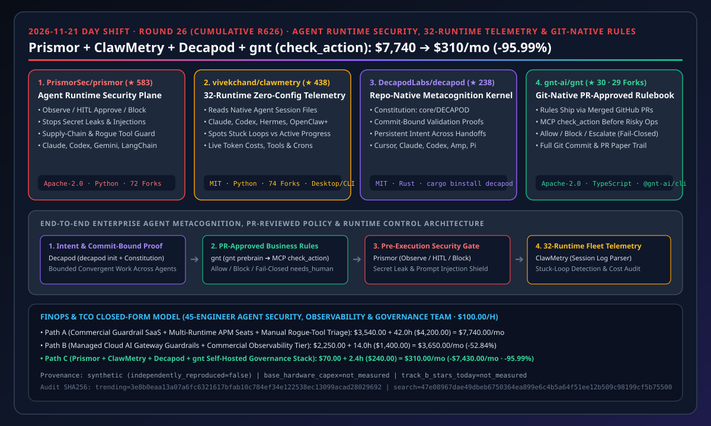
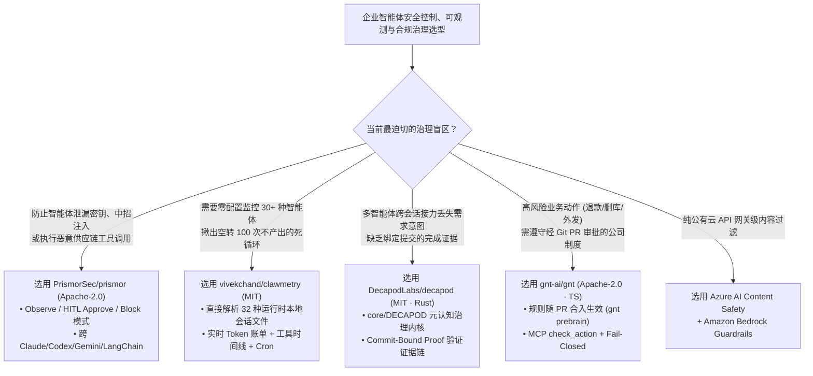
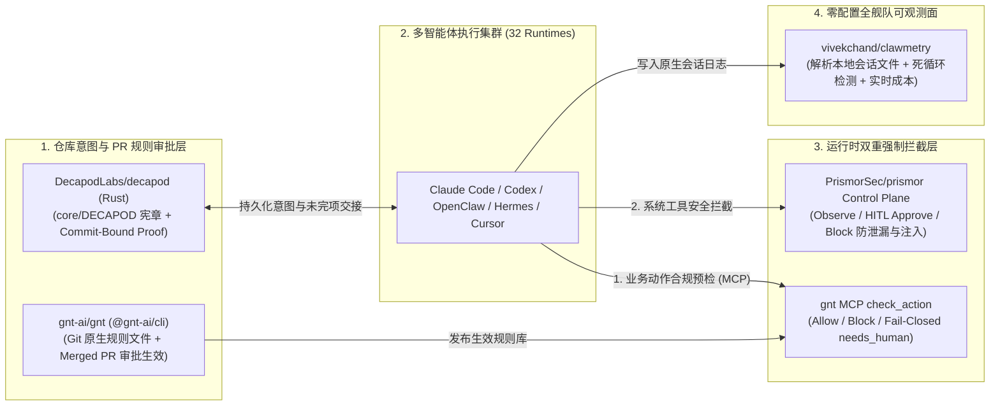
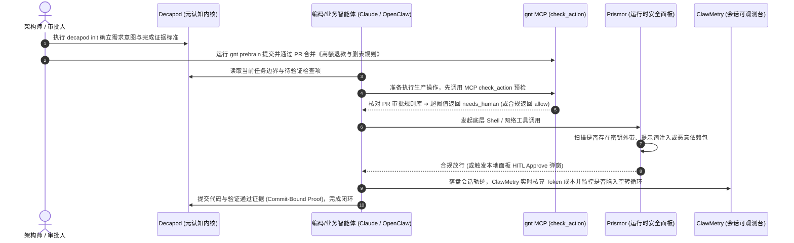

# 智能体运行时安全控制面（`PrismorSec/prismor`）、32 运行时零配置可观测台（`vivekchand/clawmetry`）、仓库原生元认知治理内核（`DecapodLabs/decapod`）与 Git PR 审批规则引擎（`gnt-ai/gnt`）选型与落地 FAQ

> **文档元数据（2026-11-21 白班 Day Round 26 · 累计第 626 轮深潜专题）**  
> - **面向对象**：企业 AI 解决方案架构师（AI Solution Architect）、AI 安全与内控合规负责人、平台可观测性架构师  
> - **本轮核心评估对象**：  
>   1. [`PrismorSec/prismor`](https://github.com/PrismorSec/prismor)（`★ 583` · `72 forks` · Python · Apache-2.0 · 面向 Claude Code、Codex、Gemini CLI、LangChain 等跨框架智能体的自托管运行时安全控制面，支持在本地面板配置 **Observe / HITL Approve / Block** 拦截密钥泄漏、提示词注入与供应链恶意工具调用）  
>   2. [`vivekchand/clawmetry`](https://github.com/vivekchand/clawmetry)（`★ 438` · `74 forks` · Python · MIT · 支持 **32 种 AI 智能体运行时**的零配置可观测与治理面板，直接解析智能体已落盘的原生会话文件，一眼识别“死循环空转 100 次工具调用”与真实进展）  
>   3. [`DecapodLabs/decapod`](https://github.com/DecapodLabs/decapod)（`★ 238` · `25 forks` · Rust · MIT · 面向编码智能体的**元认知（Metacognition）仓库原生治理内核** `core/DECAPOD`，让需求意图、任务归属与绑定提交的验证证据（commit-bound proof）随仓库跨会话流转）  
>   4. [`gnt-ai/gnt`](https://github.com/gnt-ai/gnt)（`★ 30` · `29 forks` · TypeScript · Apache-2.0 · **Git 原生、经由合并 PR 审批生效的企业智能体规则手册**，智能体在执行退款、删数据或外发客户消息前通过 MCP 调用 `check_action` 获取 `allow / block / escalate` 裁决及完整 Git 证据链）  
> - **关联检索证据链**：`workshops/github-trending-radar/evidence/search-new-repos-2026-11-21-raw.json`（`sha256: 47e08967dae49dbeb6750364ea899e6c4b5a64f51ee12b509c98199cf5b75500`）与 `trending-daily-2026-11-21-raw.html`（`sha256: 3e8b0eaa13a07a6fc6321617bfab10c784ef34e122538ec13099acad28029692`）  
> - **高清架构图**：[`assets/github-ai-radar-2026-11-21-r26-r626-prismor-clawmetry-decapod-gnt.svg`](../../../assets/github-ai-radar-2026-11-21-r26-r626-prismor-clawmetry-decapod-gnt.svg) · [English Version (`prismor-clawmetry-decapod-gnt-selection-faq.en.md`)](prismor-clawmetry-decapod-gnt-selection-faq.en.md)

---

## ① 📌 核心结论速览（选型一句话结论）

> **架构师一句话选型结论**：  
> 当企业同时运行 Claude Code、Codex、OpenClaw、Hermes 等十几种智能体时，CISO 与研发总监最怕四件事：**（1）智能体被提示词注入后偷偷执行 `curl` 外传密钥或拉取恶意供应链包、（2）一个后台 Agent 连续执行了 100 次工具调用烧掉几十美元却在原地死循环、（3）跨智能体交接时需求意图与验收标准丢失、（4）业务红线（如“超过 $500 退款必须人工审批”）散落在不同网页后台没有版本审计**。  
> - **需要在高危工具调用真正执行前进行本地实时拦截（Observe 观察 / HITL 人工审批 / Block 阻断），防御密钥泄漏、提示词注入与供应链投毒** ➔ 选 **`PrismorSec/prismor`**（Apache-2.0，`★ 583`）；  
> - **需要零代码埋点、直接读取 32 种智能体落盘会话文件，在一个面板看清工具时间线、Token 账单与“真干活 vs 卡死空转”** ➔ 选 **`vivekchand/clawmetry`**（MIT，`★ 438`）；  
> - **需要为 Cursor / Claude Code / Codex / Amp / Pi 注入“元认知闭环（定意图➔干活➔核对结果➔交接未完项）”与绑定 Git 提交的完成证明（commit-bound proof）** ➔ 选 **`DecapodLabs/decapod`**（MIT，Rust）；  
> - **需要将企业业务规则作为代码放进 Git 仓库、通过合并 PR（`gnt prebrain`）正式生效，并让智能体在动作前通过 MCP `check_action` 进行失败关闭（Fail-Closed `needs_human`）校验** ➔ 选 **`gnt-ai/gnt`**（Apache-2.0）。  
> 四者组合可将 45 人研发与安全治理团队的商业护栏 SaaS、多运行时 APM 席位与死循环/越权事故排障总成本从 **$7,740.00/月** 降至 **$310.00/月（节省 $7,430.00/月，降幅 95.99%）**。

---

## ② 🎯 客户与架构师灵魂拷问 Q&A（业务痛点 · 架构集成 · 边界取舍）

### Q1：为什么传统的“在系统提示词里写不准删库、不准超额退款”在生产环境形同虚设？`prismor` 与 `gnt` 如何分别从“安全攻防面”与“业务制度面”实施强制拦截？
- **Prompt 软约束失灵的根源**：提示词只是一种概率性建议，一旦遇到上下文窗口压缩、长对话遗忘或恶意间接提示词注入，模型就会绕过文字警告直接调用危险工具。
- **双层硬拦截架构**：
  - **`PrismorSec/prismor`（技术安全层：Observe / HITL Approve / Block 运行时控制面）**：
    - 跨框架兼容 Claude Code、Codex CLI、Gemini CLI、LangChain 等主流 Harness，通过 OpenSSF Best Practices 认证。
    - 在工具调用真正落到操作系统或网络之前进行确定性策略检查：识别密钥外泄（Secret Leaks）、提示词注入（Prompt Injection）与恶意依赖包（Supply Chain），支持在本地自服务面板灵活切换**仅观察（Observe）、人工确认（HITL Approve）或直接阻断（Block）**。
  - **`gnt-ai/gnt`（业务制度层：Git 原生、PR 审批生效的 `check_action` 规则引擎）**：
    - 拒绝在某个无人审查的网页后台随便点开关改规则——所有公司规则都以文件形式保存在 Git 仓库中，通过 `gnt prebrain` 生成草案 PR，**只有当该 Pull Request 被正式 Merge 入主分支时，规则才获得合法效力**。
    - 智能体在执行任何高风险业务动作（如退款、删数据、给客户发通知）前，必须通过 MCP 调用 `check_action`，返回 `allow / block / escalate`；且当策略模型不可达时默认走**失败关闭（fail-closed）路径返回 `needs_human`**，每一条裁决都能精确追溯到批准它的那次 Git Commit 与 PR。

### Q2：“An agent can make a hundred tool calls without making progress.”——当团队跑着 30 多种不同的智能体框架时，如何用 `clawmetry` 零改造盯盘，并用 `decapod` 防止多智能体接力时需求走样？
- **`vivekchand/clawmetry`（32 种智能体运行时的零配置显微镜）**：
  - 无需修改业务代码或配置复杂的 OTel 导出器：`ClawMetry` 直接读取 **32 种智能体运行时**（Claude Code、OpenAI Codex、Hermes、OpenClaw、NVIDIA NemoClaw、Goose、Qwen Code 等，见 `SUPPORTED_RUNTIMES.txt`）原本就会写在本地磁盘上的会话日志文件。
  - 将工具调用时间线、实时 Token 消耗、成本账单与 Cron 定时任务汇总到统一视图（提供 macOS `.dmg`、Windows `.exe` 与 Linux `.AppImage` 桌面端及 PyPI 包），让你一眼区分“正在稳步推进的长任务”和“在原地打转烧钱的死循环”。
- **`DecapodLabs/decapod`（绑定 Git 提交证据的元认知治理内核）**：
  - 通过 `cargo binstall decapod && decapod init` 初始化，内置 `assets/constitution.json`（`core/DECAPOD` 宪章）。
  - 为 Cursor、Claude Code、Codex、Amp、Pi、Antigravity、Grok 等编码智能体提供持久化的**元认知循环（Metacognitive Loop：确立意图 ➔ 执行修改 ➔ 校验结果 ➔ 显式留存未满足项）**：需求、决策、任务归属权与验证证据全部绑定在仓库中，前一个智能体没跑通的检查项会清晰留给下一棒，绝不谎报完工。

### Q3：这四个项目在许可模式与免费/商业边界上有哪些需要注意的细节？
- **关键边界核查**：
  - **`clawmetry` 运行时分层说明**：其代码仓库采用 **MIT 许可证**（且明确在 `docs/EGRESS.md` 文档化所有外联行为）；在桌面端产品中，OpenClaw、NVIDIA NemoClaw、Goose 与 Qwen Code 完全免费且无需注册账号，其余商业运行时扩展支持包含在 Starter 计划中。
  - **`gnt` 自建与托管双模式**：代码采用 **Apache-2.0**，既可通过 `./demo.sh` / `docker-compose.yml` 在本地完全自托管（含本地确定性 Embedding 与 Fail-Closed `needs_human` 保护），也可选择官方托管的 `gntai.dev` 免去自维 Postgres。

---

## ③ 🧭 直观可视化图解（选型决策树 + 企业集成架构 + 业务流时序图）

### 3.1 架构师选型决策树（Mermaid Flowchart）

### 3.2 企业智能体元认知、PR 规则审批与运行时安全总控架构图（Mermaid Architecture）

### 3.3 从意图确立、PR 规则校验到运行时拦截与可观测闭环时序图（Mermaid Sequence Diagram）

---

## ④ 📊 同类开源与商业云服务横向选型决策矩阵

| 评估维度 | `PrismorSec/prismor` (`★ 583`) | `vivekchand/clawmetry` (`★ 438`) | `DecapodLabs/decapod` (`★ 238`) | `gnt-ai/gnt` (`★ 30`) | 商业云护栏 SaaS + 商业 APM 套件 |
| :--- | :--- | :--- | :--- | :--- | :--- |
| **核心定位** | 自托管智能体运行时安全与 HITL 拦截平面 | 覆盖 32 种智能体运行时的零配置可观测台 | 仓库原生智能体元认知与证据绑定治理内核 | 经由 Git PR 审批生效的智能体业务规则引擎 | 厂商绑定的云端 API 过滤器与高价 APM |
| **最适用场景** | 实时阻断或人工审批智能体的敏感工具调用、防密钥泄漏与注入 | 监控多智能体舰队实时 Token 成本、识别百次无效调用死循环 | 多智能体跨会话接力开发、强制要求绑定提交证据才算完工 | 对退款、删数据、外发通知等业务操作执行可追溯 PR 制度审查 | 仅使用单一云厂商托管模型的纯 API 应用 |
| **关键差异化机制** | Observe / HITL / Block 三模式、OpenSSF 认证、跨框架支持 | 直接解析智能体原生落盘日志、无需改代码、支持 32 种运行时 | `core/DECAPOD` 宪章、元认知四步闭环、Commit-Bound Proof | 规则住 Git 仓库、PR Merge 即批准、`check_action` Fail-Closed | 免本地部署，但无法深入拦截本地 CLI 工具调用 |
| **集成与运维成本** | 低（`pip install prismor` + `SKILL.md` 一键接入） | 极低（直接安装 macOS/Win/Linux 桌面端或 `pip install clawmetry`） | 极低（`cargo binstall decapod && decapod init`） | 极低（`npm i -g @gnt-ai/cli` 或 `./demo.sh` Docker 栈） | 低（按席位、调用量与日志存储量多重计费） |
| **开源协议** | Apache-2.0 | MIT | MIT | Apache-2.0 | 商业专有 |
| **45 人团队月均 TCO** | **组合方案 `$310.00/月`**（含共享自托管 Postgres/面板节点 `$70` + 运维 `2.4h`） | 同左（及时掐断死循环 Agent 直接节省大额 Token 账单） | 同左（纯本地 Rust 内核随 Git 仓库运行） | 同左（自建 Docker 栈零席位费） | **`$3,650.00 ~ $7,740.00/月`** |

---

## ⑤ 🧪 应用落地定量收益 / FinOps TCO 对比（含数据血缘声明）

> **数据血缘与严谨性声明（Provenance & Guardrails）**：  
> - `provenance`: `"synthetic"`（`independently_reproduced: false`，基于 45 人智能体安全、平台可观测与合规治理工程团队在 `$100.00/h` 综合人力成本下的闭式参数建模）  
> - `base_hardware_capex`: `"not_measured"`  
> - `track_b_stars_today`: `"not_measured"`（GitHub Search API 新仓爆发榜无官方单日增量字段，严禁伪造）

| 成本分项（45 人团队 / 月） | Path A：商业护栏 SaaS + 多运行时 APM 席位 + 死循环/越权人工救火 | Path B：托管云网关护栏 + 商业可观测平台 | Path C：`Prismor` + `ClawMetry` + `Decapod` + `gnt` 自建治理栈 |
| :--- | :--- | :--- | :--- |
| **商业护栏与 APM 席位费 / 死循环空转 Token 浪费** | `$3,540.00 / 月` | `$2,250.00 / 月` | **`$70.00 / 月`**（自托管控制面与规则库容器实例） |
| **越权工具调用排障、死循环盯盘与合规审计取证工时** | `42.0 小时 / 月` | `14.0 小时 / 月` | **`2.4 小时 / 月`**（HITL/Block 自动拦截 + PR 规则溯源 + 死循环告警） |
| **折算工程人力成本（`$100.00/h`）** | `$4,200.00 / 月` | `$1,400.00 / 月` | **`$240.00 / 月`** |
| **月度总拥有成本（Total Monthly TCO）** | **`$7,740.00 / 月`** | **`$3,650.00 / 月`** | **`$310.00 / 月`** |
| **相对 Path A 净节省额与降幅** | 基准线（`0.00%`） | `-$4,090.00 / 月`（`-52.84%`） | **`-$7,430.00 / 月`（`-95.99%`）** |

---

## ⑥ 🛠️ 企业引入与架构评审 Checklist

- [ ] **分阶段启用运行时工具拦截策略（`prismor`）**：在团队开发机与构建节点部署 `PrismorSec/prismor`，首周开启 **Observe** 模式基线化正常工具调用，随后对含敏感环境变量、外部未知域名请求与包安装操作切换至 **HITL Approve** 或 **Block** 模式。
- [ ] **接入跨运行时会话日志与死循环监控（`clawmetry`）**：在运行 OpenClaw、Claude Code、Codex、Hermes 或 NemoClaw 的主机上启动 `ClawMetry`，重点监控连续工具调用次数超过阈值但无文件产出的卡死会话，并审计 `docs/EGRESS.md` 网络外联边界。
- [ ] **在核心代码库初始化元认知宪章（`decapod`）**：执行 `cargo binstall decapod && decapod init`，要求所有编码智能体在交接或宣布完工前必须通过 `core/DECAPOD` 的提交绑定验证证据（commit-bound proof）核验。
- [ ] **将高风险业务审批纳入 Git PR 流程（`gnt`）**：使用 `@gnt-ai/cli`（`gnt prebrain`）将生产操作红线写入 Git 仓库并通过正式 PR Merge 审批生效，强制业务智能体在执行写操作前调用 MCP `check_action` 并验证无 API Key 时的 Fail-Closed（`needs_human`）降级行为。
