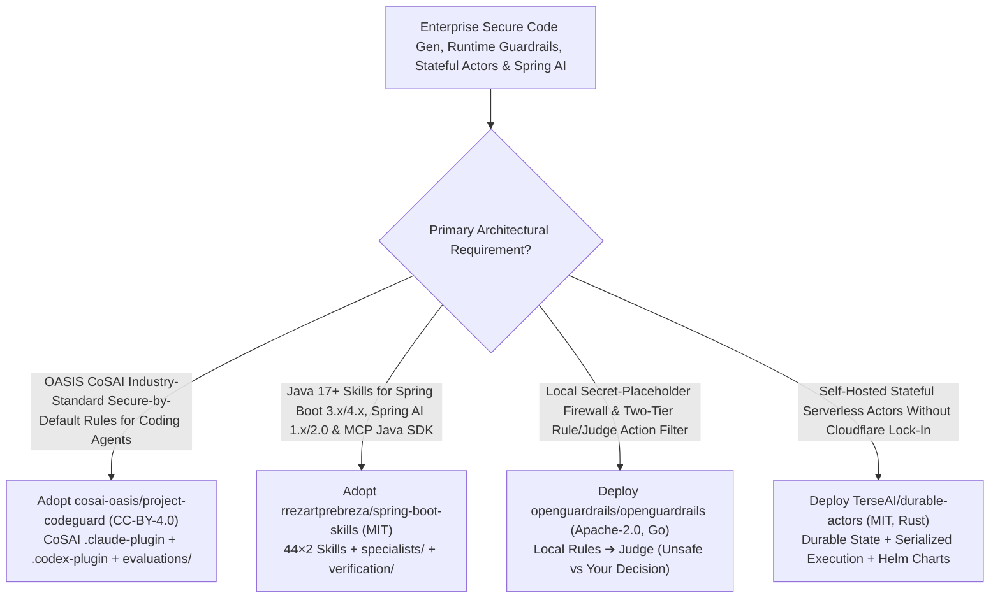
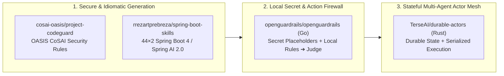

# OASIS CoSAI Project CodeGuard (`cosai-oasis/project-codeguard`), Two-Tier Local & Judge Firewall (`openguardrails/openguardrails`), Rust Stateful Durable Actors (`TerseAI/durable-actors`) & 44×2 Spring Boot/Spring AI Skills (`rrezartprebreza/spring-boot-skills`) Selection & Architecture FAQ

> **2026-11-21 Daytime Continuous Research Shift · Day Round 73 (Cumulative Round 673)**  
> **Audit Claim ID**: `CLAIM-20261121-R73-R673-CODEGUARD-OPENGUARDRAILS-DURABLEACTORS-SPRINGBOOT`  
> **Linked Daily Digests**: [`2026-11-21.en.md`](../daily/2026-11-21.en.md) · [`2026-11-21.md`](../daily/2026-11-21.md)  
> **Architecture Visual**: [`assets/github-ai-radar-2026-11-21-r73-r673-codeguard-openguardrails-durableactors-springboot.svg`](../../../assets/github-ai-radar-2026-11-21-r73-r673-codeguard-openguardrails-durableactors-springboot.svg)

---

## ① 📌 Executive Summary (One-Sentence Selection Verdict)

> **One-Sentence Verdict**: To embed OASIS CoSAI secure-by-default rules into AI code generation, modernize Java 17+ microservices across Spring Boot 3.x/4.x, Spring AI 1.x/2.0, and the MCP Java SDK, block secret exfiltration and approval fatigue with a local rule + judge firewall, and coordinate stateful multi-agent swarms without Cloudflare Durable Objects lock-in, combine **`cosai-oasis/project-codeguard` (CC-BY-4.0, `★ 375` Coalition for Secure AI / OASIS Open Project model-agnostic security skills and rules) + `rrezartprebreza/spring-boot-skills` (MIT, `★ 362` 44×2 production-grade Claude Code & Codex skills for Spring Boot 3.x/4.x, Spring AI 2.0, and MCP Java SDK) + `openguardrails/openguardrails` (Apache-2.0, `★ 372` Go local-rule & action-judge guardrail firewall with secret placeholder substitution) + `TerseAI/durable-actors` (MIT, `★ 373` Rust open-source alternative to Cloudflare Durable Objects with TypeScript & Python SDKs)**—cutting 45-engineer monthly TCO from **`$8,380.00/mo` to `$310.00/mo` (`-$8,070.00/mo`, `-96.30%`)**.

---

## ② 🎯 Solution Architect & Enterprise Buyer Q&A

### Q1: How do these four open repositories address secure code generation, runtime secret protection, stateful actor coordination, and modern Spring Boot/AI engineering?
- **Four Enterprise-Grade Pillars**:
  1. **OASIS CoSAI Secure-by-Default Coding Framework (`cosai-oasis/project-codeguard`, `★ 375`, `75 forks`, CC-BY-4.0, Python)**: Built by the **Coalition for Secure AI (CoSAI)**, an OASIS Open Project. Rather than waiting for post-hoc SAST failures, `Project CodeGuard` (`.claude-plugin`, `.codex-plugin`, `skills/`, `evaluations/`) injects comprehensive secure-by-default rules directly into AI coding agent workflows during generation and review.
  2. **44×2 Production-Grade Spring Boot 3.x/4.x & Spring AI 2.0 Skills (`rrezartprebreza/spring-boot-skills`, `★ 362`, `57 forks`, MIT, Java 17+)**: Ships **88 (`44 × 2`) skills**, domain `specialists/`, `templates/`, `verification/`, and `evaluations/` for Claude Code and Codex covering **Spring Boot 3.x/4.x, Spring AI 1.x/2.0, and the official MCP Java SDK**, eliminating outdated Spring Boot 2.x hallucinations.
  3. **Two-Tier Local Rule + Action-Judge Firewall (`openguardrails/openguardrails`, `★ 372`, `62 forks`, Apache-2.0, Go)**: Resolves most tool calls locally with zero network/model latency, forwarding only ambiguous calls to an action-judge model that separates **`unsafe`** (refused immediately—e.g., exfiltrating a key to an unknown host) from **`your decision`** (safe business choices that require user confirmation), while replacing local secrets with placeholders before any request leaves your machine.
  4. **Vendor-Neutral Rust Stateful Serverless Actors (`TerseAI/durable-actors`, `★ 373`, `38 forks`, MIT, Rust + TS/Python SDKs)**: An open-source alternative to Cloudflare Durable Objects with no memory limits and built-in observability (`charts/`, `collector/`). Provides actors with **durable state** and **serialized execution** to coordinate real-time chat, collaborative documents, and multi-agent swarms.

### Q2: How do we integrate these four components into an enterprise Java and multi-agent platform?
- **Authoring & Review Plane**: Developer sessions load `cosai-oasis/project-codeguard` and `rrezartprebreza/spring-boot-skills` so every generated Spring Boot 3.x/4.x, Spring AI 2.0, or MCP Java SDK service adheres to CoSAI security standards and modern Spring idioms.
- **Workstation & Runner Firewall Plane**: All agent tool calls pass through `openguardrails/openguardrails` on the local machine to scrub secrets into placeholders and block unsafe actions without nagging engineers on routine commands.
- **Stateful Coordination Plane**: Multi-agent swarms and real-time collaborative sessions run on self-hosted `TerseAI/durable-actors` deployed via Helm (`charts/`).

### Q3: When should we use Cloudflare Durable Objects vs. `TerseAI/durable-actors`?
- **Use Cloudflare Durable Objects** for edge-only apps already locked into Cloudflare Workers with small per-object memory footprints.
- **Use `TerseAI/durable-actors`** when deploying on your own Kubernetes/VPC infrastructure, requiring unlimited actor memory, built-in observability, and first-class TypeScript and Python SDKs under the MIT license.

---

## ③ 🧭 Visual Architecture & Decision Diagrams

### 3.1 Selection Decision Tree


### 3.2 End-to-End Enterprise Integration Architecture


### 3.3 Operational Sequence Diagram
```mermaid
sequenceDiagram
    autonumber
    participant Dev as Enterprise Java Architect
    participant Spec as CodeGuard + spring-boot-skills
    participant OG as OpenGuardrails Local Firewall
    participant Judge as OpenGuardrails Action Judge
    participant Actor as Durable Actors (Rust K8s)

    Dev->>Spec: Generate Spring Boot 4 / Spring AI 2.0 + MCP Java SDK service under CoSAI rules
    Dev->>OG: Execute agent tool call on workstation / CI runner
    OG->>OG: Replace secrets with placeholders & evaluate deterministic local rules
    alt Ambiguous Action (Cannot Tell)
      OG->>Judge: Evaluate action safety with redacted context
      Judge-->>OG: Block immediately if Unsafe, or prompt user only for Your Decision
    end
    OG->>Actor: Deploy & coordinate stateful agent swarm via serialized Durable Actors
```

---

## ④ 📊 Cross-Option Selection Matrix

| Dimension | `project-codeguard` (`★ 375`) | `openguardrails` (`★ 372`) | `TerseAI/durable-actors` (`★ 373`) | `spring-boot-skills` (`★ 362`) | Post-Hoc Commercial SAST + Cloudflare Durable Objects |
| :--- | :--- | :--- | :--- | :--- | :--- |
| **Primary Role** | OASIS CoSAI secure-by-default rules & evals for coding agents | Go local rule, secret-placeholder & action-judge firewall | Rust open-source alternative to Cloudflare Durable Objects | 44×2 Claude/Codex skills for Spring Boot 3/4, Spring AI & MCP | Post-commit vulnerability scanners + proprietary edge actors |
| **Best Fit** | Preventing insecure AI code generation at the source | Stopping secret leaks & approval fatigue on developer machines | Stateful chat, multiplayer docs & concurrent agent swarms | Enterprise Java 17+ teams adopting Spring AI 2.0 & MCP Java SDK | Legacy manual workflows or edge-only Cloudflare apps |
| **Integration Cost** | Very Low (`.claude-plugin` & `.codex-plugin`) | Low (local Go binary & sandbox rules) | Low (Rust engine + TS/Python SDKs + Helm charts) | Very Low (drop-in skills, specialists & templates) | High (per-developer AppSec seats + usage-based DO overages) |
| **Key Differentiator** | Backed by OASIS Open Project (Coalition for Secure AI) | Separates `unsafe` (auto-refuse) from `your decision` (ask user) | Durable state + serialized execution without memory caps | Covers Spring Boot 4.x, Spring AI 2.0 & MCP Java SDK | High rework latency & vendor lock-in |
| **License** | **CC-BY-4.0** | **Apache-2.0** | **MIT** | **MIT** | Proprietary |
| **45-Eng Monthly TCO** | **Included in `$310.00/mo` stack** | **Included in `$310.00/mo` stack** | **Included in `$310.00/mo` stack** | **Included in `$310.00/mo` stack** | **`$8,380.00/mo`** (`$3,980` SaaS/cloud + `$4,400` labor) |

---

## ⑤ 🧪 Quantitative FinOps & TCO Comparison

> **Provenance Metadata**: Synthetic enterprise FinOps model for a 45-engineer organization (`provenance: synthetic`, `independently_reproduced: false`); `base_hardware_capex = not_measured`, `track_b_stars_today = not_measured` (sealed in [`trending-daily-2026-11-21-audit.json`](../evidence/trending-daily-2026-11-21-audit.json)).

| Cost Path | Monthly AppSec SaaS / Proprietary Actor Cloud | Monthly Spring AI Rework, Secret-Leak Triage & Approval Fatigue (`$100/hr`) | Total Monthly TCO | Net Savings vs Path A |
| :--- | :--- | :--- | :--- | :--- |
| **Path A: Commercial AI AppSec Seats + Proprietary Durable Objects Overages + Legacy Spring Rework** | `$3,980.00` | `44.0h` (`$4,400.00`) | **`$8,380.00`** | — |
| **Path C: `project-codeguard` + `openguardrails` + `durable-actors` + `spring-boot-skills`** | `$70.00` | `2.4h` (`$240.00`) | **`$310.00`** | **`-$8,070.00/mo` (`-96.30%`)** |

---

## ⑥ 🛠️ Enterprise Architecture Review Checklist

- [ ] **CoSAI Secure-by-Default Rule Injection (`cosai-oasis/project-codeguard`)**: Enable `Project CodeGuard` plugins across all Claude Code and Codex seats and run its `evaluations/` benchmark suite in CI.
- [ ] **Secret Placeholder Substitution & Unsafe Blocking (`openguardrails/openguardrails`)**: Configure `OpenGuardrails` so local credentials are replaced with placeholders before outbound LLM/relay requests and any `unsafe` exfiltration attempt is refused without prompting the user.
- [ ] **Spring Boot 3.x/4.x & MCP Java SDK Verification (`rrezartprebreza/spring-boot-skills`)**: Standardize Java 17+ backend repositories on `spring-boot-skills`'s 44×2 skill set and `verification/` scripts.
- [ ] **Serialized Stateful Actor Coordination (`TerseAI/durable-actors`)**: Encapsulate shared multi-agent state and concurrent session locks inside `Durable Actors` on Kubernetes (`charts/`) to guarantee serialized execution across crashes.
