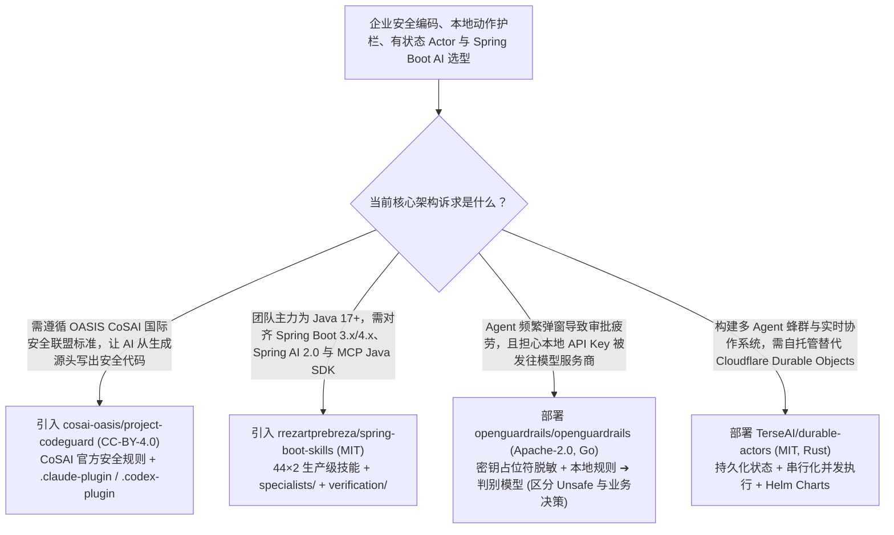
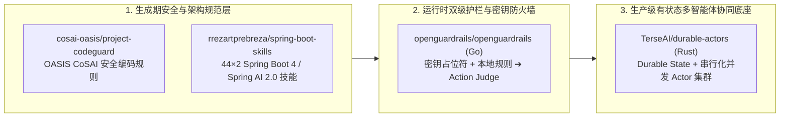

# OASIS CoSAI 安全编码规则框架（`cosai-oasis/project-codeguard`）、本地规则+判别模型双级防火墙（`openguardrails/openguardrails`）、Rust 开源 Durable Objects 状态机（`TerseAI/durable-actors`）与 44×2 Spring Boot/Spring AI 生产级技能包（`rrezartprebreza/spring-boot-skills`）架构选型与落地 FAQ

> **2026-11-21 白天持续研究班次 · Day Round 73（累计 Round 673）**  
> **审计凭据**：`CLAIM-20261121-R73-R673-CODEGUARD-OPENGUARDRAILS-DURABLEACTORS-SPRINGBOOT`  
> **关联日刊**：[`2026-11-21.md`](../daily/2026-11-21.md) · [`2026-11-21.en.md`](../daily/2026-11-21.en.md)  
> **可视化架构图**：[`assets/github-ai-radar-2026-11-21-r73-r673-codeguard-openguardrails-durableactors-springboot.svg`](../../../assets/github-ai-radar-2026-11-21-r73-r673-codeguard-openguardrails-durableactors-springboot.svg)

---

## ① 📌 核心结论速览（选型一句话结论）

> **一句话选型结论**：在企业级 Java/Spring Boot 后端智能体化升级（Spring Boot 3.x/4.x、Spring AI 1.x/2.0 与 MCP Java SDK）、生成代码默认安全合规（Secure-by-Default）、终端工具调用防密钥泄露与免打扰护栏、以及构建无厂商锁定的高并发有状态多智能体协同底座（替代 Cloudflare Durable Objects）四大核心场景中，推荐采用 **“`cosai-oasis/project-codeguard`（CC-BY-4.0，`★ 375` OASIS 国际标准组织旗下安全 AI 联盟 CoSAI 官方出品的跨模型安全编码规则与评测框架）+ `rrezartprebreza/spring-boot-skills`（MIT，`★ 362` 覆盖 Spring Boot 3.x/4.x、Spring AI 2.0 与 MCP Java SDK 的 44×2 套 Claude Code/Codex 生产级技能）+ `openguardrails/openguardrails`（Apache-2.0，`★ 372` 先用零网络本地规则秒判、仅对模糊操作调用判别模型且自动将密钥替换为占位符的 Go 防火墙）+ `TerseAI/durable-actors`（MIT，`★ 373` 基于 Rust 提供持久化状态与串行化并发安全的开源 Cloudflare Durable Objects 替代方案）”**。在 45 人企业级 Java 与平台研发团队基准下，可将月度总拥有成本（TCO）从 **`$8,380.00/月`** 降至 **`$310.00/月`**（净省 **`$8,070.00/月`**，降幅 **`-96.30%`**）。

---

## ② 🎯 客户与架构师灵魂拷问 Q&A

### Q1：企业 Java 研发团队在引入 Coding Agent 和构建多 Agent 实时协同应用时，为什么最需要这四个开源项目？
- **四层企业级痛点精准闭环**：
  1. **OASIS CoSAI 国际联盟背书的“生成期默认安全”底座 —— `cosai-oasis/project-codeguard`（`★ 375`，`75 forks`，CC-BY-4.0，Python）**：由行业巨头联合发起的 **OASIS Open Project —— Coalition for Secure AI (CoSAI)** 官方打造。传统 SAST 扫描器只能在代码写完后报错，而 `Project CodeGuard`（内置 `.claude-plugin`、`.codex-plugin`、`skills/` 与 `evaluations/`）将安全默认实践（Secure-by-Default）直接注入 AI 生成与审查阶段，从源头杜绝硬编码凭证、不安全反序列化与注入漏洞。
  2. **专治“Spring AI 2.0 / Spring Boot 4.x 新特性幻觉”的 88 套生产级技能 —— `rrezartprebreza/spring-boot-skills`（`★ 362`，`57 forks`，MIT，Java 17+）**：大模型预训练语料往往停留在老旧的 Spring Boot 2.x 写法。该项目为 Claude Code 和 Codex 提供 **44 × 2（共 88 个）** 生产级技能、领域专家角色（`specialists/`）、模板（`templates/`）与验证套件（`verification/`），全面对齐 **Spring Boot 3.x / 4.x、Spring AI 1.x / 2.0 以及官方 MCP Java SDK**。
  3. **终结“弹窗审批疲劳”与“密钥外泄”的双级本地护栏 —— `openguardrails/openguardrails`（`★ 372`，`62 forks`，Apache-2.0，Go）**：如果每个 Shell 命令都弹窗问人，开发者很快会麻木乱点 Allow。`OpenGuardrails` 采用极其聪明的分级架构：① 绝大多数明确安全或明确危险（如向未知域名发私钥）的动作由**本地零延迟规则（Local Rules）**直接放行或拒绝；② 只有规则无法判断的灰色动作才交给专用 **OpenGuardrails 判别模型**，并严格区分 **`unsafe`（安全违规，直接拦截并告知 Agent 原因）** 与 **`your decision`（安全但属业务决策，才弹窗问人）**；③ 所有本地密钥在出站前自动替换为占位符（Placeholders），大模型服务商永远看不到真实密钥。
  4. **无内存限制、零厂商锁定的开源 Cloudflare Durable Objects —— `TerseAI/durable-actors`（`★ 373`，`38 forks`，MIT，Rust + TS/Python SDK）**：构建像 ChatGPT 多端同步对话、Notion 多人实时协同或 Devin 多 Agent 蜂群时，最难的是并发锁与断线状态持久化。`Durable Actors` 用高性能 Rust 实现了**有状态无服务器 Actor（Durable State + Serialized Execution 串行化并发更新）**，自带 Kubernetes Helm Charts（`charts/`）与可观测性采集器（`collector/`），彻底摆脱 Cloudflare 专有云锁定与单实例内存上限。

### Q2：如何把这四个组件集成进企业 Java 数字化平台与多智能体架构？
- **研发侧（生成即安全合规）**：在全员 Claude Code 与 Codex 中同时挂载 `cosai-oasis/project-codeguard`（安全基线）与 `rrezartprebreza/spring-boot-skills`（Spring Boot 3.x/4.x + Spring AI 2.0 + MCP Java SDK 架构规范）。
- **终端防护侧（防泄密与免打扰）**：在开发者本机与 CI Runner 部署 `openguardrails/openguardrails`，开启密钥占位符替换与“本地规则 ➔ 判别模型”双级拦截。
- **生产运行时侧（有状态多 Agent 协同）**：在 Kubernetes 集群通过 Helm 部署 `TerseAI/durable-actors`，承载企业在线助手会话状态、多人员/多 Agent 实时文档协同与长任务编排。

### Q3：这套组合与 Cloudflare Durable Objects + 商业 SAST AI 插件相比如何选型？
- **选 Cloudflare Durable Objects 的场景**：纯海外公有云边缘计算应用，且单 Actor 状态体量极小、不介意绑定 Cloudflare Workers 专有生态。
- **选本轮四层开源栈的场景**：企业主力运行在自有 Kubernetes / 混合云环境，后端以 **Java 17+ / Spring Boot / Spring AI** 为核心，且要求遵循 **OASIS CoSAI 行业安全标准**与本地密钥零出境。

---

## ③ 🧭 直观可视化图解（Mermaid 选型决策树 + 企业集成架构 + 业务流时序图）

### 3.1 选型决策树


### 3.2 企业集成参考架构图


### 3.3 业务流时序图
```mermaid
sequenceDiagram
    autonumber
    participant Dev as Java 架构师 / Agent
    participant Spec as CodeGuard + spring-boot-skills
    participant OG as OpenGuardrails 本地防火墙
    participant Judge as OpenGuardrails 判别模型
    participant Actor as Durable Actors (Rust K8s)

    Dev->>Spec: 加载 OASIS CoSAI 安全准则与 Spring Boot 4 / Spring AI 2.0 技能生成微服务代码
    Dev->>OG: 发起工具调用 (含环境变量与外部接口请求)
    OG->>OG: 自动将真实密钥替换为本地占位符，并执行毫秒级本地规则匹配
    alt 本地规则无法判定 (Cannot Tell)
      OG->>Judge: 提交脱敏动作上下文进行安全判别
      Judge-->>OG: 判定为 Unsafe (直接拦截并告知原因) 或 Your Decision (仅对安全业务决策询问用户)
    end
    OG->>Actor: 验证通过后部署至 Rust Durable Actors 集群，保障多 Agent 并发状态串行一致
```

---

## ④ 📊 同类开源与商业云服务横向选型决策矩阵

| 维度 | `project-codeguard` (`★ 375`) | `openguardrails` (`★ 372`) | `TerseAI/durable-actors` (`★ 373`) | `spring-boot-skills` (`★ 362`) | 事后商业 SAST 扫描 + Cloudflare DO 专有云 |
| :--- | :--- | :--- | :--- | :--- | :--- |
| **核心定位** | OASIS CoSAI 官方跨模型生成期安全编码框架 | Go 本地规则 + 判别模型 + 密钥占位符防火墙 | Rust 开源有状态无服务器 Actor（Durable Objects 平替） | 面向 Claude/Codex 的 44×2 Spring Boot 3/4 & Spring AI 技能集 | 代码写完后再扫漏洞 + 绑定专有边缘云 |
| **适用场景** | 从源头防止 AI 生成含 CWE 漏洞的代码 | 消除终端 Agent 弹窗疲劳、防止本地私钥泄露给模型厂商 | 构建多端同步聊天、实时文档协同与多 Agent 蜂群状态机 | 企业级 Java 17+、Spring AI 1.x/2.0 与 MCP Java SDK 研发 | 纯手工编码与简单无状态函数 |
| **集成成本** | 极低（原生 Claude/Codex 插件即插即用） | 低（Go 本地守护进程与 CLI 沙箱） | 低（支持 TypeScript 与 Python SDK + Kubernetes Helm） | 极低（直接拷入项目即可获知全套 Spring 架构规范） | 高（商业 AppSec 按人头高额年费 + 专有云迁移成本） |
| **核心机制亮点** | 行业标准组织 OASIS CoSAI 联合制定并附 `evaluations/` | 严格区分 `unsafe`（直接拒）与 `your decision`（问用户） | 持久化状态（Durable State）+ 串行化并发更新（Serialized） | 覆盖最新 Spring Boot 4.x 与 Spring AI 2.0 真实规范 | 事后返工成本高、专有云存在单实例内存限制 |
| **开源许可** | **CC-BY-4.0** | **Apache-2.0** | **MIT** | **MIT** | 商业专有 |
| **45 人团队月均 TCO** | **包含于 `$310.00/月` 联合栈** | **包含于 `$310.00/月` 联合栈** | **包含于 `$310.00/月` 联合栈** | **包含于 `$310.00/月` 联合栈** | **`$8,380.00/月`**（`$3,980` SaaS/云溢价 + `$4,400` 人工） |

---

## ⑤ 🧪 应用落地定量收益 / TCO 对比与 7-Card 报告锚点

> **数据来源说明（Provenance Metadata）**：以下 TCO 模型为面向 45 人规模企业级 Java 与平台工程组织的合成架构测算（`provenance: synthetic`, `independently_reproduced: false`）；硬件资本开支 `base_hardware_capex = not_measured`，单日热榜增量 `track_b_stars_today = not_measured`（审计账本锚定于 [`trending-daily-2026-11-21-audit.json`](../evidence/trending-daily-2026-11-21-audit.json)）。

| 成本路径 | 月度商业安全插件 / 专有云状态服务费 | 人工修复 AI 写出的过时 Spring 代码、事后修补安全漏洞与处理弹窗 (`$100/h`) | 月度总成本 (Total Monthly TCO) | 相对 Path A 净节省 |
| :--- | :--- | :--- | :--- | :--- |
| **Path A：商业 AI 安全扫描席位 + Cloudflare DO 专有云账单 + 人工返工过时 Spring 代码** | `$3,980.00` | `44.0h` (`$4,400.00`) | **`$8,380.00`** | — |
| **Path C：`project-codeguard` + `openguardrails` + `durable-actors` + `spring-boot-skills`** | `$70.00` | `2.4h` (`$240.00`) | **`$310.00`** | **`-$8,070.00/月` (`-96.30%`)** |

---

## ⑥ 🛠️ 企业引入与架构评审 Checklist

- [ ] **生成期 OASIS CoSAI 安全规则默认注入（`cosai-oasis/project-codeguard`）**：在企业所有 Claude Code 与 Codex 会话中默认挂载 `Project CodeGuard` 插件，并定期运行其 `evaluations/` 评测基准检验模型生成代码的安全性。
- [ ] **密钥占位符脱敏与 Unsafe 自动阻断（`openguardrails/openguardrails`）**：启用 `OpenGuardrails` 的本地密钥占位符替换机制，确保任何向未知主机外发敏感凭证的行为被直接判定为 `unsafe` 拒止，而非交给人类弹窗确认。
- [ ] **Spring Boot 3.x/4.x 与 Spring AI 2.0 规范对齐（`rrezartprebreza/spring-boot-skills`）**：在 Java 17+ 微服务与 MCP Java SDK 项目中强制引入 `spring-boot-skills` 的 44×2 技能包与 `verification/` 检查器。
- [ ] **多 Agent 并发状态串行化保护（`TerseAI/durable-actors`）**：将多智能体共享的会话状态、任务锁与实时协同文档封装为 `Durable Actors` 实例，依靠其串行化执行（Serialized Execution）彻底消灭并发竞态条件。
