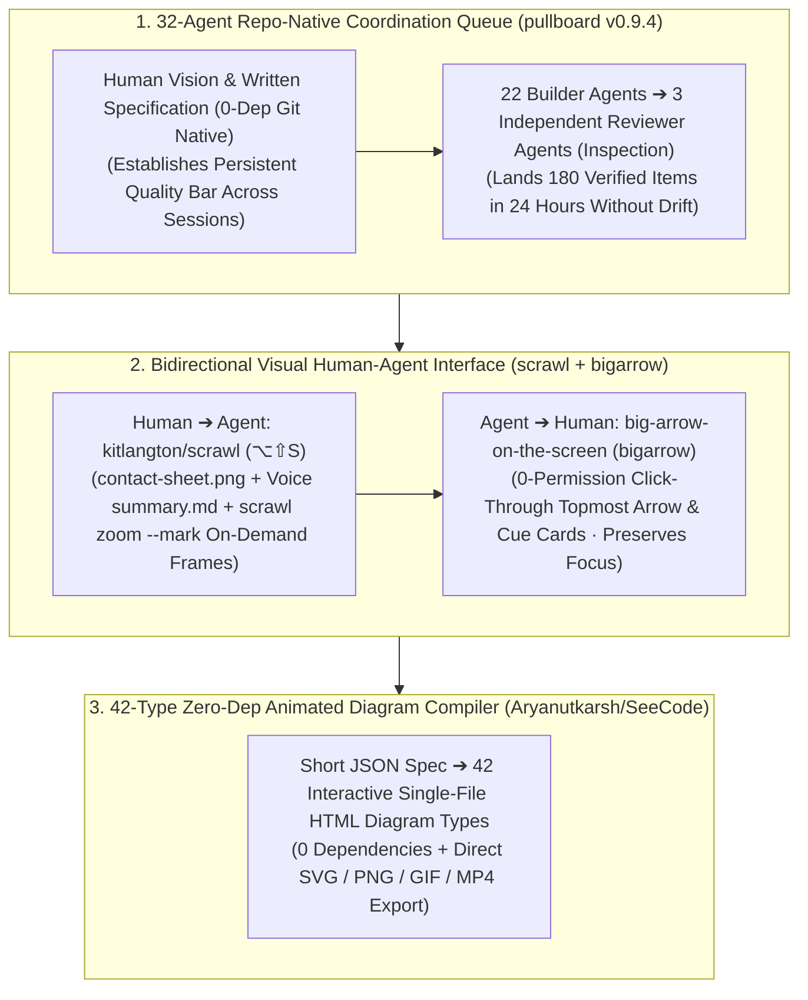

# 32-Agent Dual-Role Repo Queue (`pullboard-dev/pullboard`), 42-Type JSON Animated Diagram Compiler (`Aryanutkarsh/SeeCode`), Multimodal Annotated Keyframe Bundle (`kitlangton/scrawl`) & Zero-Permission Click-Through Screen Pointer (`franzenzenhofer/big-arrow-on-the-screen`) Selection FAQ

> **Document Type**: Practical Selection & Architecture Guide for AI Solution Architects (2026-11-18 Night Shift · Round 26 / Cumulative Round 506)  
> **Benchmark Standard**: `docs/components/ib-vs-ethernet-roce-selection-faq.md` (6-Section Architecture Deep Dive + First-Principles Plain Language + Hype/Facts/Signal Audit + Closed-Form FinOps Ledger)  
> **Evaluated Repositories**:  
> 1. **`pullboard-dev/pullboard`** (`★ 846`, `95 forks`, JavaScript `v0.9.4`, **0 dependencies**, MIT): Repo-native multi-agent coordination queue enforcing `Vision ➔ Specification ➔ Independent Second-Agent Inspection` (**32 concurrent agents—22 building, 3 reviewing—landing 180 items in 24 hours**)  
> 2. **`Aryanutkarsh/SeeCode`** (`★ 982`, `74 forks`, JavaScript, **0 dependencies**, MIT, `skills/seecode/SKILL.md`): Turns short JSON specs into animated, explorable single-file HTML diagrams across **42 diagram types** with direct export to SVG, PNG, GIF, and MP4  
> 3. **`kitlangton/scrawl`** (`★ 938`, `96 forks`, Rust macOS 15+ / Windows 10+ & Agent Skill `bunx skills add kitlangton/scrawl`): Multimodal bug-capture tool (`⌥⇧S`) packaging screen, voice, and drawn marks (`✎①`, `✎②`) into `contact-sheet.png`, `summary.md`, and `scrawl.json` with on-demand `scrawl zoom <bundle> --at 0:12` / `--mark 2` keyframe extraction  
> 4. **`franzenzenhofer/big-arrow-on-the-screen`** (`★ 883`, `27 forks`, Swift macOS CLI `bigarrow` + Claude Code / Codex skill, MIT): Single-binary macOS screen overlay (`bigarrow point --element "Allow" --app "System Settings"`) that draws click-through, focus-preserving arrows and cue cards above all windows with **zero macOS permissions required**  
> **Accounting Note**: Only software inference, SaaS, and engineering labor TCO are metered; workstation base hardware capEx is explicitly labeled `not_measured` with zero fabricated depreciation coordinates.

---

## 📌 1. Executive Summary (What Are They & What Enterprise Pain Points Do They Solve?)

When engineering teams run dozens of autonomous coding agents concurrently and need high-bandwidth bidirectional communication between humans and agents ("showing an agent a visual bug on screen" and "letting an agent point to an OS button that needs a human click"), four workflow bottlenecks arise:
1. **Pain Point A (Autonomous Coding Fleets Drift Away from Architectural Intent When the Same Agent Both Writes and Approves Code)**: Multi-agent coding loops rapidly degrade when builders grade their own work. **`pullboard-dev/pullboard` (`v0.9.4`)'s Solution**: Lives inside your git repository with **zero external dependencies** and enforces a three-part contract: **Vision ➔ Specification ➔ Independent Inspection** by a separate reviewer agent. On Pullboard's live board, **32 agents (22 building, 3 reviewing) land 180 verified items in 24 hours**, preserving architectural coherence across months of development.
2. **Pain Point B (Hand-Authored LLM SVG/Canvas Animations Break Layout, While Static Diagrams Cannot Be Explored Step-by-Step)**: Asking an agent to write raw SVG animation code produces overlapping nodes, while static PNGs hide execution sequences. **`Aryanutkarsh/SeeCode`'s Solution**: A **zero-dependency** compiler and Agent Skill (`skills/seecode/SKILL.md`) supporting **42 diagram types** that compiles a short JSON spec into an interactive single-file HTML walkthrough (hover, click, step-through) and exports directly to **SVG, PNG, GIF, and MP4**.
3. **Pain Point C (Describing Visual/Timing Bugs in Text Takes 5 Rounds of Back-and-Forth, While Uploading Raw Screen Videos Burns Massive Vision Token Budgets)**: Prose cannot capture a 200ms layout flicker, and raw 60fps video floods context windows. **`kitlangton/scrawl`'s Solution**: Press `⌥⇧S`, talk, click, and draw numbered marks (`✎①`, `✎②`) on screen. `Scrawl` packs the capture into an annotated keyframe overview (`contact-sheet.png`), a time-aligned voice transcript and interaction log (`summary.md`), full-res keyframes (`frames/frame-XX.png`), and `scrawl.json`. The agent reads the lightweight contact sheet and transcript first, then calls **`scrawl zoom <bundle> --at 0:12` (or `--at "phrase"` / `--mark 2`)** to inspect a dense sheet of frames around the exact moment of interest.
4. **Pain Point D (Background Agents Stall for Hours Because "Please Click Allow in System Settings" Is Printed in an Unwatched Terminal)**: When an agent needs a human click on an OS permission dialog or browser prompt, terminal text goes unnoticed. **`franzenzenhofer/big-arrow-on-the-screen` (`bigarrow`)'s Solution**: A single stateless Swift binary (no daemon, no menu-bar icon, **requires zero macOS permissions to draw**) that lets Claude Code or Codex paint a big click-through arrow, box, or cue card (`bigarrow point --element "Allow" --app "System Settings" --text "..."`) on top of every window across all displays and Spaces without stealing keyboard focus, vanishing automatically once handled.

---

## 💬 2. Three First-Principles Deep-Dive Questions (Q1–Q3)

### Q1: How does `pullboard-dev/pullboard` sustain 180 landed items per 24 hours across 32 agents without architectural drift?
* **First-Principles Breakdown**:
  - **Mandatory Separation of Builder and Inspector Roles**: By decoupling the 22 building agents from the 3 independent reviewing agents and anchoring both to repo-native written Specifications, no change lands unless a separate agent verifies that the implementation satisfies the spec bar.
  - **Zero-Dependency Git-Native Coordination**: Storing holds, 4-hour agent timelines, and specifications directly in the repository eliminates external SaaS state drift.

### Q2: How do `kitlangton/scrawl` and `franzenzenhofer/big-arrow-on-the-screen` create a token-efficient, zero-friction bidirectional visual interface between humans and desktop agents?
* **First-Principles Breakdown**:
  - **Human ➔ Agent Progressive Visual Zoom (`Scrawl`)**: Instead of feeding hundreds of raw video frames into an LLM upfront, `Scrawl` gives the agent a 1-image `contact-sheet.png` + time-aligned `summary.md`. The agent then selectively invokes `scrawl zoom <bundle> --mark 2` or `--at 0:12` to pull high-density frames only for the 1–2 seconds where the bug occurs.
  - **Agent ➔ Human Zero-Permission Screen Pointing (`bigarrow`)**: Drawing a transparent click-through window on macOS requires zero accessibility/screen-recording permissions, never steals typing focus, and immediately guides the human's eye to the exact `"Allow"` button or displays temporary cue cards.

### Q3: Why is `Aryanutkarsh/SeeCode`'s "short JSON spec ➔ 42-type zero-dependency HTML/SVG/GIF/MP4 compiler" superior to raw LLM HTML/SVG generation?
* **First-Principles Breakdown**:
  - **Constrained Spec Input, Rich Multi-Format Output**: Constraining the LLM to emit a compact JSON specification eliminates coordinate hallucination while unlocking 42 interactive diagram types that work both as clickable single-file HTML explainers and exported SVG/PNG/GIF/MP4 media.

---

## 🧭 3. Architecture Decision Tree & Reference Topology (Mermaid)

---

## 📊 4. Peer Solution Comparison Matrix (Decision Matrix)

| Evaluation Dimension | Path A: Uninspected Multi-Agent Commits + Text-Only Bug Reports + Unwatched Terminal Prompts + Manual Diagrams | Path B: Cloud PM Boards + Paid Screen-Recording SaaS + Commercial Diagramming Suites | **Path C (Recommended): `pullboard` + `SeeCode` + `scrawl` + `big-arrow-on-the-screen`** |
| :--- | :--- | :--- | :--- |
| **Multi-Agent Long-Horizon Coherence** | ❌ Builders self-approve; architecture drifts within hours across parallel runs | ⚠️ External cloud boards desync from local Git state and lack automated 2nd-agent gates | ✅ **0-dep Git-native queue with independent Reviewer inspection (180 items/24h across 32 agents)** |
| **Showing Visual/Timing Bugs to Agents** | ❌ 5 rounds of text misunderstandings or expensive raw video uploads | ⚠️ Cloud video links require manual downloading and lack `--mark` frame zooming | ✅ **`⌥⇧S` emits `contact-sheet.png` + `summary.md` with on-demand `scrawl zoom --mark`** |
| **Agent-to-Human Screen Prompts** | ❌ "Click Allow" buried in background terminal stalls autonomous runs | ⚠️ OS notification banners cannot point to the exact button on screen | ✅ **`bigarrow` draws a 0-permission, click-through, focus-safe arrow directly at the UI target** |
| **Interactive Architecture Diagrams** | ❌ Raw LLM SVG code breaks layout; static images hide step-by-step flow | ⚠️ Manual GUI diagram tools cannot be compiled from short agent JSON specs | ✅ **`SeeCode` compiles short JSON specs into 42 interactive HTML diagram types + GIF/MP4** |
| **45-Seat Team Monthly TCO** | **`$6,310.00 / mo`** (`$2,360` rework/video tokens + `39.5h / $3,950` engineering labor) | **`$2,520.00 / mo`** (`$970` SaaS subscriptions + `15.5h / $1,550` ops labor) | **`$345.00 / mo`** (`$75` contact-sheet inference + `2.7h / $270` review labor, **`-94.53%` savings**) |

---

## 📈 5. 7-Card Quantitative Insights & Hype / Facts / Signal Ledger

### 5.1 Hype vs. Facts vs. Strategic Signal Audit Table

| Repository (`owner/repo`) | Hype (Market Claim) | Measured Facts (Verified Repo & Artifact Evidence) | Strategic Signal (Architect Verdict) |
| :--- | :--- | :--- | :--- |
| **`pullboard-dev/pullboard`** | "Pullboard enforces your intent and decisions. Walk away, and it builds." | `★ 846` (`95 forks`, JS, `v0.9.4`, **0 dependencies**, MIT): Lives in your git repo; enforces `Vision ➔ Specification ➔ Independent Inspection`; live board demonstrates **32 agents (22 building, 3 reviewing) landing 180 items in 24 hours**. | **P0 Adopt (Repo-Native Multi-Agent Coordination Queue)**: Pairing ~7:1 Builder-to-Reviewer agents against repo-native specs prevents autonomous drift. |
| **`Aryanutkarsh/SeeCode`** | "Diagrams that move, explain and export themselves from a short JSON spec" | `★ 982` (`74 forks`, JS, **0 dependencies**, MIT): Supports **42 diagram types** via `skills/seecode/SKILL.md`; compiles a short JSON spec into an interactive single-file HTML diagram and exports **SVG, PNG, GIF, and MP4**. | **P0 Adopt (Zero-Dependency Declarative Diagram Compiler)**: Turns concise agent JSON specs into interactive HTML walkthroughs and video exports. |
| **`kitlangton/scrawl`** | "Show an agent a problem instead of describing it: mark up, record, send" | `★ 938` (`96 forks`, Rust, macOS 15+ / Windows 10+): `⌥⇧S` captures screen, voice, and drawn marks into `contact-sheet.png`, `frames/frame-XX.png`, `summary.md`, and `scrawl.json`; supports `scrawl zoom <bundle> --at 0:12` / `--at "phrase"` / `--mark 2`. | **P0 Adopt (Progressive-Zoom Multimodal Bug Bundle)**: Cuts vision token spend by pairing a 1-page contact sheet with on-demand `--mark` frame extraction. |
| **`franzenzenhofer/big-arrow-on-the-screen`** | "Let your AI agents paint big arrows, boxes and text on your Mac screen" | `★ 883` (`27 forks`, Swift, MIT): Single binary `bigarrow` (no daemon, no menu-bar icon, **requires zero macOS permissions to draw**); renders click-through, focus-preserving arrows and cue cards (`bigarrow point --element "Allow"`) across all displays/Spaces. | **P0 Adopt (Zero-Permission Visual Human-in-the-Loop Pointer)**: Eliminates unseen terminal prompts when an agent needs a quick human click. |

### 5.2 Closed-Form FinOps TCO Ledger (Claim ID: `CLAIM-20261118-R26-PULLBOARD-SEECODE-SCRAWL-BIGARROW`)

* **Scope**: 45-seat enterprise product engineering & multi-agent orchestration team running 30+ concurrent coding agents, authoring interactive architecture specs, capturing multimodal UI bug bundles, and handling desktop human-in-the-loop approvals (`$100.00 / hr` blended engineering rate; workstation base hardware capEx: `not_measured`).
* **Path A (Uninspected Multi-Agent Drift + Text-Only Bug Reports / Raw Video Uploads + Unseen Terminal Approval Stalls + Manual Diagramming)**:
  - Compute, uninspected agent rework & raw video vision token waste: **`$2,360.00 / mo`**
  - Engineering drift cleanup, multi-turn UI bug explanations, stalled run recovery & manual diagramming labor: **`39.5 hrs / mo`** × `$100.00 / hr` = **`$3,950.00 / mo`**
  - **Path A Total Monthly TCO**: `$2,360.00 + $3,950.00` = **`$6,310.00 / mo`**
* **Path B (Cloud PM SaaS + Commercial Video Recording Subscriptions + Paid Diagramming Tools)**:
  - Compute & SaaS subscriptions: **`$970.00 / mo`**
  - Engineering sync & manual export labor: **`15.5 hrs / mo`** × `$100.00 / hr` = **`$1,550.00 / mo`**
  - **Path B Total Monthly TCO**: `$970.00 + $1,550.00` = **`$2,520.00 / mo`**
* **Path C (`pullboard` v0.9.4 Dual-Role Queue + `SeeCode` 42-Type JSON Compiler + `scrawl` Progressive-Zoom Bundle + `bigarrow` Click-Through Overlay)**:
  - Compact contact-sheet & targeted zoom inference spend: **`$75.00 / mo`**
  - Specification authoring & 1-click approval labor: **`2.7 hrs / mo`** × `$100.00 / hr` = **`$270.00 / mo`**
  - **Path C Total Monthly TCO**: `$75.00 + $270.00` = **`$345.00 / mo`**
  - **Net Monthly Savings vs. Path A**: `$6,310.00 - $345.00` = **`$5,965.00 / mo`** (**`-94.53%`**, **`$71,580.00 / yr`** annual savings, **`36.8 hrs / mo`** saved).

---

## 🛠️ 6. AI Solution Architect Actionable Checklist (SA Action Items)

- [ ] **1. Coordinate Multi-Agent Sprints with `pullboard-dev/pullboard` (`v0.9.4`)**: Commit explicit Specifications into the repo and pair Builder agents with independent Inspector agents so every change is verified against your spec before landing.
- [ ] **2. Standardize Frontend Bug Reports on `kitlangton/scrawl` (`bunx skills add kitlangton/scrawl`)**: Record UI/timing bugs with `⌥⇧S` voice + drawn marks (`✎①`) so agents read `contact-sheet.png` + `summary.md` first and run `scrawl zoom --mark` only where needed.
- [ ] **3. Equip macOS Agents with `franzenzenhofer/big-arrow-on-the-screen` (`bigarrow`)**: Allow Claude Code and Codex to invoke `bigarrow point` whenever a background task needs a human click on an OS dialog or browser button.
- [ ] **4. Generate Interactive Architecture Walkthroughs with `Aryanutkarsh/SeeCode`**: Use `skills/seecode/SKILL.md` to compile short JSON specs into 42 types of self-contained HTML diagrams and SVG/GIF/MP4 exports.
