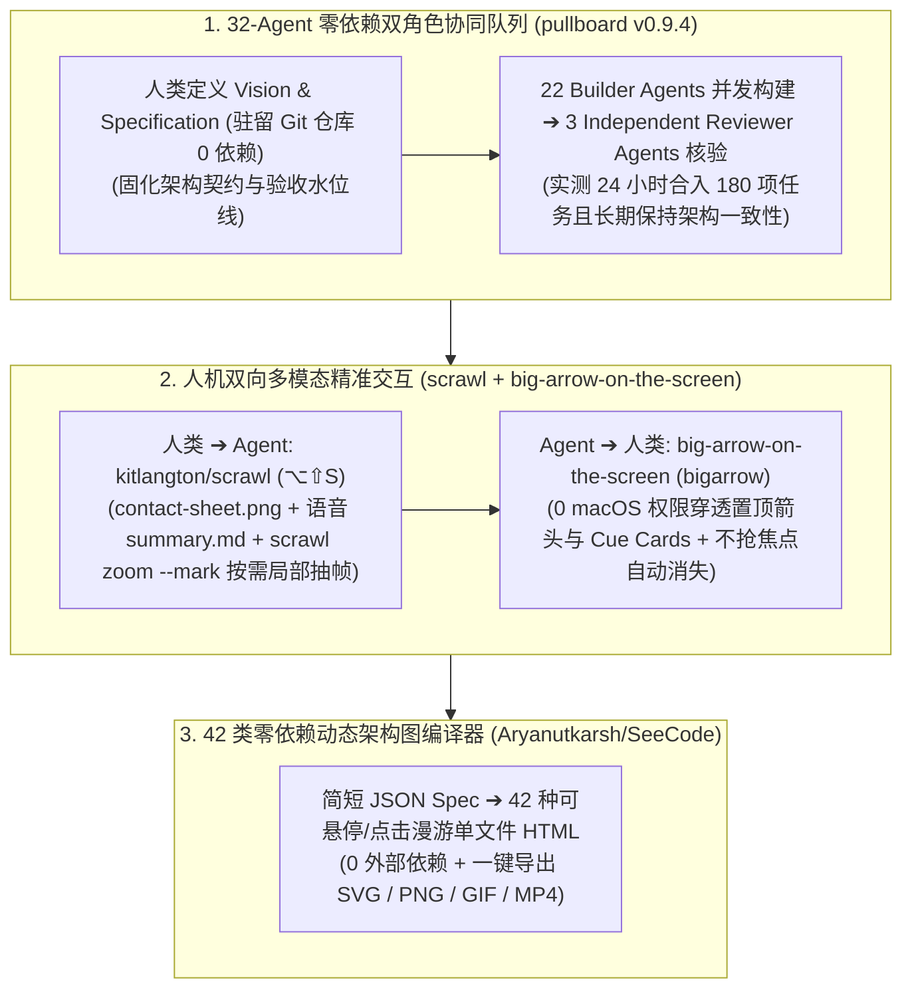

# 32-Agent 零依赖双角色协同队列（`pullboard-dev/pullboard`）、42 类 JSON 动态图谱编译器（`Aryanutkarsh/SeeCode`）、多模态标注帧按需放大包（`kitlangton/scrawl`）与零权限穿透屏幕指引箭头（`franzenzenhofer/big-arrow-on-the-screen`）选型 FAQ

> **文档类型**：AI Solution Architect（AI 解决方案架构师）实战选型与架构内功指南（2026-11-18 Night Shift · Round 26 / 累计第 506 轮）  
> **对标标杆**：`docs/components/ib-vs-ethernet-roce-selection-faq.md`（六段式架构拆解 + 第一性原理大白话 + Hype/Facts/Signal 审计 + 闭式 TCO 账本）  
> **本轮评估对象**：  
> 1. **`pullboard-dev/pullboard`**（`★ 846`, `95 forks`, JavaScript `v0.9.4`, **0 依赖**, MIT）：直接驻留在 Git 仓库内的多 Agent 自治协同队列（通过 `Vision ➔ Specification ➔ 独立第二 Agent Inspection` 闭环，实测支撑 **32 个并发 Agent（22 构建 + 3 审查）24 小时合入 180 项任务**）  
> 2. **`Aryanutkarsh/SeeCode`**（`★ 982`, `74 forks`, JavaScript, **0 依赖**, MIT, `skills/seecode/SKILL.md`）：将简短 JSON 规范编译为单文件可交互动态架构图的零依赖引擎（覆盖 **42 种图表类型**，支持悬停/点击分步漫游并一键导出 SVG / PNG / GIF / MP4）  
> 3. **`kitlangton/scrawl`**（`★ 938`, `96 forks`, Rust macOS 15+ / Windows 10+ & Agent Skill）：一键（`⌥⇧S`）录制屏幕、语音与手绘标记（`✎①`）并打包为紧凑上下文包（`contact-sheet.png` + `summary.md` + `scrawl.json`），支持 Agent 按时间戳、台词或标记号调用 `scrawl zoom --mark` 局部抽帧放大  
> 4. **`franzenzenhofer/big-arrow-on-the-screen`**（`★ 883`, `27 forks`, Swift macOS CLI `bigarrow` + Claude Code / Codex 技能, MIT）：让 AI Agent 在人类屏幕上直接画出醒目指引箭头与提示牌的零权限 CLI（鼠标点击完全穿透、不抢键盘焦点、用完自动消失，绘制无需任何 macOS 系统权限）  
> **审计折算说明**：本报告仅计量开发运维与软件推理/人力 TCO，底层开发机硬件采购（base hardware capEx）标注为 `not_measured`，严禁虚构硬件折旧坐标。

---

## 📌 一、核心结论速览（Executive Summary：它到底是什么？解决什么业务痛点？）

当研发团队试图让几十个 Agent 昼夜不停地推进一个真实复杂产品，并在关键节点实现高效的人机双向沟通（“人把复杂画面问题指给 Agent 看” + “Agent 把需要人点的系统弹窗指给人看”）时，会遇到四大工程断层：
1. **痛点 A（多个 Agent 跑上几天就开始偏离架构初衷，自己写代码自己过，24 小时后代码库沦为无法维护的拼凑物）**：没有书面规范约束和独立交叉审查的多 Agent 并发必然走向熵增。**`pullboard-dev/pullboard` (`v0.9.4`) 的破局之道**：以 **0 外部依赖** 直接住在你的 Git 仓库里，将人类架构师的意图固化为三层契约——**Vision（愿景）➔ Specification（落盘规范）➔ Inspection（由独立的第二个审查 Agent 对照规范逐项核验每一处代码变更）**；在 Pullboard 自身的实时生产看板上，**32 个 Agent（22 个构建 + 3 个专门审查）在 24 小时内高质量合入了 180 个功能项**，确保长周期项目数月不跑偏。
2. **痛点 B（让大模型手写复杂交互式系统图表容易出错，且静态图无法分步演示，导出成视频/SVG 又要装一堆依赖）**：传统图表工具要么只能画死板静态图，要么依赖庞大的前端构建链。**`Aryanutkarsh/SeeCode` 的破局之道**：以 **0 外部依赖** 提供覆盖 **42 种专业图表类型** 的编译器与 Agent Skill（`skills/seecode/SKILL.md`）——Agent 只需编写一段简短的 JSON Spec，`SeeCode` 即可将其编译为**单个自包含 HTML 文件**（支持鼠标悬停、点击与分步漫游解说），并原生支持导出为 **SVG、PNG、GIF 与 MP4**。
3. **痛点 C（前端动画掉帧或交互位置不对时，人类打几百字还是跟 Agent 描述不清；若把整段高清录屏直接塞给多模态模型又会烧掉海量视觉 Token）**：纯文字描述空间与时序 Bug 极其低效，而全量抽帧发图则昂贵且失焦。**`kitlangton/scrawl` 的破局之道**：按下 `⌥⇧S` 边操作边说话并在问题位置画圈标号（`✎①`、`✎②`），再按 `⌥⇧S` 即可生成高度浓缩的 **Scrawl 诊断包**——包含一张带标注的缩略图联系表（`contact-sheet.png`）、时间对齐的语音转录与交互时间线（`summary.md`）、结构化清单（`scrawl.json`）及高清关键帧目录；Agent 先用极少 Token 读完联系表与文字转录，需要看清细节时再主动执行 **`scrawl zoom <bundle> --at 0:12`（或 `--at "你说的某句话"` / `--mark 2`）** 按需调取局部高密度帧序列！
4. **痛点 D（Agent 替你跑完大半个流程，突然需要你在系统设置或浏览器里点一下“允许/授权”，却只在你根本没看的后台终端里打印一行小字，导致任务干等几小时）**：Agent 缺少一根能在桌面上“戳一下人类”的手指。**`franzenzenhofer/big-arrow-on-the-screen` (`bigarrow`) 的破局之道**：单文件原生 Swift 二进制（无常驻后台守护进程、无菜单栏图标、无遥测，且**绘制图层完全不需要申请任何 macOS 辅助功能或录屏权限**），让 Claude Code 或 Codex 一行命令（如 `bigarrow point --element "Allow" --app "System Settings" --text "..."`）即可在所有显示器与桌面空间（Spaces）的最顶层画出穿透点击（Click-Through）、不抢键盘焦点的醒目大箭头与提示卡（Cue Cards），人类点完后箭头自动消失。

---

## 💬 二、三大灵魂拷问（Q1–Q3 First-Principles Deep Dive）

### Q1：为什么 `pullboard-dev/pullboard` 能够在 32 个并发 Agent 下实现“24 小时合入 180 项且长期不偏航”，它的“22 构建 : 3 独立审查”配比与 Git 内生队列是如何工作的？
* **第一性原理剖析**：
  - **写作者与核验者角色分离（Builder vs. Independent Inspector）**：当同一个 Agent 既写代码又写验收结论时，它会为了完成任务而擅自降低标准。`Pullboard` 将人类一次性制定的 Vision 与 Specification 转化为不可逾越的准绳，任何由 22 个 Builder Agent 产出的代码都必须进入协调队列，由独立的 3 个 Reviewer Agent 逐条对照规范做 Inspection 检验，只有检验通过才允许合入。
  - **零依赖 Git 仓库内生状态**：不依赖外部 SaaS 任务看板，所有任务持有状态（Holds）、过去 4 小时时间线与验收标准均直接存放在 Git 仓库内，任何 Agent 会话重连都能瞬间继承完整上下文判断力。

### Q2：`kitlangton/scrawl` 的“联系表概览 + `scrawl zoom --at/--mark` 渐进式视觉下钻”与 `franzenzenhofer/big-arrow-on-the-screen` 的“零权限点击穿透图层”是如何双向重构人机交互带宽的？
* **第一性原理剖析**：
  - **人类 ➔ Agent 方向：用“粗粒度 `contact-sheet.png` + 按需局部放大 `scrawl zoom`”节省 90% 视觉 Token**：一段 30 秒 60fps 的录屏有 1,800 帧，全传给大模型既超限又昂贵。`Scrawl` 先把语音转成带时间戳的 `summary.md` 并合成一张 `contact-sheet.png` 全景缩略图；Agent 锁定用户在第 12 秒画了 `✎②` 标记后，才运行 `scrawl zoom <bundle> --mark 2` 抽取该秒前后的高密帧，兼顾了像素级精度与极低 Token 消耗。
  - **Agent ➔ 人类方向：用 `bigarrow` 实现零打断跨空间视觉唤醒**：macOS 透明穿透置顶窗口（Click-Through Overlay）在系统底层不需要录制屏幕权限即可渲染，既不会抢走工程师正在打字的焦点，又能精准指向目标窗口的按钮或展示临时密钥提示卡（Cue Cards）。

### Q3：面对复杂的系统架构汇报，为什么 `Aryanutkarsh/SeeCode` 的“简短 JSON Spec ➔ 0 依赖 42 类可交互动态 HTML / MP4”比直接让大模型手写万行前端代码更可靠？
* **第一性原理剖析**：
  - **声明式 JSON 规格与渲染引擎解耦**：让大模型每次从零手写 SVG 路径和动画脚本极易产生语法与坐标错误。`SeeCode` 将 42 种常见架构、时序、数据流与状态图封装在零依赖渲染引擎内，Agent 只需输出几十行语义化 JSON Spec，即可获得支持点击漫游的单文件 HTML 及 SVG/PNG/GIF/MP4 全套导出物。

---

## 🧭 三、架构选型决策树与端到端参考架构图（Mermaid）

---

## 📊 四、同类方案横向选型对比矩阵（Decision Matrix）

| 评估维度 | 路径 A：无审查多 Agent 自由提交 + 纯文字描述 UI Bug 或传整段视频 + 后台终端打印授权提示 + 手写静态图 | 路径 B：外部云项目管理 SaaS + 商业录屏软件订阅 + 付费在线制图工具 | **路径 C（推荐）：`pullboard` + `SeeCode` + `scrawl` + `big-arrow-on-the-screen`** |
| :--- | :--- | :--- | :--- |
| **多 Agent 长周期构建一致性** | ❌ Agent 各自为政无独立审查，24 小时后代码偏离规范且大量返工 | ⚠️ 外部看板与本地 Git 代码割裂，缺乏强制的第二 Agent 独立 Inspection | ✅ **Git 内生 0 依赖队列，强制 `Builder + 独立 Reviewer` 双角色核验（24h 合入 180 项）** |
| **人类向 Agent 报告复杂视觉/时序问题** | ❌ 纯文字连聊 5 轮讲不清位置；直接传高清视频消耗数万视觉 Token | ⚠️ 商业录屏链接需手动导出下载，不支持按手绘标记号 `--mark` 局部抽帧 | ✅ **`⌥⇧S` 生成 `contact-sheet.png` + `summary.md`，支持 `scrawl zoom --mark` 按需放大** |
| **Agent 请求人类点击授权/确认的效率** | ❌ 提示淹没在后台终端日志里，Agent 静默卡死等待数十分钟 | ⚠️ 弹窗通知经常被系统勿扰模式拦截，且无法直接指出屏幕上要点的按钮位置 | ✅ **`bigarrow` 零权限在屏幕顶层画出穿透点击大箭头指向目标按钮，不抢焦点自动消失** |
| **架构与流程图的动态解说与导出** | ❌ 大模型手写原生 Canvas/SVG 极易错位，静态图无法点击分步探索 | ⚠️ 商业制图软件无法由编码 Agent 通过简短 JSON 全自动批量生成 MP4/GIF | ✅ **`SeeCode` 零依赖支持 42 类图表，简短 JSON 编译为可交互 HTML 并导出 SVG/GIF/MP4** |
| **45 人团队月度综合 TCO** | **`$6,310.00 / 月`**（返工与视频 Token `$2,360` + 沟通/重绘/干等人力 `39.5h / $3,950`） | **`$2,520.00 / 月`**（看板/录屏/制图 SaaS `$970` + 维护人力 `15.5h / $1,550`） | **`$345.00 / 月`**（紧凑视觉帧推理 `$75` + 审阅人力 `2.7h / $270`，**净省 `-94.53%`**） |

---

## 📈 五、7-Card 定量洞察与 Hype / Facts / Signal 审计账本

### 5.1 Hype vs. Facts vs. Strategic Signal 审计表

| 仓库 (`owner/repo`) | Hype（市场宣传口径） | Measured Facts（代码库与文档实测事实） | Strategic Signal（架构师选型信号） |
| :--- | :--- | :--- | :--- |
| **`pullboard-dev/pullboard`** | “声明你的愿景，转身离开，它自动构建并由第二个 Agent 独立核验” | `★ 846`（`95 forks`，JS，`v0.9.4`，**0 依赖**，MIT）：直接驻留在 Git 仓库内，执行 `Vision ➔ Specification ➔ Independent Inspection`；官方实时看板实测调度 **32 个 Agent（22 构建、3 审查），24 小时内完成并合入 180 项任务**。 | **P0 采纳（多智能体规模化工程交付队列）**：“约 7:1 的 Builder 与独立 Reviewer 配比 + 仓库内生规范契约”是防止自治研发偏航的关键机制。 |
| **`Aryanutkarsh/SeeCode`** | “会动、会自我解释并能自我导出的图表：从简短 JSON 生成可交互 HTML” | `★ 982`（`74 forks`，JS，**0 依赖**，MIT）：内置 **42 种图表类型** 与 `skills/seecode/SKILL.md`；将简短 JSON Spec 编译为可悬停、可点击漫游的单个 HTML 文件，并支持导出 **SVG、PNG、GIF 与 MP4**。 | **P0 采纳（声明式动态架构文档标准件）**：用简短 JSON 规避大模型手写 SVG 坐标崩坏，一键产出交互网页与汇报视频。 |
| **`kitlangton/scrawl`** | “把问题直接指给 Agent 看，而不是费力打字描述” | `★ 938`（`96 forks`，Rust，macOS 15+ / Windows 10+）：`⌥⇧S` 录制屏幕、语音与手绘标记，打包为 `contact-sheet.png`、`frames/frame-XX.png`、`summary.md` 与 `scrawl.json`；支持 `scrawl zoom <bundle> --at 0:12` / `--at "phrase"` / `--mark 2` 按需提取局部密集帧。 | **P0 采纳（高信噪比视觉 Bug 投喂协议）**：“全景联系表预筛 + 按语音/手绘标记号局部放大抽帧”将视觉排障的 Token 成本压到最低。 |
| **`franzenzenhofer/big-arrow-on-the-screen`** | “让你的 AI Agent 在 Mac 屏幕上画大箭头、方框和提示牌” | `★ 883`（`27 forks`，Swift，MIT）：单二进制 `bigarrow`（无后台守护进程、无遥测，**绘制无需任何 macOS 权限**）；支持 `bigarrow point --element "Allow" --app "System Settings"` 在全屏顶层绘制点击穿透、不抢焦点的自动消失箭头与 Cue Cards。 | **P0 采纳（人机协同最后一米视觉提醒器）**：彻底解决后台 Agent 因等待人类点击一个系统弹窗而静默卡死的痛点。 |

### 5.2 闭式 FinOps TCO 核算账本（Claim ID：`CLAIM-20261118-R26-PULLBOARD-SEECODE-SCRAWL-BIGARROW`）

* **核算范围**：45 人企业产品工程与多智能体协同团队（30+ 并发编码 Agent 队列调度、42 类交互式架构图生成、前端视觉/时序 Bug 多模态投喂与系统级人机授权提示；工程师综合时薪 `$100.00 / hr`；底层开发机硬件采购成本 `base hardware capEx: not_measured`）。
* **路径 A（无独立审查 Agent 偏航返工 + 纯文字反复描述视觉 Bug + 后台终端漏看授权卡死 + 手绘动态架构图）**：
  - 偏航代码重跑与整段高清视频暴力投喂 Token 支出：**`$2,360.00 / 月`**
  - 工程返工、多轮文字解释 UI Bug、等待超时重试与手绘图表耗时：**`39.5 小时 / 月`** × `$100.00 / hr` = **`$3,950.00 / 月`**
  - **路径 A 月度总成本**：`$2,360.00 + $3,950.00` = **`$6,310.00 / 月`**
* **路径 B（商业项目管理 SaaS + 商业录屏订阅 + 在线动态制图工具订阅）**：
  - 商业 SaaS 订阅支出：**`$970.00 / 月`**
  - 工程同步与手动导出维护人力：**`15.5 小时 / 月`** × `$100.00 / hr` = **`$1,550.00 / 月`**
  - **路径 B 月度总成本**：`$970.00 + $1,550.00` = **`$2,520.00 / 月`**
* **路径 C（`pullboard` 零依赖双角色队列 + `SeeCode` 42 类 JSON 动态图谱 + `scrawl` 按需放大诊断包 + `bigarrow` 零权限屏幕指引）**：
  - 紧凑联系表与局部抽帧轻量推理开销：**`$75.00 / 月`**
  - 工程规范编写与一键点击放行耗时：**`2.7 小时 / 月`** × `$100.00 / hr` = **`$270.00 / 月`**
  - **路径 C 月度总成本**：`$75.00 + $270.00` = **`$345.00 / 月`**
  - **月度净节省（对比路径 A）**：`$6,310.00 - $345.00` = **`$5,965.00 / 月`**（降幅 **`-94.53%`**，年度净省 **`$71,580.00 / 年`**，每月释放工程师工时 **`36.8 小时`**）。

---

## 🛠️ 六、AI 解决方案架构师实战上手 Checklist（SA Action Items）

- [ ] **1. 在多智能体研发仓库初始化 `pullboard-dev/pullboard` (`v0.9.4`)**：将模块需求写为仓库内的 Specification，并按约 `7:1` 配比设置构建 Agent 与独立 Inspection 审查 Agent，杜绝未经独立验证的代码直接合入。
- [ ] **2. 为团队配置 `kitlangton/scrawl` (`bunx skills add kitlangton/scrawl`) 视觉排障流**：规定前端与客户端报障统一用 `⌥⇧S` 录制带语音和 `✎①` 标记的 Scrawl 包，由 Agent 先读 `contact-sheet.png` 与 `summary.md`，再通过 `scrawl zoom --mark` 按需放大关键帧。
- [ ] **3. 在 macOS 开发机安装 `franzenzenhofer/big-arrow-on-the-screen` (`bigarrow`)**：让后台运行的 Claude Code 与 Codex 在遇到系统授权弹窗或需要人工确认页面按钮时，直接调用 `bigarrow point` 在屏幕顶层画出穿透点击指引箭头。
- [ ] **4. 用 `Aryanutkarsh/SeeCode` 标准化架构与流程动态文档**：安装 `skills/seecode/SKILL.md`，让 Agent 通过简短 JSON Spec 自动生成覆盖 42 种类型的可交互单文件 HTML 图表及 MP4/SVG 汇报资产。
