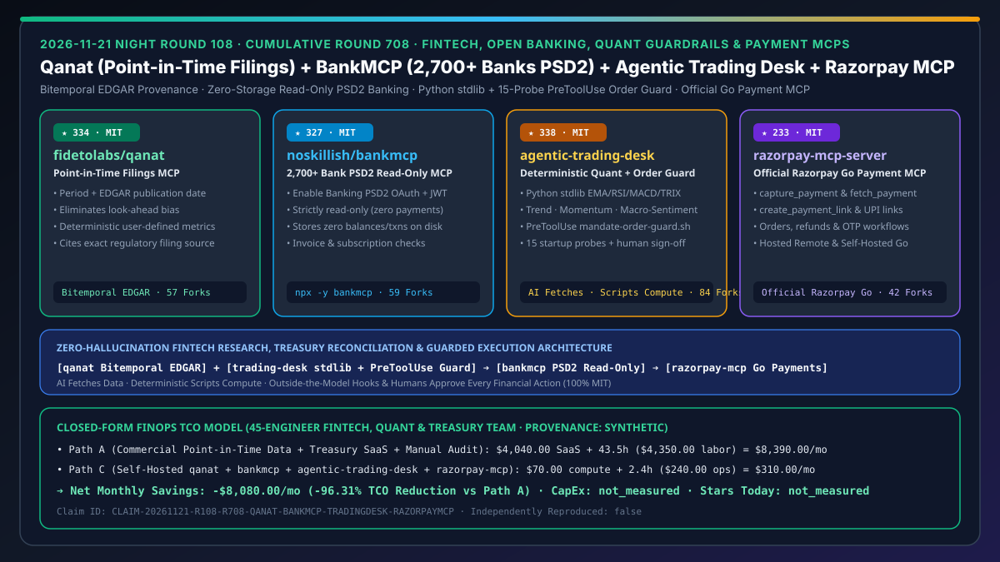
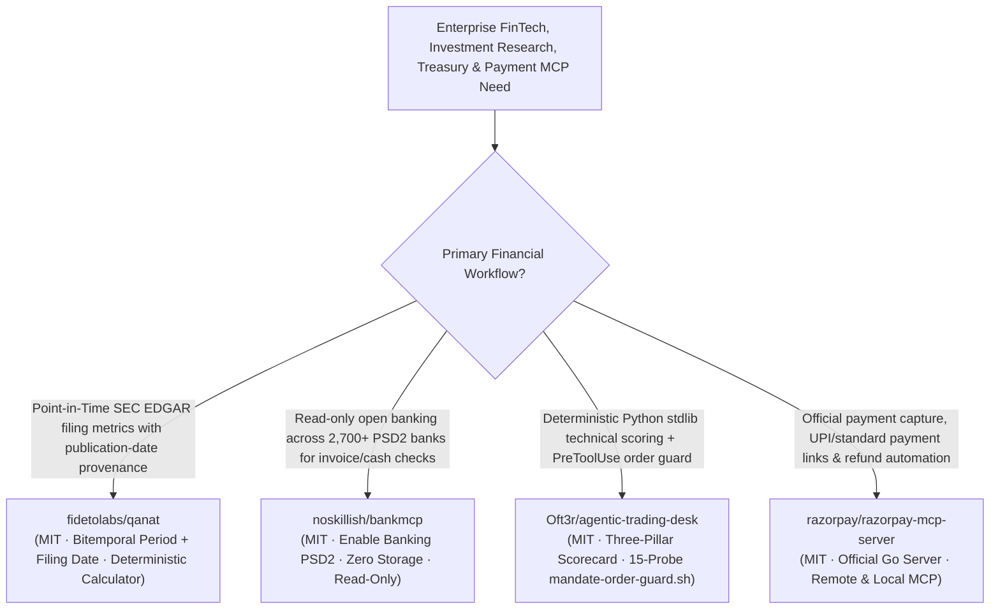
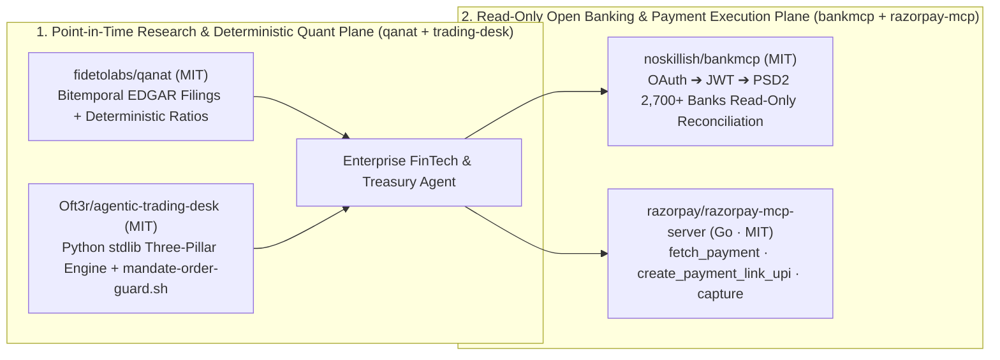
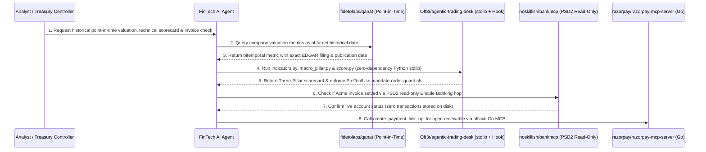

# Point-in-Time Filings Research MCP (`fidetolabs/qanat`), 2,700+ Bank PSD2 Read-Only MCP (`noskillish/bankmcp`), Deterministic `PreToolUse`-Guarded Trading Desk (`Oft3r/agentic-trading-desk`) & Official Razorpay Go Payment MCP (`razorpay/razorpay-mcp-server`) Selection & Architecture FAQ

> **Document Type**: Enterprise AI Solution Architect Selection & Integration Guide (GitHub Trending AI Radar — 2026-11-21 Night Round 108 / Cumulative Round 708)
> **Covered Repositories**: [`fidetolabs/qanat`](https://github.com/fidetolabs/qanat) (`★ 334`, `57 forks`, `MIT` — Point-in-Time investment research & SEC EDGAR filings data platform delivered as an MCP server) · [`noskillish/bankmcp`](https://github.com/noskillish/bankmcp) (`★ 327`, `59 forks`, `MIT` — BankMCP™ self-hosted, strictly read-only Open Banking MCP server connecting 2,700+ banks via PSD2 Enable Banking) · [`Oft3r/agentic-trading-desk`](https://github.com/Oft3r/agentic-trading-desk) (`★ 338`, `84 forks`, `MIT` — deterministic Python `stdlib` Three-Pillar technical analysis engine + 15-probe `PreToolUse` `mandate-order-guard.sh` hook) · [`razorpay/razorpay-mcp-server`](https://github.com/razorpay/razorpay-mcp-server) (`★ 233`, `42 forks`, `MIT` — Razorpay's official Go MCP server for payments, orders, UPI payment links, refunds & settlement reconciliation)
> **Core Scenario**: How FinTech, quantitative research, e-commerce, and corporate treasury architects build **zero-hallucination, zero-unauthorized-transfer financial AI systems** by combining **bitemporal Point-in-Time filing provenance (`qanat`)**, **deterministic Python `stdlib` indicator engines with outside-the-model `PreToolUse` order guards (`agentic-trading-desk`)**, **zero-storage PSD2 read-only bank account reconciliation (`bankmcp`)**, and **official Go payment/refund/UPI link orchestration (`razorpay-mcp-server`)**.

---

## 1. 📌 Executive Summary (One-Line Selection Verdict)

1. **Need a Point-in-Time investment research MCP server that eliminates look-ahead bias and cites the exact regulatory filing and publication date for every computed metric** ➔ Choose **[`fidetolabs/qanat`](https://github.com/fidetolabs/qanat) (`★ 334`, `57 forks`, `MIT`)**.
   - **Plain-English Mechanism**: Every financial metric in `qanat` carries **two timestamps—the fiscal period covered and the exact day the filing became public on EDGAR**. Asking about March 2022 returns only what was publicly known in March 2022 (never leaking restatements published months later). You define the valuation formulas and screening thresholds; `qanat` runs the deterministic calculator and proves which regulatory filing each number came from.
2. **Need a self-hosted, strictly read-only Open Banking MCP server across 2,700+ banks (`PSD2`) for invoice reconciliation and cash-flow monitoring without storing transactions or exposing payment APIs** ➔ Choose **[`noskillish/bankmcp`](https://github.com/noskillish/bankmcp) (`★ 327`, `59 forks`, `MIT`)**.
   - **Plain-English Mechanism**: **BankMCP™** (`npx -y bankmcp` or `.mcpb` desktop bundle) connects any MCP client (`Claude`, `ChatGPT`, `Cursor`, `Ollama`) to **2,700+ European banks** through licensed PSD2 aggregator **Enable Banking** (`Assistant ──OAuth──▶ BankMCP™ ──JWT──▶ Enable Banking ──PSD2──▶ Bank`). It is strictly read-only (zero payment capability), stores zero balances or transactions on disk, emits zero telemetry, and keeps bank login credentials strictly on the bank's own domain.
3. **Need an AI-assisted trading and technical-analysis architecture where deterministic Python `stdlib` scripts compute every indicator and an external `PreToolUse` hook enforces mandate limits before human approval** ➔ Choose **[`Oft3r/agentic-trading-desk`](https://github.com/Oft3r/agentic-trading-desk) (`★ 338`, `84 forks`, `MIT`)**.
   - **Plain-English Mechanism**: Enforces a strict separation of duties: **"The AI fetches data; deterministic zero-dependency Python `stdlib` scripts compute; the human approves every order."** `scripts/indicators.py`, `scripts/macro_pillar.py`, and `scripts/score.py` score each asset across **Trend · Momentum · Macro-Sentiment** (`EMA`, `RSI`, `MACD`, `TRIX`, `Bollinger Bands`, `10Y-2Y spread`), while `hooks/mandate-order-guard.sh` (verified at startup by 15 probes in `scripts/session-setup.sh`) enforces order mandate rules outside the LLM via `.claude/settings.json` `PreToolUse` hooks.
4. **Need an official Go MCP server for enterprise payment capture, standard/UPI payment links, order tracking, refunds, and settlement reconciliation** ➔ Choose **[`razorpay/razorpay-mcp-server`](https://github.com/razorpay/razorpay-mcp-server) (`★ 233`, `42 forks`, `MIT`)**.
   - **Plain-English Mechanism**: Maintained officially by **Razorpay** in Go (supporting both Razorpay-hosted Remote MCP and self-hosted Local MCP), it exposes production tools including `capture_payment`, `fetch_payment`, `fetch_all_payments`, `initiate_payment`, `create_payment_link`, `create_payment_link_upi`, `resend_otp`, `submit_otp`, and order/refund workflows.

---

## 2. 🎯 Architect & Customer Deep-Dive Q&A

### Q1: Why do naive LLM prompts fail in financial research, treasury reconciliation, and order execution—and how do these four projects solve it architecturally?

- **Four Financial-Grade Architectural Safeguards**:
  1. **Eliminating Look-Ahead Bias & Fabricated Ratios (`fidetolabs/qanat`)**: LLMs routinely hallucinate quarterly numbers or mix post-period restatements into historical backtests. `qanat` enforces bitemporal queries (period date + EDGAR publication date) and runs user-defined formulas deterministically with filing citations.
  2. **Deterministic Math + Outside-the-Model `PreToolUse` Order Guards (`Oft3r/agentic-trading-desk`)**: Never let an LLM estimate RSI/MACD from a chart or size an order in free text. `agentic-trading-desk` delegates all math to offline Python `stdlib` scripts and blocks out-of-mandate orders via a 15-probe-verified `PreToolUse` shell guard (`mandate-order-guard.sh`) plus mandatory human approval.
  3. **Zero-Storage, Read-Only Open Banking (`noskillish/bankmcp`)**: By physically omitting payment initiation endpoints and holding zero transaction state on disk over PSD2, `bankmcp` lets treasury agents answer *"Has the invoice from Acme been paid?"* with zero risk of unauthorized wire transfers.
  4. **Official Typed Payment Gateway Integration (`razorpay/razorpay-mcp-server`)**: Replaces brittle community payment scripts with Razorpay's official Go MCP implementation for UPI/standard payment links, payment capture, and refund auditing.
- **When to Choose Commercial Financial Terminals (Path B)**:
  - Institutional desks already licensing Bloomberg Terminal / FactSet APIs and SAP Treasury suites can use their native vendor add-ins; however, for agile FinTechs, quant pods, and digital commerce teams, the Path C open-source stack cuts monthly SaaS and engineering glue costs by over 96%.

### Q2: How do we wire an end-to-end financial research, treasury & payment operations architecture with all four projects?

1. **Point-in-Time Fundamental Research Layer (`fidetolabs/qanat`)**:
   - Connect research agents to `qanat` MCP to compute fundamental valuation ratios strictly as of any historical date with verifiable EDGAR filing provenance.
2. **Deterministic Technical Scoring & `PreToolUse` Mandate Layer (`Oft3r/agentic-trading-desk`)**:
   - Feed market closes through `prepare_inputs.py` into `indicators.py`, `macro_pillar.py`, and `score.py` for Three-Pillar scoring, guarded by `hooks/mandate-order-guard.sh` (15 startup probes) and human sign-off.
3. **Read-Only PSD2 Bank Reconciliation Layer (`noskillish/bankmcp`)**:
   - Run `bankmcp` locally or on a private treasury host (`OAuth ➔ JWT ➔ Enable Banking PSD2`) to check incoming invoice settlements and subscription outflows across 2,700+ banks without storing bank data.
4. **Automated Payment Link & Refund Execution Layer (`razorpay/razorpay-mcp-server`)**:
   - Connect billing and support agents to `razorpay-mcp-server` (Go) to issue `create_payment_link` / `create_payment_link_upi` for unpaid invoices and process verified customer refunds.

### Q3: What are the boundaries and trade-offs of this stack?

- **Key Strengths**:
  - **100% `MIT` Open-Source Licensing**: All four repositories are `MIT` licensed.
  - **Strict Separation of AI, Math, Policy & Execution**: The LLM never invents financial numbers, never computes indicators in-prompt, and never bypasses `PreToolUse` or read-only PSD2 boundaries.
- **Scope & Compliance Notes**:
  - `qanat` and `agentic-trading-desk` are research/decision-support tools (not financial advice); `bankmcp`'s Enable Banking PSD2 coverage targets 2,700+ European banks.

---

## 3. 🧭 Visual Architecture & Decision Diagrams

### 3.1 Solution Architect Selection Decision Tree

### 3.2 End-to-End Enterprise Reference Architecture

### 3.3 Point-in-Time Verification, Three-Pillar Scoring, PSD2 Bank Check & UPI Link Sequence

---

## 4. 📊 Peer Open-Source vs Commercial Cloud Selection Matrix

| Dimension | `fidetolabs/qanat` (`★ 334`) | `noskillish/bankmcp` (`★ 327`) | `Oft3r/agentic-trading-desk` (`★ 338`) | `razorpay/razorpay-mcp-server` (`★ 233`) | Commercial FinData Terminal + Treasury SaaS (Path A) | Cloud ERP Finance Copilot (Path B) |
| :--- | :--- | :--- | :--- | :--- | :--- | :--- |
| **Core Role** | Point-in-Time filings calculator & provenance MCP | 2,700+ bank PSD2 read-only reconciliation MCP | Python `stdlib` Three-Pillar quant + `PreToolUse` guard | Official Razorpay Go payment, UPI link & refund MCP | Commercial Point-in-Time feed + commercial bank aggregator SaaS | Cloud ERP finance & billing add-in |
| **Safety & Anti-Hallucination** | **Period + publication date bitemporal provenance** | **Read-only (no payments) + zero transaction storage** | **Offline Python `stdlib` math + 15-probe order guard** | **Official Razorpay Go implementation (Local/Remote)** | High per-seat terminal fees; LLM prompt math hallucinates | Lacks Point-in-Time filing provenance & `PreToolUse` quant hooks |
| **License** | `MIT` | `MIT` | `MIT` | `MIT` | Proprietary SaaS | Proprietary Cloud PaaS |
| **Monthly TCO (45-Eng Team)** | **`$310.00/mo` combined** (`$70.00` compute + `2.4h` ops) | Included in `$310.00/mo` stack | Included in `$310.00/mo` stack | Included in `$310.00/mo` stack | **`$8,390.00/mo`** (`$4,040.00` data/SaaS + `43.5h` labor) | `~$2,750.00/mo` (enterprise finance seat add-ons) |

---

## 5. 🧪 Quantitative ROI / FinOps TCO Model & 7-Card Report

> **📊 Provenance & Closed-Form Audit Declaration**:
> - **Provenance**: `synthetic` (45-engineer enterprise FinTech, quant research & treasury automation workload model; `independently_reproduced = false`; `base_hardware_capex = not_measured`; `track_b_stars_today = not_measured`).
> - **Closed-Form Equations**:
>   - **Path A (Commercial Point-in-Time Financial Data Feed + Commercial Multi-Bank Treasury SaaS + Manual EDGAR Filing Verification, Invoice Reconciliation & Custom Payment MCP Glue)**: Monthly data & SaaS subscriptions **`$4,040.00`** + research verification & treasury ops labor **`43.5h × $100.00/h = $4,350.00`** = **`$8,390.00/mo`**.
>   - **Path C (Self-Hosted `fidetolabs/qanat` + `noskillish/bankmcp` + `Oft3r/agentic-trading-desk` + `razorpay/razorpay-mcp-server`)**: Shared container compute **`$70.00`** + formula & mandate hook maintenance **`2.4h × $100.00/h = $240.00`** = **`$310.00/mo`**.
>   - **Net Savings vs Path A**: **`-$8,080.00/mo`** (**`96.31%`** cost reduction).

| Architecture Option | API / SaaS / Compute | FinTech & Ops Labor (`$100/h`) | Total Monthly TCO | Net Savings vs Path A | Key Architectural Outcome |
| :--- | :---: | :---: | :---: | :---: | :--- |
| **Path A: Commercial FinData API + Treasury SaaS + Manual Audit** | `$4,040.00` | `43.5h` (`$4,350.00`) | **`$8,390.00`** | Baseline | Expensive seat tiers; prompt-level math risks hallucinations |
| **Path B: Cloud ERP Finance Module + Hosted Billing Plugin** | `$1,550.00` | `12.0h` (`$1,200.00`) | **`$2,750.00`** | `-$5,640.00` (`-67.22%`) | Good for standard GL, but lacks Point-in-Time EDGAR & quant guards |
| **Path C: `qanat` + `bankmcp` + `trading-desk` + `razorpay`** | **`$70.00`** | **`2.4h` (`$240.00`)** | **`$310.00`** | **`-$8,080.00` (`-96.31%`)** | **Bitemporal EDGAR + 2,700-bank read-only PSD2 + 15-probe guard + Go payment MCP** |

- 🔗 **7-Card 4:5 Visual Report**: [`workshops/github-trending-radar/cards.en.html`](../cards.en.html) · [`cards.html`](../cards.html)

---

## 6. 🛠️ Enterprise Adoption & Architecture Review Checklist

- [ ] **1. Enforce Bitemporal Filing Provenance with `fidetolabs/qanat`**: Deploy `qanat` as an MCP server so all fundamental screening and backtesting queries resolve against both fiscal period and EDGAR publication date.
- [ ] **2. Decouple Math & Enforce `PreToolUse` Order Guards (`Oft3r/agentic-trading-desk`)**: Delegate all technical indicator math (`EMA`, `RSI`, `MACD`, `TRIX`, `Bollinger Bands`) to offline Python `stdlib` scripts and verify `hooks/mandate-order-guard.sh` with `scripts/session-setup.sh` (15 probes) before enabling order tools.
- [ ] **3. Self-Host `noskillish/bankmcp` for Zero-Storage Read-Only Treasury Checks**: Connect `npx -y bankmcp` via Enable Banking PSD2 OAuth/JWT so assistants can reconcile invoices and monitor cash thresholds across 2,700+ banks with zero payment capabilities and zero local transaction storage.
- [ ] **4. Integrate `razorpay/razorpay-mcp-server` for Automated Receivables & Refunds**: Run Razorpay's official Go MCP server to generate standard/UPI payment links (`create_payment_link_upi`) and reconcile payments/refunds under human-in-the-loop approval.
