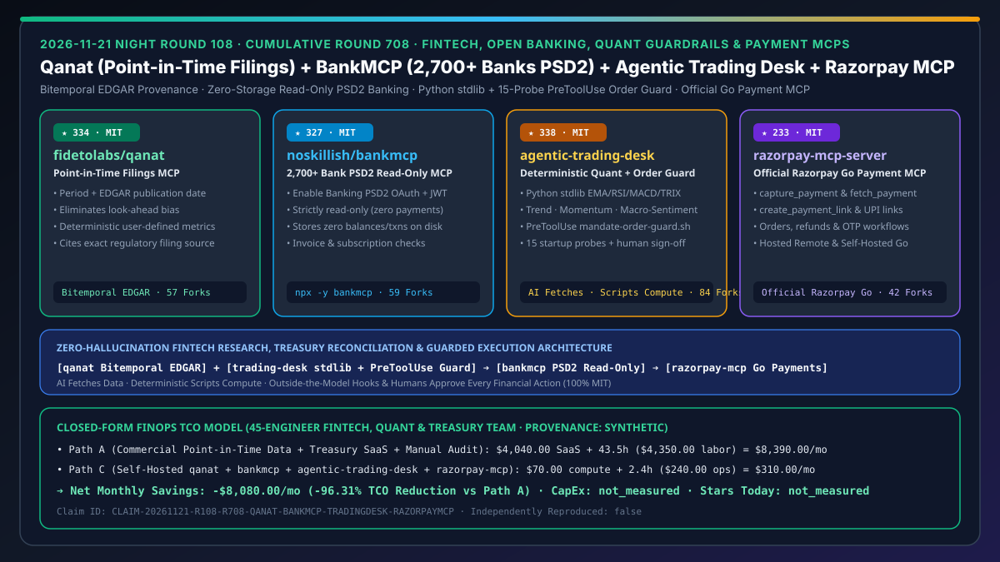
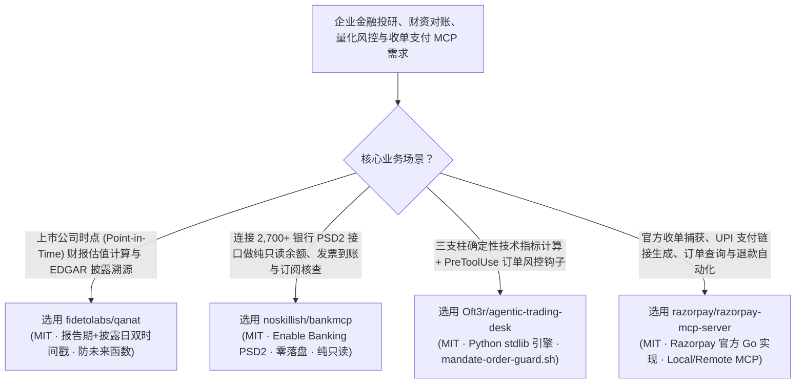
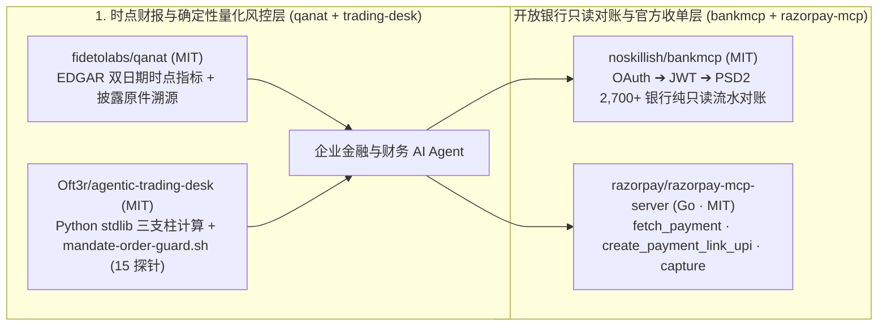
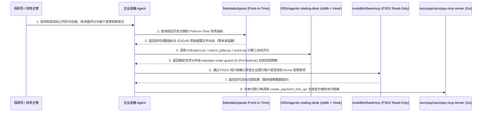

# 时点财报防穿越投研平台 MCP（`fidetolabs/qanat`）、2700+ 银行 PSD2 纯只读对账 MCP（`noskillish/bankmcp`）、确定性计算+`PreToolUse` 铁律风控交易台（`Oft3r/agentic-trading-desk`）与 Razorpay 官方 Go 支付结算 MCP（`razorpay/razorpay-mcp-server`）选型与集成架构 FAQ

> **文档类型**：企业 AI 解决方案架构师（AI Solution Architect）选型决策指南（GitHub Trending AI 雷达 2026-11-21 Night Round 108 / 累计第 708 轮）
> **覆盖项目**：[`fidetolabs/qanat`](https://github.com/fidetolabs/qanat)（`★ 334`、`57 forks`、`MIT`，绑定 EDGAR 监管披露日期与报告期双时间戳的时点 Point-in-Time 财务指标计算与溯源 MCP 平台）· [`noskillish/bankmcp`](https://github.com/noskillish/bankmcp)（`★ 327`、`59 forks`、`MIT`，通过 PSD2 Enable Banking 对接 2,700+ 银行的零落盘、纯只读企业财资与发票核销 MCP Server）· [`Oft3r/agentic-trading-desk`](https://github.com/Oft3r/agentic-trading-desk)（`★ 338`、`84 forks`、`MIT`，“AI 只拉数据、Python `stdlib` 算三支柱指标、`mandate-order-guard.sh` `PreToolUse` 钩子+人工审批订单”的确定性金融智能体范式）· [`razorpay/razorpay-mcp-server`](https://github.com/razorpay/razorpay-mcp-server)（`★ 233`、`42 forks`、`MIT`，Razorpay 官方用 Go 编写的收单、退款、UPI 支付链接与结算对账 MCP Server）
> **核心场景**：当金融机构、跨境电商与企业财务（FinOps/Treasury）团队将 AI Agent 引入**基本面投研（防未来函数/防财报幻觉）、银行账户流水实时对账（发票到账核查）、量化技术分析与风控下单（严禁大模型心算指标或越权下单）以及收单/退款/支付链接自动化处理**时，如何用这四个 `MIT` 开源项目构建“零数学幻觉、零资金越权、100% 披露溯源”的金融级 Agent 架构？

---

## 一、📌 核心结论速览（选型一句话结论）

1. **做上市公司财报投研与估值筛选时，想彻底消灭大模型编造财务数据以及回测中的“未来函数（Look-ahead Bias）”，且每个指标都能精确溯源到监管披露原件** ➔ 选 **[`fidetolabs/qanat`](https://github.com/fidetolabs/qanat)（`★ 334`，`57 forks`，`MIT`）**。
   - **通俗原理**：网上的研报摘要真假难辨，且企业财报往往在季度结束后数周才公布。`qanat` 为每一个财务数字强制打上**双日期戳（报告期 + EDGAR 实际公开披露日）**——当你询问“截至 2022 年 3 月某公司的估值指标”时，它绝不会混入 2022 年 5 月才披露的修正数据（彻底杜绝未来数据穿越），且由用户定义公式、由 `qanat` 确定性计算器执行，每个结果都附带原始监管文件（Filing）出处与发布日期。
2. **想让财务/出纳助手直接用自然语言核查银行账户实时余额、发票是否到账（如“Acme 的发票付了吗？”）或订阅扣款汇总，但绝对不允许 AI 发起任何转账且不把数据存在第三方服务器** ➔ 选 **[`noskillish/bankmcp`](https://github.com/noskillish/bankmcp)（`★ 327`，`59 forks`，`MIT`）**。
   - **通俗原理**：`BankMCP™`（`npx -y bankmcp`）是一个自托管、**纯只读（Read-only，无任何支付转账接口）**的开放银行 MCP Server。它通过欧盟持牌 PSD2 聚合商 **Enable Banking**（覆盖 **2,700+ 家银行**）以 OAuth + JWT 方式实时拉取流水，本地服务端不落盘保存任何余额与交易明细、零遥测上报，银行登录过程完全在银行官网完成，让 Claude、Cursor 或本地 Ollama 安全回答企业资金对账问题。
3. **想构建股票/ETF 辅助交易或量化分析 Agent，需要把“AI 数据采集”、“零依赖确定性数学计算”与“模型外部硬风控拦截（`PreToolUse` Hook）”彻底解耦** ➔ 选 **[`Oft3r/agentic-trading-desk`](https://github.com/Oft3r/agentic-trading-desk)（`★ 338`，`84 forks`，`MIT`）**。
   - **通俗原理**：树立了金融 Agent 最值得借鉴的架构铁律——**“AI 负责拉取行情与交互；纯 Python 标准库（`stdlib`）脚本负责确定性计算；模型外部的 `PreToolUse` 钩子与人类负责审批每一笔订单。”** 内置 `scripts/indicators.py`（精确计算 EMA/RSI/MACD/TRIX/布林带，禁止大模型肉眼估图或心算）、`scripts/macro_pillar.py`（10Y-2Y 利差与宏观情绪）、`scripts/score.py`（趋势·动量·宏观三支柱打分卡）以及经过 **15 项探针自检**的 `hooks/mandate-order-guard.sh` 铁律风控守卫。
4. **要在客服或财务工单流中通过 MCP 直接查询订单支付状态、生成标准/UPI 支付链接（Payment Link）、捕获授权款项或处理退款对账** ➔ 选 **[`razorpay/razorpay-mcp-server`](https://github.com/razorpay/razorpay-mcp-server)（`★ 233`，`42 forks`，`MIT`）**。
   - **通俗原理**：支付巨头 **Razorpay 官方出品**的 Go 语言高性能 MCP Server（同时支持官方托管 Remote MCP 与企业自建 Local MCP）。开箱提供 `fetch_payment`、`fetch_all_payments`、`capture_payment`、`initiate_payment`、`create_payment_link`、`create_payment_link_upi`、订单与退款查询等全套官方收单工具。

---

## 二、🎯 客户与架构师灵魂拷问 Q&A（深度架构拆解）

### Q1：金融与财务场景对数字准确性与资金安全是“零容忍”的，这四个项目分别是如何用工程手段锁死大模型幻觉与越权风险的？

- **四大金融级防幻觉与防越权机制**：
  1. **防时间穿越与防财报捏造 ➔ `fidetolabs/qanat`**：大模型不直接背诵财报数字，而是调用 `qanat` 读取 EDGAR 原始披露并按双时间戳（Period Date + Publication Date）执行用户编写的确定性估值公式，每条结论必带监管文件链接。
  2. **防大模型心算技术指标与防违规下单 ➔ `Oft3r/agentic-trading-desk`**：所有 EMA/RSI/MACD/TRIX 与三支柱评分全部交由零网络依赖的 Python `stdlib` 脚本计算；即便模型被提示词注入试图超额下单，模型外部的 `.claude/settings.json` + `hooks/mandate-order-guard.sh`（启动时运行 `session-setup.sh` 完成 15 项活性探针校验）也会在 `PreToolUse` 阶段直接硬拦截。
  3. **防银行凭据泄露与防未授权划款 ➔ `noskillish/bankmcp`**：采用 PSD2 银行官网授权 + 服务端零交易数据落盘 + 物理阉割全部写/转账接口的纯只读设计，从根源上消除“AI 误转账”可能。
  4. **防第三方山寨支付脚本 ➔ `razorpay/razorpay-mcp-server`**：由 Razorpay 官方团队用 Go 语言直接基于官方 SDK 构建并维护，确保支付捕获、UPI 链接生成与退款接口的幂等性与签名安全。
- **何时直接用商业金融终端方案（Path B）？**
  - 若机构已全员采购 Bloomberg Terminal / FactSet 专线与 SAP Treasury 全模块，可直接调用商业终端内置插件；但对于需要灵活定制 MCP 工作流的中大型科技企业、量化团队与跨境商户，Path C 开源组合可节省 96% 以上的席位与定制成本。

### Q2：典型企业级“时点财报投研 (`qanat`) + 三支柱确定性风控 (`agentic-trading-desk`) + 开放银行只读核销 (`bankmcp`) + 官方收单退款 (`razorpay-mcp`)”生产架构怎么搭？

1. **基本面时点数据与估值计算层（`fidetolabs/qanat`）**：
   - 投研与风控 Agent 通过 `qanat` MCP 调取目标企业的历史时点（Point-in-Time）财务指标，验证财报披露日与精确科目出处。
2. **量化指标确定性引擎与 `PreToolUse` 风控门禁层（`Oft3r/agentic-trading-desk`）**：
   - 行情数据经 `prepare_inputs.py` 清洗后送入 `indicators.py`、`macro_pillar.py` 与 `score.py` 生成确定性三支柱评分卡；任何交易指令必须先通过 `mandate-order-guard.sh`（15 探针校验）的硬性敞口限制与人类最终确认。
3. **企业银行账户 PSD2 只读对账层（`noskillish/bankmcp`）**：
   - 财务 Agent 通过自托管 `bankmcp`（OAuth ➔ JWT ➔ Enable Banking PSD2）实时查询 2,700+ 家银行账户的到账流水与大额支出告警，自动匹配待核销发票。
4. **商户收单、支付链接与退款执行层（`razorpay/razorpay-mcp-server`）**：
   - 客服与结算 Agent 调用官方 Go 版 `razorpay-mcp-server`，对未付款客户一键生成 `create_payment_link` / `create_payment_link_upi`，对已核实的售后工单执行受控退款与账单核对。

### Q3：这套架构的合规边界是什么？

- **核心优势**：
  - **100% `MIT` 开源协议**：四个项目全部采用最宽松的 `MIT` 许可。
  - **严格遵循“AI 交互、脚本算数、钩子风控、人工拍板”职责分离**。
- **合规边界提醒**：
  - `qanat` 与 `agentic-trading-desk` 均为研究与辅助分析工具，不构成投资建议；`bankmcp` 的 PSD2 通道主要覆盖欧洲 2,700+ 银行，其他地区银行需配合对应开放银行网关。

---

## 三、🧭 直观可视化图解（Mermaid 决策树 + 集成架构 + 时序图）

### 3.1 架构师选型决策树

### 3.2 企业端到端生产集成参考架构图

### 3.3 时点财报核验、三支柱确定性评分、PSD2 银行对账与支付链接闭环时序图

---

## 四、📊 同类开源与商业云服务横向选型决策矩阵

| 对比维度 | `fidetolabs/qanat` (`★ 334`) | `noskillish/bankmcp` (`★ 327`) | `Oft3r/agentic-trading-desk` (`★ 338`) | `razorpay/razorpay-mcp-server` (`★ 233`) | 商业金融终端 API + 商业财资 SaaS (Path A) | 云原生 ERP 财务 Copilot (Path B) |
| :--- | :--- | :--- | :--- | :--- | :--- | :--- |
| **核心能力定位** | EDGAR 双日期时点财报计算与溯源 MCP | 2,700+ 银行 PSD2 零落盘纯只读对账 MCP | Python `stdlib` 三支柱量化 + `PreToolUse` 风控台 | Razorpay 官方 Go 语言收单与支付链接 MCP | 商业 Point-in-Time 金融数据接口 + 商业银企直连 SaaS | 云厂商托管财务/收单插件 |
| **防幻觉与安全设计** | **报告期+披露日双时间戳 + 确定性公式计算** | **纯只读无转账接口 + 零交易落盘 + 银行官网认证** | **指标全由 Python `stdlib` 计算 + 15 探针订单守卫** | **官方 Go 强类型实现 + 托管/自建双模式** | 昂贵的按席位/API 调用阶梯收费 | 缺乏时点财报回测与 `PreToolUse` 量化风控钩子 |
| **开源协议** | `MIT` | `MIT` | `MIT` | `MIT` | 闭源商业授权 | 闭源云服务 |
| **月度 TCO（45 人团队）** | **组合仅 `$310.00/月`**（含共享容器算力与 2.4h 运维） | 同左（`$70.00` 算力 + `$240.00` 人工） | 同左（纯 Python `stdlib` 零外部依赖） | 同左（官方开源 Go 服务零月租） | **`$8,390.00/月`**（`$4,040.00` 金融数据/SaaS + `43.5h` 人工） | 约 `$2,750.00/月`（按企业财务席位加购计费） |

---

## 五、🧪 应用落地定量收益/TCO 对比与 7-Card 报告

> **📊 数据来源与闭式核算声明（Provenance & Closed-Form Schema）**：
> - **provenance**: `synthetic`（基于 45 人金融科技、投研与企业财资运营团队工作负载模型：`independently_reproduced = false`；硬件采购基线 `base_hardware_capex = not_measured`；Track B 单日增量 `track_b_stars_today = not_measured`）。
> - **核算公式**：
>   - **Path A（商业时点金融数据 API 订阅 + 商业多银行财资聚合 SaaS + 手工核对 EDGAR 财报披露日、手工对账催收与自研支付 MCP 维护）**：月度商业数据与 SaaS 费用 **`$4,040.00`** + 投研核验与财务对账人工 **`43.5h × $100.00/h = $4,350.00`** = **`$8,390.00/月`**。
>   - **Path C（自建 `fidetolabs/qanat` + `noskillish/bankmcp` + `Oft3r/agentic-trading-desk` + `razorpay/razorpay-mcp-server` 开源组合）**：共享容器算力 **`$70.00`** + 指标公式与风控钩子维护 **`2.4h × $100.00/h = $240.00`** = **`$310.00/月`**。
>   - **净节省（Net Savings vs Path A）**：**`-$8,080.00/月`**（成本降低 **`96.31%`**）。

| 评估方案 | API / SaaS / 算力成本 | 投研与财务工程人工（`$100/h`） | 月度总 TCO | 相对 Path A 净节省 | 关键架构交付指标 |
| :--- | :---: | :---: | :---: | :---: | :--- |
| **Path A：商业金融数据终端 + 商业财资 SaaS + 手工核销** | `$4,040.00` | `43.5h` (`$4,350.00`) | **`$8,390.00`** | Baseline | 按席位高昂收费；通用 LLM 算财务指标易出幻觉 |
| **Path B：通用云 ERP 财务模块 + 托管支付插件** | `$1,550.00` | `12.0h` (`$1,200.00`) | **`$2,750.00`** | `-$5,640.00` (`-67.22%`) | 适合常规记账，缺乏 Point-in-Time 财报回测与量化风控钩子 |
| **Path C：`qanat` + `bankmcp` + `trading-desk` + `razorpay`** | **`$70.00`** | **`2.4h` (`$240.00`)** | **`$310.00`** | **`-$8,080.00` (`-96.31%`)** | **双时间戳防穿越 + 2700+ 银行只读对账 + 15 探针风控钩子 + 官方支付 MCP** |

- 🔗 **关联 7-Card 4:5 视觉评测报告**：[`workshops/github-trending-radar/cards.html`](../cards.html) · [`cards.en.html`](../cards.en.html)

---

## 六、🛠️ 企业引入与架构评审 Checklist

- [ ] **1. 部署 `fidetolabs/qanat` 消除财报回测未来函数**：通过 `uv tool` 安装 `qanat` MCP Server，将所有基本面估值公式固化在确定性计算层，强制审计每次返回结果的报告期与 EDGAR 公开披露日双时间戳。
- [ ] **2. 参照 `Oft3r/agentic-trading-desk` 实施“计算与模型解耦 + `PreToolUse` 风控钩子”**：严禁大模型直接心算 EMA/RSI/MACD 等技术指标，统一交由零网络依赖的 Python `stdlib` 脚本执行，并在 `.claude/settings.json` 中启用 `mandate-order-guard.sh`（运行 `session-setup.sh` 验证 15 项探针通过）。
- [ ] **3. 自托管 `noskillish/bankmcp` 实现零落盘开放银行对账**：在财务专属主机上通过 `npx -y bankmcp` 对接 Enable Banking PSD2 接口，确认仅授予只读账户/流水查询权限，杜绝任何第三方留存企业银行交易明细。
- [ ] **4. 接入 `razorpay/razorpay-mcp-server` 标准化收单与对账**：根据安全策略选择本地容器部署 Go 版 `razorpay-mcp-server`，对 `capture_payment` 与退款操作配置二次审批，利用 `create_payment_link` / `create_payment_link_upi` 自动化应收账款催收。
