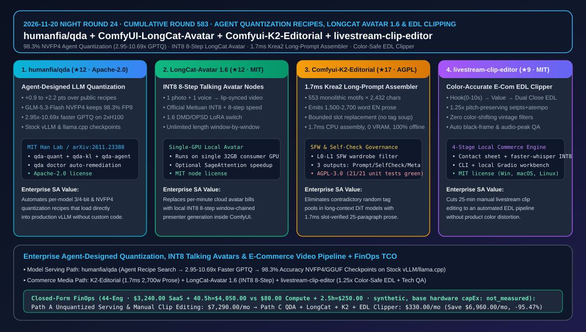
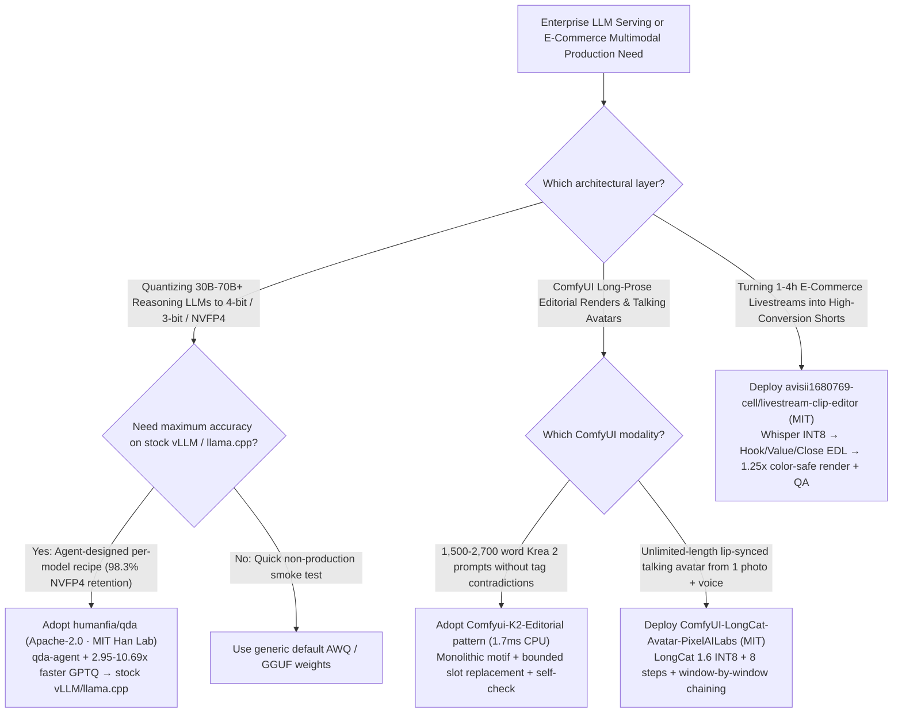
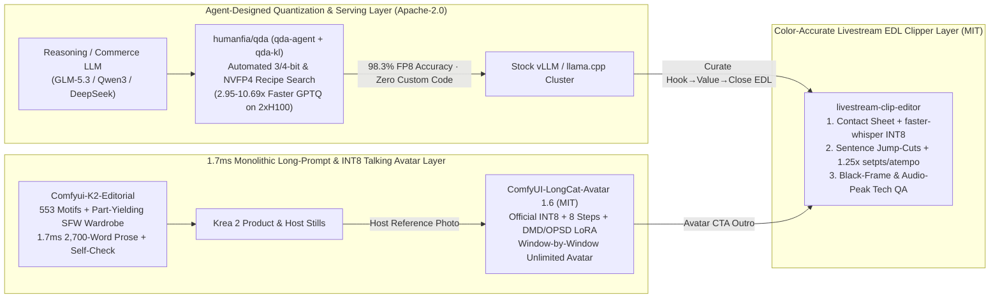
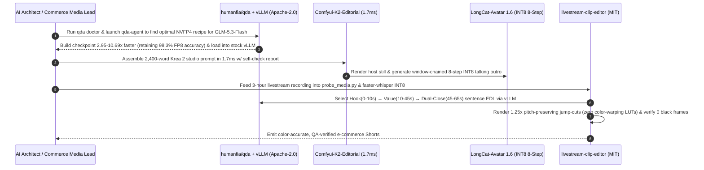

# How to Choose Agent-Designed LLM Quantization Recipes (98.3% NVFP4), INT8 8-Step LongCat Talking Avatars, 1.7ms Krea2 Long-Prompt Assemblers, and Color-Accurate Livestream EDL Clippers? `humanfia/qda`, `ComfyUI-LongCat-Avatar`, `Comfyui-K2-Editorial`, and `livestream-clip-editor` Architecture & Selection FAQ

> **Document Metadata (2026-11-20 Night Round 24 · Cumulative Round 583)**
> - **Target Audience**: AI Solution Architects, LLM Inference & vLLM Platform Architects, E-Commerce Digital-Human & Video Automation Leads
> - **Primary Repositories Evaluated**:
>   1. [`humanfia/qda`](https://github.com/humanfia/qda) (★ 12 · `stars_today: not_measured` · `4 stars/day` · Python · Apache-2.0 · MIT Han Lab blog & `arXiv:2611.23388`) — Agent-driven LLM quantization recipe design system (`qda-quant` + `qda-kl` + `qda-agent`) that discovers optimal per-model 4-bit, 3-bit, and `NVFP4` recipes and exports checkpoints that **stock `vLLM` and `llama.cpp` load with zero custom code**. Outperforms the strongest public recipes across 4 reasoning models by **`+0.9 to +2.2` accuracy points**, retains **`98.3%` of FP8 accuracy** on `GLM-5.3-Flash` at `NVFP4` (vs. `96.9%` for the best vendor checkpoint), and builds GPTQ **`2.95× to 10.69×` faster** than `llm-compressor 0.15` on 2×H100 GPUs
>   2. [`Pixelailabs/ComfyUI-LongCat-Avatar-PixelAILabs`](https://github.com/Pixelailabs/ComfyUI-LongCat-Avatar-PixelAILabs) (★ 12 · `stars_today: not_measured` · `4 stars/day` · Python · MIT) — First ComfyUI custom nodes for Meituan's **LongCat-Video-Avatar 1.6**, supporting the official **INT8** checkpoint, **8-step** fast sampling, the `1.6 DMD/OPSD LoRA` switch, and unlimited-length lip-synced talking avatar videos generated window-by-window on a single 32 GB GPU
>   3. [`lingdongbudong/Comfyui-K2-Editorial`](https://github.com/lingdongbudong/Comfyui-K2-Editorial) (★ 17 · `stars_today: not_measured` · `3 stars/day` · Python · AGPL-3.0) — 100% offline, zero-VRAM, **`1.7 ms` English long-prompt assembler (`1,500–2,700` words)** for Krea 2 that replaces contradictory random tag pools with **"553 Monolithic Motifs + Bounded Slot Replacement"** (`2,432` characters × `L0–L1` SFW wardrobe slots with automatic part-level outfit yielding), outputting `Prompt + Self-Check Report + Metadata` (`21/21` unit tests passing)
>   4. [`avisii1680769-cell/livestream-clip-editor`](https://github.com/avisii1680769-cell/livestream-clip-editor) (★ 9 · `stars_today: not_measured` · `1 star/day` · Python · MIT) — Local CLI + Gradio e-commerce livestream clipping engine and Claude Code skill combining `probe_media.py` & `contact_sheet.py`, `faster-whisper` INT8 sentence-level timestamps, **EDL sequencing (`Hook 0–10s → Selling Points 10–45s → Dual Urgency Close 45–65s`)**, pitch-preserving **`1.25×` speedup (`setpts + atempo`)**, color-safe editing (avoiding vintage filters that cause apparel/cosmetics return disputes), and automated black-frame/audio-peak QA
> - **Provenance & Guardrail Statement**: Structured after `ib-vs-ethernet-roce-selection-faq.md`. All four repositories come from `search-new-repos-2026-11-20-raw.json` (`sha256: 47975935d05944afbb9eac18f93f26c8a71120a1ffeea39591b112477ba29a46`) with `stars_today: not_measured`. Upstream paper/README metrics (`arXiv:2611.23388` `+0.9–2.2` accuracy gains, `98.3%` NVFP4 retention, `2.95×–10.69×` GPTQ speedup, `1.7 ms` assembly) are labeled `anonymized_reported (independently_reproduced=false)`. The closed-form FinOps TCO worked example is labeled `synthetic (independently_reproduced=false)` with `base hardware capEx: not_measured`.

---

## ① 📌 Executive Summary (One-Sentence Selection Verdict)

> **One-Sentence Verdict**: When scaling **enterprise LLM inference clusters and high-conversion e-commerce digital-human/livestream video pipelines**, **never apply a one-size-fits-all static GPTQ/AWQ recipe across reasoning models (which degrades chain-of-thought accuracy), and never apply color-shifting "anti-duplication" LUTs to e-commerce product clips (which triggers buyer returns over mismatched apparel/cosmetic colors)**! Instead, let Apache-2.0 **`humanfia/qda` design per-model NVFP4/4-bit quantization recipes (`98.3%` FP8 accuracy retention, `2.95×–10.69×` faster GPTQ builds, loading directly into stock `vLLM` / `llama.cpp`)**, pair MIT-licensed **`ComfyUI-LongCat-Avatar` (INT8 8-step window-chained talking avatars)** with **`Comfyui-K2-Editorial`'s `1.7 ms` monolithic-motif long-prompt architecture**, and automate livestream highlights with MIT-licensed **`livestream-clip-editor` (`1.25×` pitch-preserving EDL jump-cuts + black-frame QA)** to cut a 44-person organization's monthly GPU serving, avatar API, and manual editing TCO from **$7,290.00/mo** down to **$330.00/mo** (saving **$6,960.00/mo**, **`-95.47%`**, `synthetic, independently_reproduced=false`).



### Core Capabilities & Metrics Cheat Sheet

| Dimension | `humanfia/qda` | `ComfyUI-LongCat-Avatar` | `Comfyui-K2-Editorial` | `livestream-clip-editor` |
|---|---|---|---|---|
| **Plain-English Positioning** | Agent-designed LLM quantization recipe engine outputting stock `vLLM` & `llama.cpp` checkpoints | ComfyUI nodes for Meituan's `LongCat-Video-Avatar 1.6` (INT8, 8 steps, window-chained) | `1.7 ms` zero-VRAM 1,500–2,700-word English prompt assembler for Krea 2 | Local sentence-level EDL jump-cut & `1.25×` pitch-preserving e-commerce livestream clipper |
| **Primary Enterprise Pain Point Solved** | Manual 3/4-bit & NVFP4 quantization tuning being slow and losing reasoning accuracy | Local talking-avatar models running out of VRAM after 5 seconds or taking 30+ diffusion steps | Random tag-pool prompts creating contradictory lighting, camera angles, and overlapping outfits in long-text DiT models | Spending 20–30 mins manually cutting 1-min livestream clips, or using color-warping filters that cause product returns |
| **Key Technical / Measured Spec** | **`+0.9 to +2.2` pts** over best public recipes; **`98.3%`** FP8 retention on `GLM-5.3-Flash` NVFP4; **`2.95×–10.69×` faster** GPTQ | 1 photo + 1 voice line; official **INT8** model; **8 steps**; `1.6 DMD/OPSD LoRA`; window-by-window continuation | `553` monolithic motifs × `2,432` chars; `L0–L1` SFW part-yielding wardrobe; `1.7 ms` CPU execution; `21/21` tests green | Contact sheet + `faster-whisper` INT8 → `Hook/Value/Dual-Close` EDL → `1.25×` `setpts+atempo` → black-frame/peak QA |
| **License & Governance** | **Apache-2.0** (includes `qda doctor` setup diagnostics) | **MIT** (node code MIT; runs on 1×32 GB GPU) | **AGPL-3.0** (text-only output; third-party IP names require replacement for commercial brand ads) | **MIT** (Windows, macOS & Linux; CLI + local Gradio UI) |

---

## ② 🎯 Solution Architect & Customer Deep-Dive Q&A

### Q1: Why do static, off-the-shelf quantization scripts (`llm-compressor` defaults) degrade reasoning models at 3-bit, 4-bit, or `NVFP4`, and how does `humanfia/qda` achieve `98.3%` FP8 accuracy retention while building GPTQ up to `10.69×` faster?

- **Why Each Model Needs Its Own Quantization Recipe**:
  - Quantizing a reasoning LLM to 4-bit, 3-bit, or `NVFP4` involves choosing which calibration/smoothing transforms to apply, in what order, and with what per-layer hyperparameters. A recipe that works on Llama-3 often hurts a MoE or hybrid reasoning model like `GLM-5.3-Flash`.
- **How `humanfia/qda` (Apache-2.0 · `arXiv:2611.23388`) Automates Recipe Discovery**:
  1. **Agent-Proposed Recipes + Fast KL/Benchmark Scoring (`qda-agent` + `qda-kl` + `qda-quant`)**: A coding agent proposes candidate quantization recipes, and QDA builds and scores each candidate in minutes—running GPTQ **`2.95× to 10.69×` faster than `llm-compressor 0.15`** on 2×H100 GPUs (`anonymized_reported, independently_reproduced=false`).
  2. **Measured Accuracy Gains**: Across 4 reasoning models, QDA's agent-discovered recipes beat the strongest public recipes by **`+0.9 to +2.2` accuracy points on average**; on `GLM-5.3-Flash` at `NVFP4`, QDA retains **`98.3%` of the FP8 model's accuracy**, outperforming the best vendor checkpoint (`96.9%`).
  3. **Zero Custom Serving Code**: The winning checkpoint exports in standard formats that **stock `vLLM` and `llama.cpp` load directly**, verified via `qda doctor`.

### Q2: How do `lingdongbudong/Comfyui-K2-Editorial` and `Pixelailabs/ComfyUI-LongCat-Avatar-PixelAILabs` streamline high-fashion visual prompting and unlimited-length talking avatars in ComfyUI?

- **`Comfyui-K2-Editorial` (AGPL-3.0): "Monolithic Motif + Bounded Slots" Instead of Random Tag Soup**:
  - Long-context DiT models like **Krea 2** expect 20–25 structured paragraphs (`1,500–2,700` words) describing camera geometry, 5-layer depth of field, material zones, and color-palette percentages. Random tag combinators inevitably pit indoor warm key lights against outdoor snowstorms or stack conflicting garments.
  - `Comfyui-K2-Editorial` locks scene composition, lighting, and typography inside **553 curated monolithic motifs** (`312` 3D scenes, `15` posters, `226` short prompts) and exposes only bounded replacement slots (identity, aspect ratio badge cycling `Portrait → Landscape → Square`, fabric/garment parts where dresses automatically yield conflicting top/bottom slots, and in-image display text)—assembling the full prompt in **`1.7 ms` on CPU with 0 VRAM** alongside a `Self-Check Report` and `Metadata` string.
- **`ComfyUI-LongCat-Avatar-PixelAILabs` (MIT): INT8, 8-Step Window-Chained Talking Avatars**:
  - Wraps Meituan's **LongCat-Video-Avatar 1.6** official **INT8** model, **8-step** sampler, and `1.6 DMD/OPSD LoRA` switch into ComfyUI so a single photo + audio track generates lip-synced talking videos of arbitrary length **window by window** on a single 32 GB GPU (with optional `sageattention`).

### Q3: Why do generic "anti-duplication filter scripts" ruin e-commerce livestream clips, and how does `avisii1680769-cell/livestream-clip-editor` automate high-conversion clips safely?

- **The E-Commerce Color-Distortion Trap**:
  - Applying vintage LUTs or heavy hue shifts to bypass short-video deduplication distorts the true color of clothing, lipstick, and jewelry—leading directly to customer return disputes.
- **How `livestream-clip-editor` (MIT) Automates Color-Safe EDL Clips**:
  - **Stage 1 (`probe_media.py` & `contact_sheet.py`)**: Computes speech ratios and builds a timestamped visual contact sheet from 1–4 hour livestream recordings.
  - **Stage 2 (`transcribe.py` — Whisper INT8)**: Produces punctuated sentence-level timestamps.
  - **Stage 3 (Conversion-Oriented EDL)**: Sequences sentence segments into **`Hook (0–10 s) → Core Selling Points (10–45 s) → Dual Urgency Close (45–65 s)`** with hard jump-cuts that strip dead air.
  - **Stage 4 (`render_edit.py` + Technical QA)**: Applies pitch-preserving **`1.25×` speedup (`setpts` + `atempo`)** without color-warping LUTs, then runs automated technical QA checking duration, codec, black frames, and audio clipping peaks.

---

## ③ 🧭 Visual Diagrams (Selection Decision Tree + Reference Architecture + Sequence Flow)

### 3.1 LLM Quantization, Long-Prose DiT Prompting, Talking Avatars & Livestream Clipping Decision Tree



### 3.2 End-to-End Agent-Quantized Serving & E-Commerce Video Automation Architecture



### 3.3 `qda` Recipe Search → `LongCat` INT8 Avatar → `livestream-clip-editor` EDL Sequence



---

## ④ 📊 Comparative Selection Matrix (Open Source vs. Commercial Cloud & Legacy Baselines)

| Dimension | `humanfia/qda` (Apache-2.0) | `ComfyUI-LongCat-Avatar` (MIT) | `Comfyui-K2-Editorial` (AGPL-3.0) | `livestream-clip-editor` (MIT) | Static `llm-compressor` + Cloud Avatar SaaS + Manual/LUT Editing |
|---|---|---|---|---|---|
| **Core Positioning** | **Agent-designed LLM quantization recipes (`NVFP4 / 4-bit / 3-bit`) for stock `vLLM` / `llama.cpp`** | **ComfyUI nodes for Meituan `LongCat-Video-Avatar 1.6` (INT8, 8 steps, window-chained)** | **`1.7 ms` zero-VRAM 1,500–2,700-word Krea 2 prompt assembler** | **Sentence-level EDL jump-cut & `1.25×` color-safe e-commerce livestream clipper** | Hand-tuned static quantization, metered cloud avatar APIs, and 25-min manual CapCut editing |
| **Quantitative & Quality Wins** | **`+0.9 to +2.2` pts** over best public recipes; **`98.3%`** FP8 retention on `GLM-5.3-Flash` NVFP4; **`2.95×–10.69×` faster** GPTQ | Official INT8 + 8-step sampling with window-by-window continuation on one 32 GB GPU | Monolithic motif + part-yielding wardrobe prevents tag-soup contradictions in `1.7 ms` | Cuts 20–30 min manual clip editing to automated EDL runs while preserving true product colors | Static quantization drops reasoning accuracy; vintage deduplication LUTs cause product returns |
| **Deployment Compatibility** | Winning checkpoints load directly into **unmodified `vLLM` and `llama.cpp`** | Native ComfyUI custom nodes with optional `sageattention` | Pure Python 3.10+ stdlib, zero external dependencies, 100% offline | Cross-platform Python + FFmpeg CLI & local Gradio workbench | Research quantizers often require custom forks that break vLLM upgrades |
| **License & Governance** | **Apache-2.0** | **MIT** (nodes MIT; weights follow Meituan LongCat license) | **AGPL-3.0** (`L0–L1` SFW wardrobe; replace third-party IP character names for commercial ads) | **MIT** | Proprietary per-minute and per-seat SaaS billing |
| **Monthly TCO (44-Person Org)** | **~$40.00 / mo** (halves production serving GPU memory footprint) | **~$40.00 / mo** (local GPU power vs. per-minute cloud avatar bills) | **$0.00 / mo** | **$0.00 / mo** | **$7,290.00 / mo** (extra FP8 GPU rent + cloud avatar minutes + 40.5h manual quant/clip labor) |

---

## ⑤ 🧪 Quantitative Enterprise FinOps TCO & 7-Card Report Alignment

### 5.1 Closed-Form FinOps Worked Example (44-Person AI Serving Platform & E-Commerce Content Engineering Organization)

> **Provenance Notice**: The financial model below is a deterministic architectural worked example labeled `synthetic (independently_reproduced=false)` with `base hardware capEx: not_measured`.

| Cost Component | Path A: Unoptimized Serving GPUs + Metered Cloud Avatar APIs + Manual Livestream Editing | Path C: `humanfia/qda` NVFP4 + `LongCat` INT8 Nodes + `K2-Editorial` + `livestream-clip-editor` | Closed-Form Formula & Architectural Notes |
|---|---|---|---|
| **Serving GPU Capacity, Cloud Avatar APIs & Video SaaS** | **$3,240.00 / mo** | **$80.00 / mo** | Path A: extra FP8/FP16 GPU capacity + metered cloud talking-avatar minutes = `$3,240.00/mo`; Path C: `qda` `98.3%`-accurate NVFP4 checkpoints on stock vLLM + local INT8 8-step `LongCat-Avatar` = `$80.00/mo` |
| **Manual Quantization Tuning, Prompt Debugging & 25-Min/Clip Editing ($100/h)** | **$4,050.00 / mo** (`40.5h × $100.00`) | **$250.00 / mo** (`2.5h × $100.00`) | Path A: 44-person org spends `40.5h/mo` running slow manual quant sweeps, fixing contradicted tag-soup prompts, and hand-cutting livestream clips (`$4,050.00`); Path C: `qda-agent` + `1.7 ms` K2 assembly + automated EDL QA cuts ops to `2.5h/mo` (`$250.00`) |
| **Total Monthly TCO** | **$7,290.00 / mo** | **$330.00 / mo** | **Net savings of $6,960.00 / mo (-95.47% reduction, $83,520.00 annualized, `not_measured` hardware capEx)** |

```chart
{
  "data": {
    "values": [
      { "Category": "Serving GPU Rent & Cloud Avatar/Video APIs", "Deployment": "Path A: Unquantized Serving, Cloud Avatar & Manual Editing", "MonthlyCostUSD": 3240 },
      { "Category": "Manual Quant Tuning, Prompt Fixes & Clip Editing (44-Eng)", "Deployment": "Path A: Unquantized Serving, Cloud Avatar & Manual Editing", "MonthlyCostUSD": 4050 },
      { "Category": "Serving GPU Rent & Cloud Avatar/Video APIs", "Deployment": "Path C: QDA NVFP4 + LongCat INT8 + K2 + EDL Clipper", "MonthlyCostUSD": 80 },
      { "Category": "Manual Quant Tuning, Prompt Fixes & Clip Editing (44-Eng)", "Deployment": "Path C: QDA NVFP4 + LongCat INT8 + K2 + EDL Clipper", "MonthlyCostUSD": 250 }
    ]
  },
  "semantic_types": {
    "Category": "Category",
    "Deployment": "Name",
    "MonthlyCostUSD": "Amount"
  },
  "chart_spec": {
    "chartType": "Grouped Bar Chart",
    "title": "QDA Agent Quantization + LongCat INT8 + EDL Clipper cut monthly TCO by 95.47%",
    "subtitle": "Monthly cost in USD (44-person AI serving & e-commerce media org, synthetic)",
    "encodings": {
      "x": "Category",
      "y": "MonthlyCostUSD",
      "group": "Deployment",
      "color": "Deployment"
    }
  }
}
```

### 5.2 Alignment with the 7-Card 4:5 Visual Report (`cards.html` / `cards.en.html`)

- **✅ Good Fit**: Automated per-model 3/4-bit and `NVFP4` quantization recipe discovery for stock `vLLM` / `llama.cpp`, single-GPU INT8 8-step window-chained talking avatars in ComfyUI, `1.7 ms` conflict-free 2,700-word Krea 2 prompt assembly, and color-accurate e-commerce livestream EDL jump-cutting.
- **⛔ Not For**: Running `humanfia/qda` build pipelines without Linux + NVIDIA GPUs, using third-party copyrighted anime/game character presets from `Comfyui-K2-Editorial` in commercial brand campaigns, or applying color-warping deduplication filters to color-critical merchandise clips.

---

## ⑥ 🛠️ Enterprise Architecture Review & Rollout Checklist

- [ ] **Run `qda doctor` & Gate Quantized Checkpoints on `>=98%` Relative Accuracy**: Use `humanfia/qda` (Apache-2.0) to search per-model 4-bit/`NVFP4` recipes, verify zero `MISS` items via `qda doctor`, and confirm the exported checkpoint loads into unmodified `vLLM` or `llama.cpp` with `>=98%` accuracy retention on domain benchmarks.
- [ ] **Enable INT8 + 8-Step Sampling & `sageattention` on `LongCat-Avatar 1.6`**: Configure `Pixelailabs/ComfyUI-LongCat-Avatar-PixelAILabs` (MIT) with the official INT8 weights and `1.6 DMD/OPSD LoRA` switch for window-by-window long talking-head generation.
- [ ] **Adopt Monolithic Motif + Bounded Slot Prompting & Strip Third-Party IP**: Run `python tests/run_all.py` (`21/21` checks) in `lingdongbudong/Comfyui-K2-Editorial` (AGPL-3.0), replace third-party game/anime character names with first-party brand personas for commercial work, and inspect the node's `Self-Check Report` output string.
- [ ] **Enforce Color-Safe `1.25×` EDL Jump-Cuts & Black-Frame QA on Livestream Clips**: Process e-commerce recordings through `avisii1680769-cell/livestream-clip-editor` (MIT) using `contact_sheet.py`, `faster-whisper` INT8, and `Hook → Value → Dual-Close` EDLs while keeping hue-altering filters disabled and verifying zero black frames or audio clipping peaks before publishing.
