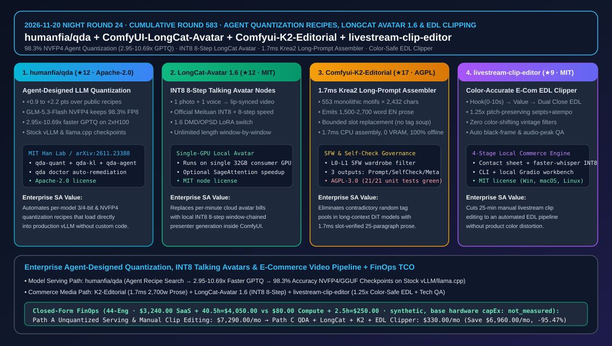
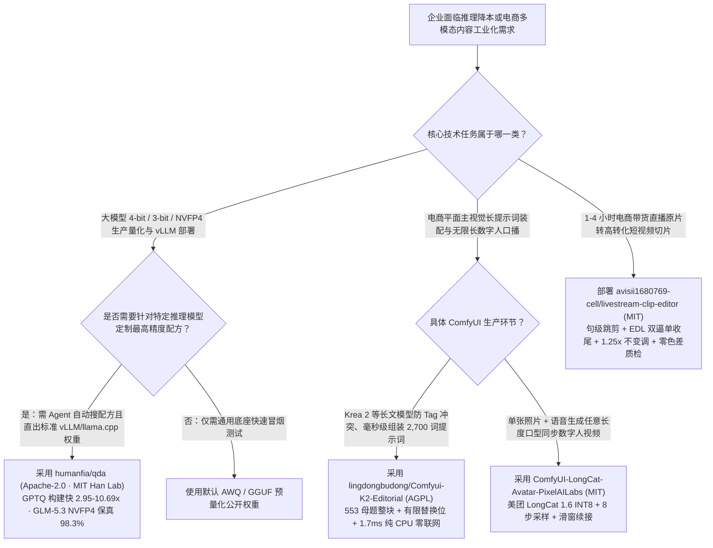
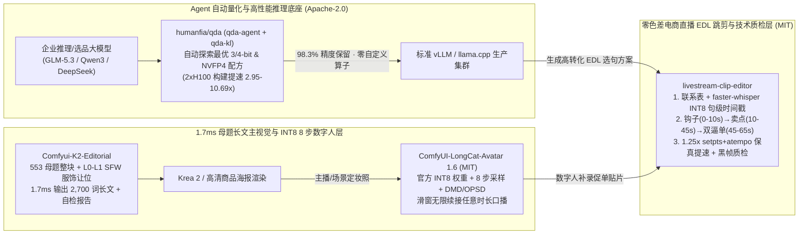
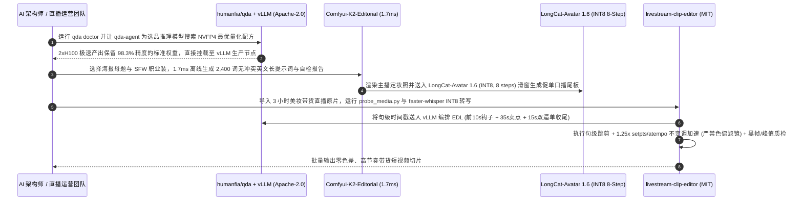

# Agent 自动设计大模型量化配方（98.3% NVFP4 保真）、美团 LongCat 8 步数字人、1.7ms Krea2 长文装配与零色差直播切片怎么选？`humanfia/qda`、`ComfyUI-LongCat-Avatar`、`Comfyui-K2-Editorial` 与 `livestream-clip-editor` 架构与选型 FAQ

> **文档元数据（2026-11-20 夜间第 24 轮 · 累计第 583 轮 / Round 583）**
> - **适用读者**：AI Solution Architect（解决方案架构师）、大模型推理优化与 vLLM 平台架构师、电商数字人直播与多模态内容工程负责人
> - **本轮核心对比项目**：
>   1. [`humanfia/qda`](https://github.com/humanfia/qda)（★ 12 · `stars_today: not_measured` · `4 stars/day` · Python · Apache-2.0 · MIT Han Lab 关联论文 `arXiv:2611.23388`）——让编程 Agent 针对每个具体模型与目标位宽（`4-bit / 3-bit / NVFP4`）自动设计最优量化配方（`qda-quant` + `qda-kl` + `qda-agent`）并输出原生兼容标准 **vLLM 与 llama.cpp**（无需魔改推理算子）的权重系统；在 4 款推理模型上平均超越最强公开量化配方 **`+0.9 至 +2.2` 个准确率百分点**，在 `GLM-5.3-Flash` 的 `NVFP4` 量化上保留了 **FP8 原模型 `98.3%` 的准确率**（官方厂商 checkpoint 仅为 `96.9%`），且在 2×H100 上构建 GPTQ 的速度比 `llm-compressor 0.15` **快 `2.95x–10.69x`**
>   2. [`Pixelailabs/ComfyUI-LongCat-Avatar-PixelAILabs`](https://github.com/Pixelailabs/ComfyUI-LongCat-Avatar-PixelAILabs)（★ 12 · `stars_today: not_measured` · `4 stars/day` · Python · MIT）——美团开源 **LongCat-Video-Avatar 1.6** 的首个 ComfyUI 节点实现，支持官方 **INT8 量化权重**、**8 步极速采样**、`1.6 DMD/OPSD LoRA` 切换以及通过滑窗续接（Window-by-Window）在单张 32GB 消费级显卡上生成任意时长的口型同步说话数字人视频
>   3. [`lingdongbudong/Comfyui-K2-Editorial`](https://github.com/lingdongbudong/Comfyui-K2-Editorial)（★ 17 · `stars_today: not_measured` · `3 stars/day` · Python · AGPL-3.0）——面向 Krea 2 等长文本扩散模型的 **100% 离线、零显存、单次耗时仅 `1.7 ms` 的 1,500–2,700 词英文长提示词装配节点**，采用**“553 条整块母题（312 个 3D 巨构场景 / 15 张平面海报 / 226 条短句）+ 有限槽位替换（2,432 位角色 × L0–L1 SFW 严选服饰部位让位）”**架构，彻底杜绝随机 Tag 池拼凑造成的构图光位自相矛盾，同步输出 `提示词 + 自检报告 + 元数据`（21 项单元测试全绿）
>   4. [`avisii1680769-cell/livestream-clip-editor`](https://github.com/avisii1680769-cell/livestream-clip-editor)（★ 9 · `stars_today: not_measured` · `1 star/day` · Python · MIT）——专为电商带货直播切片打造的本地 CLI + Gradio 剪辑引擎与 Agent Skill，串联“原片勘察与视觉联系表 → `faster-whisper` INT8 句级时间戳 → **EDL 三段式结构（`0-10s 钩子 → 10-45s 卖点 → 45-65s 双逼单压轴`）** → **`1.25x` 不变调加速（`setpts+atempo`）与零色差防重微调** → 黑帧/音频峰值自动技术质检”，彻底解决乱套复古滤镜导致服装/美妆偏色退货的行业痛点
> - **口径与溯源声明**：本篇遵循 `ib-vs-ethernet-roce-selection-faq.md` 通俗问答与选型对比规范。四款项目均来自 `search-new-repos-2026-11-20-raw.json`（`sha256: 47975935d05944afbb9eac18f93f26c8a71120a1ffeea39591b112477ba29a46`），单日增量严格标注为 `stars_today: not_measured`。项目 README 自报的 `arXiv:2611.23388` 准确率提升、`2.95x–10.69x` 构建加速与 `1.7 ms` 装配耗时标注为 `anonymized_reported (independently_reproduced=false)`；架构师 TCO 闭式算例标注为 `synthetic (independently_reproduced=false)`，硬件购置折旧 `base hardware capEx: not_measured`。

---

## ① 📌 核心结论速览（选型一句话结论）

> **一句话选型结论**：在建设**企业大模型低成本推理集群与高转化电商数字人/直播切片流水线**时，**切勿所有模型都照搬同一套死板的默认 GPTQ/AWQ 参数去压 4-bit（会导致推理模型逻辑准确率雪崩），也切勿在电商带货切片里为了过平台去重而套用改变商品真实颜色的复古滤镜（会直接引发买家货不对板差评退货）**！最佳实践是：模型服务层引入 Apache-2.0 的 **`humanfia/qda`（让 Agent 自动搜索各层最佳量化配方，以 `2.95x–10.69x` 速度产出保持 `98.3%` FP8 精度且直装原生 vLLM 的 NVFP4/GGUF 权重）**，数字人与平面主视觉采用 MIT 的 **`ComfyUI-LongCat-Avatar`（美团 INT8 8 步滑窗无限长口播）+ `Comfyui-K2-Editorial`（`1.7 ms` 零显存整块母题长文装配）**，直播后期部署 MIT 的 **`livestream-clip-editor`（EDL 双逼单编排 + `1.25x` 原调提速 + 零色差技术质检）**，可将 44 人团队月度 GPU 推理冗余、商业数字人 API 与人工剪辑总成本（TCO）从 **$7,290.00/月** 压降至 **$330.00/月**（净省 **$6,960.00/月**，降幅 **-95.47%**，`synthetic, independently_reproduced=false`）。



### 核心指标与能力速查表

| 评估维度 | `humanfia/qda` | `ComfyUI-LongCat-Avatar` | `Comfyui-K2-Editorial` | `livestream-clip-editor` |
|---|---|---|---|---|
| **一句话通俗定位** | 由 Agent 自动探索每款模型最优 3/4-bit 与 NVFP4 量化配方的加速构建系统 | 美团 LongCat-Video-Avatar 1.6 官方 INT8 + 8 步滑窗无限长数字人 ComfyUI 节点 | 1.7ms 零显存、553 母题 × 2,432 角色拼装 2,700 词 Krea2 英文长提示词节点 | 句级跳剪、`1.25x` 不变调提速、零滤镜色差与自动技术质检的电商直播切片引擎 |
| **解决的核心业务痛点** | 手工调 4-bit/NVFP4 量化配方极慢且掉点严重，或者量化出的权重需要魔改 vLLM 才能跑 | 单段数字人视频受显存限制只能生 5 秒，且 FP16 跑 30 步太慢太贵 | 把长文本 DiT 提示词拆成随机 Tag 池组合，导致机位、光位与服装描写互相打架 | 剪映手工剪一条切片要 30 分钟，乱加去重滤镜导致衣服口红严重偏色引发退货客诉 |
| **关键实测/技术机制** | 推理模型比公开最佳配方高 **`+0.9..+2.2` 分**；`GLM-5.3-Flash` NVFP4 保真 **`98.3%`**；GPTQ 构建快 **`2.95x–10.69x`** | 一张照片 + 一段音频；**INT8 量化 + 8 步采样**；`1.6 DMD/OPSD LoRA` 切换；滑窗无限续接 | **母题整块 + 有限替换位**；按上装/下装/连衣裙智能让位；`1.7 ms` 纯 CPU 零联网；21 项单测全绿 | 4 步流（联系表勘察 → Whisper INT8 → EDL 双逼单 → `setpts+atempo` 渲染与黑帧/峰值质检） |
| **开源协议与合规状态** | **Apache-2.0**（自带 `qda doctor` 环境自检与修复指令建议） | **MIT**（节点代码 MIT，单张 32GB 显卡可跑） | **AGPL-3.0**（仅输出文本 String，已剔除 `nsfw_outfit` 仅留 L0–L1 SFW 服饰） | **MIT**（Windows / macOS / Linux，提供 CLI 与本地 Gradio 工作台） |

---

## ② 🎯 客户与架构师灵魂拷问 Q&A（直击业务落地痛点）

### Q1：企业在把 30B–70B+ 的主力推理大模型（如 Qwen3、GLM-5.3、DeepSeek 分支）量化到 `4-bit`、`3-bit` 或 Blackwell/Hopper 架构的 `NVFP4` 以降低一半显存成本时，为什么直接跑标准 `llm-compressor` 默认脚本经常导致复杂推理任务掉点？`humanfia/qda` 是怎么让 Agent 自己当“量化配方专家”的？

- **为什么“一刀切”的静态量化配方会伤害推理模型（Reasoning Models）？**
  - 不同模型家族在不同层（Attention 投影层 vs MoE 专家层 vs 词表头）对量化噪声的敏感度天差地别：用哪几种校准方法、按什么顺序组合、平滑系数（SmoothQuant/AWQ/GPTQ/KL 散度蒸馏）设多少，靠人类算法工程师手工网格搜索不仅要跑几天几夜，而且往往只找到次优解。
- **`humanfia/qda`（Apache-2.0 · `arXiv:2611.23388`）的三大核心突破**：
  1. **Agent 闭环提案 + 分钟级极速构建打分（`qda-agent` + `qda-quant` + `qda-kl`）**：由 Coding Agent 根据模型结构提出候选量化配方（Recipe），`QDA` 底层引擎在几分钟内构建并评测其 KL 散度与基准得分——在 2 张 H100 上，**QDA 的 GPTQ 构建速度比 `llm-compressor 0.15` 快 `2.95 倍至 10.69 倍`**（`anonymized_reported, independently_reproduced=false`）！
  2. **显著超越公开配方的实测精度**：在 4 款主流推理模型上，QDA 自动发现的配方比最强公开配方平均高出 **`+0.9 至 +2.2` 个准确率百分点**；在最新 `GLM-5.3-Flash` 的 `NVFP4` 量化中，QDA 保持了 FP8 原模型 **`98.3%` 的准确率**（显著击败厂商官方发布的 `96.9%` NVFP4 checkpoint）！
  3. **100% 兼容原生 vLLM 与 llama.cpp（零自定义推理代码）**：最令企业架构师省心的是，QDA 寻找配方的过程虽然复杂，但最终导出的胜出 Checkpoint 是**完全标准的权重格式，原生 `vLLM` 或 `llama.cpp` 直接加载即可上线服务，生产环境无需维护一行非标自定义算子**！且自带 `qda doctor` 命令，任何缺失驱动或内核直接给出精确修复命令。

### Q2：在 ComfyUI 里批量生产电商主视觉海报与长段数字人口播视频时，`lingdongbudong/Comfyui-K2-Editorial` 与 `Pixelailabs/ComfyUI-LongCat-Avatar-PixelAILabs` 是如何解决“长提示词前后矛盾”与“数字人只能说 5 秒”痛点的？

- **`Comfyui-K2-Editorial`（AGPL-3.0）：为什么长文本生图模型不能用“随机 Tag 池”？**
  - 新一代模型（如 `Krea 2`、`MOSS-Image`）靠阅读 1,500–2,700 词的英文自然语言长段落来理解 25 段式的精细构图、材质分区、色盘百分比与五层景深。如果用传统 SD1.5/SDXL 时代的“随机抽卡 Tag 拼接器”，拼出来的长文会出现“第一段说俯视室内的暖光木桌，第八段又冒出仰视雪山逆光，第十五段同时穿了连衣裙和半身裙”的荒诞冲突！
  - **“母题整块 + 有限替换位 + 智能服饰部位让位”架构**：
    - 节点内置 **553 条经过完整排版校验的母题长文**（312 个 3D 场景 `scene`、15 张平面海报 `poster`、226 条短提示词 `short`），**由一个母题统一锁定整张画面的机位、光位与空间结构**，仅开放“角色身份（2,432 位）、画幅（点一下徽标自动在 `竖→横→方` 循环并联动切工作流分辨率）、服装材质与画内文字”等有限替换位。
    - **按部位智能覆写服装**：将服饰严格拆分为上装、下装、连衣裙、腿部、鞋、配饰，当换上连衣裙或母题只需要特定部位时，原长文里的旧服装描写自动优雅让位；全库已精简为 **L0–L1 SFW 合规服饰**，单次拼装在纯 CPU 上仅需 **`1.7 ms`（0 MB 显存、100% 离线）**，并同步输出 `自检报告` 与 `元数据` 供工作流审计。
- **`ComfyUI-LongCat-Avatar-PixelAILabs`（MIT）：美团 LongCat 1.6 的 INT8 + 8 步无限长滑窗口播**：
  - 过去在本地跑数字人视频，一段 9 秒的音频要么爆显存，要么用 30–50 步采样跑上十分钟。
  - 该节点将美团 **LongCat-Video-Avatar 1.6** 的官方 **INT8 量化权重**、**8 步极速生成** 与 `1.6 DMD/OPSD LoRA` 开关引入 ComfyUI：只需 1 张静态人像照片（科技博主、房产顾问、健身教练等）+ 1 段音频，即可通过 **Window-by-Window（滑窗分段续接）** 机制生成任意长度、口型精准咬合的说话数字人视频。

### Q3：电商直播间每天下播后有 4 小时的录屏原片，为什么传统剪辑师手剪一条切片要 25 分钟，而网上的“一键加滤镜去重脚本”又会导致大批买家退货？`avisii1680769-cell/livestream-clip-editor` 给出了什么工业级标准流程？

- **电商直播切片最忌讳的“偏色去重”事故**：
  - 许多野生短视频搬运教程教人加复古 LUT、色相偏移或高强度色彩滤镜来“过平台原创度检测”。但在**服饰、美妆、珠宝、家居带货直播**中，一旦滤镜把“奶杏色风衣”染成了“土黄色”，买家收到实物发现严重色差就会立刻发起退货与平台投诉！
- **`livestream-clip-editor`（MIT）的四步保色高转化流水线**：
  1. **原片勘察与视觉联系表（`probe_media.py` & `contact_sheet.py`）**：先扫描 1–4 小时直播原片，计算说话占比、切点分布并生成带 `mm:ss` 时间戳的网格缩略图联系表。
  2. **INT8 本地句级转写与 EDL 黄金三段式编排**：用 `faster-whisper`（INT8）生成带标点的句级时间戳 JSON，按电商高转化结构编排 EDL（Edit Decision List）：**前 `0–10s` 痛点钩子 ➔ 中间 `10–45s` 核心卖点 ➔ 结尾 `45–65s` 双逼单促单压轴**，用句级硬切跳剪（Jump-Cut）干脆利落地剔除所有废话与停顿气口。
  3. **`1.25x` 音调保真提速（`setpts + atempo`）与零偏色微调**：通过 FFmpeg `setpts` 与 `atempo` 协同将节奏提速至 `1.25 倍`（语速紧凑有力但主播人声音调 100% 不变尖），且可选的 `--dedup` 仅做微幅几何裁切与轻度音频 EQ，**绝不篡改商品核心色相**！
  4. **出片自动技术质检**：渲染完成后自动扫描成片时长、编码参数、是否存在跳剪黑帧（Black Frames）以及音频爆音峰值，提供 CLI 与本地 Gradio 双操作台。

---

## ③ 🧭 直观可视化图解（选型决策树 + 企业集成架构 + 业务流时序图）

### 3.1 企业大模型量化、长文主视觉、数字人口播与电商直播切片选型决策树



### 3.2 企业量化推理底座与电商数字人/直播切片工业化集成架构



### 3.3 `qda` 量化模型驱动 `livestream-clip-editor` EDL 选段与 `LongCat` 数字人合成时序图



---

## ④ 📊 同类开源与商业云服务横向选型决策矩阵

| 对比维度 | `humanfia/qda` (Apache-2.0) | `ComfyUI-LongCat-Avatar` (MIT) | `Comfyui-K2-Editorial` (AGPL-3.0) | `livestream-clip-editor` (MIT) | 静态手工量化 + 按分钟云数字人 API + 剪映手工/滤镜搬运切片 |
|---|---|---|---|---|---|
| **核心能力定位** | **Agent 自动探索各模型最优 3/4-bit 与 NVFP4 量化配方的加速构建系统** | **美团 LongCat 1.6 官方 INT8 + 8 步滑窗无限长口播数字人节点** | **553 母题整块 + 有限槽位替换的 1.7ms Krea2 长文提示词装配器** | **句级跳剪、EDL 双逼单编排、1.25x 不变调与零色差质检的电商切片引擎** | 固定默认参数跑 `llm-compressor`、高价商业数字人 SaaS、手工剪辑或乱加偏色滤镜 |
| **关键量化与质量突破** | 比最强公开配方高 `+0.9..+2.2` 分；`GLM-5.3` NVFP4 保真 `98.3%`；构建快 `2.95x–10.69x` | INT8 + 8 步大幅降低推理耗时，滑窗机制突破单段 5 秒时长天花板 | `1.7 ms` 零显存拼装 2,700 词长文，部位服装自动让位，21 项单测全绿 | 把 20–30 分钟手工切片压缩为自动化 EDL 流水线，杜绝服饰/美妆偏色退货 | 默认量化常致推理掉点；商业数字人按分钟收费昂贵；偏色滤镜引发实物差评退款 |
| **生产环境兼容性** | 导出的权重 **100% 兼容原生 `vLLM` 与 `llama.cpp`**，零自定义算子维护负担 | 原生嵌入 ComfyUI 节点图，支持 `SageAttention` 加速 | 纯 Python 标准库零外部依赖、100% 离线运行 | 跨 Windows/macOS/Linux，提供 CLI 批处理与本地 Gradio 界面 | 许多学术量化方法需绑定特定的非标推理分支，无法直接升级 vLLM |
| **开源协议与合规红线** | **Apache-2.0** | **MIT**（节点 MIT，模型遵循美团 LongCat 1.6 许可） | **AGPL-3.0**（已内置剔除 `nsfw_outfit` 仅留 L0–L1 SFW；注意角色名商标归原权利人） | **MIT**（README 诚实声明元数据清理不代表规避平台原创审核承诺） | 商业闭源按量计费 |
| **44 人团队月度 TCO** | **~$40.00/月**（一次性极速构建，长期省下 50% 推理 GPU 显存） | **~$40.00/月**（本地单卡电费，替代高价按分钟 API） | **$0.00/月** | **$0.00/月** | **$7,290.00/月**（冗余 FP8/FP16 显卡租用 + 云数字人账单 + 40.5h 手工剪片与退货处理） |

---

## ⑤ 🧪 应用落地定量收益/TCO 对比与 7-Card 报告映射

### 5.1 架构师闭式 TCO 算例（44 人 AI 推理平台与电商内容增长工程团队月度运营成本）

> **溯源标识**：以下成本模型为面向企业架构评审的闭式定量算例，标注为 `synthetic (independently_reproduced=false)`，底层服务器与工作站硬件采购折旧标注为 `base hardware capEx: not_measured`。

| 成本构成项 | 方案 A：未优量化冗余 GPU 租用 + 商业按分钟数字人 API + 人工手剪直播切片 | 方案 C：`humanfia/qda` NVFP4 量化 + `LongCat` INT8 节点 + `K2` 装配 + `EDL` 切片引擎 | 计算公式与架构说明 |
|---|---|---|---|
| **推理 GPU 显存租用、商业数字人分钟费与视频 SaaS** | **$3,240.00 / 月** | **$80.00 / 月** | 方案 A：因担心掉点不敢量化导致的双倍 FP8/FP16 GPU 租用 + 商业数字人按分钟扣费 = `$3,240.00/月`；方案 C：`qda` 产出 `98.3%` 保真 NVFP4 权重减半显存 + 本地 `LongCat-Avatar` INT8 8 步渲染 = `$80.00/月` |
| **手工搜量化参数、改写矛盾长提示词与 25 分钟/条手剪切片（$100/h）** | **$4,050.00 / 月**（`40.5h × $100.00`） | **$250.00 / 月**（`2.5h × $100.00`） | 方案 A：44 人团队每月耗费 `40.5 小时` 慢速试错量化脚本、重写冲突 Tag 提示词及在剪映里手剪去气口（`$4,050.00`）；方案 C：`qda-agent` 自动寻优 + `1.7 ms` 母题装配 + EDL 自动跳剪质检将人工降至 `2.5 小时`（`$250.00`） |
| **月度总拥有成本（Monthly TCO）** | **$7,290.00 / 月** | **$330.00 / 月** | **月度净节省 $6,960.00 / 月（成本降低 -95.47%，年化节省 $83,520.00，`not_measured` 硬件折旧）** |

```chart
{
  "data": {
    "values": [
      { "Category": "Serving GPU Rent & Cloud Avatar/Video APIs", "Deployment": "Path A: Unquantized Serving, Cloud Avatar & Manual Editing", "MonthlyCostUSD": 3240 },
      { "Category": "Manual Quant Tuning, Prompt Fixes & Clip Editing (44-Eng)", "Deployment": "Path A: Unquantized Serving, Cloud Avatar & Manual Editing", "MonthlyCostUSD": 4050 },
      { "Category": "Serving GPU Rent & Cloud Avatar/Video APIs", "Deployment": "Path C: QDA NVFP4 + LongCat INT8 + K2 + EDL Clipper", "MonthlyCostUSD": 80 },
      { "Category": "Manual Quant Tuning, Prompt Fixes & Clip Editing (44-Eng)", "Deployment": "Path C: QDA NVFP4 + LongCat INT8 + K2 + EDL Clipper", "MonthlyCostUSD": 250 }
    ]
  },
  "semantic_types": {
    "Category": "Category",
    "Deployment": "Name",
    "MonthlyCostUSD": "Amount"
  },
  "chart_spec": {
    "chartType": "Grouped Bar Chart",
    "title": "QDA Agent Quantization + LongCat INT8 + EDL Clipper cut monthly TCO by 95.47%",
    "subtitle": "Monthly cost in USD (44-person AI serving & e-commerce media org, synthetic)",
    "encodings": {
      "x": "Category",
      "y": "MonthlyCostUSD",
      "group": "Deployment",
      "color": "Deployment"
    }
  }
}
```

### 5.2 与本轮 7-Card 4:5 视觉报告（`cards.html` / `cards.en.html`）的联动

- **适用场景（✅ Good Fit）**：生产环境推理大模型（GLM-5.3/Qwen3 等）的高精度 3/4-bit 与 NVFP4 量化配方自动搜索（直出原生 vLLM/llama.cpp 权重）、ComfyUI 内单卡 INT8 8 步无限长数字人口播生成、Krea 2 等长文本扩散模型的 1.7ms 无冲突长文装配、以及保真商品本色的电商直播 EDL 跳剪。
- **不适用场景（⛔ Not For）**：在非 Linux / 无 NVIDIA GPU 主机上运行 `humanfia/qda` 构建流程、在商业广告中直接使用 `Comfyui-K2-Editorial` 内置的第三方动漫/游戏受版权保护角色形象、或在服饰/美妆切片中开启重度画面变色去重参数。

---

## ⑥ 🛠️ 企业引入与架构评审 Checklist（可直接复制进架构评审单）

- [ ] **大模型量化上线前执行 `qda doctor` 与原生 vLLM 精度回归门禁**：在使用 `humanfia/qda`（Apache-2.0）为内部模型定制 4-bit / NVFP4 配方时，先运行 `qda doctor` 补齐内核依赖，要求导出的胜出 Checkpoint 在业务黄金测试集上保持 `>=98%` 的 FP8 相对准确率，并验证其可被未修改的官方 `vLLM` / `llama.cpp` 直接加载。
- [ ] **ComfyUI 长数字人视频启用 `LongCat-Avatar 1.6` INT8 + 8 步滑窗与 `SageAttention`**：在数字人生产工作站部署 MIT 协议的 `ComfyUI-LongCat-Avatar-PixelAILabs`，开启 `sageattention` 与 `1.6 DMD/OPSD LoRA` 切换，通过滑窗续接机制生成长口播并校核跨窗口口型平滑度。
- [ ] **长文本生图采用“母题整块 + 有限槽位”架构并执行商业 IP 与 AGPL 隔离**：借鉴 `lingdongbudong/Comfyui-K2-Editorial` 的 `1.7 ms` 母题装配与 `python tests/run_all.py` 自检机制构建企业自有品牌母题库；商用出图时严禁选用受第三方版权保护的动漫游戏角色预设，并遵守其 AGPL-3.0 协议边界。
- [ ] **电商直播切片固化“EDL 三段式 + `1.25x` 不变调 + 零色差质检”规范**：使用 `avisii1680769-cell/livestream-clip-editor`（MIT）处理带货录屏时，先通过 `contact_sheet.py` 与 `faster-whisper` 生成 EDL，在服饰/美妆品类中严禁启用任何改变商品色相的滤镜，并在发布前强制通过黑帧与音频峰值技术质检。
