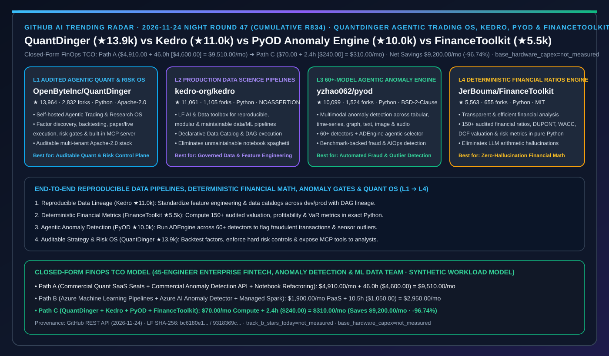
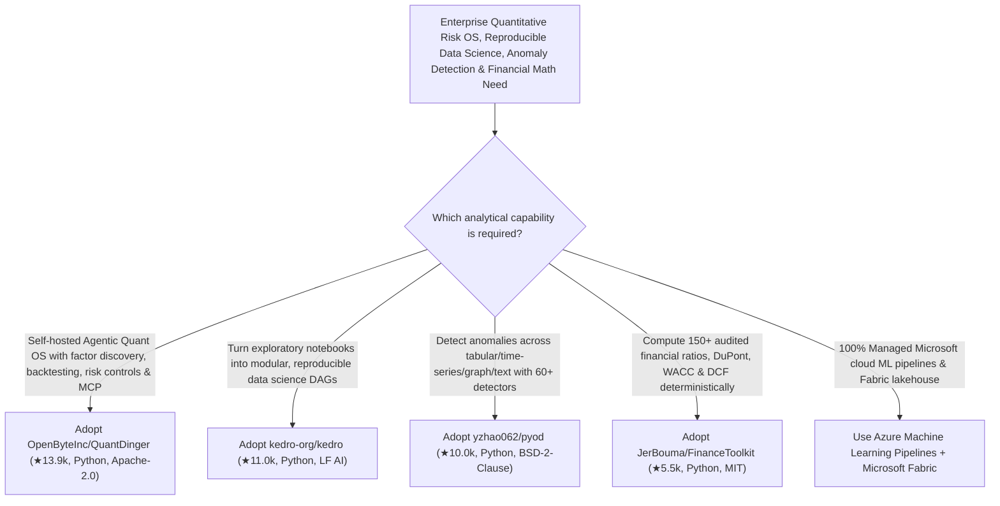
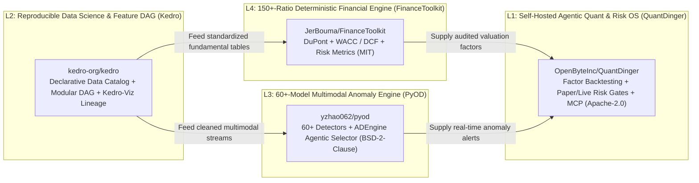
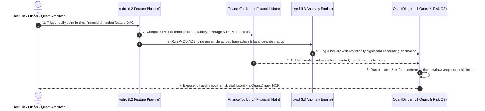

# Self-Hosted Agentic Quant & Risk OS (`OpenByteInc/QuantDinger`), Reproducible Data Science Pipelines (`kedro-org/kedro`), 60+-Model Anomaly Detection Engine (`yzhao062/pyod`) & Deterministic Financial Ratios Toolkit (`JerBouma/FinanceToolkit`) Selection & Architecture FAQ

> **Document Type**: AI Solution Architect Selection & Integration Guide (2026-11-24 Night Round 47 / Cumulative Round 834)  
> **Reading Time**: ~8 minutes  
> **Covered Repositories**: [`OpenByteInc/QuantDinger`](https://github.com/OpenByteInc/QuantDinger) (`★ 13,964` · `2,832 forks` · Python · `Apache-2.0`) · [`kedro-org/kedro`](https://github.com/kedro-org/kedro) (`★ 11,061` · `1,105 forks` · Python · `NOASSERTION`) · [`yzhao062/pyod`](https://github.com/yzhao062/pyod) (`★ 10,099` · `1,524 forks` · Python · `BSD-2-Clause`) · [`JerBouma/FinanceToolkit`](https://github.com/JerBouma/FinanceToolkit) (`★ 5,563` · `655 forks` · Python · `MIT`)  
> **Evidence Provenance**: GitHub REST API verified metadata (2026-11-24) and sealed local evidence files `trending-daily-2026-11-24-raw.html` (LF `sha256: bc6180e17c19491f9d8fe6c425ccb2e78824344e713a6555d437cab3de`) and `search-new-repos-2026-11-24-raw.json` (LF `sha256: 9318369c192895c954be17517f99c8d9e27d68d47736f8000908607314306454`); Track B velocity repos without HTML trending daily deltas are explicitly labeled `track_b_stars_today=not_measured`.  
> **中文版本**: [`quantdinger-kedro-pyod-financetoolkit-selection-faq.md`](./quantdinger-kedro-pyod-financetoolkit-selection-faq.md)

---

## ① 📌 Executive Summary

**One-Sentence Selection Verdict**: When enterprise FinTech, corporate treasury/risk, and AIOps engineering teams need an **auditable, zero-arithmetic-hallucination quantitative and anomaly-detection stack**, combining **`OpenByteInc/QuantDinger` (L1 Self-Hosted Agentic Trading, Factor Backtesting, Risk Control & MCP OS), `kedro-org/kedro` (L2 Production-Ready Reproducible Data Science & ML Pipeline Toolbox), `yzhao062/pyod` (L3 60+-Detector Multimodal Anomaly Detection Library with ADEngine Agentic Orchestration), and `JerBouma/FinanceToolkit` (L4 150+-Ratio Deterministic Financial Analysis & Valuation Engine)** reduces monthly TCO for a 45-engineer team from **`$9,510.00/mo`** (Path A: Commercial Quant Terminal SaaS + Commercial Fraud/Anomaly APIs + Manual Notebook Refactoring) to **`$310.00/mo`** (Path C), saving **`$9,200.00/mo` (`-96.74%`)**.

| Dimension | `OpenByteInc/QuantDinger` (L1 Agentic Quant & Risk OS) | `kedro-org/kedro` (L2 Reproducible Data Pipelines) | `yzhao062/pyod` (L3 60+-Detector Anomaly Engine) | `JerBouma/FinanceToolkit` (L4 Deterministic Financial Math) |
|---|---|---|---|---|
| **Verified Stars & Forks** | `★ 13,964` · `2,832 forks` | `★ 11,061` · `1,105 forks` | `★ 10,099` · `1,524 forks` | `★ 5,563` · `655 forks` |
| **Language & License** | Python (`Apache-2.0`) | Python (`NOASSERTION` · LF AI & Data `Apache-2.0`) | Python (`BSD-2-Clause`) | Python (`MIT`) |
| **Plain-English Positioning** | Complete open-source, self-hosted Agentic Trading OS with AI research, factor discovery, backtesting, risk controls & MCP | Toolbox for production-ready data science using software engineering best practices and DAG lineage | Python library for anomaly detection across tabular, time-series, graph, text, image & audio data with 60+ detectors | Transparent financial analysis library computing 150+ audited ratios, DuPont analysis, WACC & DCF in Python |
| **Core Enterprise Pain Solved** | Unifies fragmented research scripts, backtesters, risk limits, and MCP agent interfaces into one auditable stack | Eliminates unmaintainable Jupyter notebook spaghetti by enforcing modular nodes and declarative Data Catalogs | Automates outlier and fraud model selection across 60+ algorithms via benchmark-backed `ADEngine` | Eliminates LLM arithmetic hallucinations when computing WACC, DuPont ROE breakdowns, VaR, or valuation models |
| **When to Choose vs Cloud PaaS** | Choose for self-hosted, auditable quantitative research, paper/live risk gating, and MCP tool serving | Mandatory for converting exploratory data science notebooks into CI/CD-tested production DAGs | Mandatory for multimodal fraud, audit, and AIOps outlier detection; use Azure ML on pure Microsoft cloud | Mandatory deterministic math backend for every financial and equity-research AI agent |

---

## ② 🎯 Architect & Customer Q&A (1–2 Minute Read)

### Q1: Why must financial AI agents never compute complex valuation ratios inside LLM chain-of-thought—and how does `JerBouma/FinanceToolkit` (`★ 5,563`) guarantee accuracy?
- **The Pain**: LLMs routinely hallucinate intermediate floating-point steps when computing multi-period **Extended DuPont analyses, WACC, DCF intrinsic values, or Value-at-Risk (VaR)**.
- **Architect's Answer**: **`JerBouma/FinanceToolkit`** (`MIT`) provides **150+ unit-tested, transparent Python financial formulas**. By exposing `FinanceToolkit` as deterministic agent tools, the LLM only selects the ticker and metric while Python executes the exact accounting math.

### Q2: How does `yzhao062/pyod` (`★ 10,099`) empower AI agents to detect anomalies across tabular, time-series, graph, and text data?
- **60+ Detectors + Benchmark-Backed `ADEngine` (`BSD-2-Clause`)**: `pyod` unifies over 60 outlier detection algorithms (from fast parameter-free `ECOD`/`COPOD` to deep graph and time-series detectors) and includes **`ADEngine`**, an agentic orchestration workflow that selects and ensembles the best detectors based on dataset characteristics.

### Q3: How do `kedro-org/kedro` (`★ 11,061`) and `OpenByteInc/QuantDinger` (`★ 13,964`) bridge data engineering and auditable strategy execution?
- **Governed Feature DAGs + Auditable Risk OS**:
  1. **`kedro-org/kedro`**: Transforms raw financial and operational feeds into reproducible, unit-tested DAG pipelines with visual lineage (`Kedro-Viz`).
  2. **`OpenByteInc/QuantDinger` (`Apache-2.0`)**: Consumes governed features for factor discovery, backtesting, paper/live execution, deterministic risk controls, and MCP-based analyst interaction.

---

## ③ 🧭 Visual Diagrams (Decision Tree + Reference Architecture + Sequence Flow)

### 3.1 Selection Decision Tree

### 3.2 End-to-End Enterprise Production Reference Architecture

### 3.3 End-to-End Execution Sequence Diagram

---

## ④ 📊 Comparative Selection Matrix: OSS Stack vs. Peer OSS vs. Cloud PaaS

| Dimension | This OSS Stack (`QuantDinger` + `kedro` + `pyod` + `FinanceToolkit`) | Uncoordinated Ad-Hoc Stack (`Spaghetti Notebooks` + `LLM Mental Math` + `Static Thresholds`) | Commercial Cloud Stack (`Commercial Quant Terminal SaaS` + `Commercial Fraud API`) |
|---|---|---|---|
| **Core Role** | Auditable Agentic Quant OS + reproducible Kedro DAGs + 60+-model PyOD + 150+-ratio FinanceToolkit | Fragile `.ipynb` scripts + hallucinated financial ratios + high-false-positive static rules | Per-seat cloud quant terminals + per-call commercial anomaly APIs |
| **Best-Fit Scenario** | Institutional quant research, corporate financial auditing, fraud detection, and reproducible ML engineering | One-off academic exercises with no production deployment | Small funds outsourcing all infrastructure and strategy hosting to third-party SaaS |
| **Integration Effort** | **Low** (100% Python-native `pip` packages + Docker stack with built-in MCP server) | Very High (Rewriting data scientists' notebooks into production services takes weeks per model) | Medium (Fast SaaS onboarding, but locks proprietary alpha factors inside vendor clouds) |
| **Operational Complexity** | **Very Low** (Kedro unit-tested nodes + deterministic FinanceToolkit formulas; ~`2.4h/mo` ops) | Very High (Debugging look-ahead bias, broken notebooks, and false alarms costs ~`46.0h/mo`) | Low (Managed cloud PaaS, plus ~`10.5h/mo` data sync admin) |
| **License & Compliance** | `QuantDinger`, `kedro` (`Apache-2.0`), `pyod` (`BSD-2-Clause`), `FinanceToolkit` (`MIT`) — 100% commercial-safe | Unversioned local scripts | Proprietary per-seat and per-API-call contracts |
| **45-Engineer Monthly TCO** | **`$310.00/mo`** (`$70.00` internal compute/backtest node + `2.4h` ops) | ~`$4,670.00/mo` (`$70.00` host + `46.0h` notebook refactoring & math auditing) | **`$2,950.00/mo`** (Path B) to **`$9,510.00/mo`** (Path A commercial stack) |

---

## ⑤ 🧪 Quantitative ROI & Closed-Form FinOps TCO Comparison

> **Provenance Disclosure**: The TCO table below is a closed-form synthetic architectural model (`provenance: synthetic`, `independently_reproduced: false`) for a **45-engineer enterprise FinTech, risk analytics, and ML data-pipeline team** running 120 daily feature/anomaly pipelines and evaluating 5,000 corporate issuers (`$100.00/hr` loaded engineering rate). Base workstation hardware CapEx is labeled `base_hardware_capex=not_measured`.

| Cost Component | Path A: Commercial Quant Terminal SaaS + Commercial Anomaly API + Manual Notebook Refactoring | Path B: Azure ML Pipelines + Managed Anomaly Service + Spark | Path C: `QuantDinger` + `kedro` + `pyod` + `FinanceToolkit` |
|---|---|---|---|
| **Monthly API / SaaS / Cloud Spend** | **`$4,910.00`** (Commercial quant backtesting seats + per-call commercial anomaly detection APIs) | **`$1,900.00`** (Managed ML pipeline compute + storage + monitoring) | **`$70.00`** (`$0` license fees across all 4 permissive OSS repos; `$70` internal backtest & pipeline node) |
| **Monthly Notebook Refactoring, Financial Math Auditing & Threshold Tuning Labor** | `46.0h` (Rewriting spaghetti notebooks + manually verifying LLM financial calculations) | `10.5h` (Cloud pipeline & feature store administration) | **`2.4h`** (Production-ready `kedro` DAGs + deterministic `FinanceToolkit` + `pyod` ADEngine) |
| **Monthly Labor Cost (`$100.00/hr`)** | **`$4,600.00`** (`46.0 * 100.00`) | **`$1,050.00`** (`10.5 * 100.00`) | **`$240.00`** (`2.4 * 100.00`) |
| **Total Monthly TCO** | **`$9,510.00 / mo`** | **`$2,950.00 / mo`** | **`$310.00 / mo`** |
| **Net Monthly Savings vs. Path A** | Baseline (`$0.00`) | Saves `$6,560.00 / mo` (`-68.98%`) | **Saves `$9,200.00 / mo` (`-96.74%`)** |

---

## ⑥ 🛠️ Enterprise Architecture Review & Adoption Checklist

- [ ] **Point-in-Time Filing-Date Enforcement (`kedro` + `QuantDinger`)**: Key all fundamental and macroeconomic datasets in `kedro`'s Data Catalog by actual public filing timestamps rather than fiscal period-end dates to eliminate look-ahead bias in `QuantDinger` backtests.
- [ ] **Delegate All Financial Arithmetic to `JerBouma/FinanceToolkit`**: Prohibit LLMs from computing financial ratios or DCF valuations in free text; route all numerical calculations through `FinanceToolkit` tool calls.
- [ ] **Ensemble Outlier Scoring via `yzhao062/pyod`**: Combine parameter-free fast detectors (`ECOD`, `COPOD`) with `IForest` in `pyod` to minimize false-positive alert fatigue in production fraud and AIOps streams.
- [ ] **Deterministic Pre-Trade Risk Gates (`OpenByteInc/QuantDinger`)**: Enforce non-AI hard-coded position limits, max-drawdown circuit breakers, and mandatory paper-trading burn-in inside `QuantDinger` before enabling live execution.
