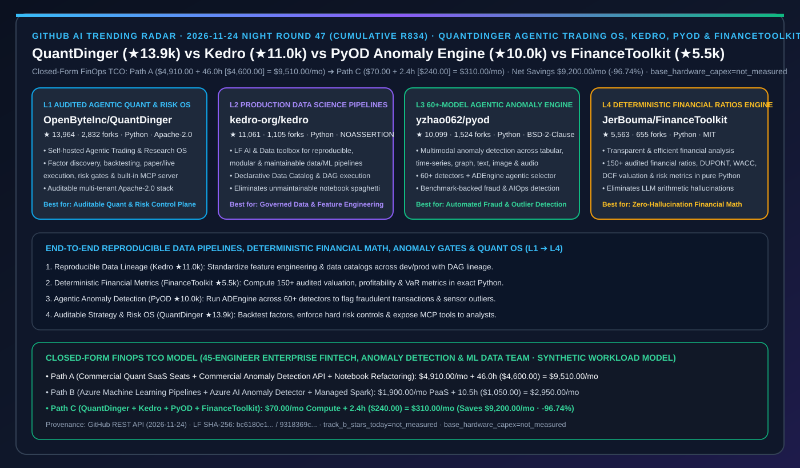
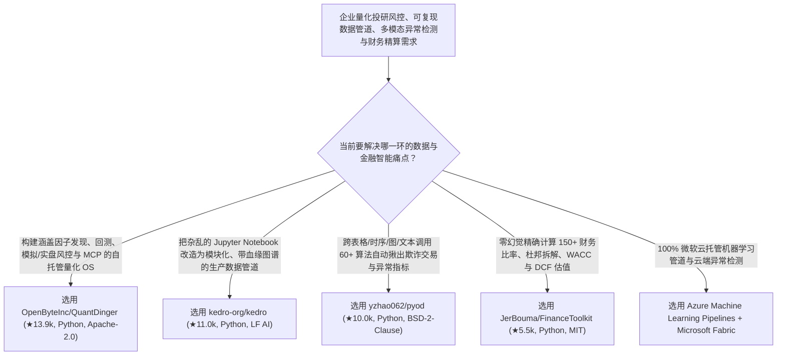
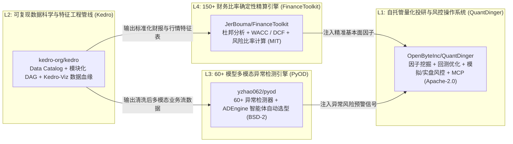
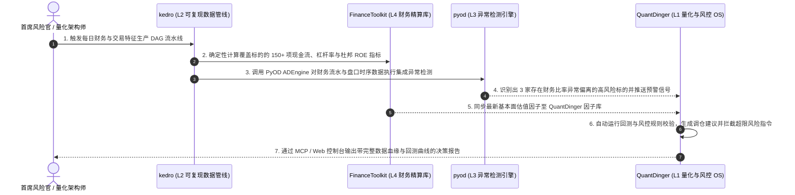

# 自托管量化与风控智能体操作系统（`OpenByteInc/QuantDinger`）、生产级可复现数据科学流水线（`kedro-org/kedro`）、60+ 算法多模态异常检测引擎（`yzhao062/pyod`）与 150+ 财务指标透明精算库（`JerBouma/FinanceToolkit`）选型与集成 FAQ

> **文档类型**：AI 解决方案架构师（AI Solution Architect）选型决策指南（2026-11-24 Night Round 47 / 累计第 834 轮）  
> **阅读耗时**：约 8 分钟  
> **覆盖项目**：[`OpenByteInc/QuantDinger`](https://github.com/OpenByteInc/QuantDinger)（`★ 13,964` · `2,832 forks` · Python · `Apache-2.0`） · [`kedro-org/kedro`](https://github.com/kedro-org/kedro)（`★ 11,061` · `1,105 forks` · Python · `NOASSERTION`） · [`yzhao062/pyod`](https://github.com/yzhao062/pyod)（`★ 10,099` · `1,524 forks` · Python · `BSD-2-Clause`） · [`JerBouma/FinanceToolkit`](https://github.com/JerBouma/FinanceToolkit)（`★ 5,563` · `655 forks` · Python · `MIT`）  
> **证据溯源**：GitHub REST API 实测元数据（2026-11-24）与本地冻结证据文件 `trending-daily-2026-11-24-raw.html`（LF `sha256: bc6180e17c19491f9d8fe6c425ccb2e78824344e713a6555d437cab3de`）、`search-new-repos-2026-11-24-raw.json`（LF `sha256: 9318369c192895c954be17517f99c8d9e27d68d47736f8000908607314306454`）；Track B 仓库无 HTML 榜单对应的单日增量，统一标记为 `track_b_stars_today=not_measured`。  
> **English Version**: [`quantdinger-kedro-pyod-financetoolkit-selection-faq.en.md`](./quantdinger-kedro-pyod-financetoolkit-selection-faq.en.md)

---

## ① 📌 核心结论速览（Executive Summary）

**选型一句话结论**：当金融机构、大型企业财务风控部与工业智能运维（AIOps）团队需要打造一套**零大模型算术幻觉、全链路可复现、自带 60+ 异常检测模型与硬性风控门禁**的数据科学与量化风控底座时，采用 **`OpenByteInc/QuantDinger`（L1 集成因子挖掘、回测、模拟/实盘风控与 MCP 的自托管智能体量化操作系统）+ `kedro-org/kedro`（L2 消灭面条式 Jupyter Notebook 的生产级模块化数据科学流水线）+ `yzhao062/pyod`（L3 支持表格/时序/图/文本/图像的 60+ 算法与 ADEngine 智能体异常检测标准库）+ `JerBouma/FinanceToolkit`（L4 内置 150+ 透明可审计财务比率、杜邦分析与 DCF 估值公式的精算工具包）**，可将 45 人团队的月度 TCO 从商业量化云席位 + 商业反欺诈/异常检测 API + 手工重构 Notebook 胶水代码（Path A）的 **`$9,510.00/月`** 降至 **`$310.00/月`**（净省 **`$9,200.00/月`**，降幅 **`-96.74%`**）。

| 评估维度 | `OpenByteInc/QuantDinger` (L1 自托管智能体量化与风控 OS) | `kedro-org/kedro` (L2 生产级可复现数据科学管线) | `yzhao062/pyod` (L3 60+ 算法智能体异常检测库) | `JerBouma/FinanceToolkit` (L4 150+ 财务比率透明精算库) |
|---|---|---|---|---|
| **GitHub 实测热度** | `★ 13,964` · `2,832 forks` | `★ 11,061` · `1,105 forks` | `★ 10,099` · `1,524 forks` | `★ 5,563` · `655 forks` |
| **实现语言与开源协议** | Python (`Apache-2.0`) | Python (`NOASSERTION` · LF AI & Data `Apache-2.0`) | Python (`BSD-2-Clause`) | Python (`MIT`) |
| **一句话通俗定位** | 一站式开源自托管 Agentic Trading OS：涵盖 AI 投研、因子发现、回测优化、风控门禁与 MCP 服务 | 麦肯锡开源并捐献给 Linux 基金会的生产级数据科学工具箱（Data Catalog + 模块化 DAG + 可视化血缘） | Python 异常检测事实标准库：覆盖 60+ 检测器、多模态数据与面向 AI Agent 的 ADEngine 自动编排 | 透明高效的金融财务分析库：用纯 Python 确定性计算 150+ 财务比率、WACC、DCF 估值与风险指标 |
| **解决的核心业务痛点** | 解决传统投研与风控“因子研究、回测脚本、实盘风控分散在五套不兼容工具里，且缺乏 MCP 接口供 Agent 安全调用”的痛点 | 根治数据科学家写的 `.ipynb` 笔记本“全局变量满天飞、换台机器就跑不通、数据工程团队要花两周重写才能上线”的顽疾 | 解决金融反欺诈与工业传感器监控中“不知道该选 Isolation Forest 还是 AutoEncoder、靠人工调参耗时费力”的痛点 | 彻底杜绝让 LLM 自己做多步浮点数乘除算错 WACC、夏普比率或杜邦分析导致的严重投研事故 |
| **何时选它 vs 云托管** | 金融机构、资管团队或企业资金部构建私有可审计的因子回测、模拟验证与风控工作台时首选 | 任何需要将探索性数据科学/ML 实验转化为软件工程级 CI/CD 生产管道的团队必选 | 财务审计异常发现、信用卡反欺诈、AIOps 指标突变检测首选；纯微软云选 Azure AI Anomaly Detector | 作为财务/投研 Agent 的确定性数学计算工具（Tool/Skill）必配底座 |

---

## ② 🎯 客户与架构师灵魂拷问 Q&A（1–2 分钟速读）

### Q1：为什么在金融投研和企业财务分析中，严禁让大模型直接用思维链（CoT）心算财务比率，而必须挂载 `JerBouma/FinanceToolkit`（`★ 5,563`）？
- **痛点**：大语言模型本质上是概率词元预测器，一旦让它直接根据三张财务报表原始数字同时计算复杂的 **扩展杜邦分析（Extended DuPont Analysis）、加权平均资本成本（WACC）、折现现金流（DCF）或条件在险价值（CVaR）**，极易在中间步骤出现小数点移位或公式张冠李戴。
- **架构师解答**：**`JerBouma/FinanceToolkit`**（`MIT`）坚持“**100% 公式透明、零黑盒精算**”原则，内置 **150+ 个经过严格单元测试的财务比率、估值模型与技术指标**。架构师只需将其封装为 MCP 工具交给 Agent 调用：大模型只负责理解用户意图并传入股票代码/财报切片，所有底层矩阵与公式计算全部由 `FinanceToolkit` 确定性完成，实现“零算术幻觉”。

### Q2：`yzhao062/pyod`（`★ 10,099`）最新引入的 `ADEngine` 智能体工作流是如何改变企业反欺诈与 AIOps 异常检测的？
- **核心收益**：`pyod`（Python Outlier Detection · `BSD-2-Clause`）汇集了从经典统计、ECOD/COPOD 到深度图神经网络在内的 **60+ 种异常检测算法**，横跨表格、时序、图谱、文本、图像与音频六大模态。其内置的 **ADEngine** 能够根据当前数据集的维度、偏度与性能约束，结合大规模基准测试先验知识，**自动为 AI Agent 选择并融合最优的异常检测器组合**，无需人工逐一盲试 60 种模型。

### Q3：`kedro-org/kedro`（`★ 11,061`）与 `OpenByteInc/QuantDinger`（`★ 13,964`）如何把数据实验室与实盘风控无缝衔接？
- **可复现数据血缘 + 闭环量化风控操作系统**：
  1. **`kedro-org/kedro`**：通过声明式 `catalog.yml`（解耦本地 CSV、Parquet、Snowflake 与 S3 存储）与纯函数节点构建可复现特征工程 DAG，并利用 `Kedro-Viz` 生成清晰的数据血缘图。
  2. **`OpenByteInc/QuantDinger`（`Apache-2.0`）**：消费清洗后的特征与因子数据，在同一套可审计栈内完成 AI 因子挖掘、历史回测、参数优化、模拟盘验证（Paper Trading）、多资产风控拦截与 MCP 服务暴露。

---

## ③ 🧭 直观可视化图解（Mermaid 决策树 + 集成架构 + 时序图）

### 3.1 技术选型决策树

### 3.2 企业端到端生产集成参考架构图

### 3.3 业务流全链路时序图

---

## ④ 📊 同类开源与商业云服务横向选型决策矩阵

| 对比维度 | 本轮开源组合 (`QuantDinger` + `kedro` + `pyod` + `FinanceToolkit`) | 传统手工作坊 (`散乱 Jupyter 脚本` + `LLM 心算财务公式` + `单规则阈值报警`) | 商业金融终端与 SaaS (`商业量化 SaaS 席位` + `商业反欺诈 API` + `托管特征平台`) |
|---|---|---|---|
| **功能定位** | 自托管量化风控 OS + 模块化数据 DAG + 60+ 模型异常检测 + 150+ 确定性财务精算 | 不可复现的个人脚本 + 算术幻觉频发的大模型直出 + 极高误报率的静态阈值 | 昂贵按席位收费的量化云终端 + 按调用次数收费的商业风控黑盒 |
| **适用场景** | 私募/资管/银行投研风控、上市公司财务舞弊与经营异常审计、工业设备与云原生 AIOps 异常检测 | 一次性课堂作业或单只股票简单画图 | 预算充裕且允许核心策略因子托管在外部第三方 SaaS 的小型机构 |
| **集成成本** | **低**（全部为标准 Python 生态，支持 `pip` 一键安装并与 Pandas/Polars/MCP 无缝衔接） | 极高（每次把数据科学家的 Notebook 重构为生产服务都要耗费数周） | 中（SaaS API 接入快，但策略代码与私有因子受限于平台专有沙箱） |
| **运维复杂度** | **极低**（`Kedro` 保障工程化可测试性，`QuantDinger` 提供一体化 Docker 栈，月均维护仅 `2.4h`） | 极高（排查线上特征穿越、修正算错的财务数字与误报耗费 `46.0h/月`） | 低（云端全托管，月均数据同步与规则配置约 `10.5h`） |
| **开源协议与合规** | `QuantDinger`、`kedro` (`Apache-2.0`)、`pyod` (`BSD-2-Clause`)、`FinanceToolkit` (`MIT`) — 100% 商业宽松合规 | 内部散乱脚本 | 商业闭源按席位/按交易量分成 |
| **45 人团队月度 TCO** | **`$310.00/月`**（含 `$70.00` 内部计算与回测节点 + `2.4h` 运维） | 约 `$4,670.00/月`（含 `$70.00` 主机 + `46.0h` 重写 Notebook 与修错工时） | **`$2,950.00/月`**（Path B）至 **`$9,510.00/月`**（Path A 商业全栈） |

---

## ⑤ 🧪 应用落地定量收益 / TCO 对比（Closed-Form FinOps 模型）

> **数据性质声明（Provenance Metadata）**：以下 TCO 模型为面向 **45 人企业金融科技（FinTech）、财务风控与数据科学工程团队**（每日运行 120 条特征工程与异常检测生产管线、覆盖 5,000 家标的企业 150+ 财务指标精算与多策略回测风控，工程师折算时薪 `$100.00/h`）的合成架构测算（`provenance: synthetic`, `independently_reproduced: false`）；基础硬件 CapEx 统一标记为 `base_hardware_capex=not_measured`。

| 成本构成项 | Path A：商业量化投研 SaaS 席位 + 商业异常检测 API + 人工重构 Notebook | Path B：Azure ML Pipelines + 云端异常检测服务 + 托管 Spark | Path C：`QuantDinger` + `kedro` + `pyod` + `FinanceToolkit` |
|---|---|---|---|
| **API / SaaS / 云资源月费** | **`$4,910.00`**（商业量化终端与回测云席位 + 按量计费商业反欺诈/异常检测 API） | **`$1,900.00`**（云端机器学习管道计算集群 + 托管存储与监控） | **`$70.00`**（四套宽松开源项目 `$0` 授权费；仅需 `$70` 内网回测与特征计算节点） |
| **月度将 Notebook 重写为生产代码、人工复核财务算术幻觉与调参工时** | `46.0h`（数据工程重写实验脚本 + 人工核对大模型算错的估值表） | `10.5h`（云端集群环境与特征注册表维护） | **`2.4h`**（`kedro` 原生生产就绪 DAG + `FinanceToolkit` 确定性精算 + `pyod` 自动选型） |
| **人工研发与风控运维成本（`$100.00/h`）** | **`$4,600.00`** (`46.0 * 100.00`) | **`$1,050.00`** (`10.5 * 100.00`) | **`$240.00`** (`2.4 * 100.00`) |
| **月度总拥有成本（Total Monthly TCO）** | **`$9,510.00 / 月`** | **`$2,950.00 / 月`** | **`$310.00 / 月`** |
| **相对 Path A 净节省** | 基准线 (`$0.00`) | 节省 `$6,560.00 / 月` (`-68.98%`) | **净省 `$9,200.00 / 月` (`-96.74%`)** |

---

## ⑥ 🛠️ 企业引入与架构评审 Checklist

- [ ] **严禁在特征工程中使用未来函数（Point-in-Time Correctness in `kedro` + `QuantDinger`）**：在 `kedro` 数据目录与 `QuantDinger` 回测管线中，所有财报与宏观指标必须严格绑定**实际公开披露时间戳（Filing Date）**而非报告期末日期，彻底杜绝回测前视偏差（Look-Ahead Bias）。
- [ ] **所有财务比率与估值计算强制收归 `JerBouma/FinanceToolkit` 确定性函数**：在编写投研或财报分析 Agent 时，通过 Prompt 规则禁止 LLM 自行用文本心算任何复合财务指标，一律调用 `FinanceToolkit` 计算并原样引用返回结果。
- [ ] **使用 `yzhao062/pyod` SUOD / 集成检测降低单模型误报率**：针对高噪金融交易或工业传感器流，优先启用 `pyod` 的多检测器集成（如 `ECOD` + `COPOD` + `IForest` 平均或最大化组合），兼顾高吞吐与低误报。
- [ ] **先过模拟盘（Paper Trading）与硬编码风控熔断再上实盘（`OpenByteInc/QuantDinger`）**：任何由 AI Agent 挖掘出的新因子或新策略，必须在 `QuantDinger` 的模拟盘环境中连续运行至少 30 个交易周期，且最大回撤、单笔敞口等硬性风控门禁由非 AI 确定性代码强制拦截。
