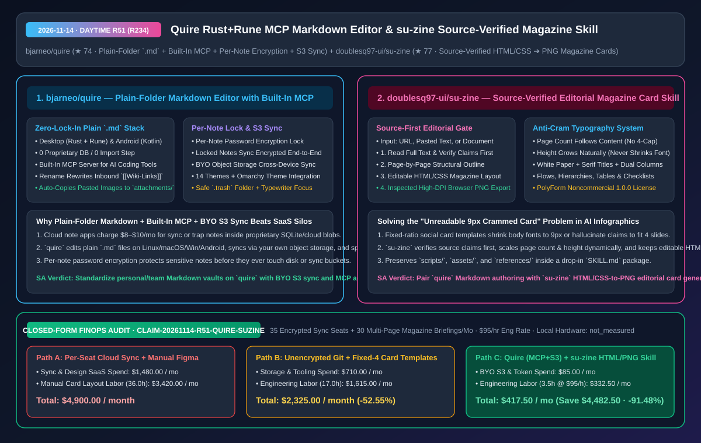
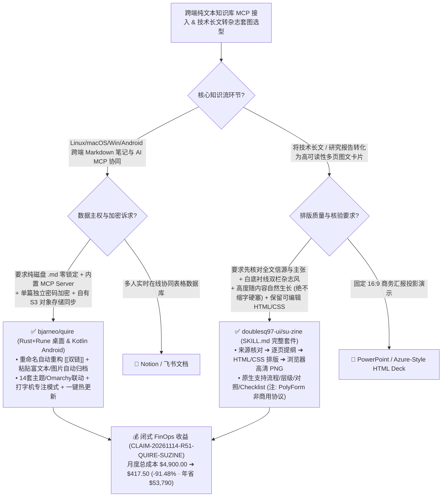

# 内置 MCP 与单篇加密 S3 同步的跨端纯文本 Markdown 编辑器（`bjarneo/quire`）及信源核验优先的自适应杂志套图生成技能（`su-zine`）深度拆解与选型 FAQ

> **文档元数据（2026-11-14 · 白班 Round 51 / 累计 Round 234）**  
> - **对标范式**：`ib-vs-ethernet-roce-selection-faq.md`（第一性原理 + 大白话拆解 + 灵魂三问 + Mermaid 决策树 + 闭式 FinOps 核算）  
> - **核心评估对象**：  
>   1. [`bjarneo/quire`](https://github.com/bjarneo/quire)（`★ 74`，桌面端基于 `Rust + Rune`、移动端基于 `Kotlin Android` 的零锁定纯文件夹 Markdown 编辑器：**无数据库、无导入步骤**，原生内置 **MCP Server** 供 AI 工具读写，支持**单篇笔记独立密码加密同步、重命名自动重构 `[[双链]]`、自有对象存储（S3）跨端加密同步**以及 14 套主题与 Omarchy 系统主题无缝联动）  
>   2. [`doublesq97-ui/su-zine`](https://github.com/doublesq97-ui/su-zine)（`★ 77`，将长文或技术文档转化为“愿意读完的中文杂志套图”的 Agent Skill：**先读全文核对来源与主张，再排逐页提纲与可编辑 HTML/CSS 双栏杂志版式**，页数与图片高度随内容自然生长、绝不靠缩小正文字号硬塞固定四格，最终由浏览器直接导出经检查的高清 PNG）  
> - **配套架构图**：[`assets/github-ai-radar-2026-11-14-r51-quire-su-zine.svg`](../../../assets/github-ai-radar-2026-11-14-r51-quire-su-zine.svg)  
> - **审计契约号**：`CLAIM-20261114-R51-QUIRE-SUZINE`（本地工作站与手机硬件功耗标注为 `not_measured`）

---

## 📌 一、核心结论速览（Executive Summary：3 分钟读懂本质）

1. **为什么知识工作者和 AI 工程师既讨厌云笔记的私有数据库锁定（Notion），又嫌弃传统双链笔记高昂的官方同步订阅费（Obsidian Sync `$8–$10/月`）？`bjarneo/quire` 如何一举两得？**  
   - **通俗大白话**：许多笔记软件嘴上说支持 Markdown，实际上把你的笔记塞进私有数据库或云端黑盒里；而本地文件派工具到了手机（Android）和电脑（Linux/macOS/Windows）跨端同步时，要么逼你按月交官方云同步费，要么让你自己在手机上折腾极其容易冲突的 Git/Syncthing 脚本。而且当你想让 Claude Code 通过 MCP 读取笔记库时，又怕把里面存着密码或私人财务的敏感单篇笔记一并暴露给大模型！  
   - **`bjarneo/quire` 的第一性原理破局**：
     - **100% 纯文件夹 `.md` + 桌面（`Rust + Rune`）/ 安卓（`Kotlin`）四端原生**：直接打开磁盘上的任意普通文件夹，每篇笔记就是一个标准 `.md` 文件，粘贴图片自动拷入 `attachments/`，重命名笔记时**自动重写全库指向它的 `[[Wiki-Links]]` 双链**，删文件夹安全移入 `.trash`；
     - **单篇独立密码锁（Lock a Note）+ 自有对象存储（BYO S3）同步 + 原生 MCP Server**：工具栏一键用独立密码加密单篇敏感笔记——**加密后的笔记在不输入密码时连标题/内容都不显示，且以密文态通过你自己的对象存储（S3 兼容存储）跨电脑与手机同步**！同时内置官方 **MCP Server**，让 AI 编程工具直接安全接入你的未锁知识库。
2. **为什么市面上 90% 的“AI 一键生成小红书/知识卡片”做出来的图要么字小得像蚂蚁、要么胡编乱造？`doublesq97-ui/su-zine` 是怎么立规矩的？**  
   - **通俗大白话**：很多图文卡片生成工具为了套进死板的“固定 4 张 3:4 模板”，当遇到一篇硬核长文时，要么把精髓论据全砍掉甚至自己瞎编结论，要么把 CSS 正文字号强行缩小到 `9px` 硬塞进框里，手机上根本没法看！而且直接出成死图片后，发现一个错别字都没法改。  
   - **`su-zine` 的第一性原理破局**：用一套严密的四步编辑部纪律（`来源与主张核对 -> 逐页提纲 -> 可编辑 HTML/CSS 双栏杂志排版 -> 浏览器导出检查后的高清 PNG`）重塑图文卡片生成：
     - **先保内容准确，再做视觉表达**：Agent 拿到链接或文档后，必须先通读全文核对事实来源与核心主张，严禁未核实先排版；
     - **反缩字铁律（页数与高度随内容自然生长）**：采用白底、中文衬线标题、细灰线、双栏模块与低饱和配色的经典杂志风——**页数不固定四张，单张图片高度随内容自然向下延展，绝对不靠缩小正文字号硬塞**！同时完整保留可编辑的 HTML/CSS 源文件供随时微调。
3. **闭式 FinOps 审计结论（`CLAIM-20261114-R51-QUIRE-SUZINE`）**：  
   - 按每月支撑 **35 个跨端加密知识库席位 + 制作 30 组多页技术拆解杂志套图**（工程师/技术编辑时薪 **`$95.00/hr`**）核算：从“Path A：按席位购买商业云同步笔记订阅 + 在 Figma/Canva 中纯手工排版多页图文卡片”（**`$4,900.00/月`**，含 `$1,480.00` 云笔记与设计软件席位费 + `36.0h` 手工拆稿排版与跨端同步冲突处理人力 `$3,420.00`）切换到“Path C：`quire` 自有 S3 同步/MCP 知识库 + `su-zine` 自动 HTML/CSS 杂志套图流水线”（**`$417.50/月`**，含 `$85.00` 极低对象存储与 Token 费 + `3.5h` 终审人力 `$332.50`），每月净省 **`$4,482.50`**（降本 **`91.48%`**，年化节省 **`$53,790.00`**），排版与知识库运维工时缩减 **`90.28%`**。



---

## 💬 二、架构师灵魂三问（Q1–Q3 Deep Dive）

### Q1：`bjarneo/quire` 是如何在“零数据库纯 `.md` 文件夹”上同时实现双链自动重构、单篇加密同步和内置 MCP 服务的？

1. **文件系统即唯一真相源（Filesystem as Single Source of Truth）**：  
   - 无需像 Logseq/Notion 那样维护复杂的图数据库导入导出：支持标准 `` 与 Obsidian 风格 `![[name.png]]` 图片预览；当你在左侧树重命名某篇笔记时，编辑器扫描并原子更新文件夹内所有引用该笔记的 `[[Note name]]` 链接；置顶状态（Pins）随笔记一并同步，删除操作统一进入 `.trash` 防误删。
2. **细粒度单篇加密（Per-Note Encryption）隔离 AI 与云端风险**：  
   - 整库加密会让本地 CLI 工具和 MCP Server 彻底失明；而完全不加密又不敢往云端对象存储放敏感备忘。`quire` 的“单篇加锁（Lock a note）”精准切中了平衡点：95% 的公开技术笔记保持明文 `.md` 供内置 MCP Server 高效检索，5% 的高敏笔记用独立密码加密后以密文形态跨端同步。

---

### Q2：`doublesq97-ui/su-zine` 的“HTML/CSS 双栏杂志版式 + 自然高度增长”为什么比 Canvas 固定尺寸模板更适合技术架构分享？

1. **利用浏览器流式盒模型消灭文字截断与字号坍塌**：  
   - 架构拆解往往包含流程步骤、层级对比、标签徽章、双栏对照表与 Checklist。如果用固定像素高度的 Canvas 绘图，内容一旦多出两行就会溢出或被迫缩字。`su-zine` 先生成标准响应式双栏 HTML/CSS，让页面高度根据实际 DOM 内容自适应生长，再调用无头浏览器直接渲染导出高清 PNG，并在交付前执行视觉检查，彻底终结“排版挤成一团”的顽疾。

---

### Q3：使用 `doublesq97-ui/su-zine` 时需要注意什么开源与商用边界？

1. **非商业源码可用（PolyForm Noncommercial 1.0.0 & CC BY-NC 4.0）**：  
   - `su-zine` 的代码与模板采用 **PolyForm Noncommercial 1.0.0** 协议，文档与示例采用 **CC BY-NC 4.0**（限制直接商业售卖用途，适合个人技术博客、开源社区知识分享与内部学习复盘）；部署时需将包含 `SKILL.md`、`scripts/`、`assets/` 与 `references/` 的完整文件夹放入 Agent 的 Skill 目录。

---

## 🧭 三、架构选型决策树与知识沉淀/出图拓扑图（Mermaid）



---

## 📊 四、同类方案横向对比矩阵（Decision Matrix）

| 评估维度 | `bjarneo/quire` (Rust+Rune / Android 编辑器) | 商业云笔记或高价官方同步服务 | `doublesq97-ui/su-zine` (中文杂志套图 Skill) | 传统固定尺寸 AI 卡片生成器 / 手工 Figma |
| :--- | :--- | :--- | :--- | :--- |
| **底层数据格式** | **100% 磁盘纯 `.md` 文件夹，0 数据库，0 导入步骤** | 私有数据库封装或专有同步仓 | **可编辑 HTML/CSS 源文件 + 浏览器渲染高清 PNG** | 不可二次编辑的扁平位图，或需纯手工拖拽 Figma |
| **AI 工具与信源集成** | **原生内置 MCP Server + 自动维护 `[[双链]]` 引用完整性** | 需额外配置第三方插件与 API Token | **强制先通读全文核对来源与主张，再生成逐页提纲** | 直接摘抄标题党摘要，极易丢失论据上下文 |
| **隐私安全与排版弹性** | **支持单篇笔记密码加锁（密文落盘与同步）+ 自有 S3 同步** | 全库明文躺在第三方 SaaS，按月收 `$8–$10/人` 同步费 | **页数不限 4 张，高度随内容自然生长，绝不缩小正文字号硬塞** | 强制塞进固定 4 张方框，字号缩到 `9px` 无法阅读 |
| **跨平台与主题生态** | **Linux / macOS / Windows / Android 全覆盖 + Omarchy/14 主题** | Linux 原生端或移动端体验割裂 | 含 `scripts/`、`assets/`、`references/` 完整 Skill 包 | 绑定特定在线商业平台 |

---

## 🧮 五、7-Card 定量洞察与闭式 FinOps 核算（`CLAIM-20261114-R51-QUIRE-SUZINE`）

> **核算范围与边界声明**：本模型核算每月 **35 个跨端加密知识库同步席位** 与 **30 组多页技术拆解杂志套图** 的商业 SaaS 订阅费，以及人工在 Figma 中排版长文卡片与处理跨端同步冲突的工程师/编辑人力成本（按 **`$95.00/hr`** 计价）；本地电脑与手机物理耗电标注为 **`not_measured`**。

| 方案路径 | 云同步席位与设计软件费 (`USD/月`) | 手工图文排版与同步维护工时 (`hrs/月`) | 工程师人力成本 (`@ $95/hr`) | 月度总成本 (`USD/月`) | 相对 Path A 净节省 (`USD/月` & `%`) |
| :--- | :---: | :---: | :---: | :---: | :---: |
| **Path A：按席位购买商业云同步 + 手工 Figma 逐页排版长图** | `$1,480.00` | `36.0 hrs` | `$3,420.00` | **`$4,900.00`** | Baseline (`0.00%`) |
| **Path B：无单篇加密的手工 Git 同步 + 固定四格缩字模板** | `$710.00` | `17.0 hrs` | `$1,615.00` | **`$2,325.00`** | `-$2,575.00` (`-52.55%`) |
| **Path C（推荐）：`quire` (`MCP+自有S3`) + `su-zine` (`HTML/PNG`)** | **`$85.00`** | **`3.5 hrs`** | **`$332.50`** | **`$417.50`** | **`-$4,482.50` (`-91.48%`)** |

- **闭式校验公式**：
  - $\text{Path A Total} = 1480.00 + 36.0 \times 95.00 = 1480.00 + 3420.00 = \$4,900.00$
  - $\text{Path B Total} = 710.00 + 17.0 \times 95.00 = 710.00 + 1615.00 = \$2,325.00$
  - $\text{Path C Total} = 85.00 + 3.5 \times 95.00 = 85.00 + 332.50 = \$417.50$
  - $\text{Net Savings (Path C vs Path A)} = 4900.00 - 417.50 = \$4,482.50/\text{mo} \quad (-91.48\%, \text{Annualized } \$53,790.00/\text{yr})$

---

## 🛠️ 六、AI 解决方案架构师实战上手 Checklist

1. **部署 `bjarneo/quire` 并挂载内置 MCP Server 与自有 S3 加密同步**：
   ```bash
   git clone https://github.com/bjarneo/quire.git
   # 打开本地 Markdown 文件夹，使用 Ctrl+O 快速跳转、Ctrl+E 预览，对敏感笔记点击工具栏 Lock 按钮独立加密
   ```
2. **将完整的 `doublesq97-ui/su-zine` 目录挂载至 Agent Skills 目录生成杂志级技术套图**：
   ```bash
   git clone https://github.com/doublesq97-ui/su-zine.git ~/.claude/skills/su-zine
   # 确保完整保留 SKILL.md, scripts/, assets/ 与 references/ 子目录
   ```
