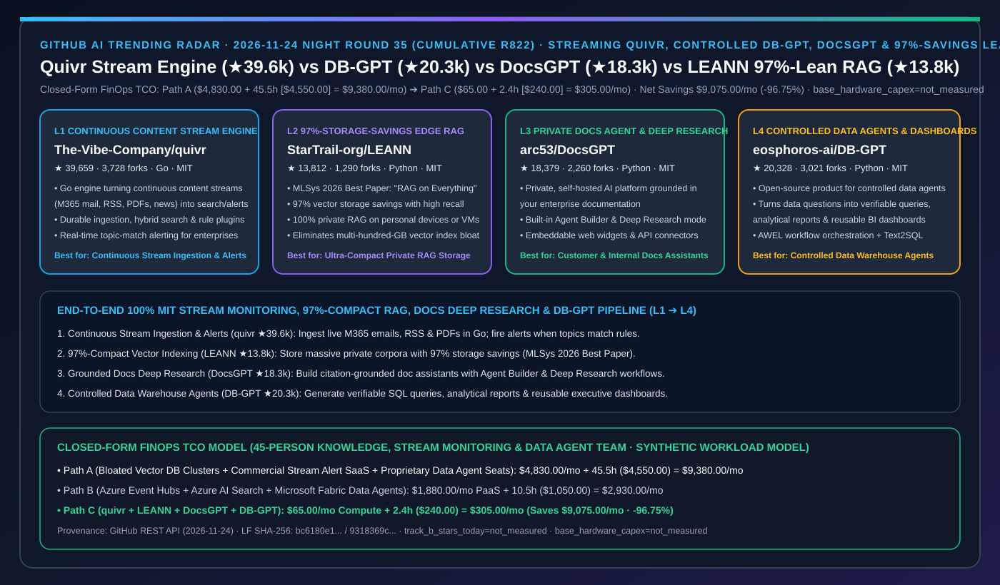
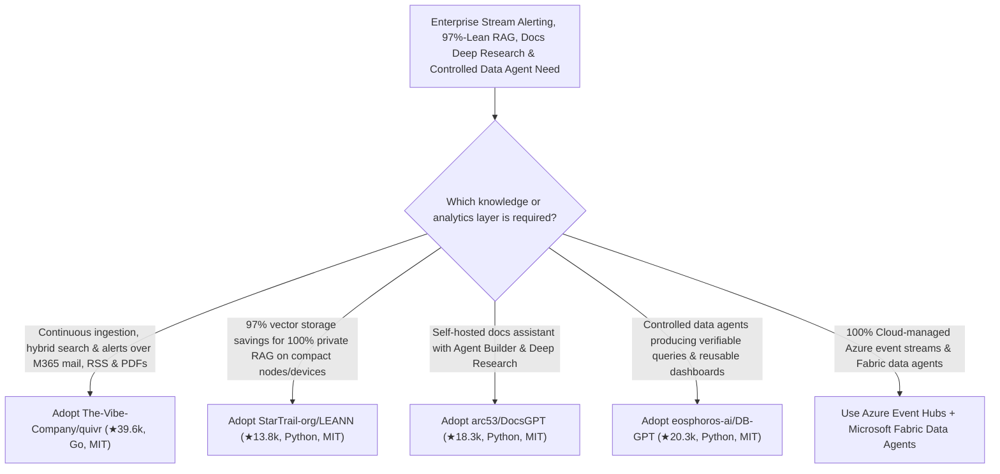
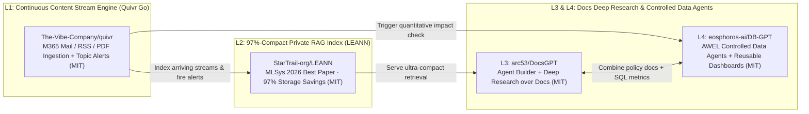

# Continuous Content Stream Engine (`The-Vibe-Company/quivr`), 97%-Storage-Savings Private RAG (`StarTrail-org/LEANN`), Private Docs Deep Research Platform (`arc53/DocsGPT`) & Controlled Data Agents (`eosphoros-ai/DB-GPT`) Selection & Architecture FAQ

> **Document Type**: AI Solution Architect Selection & Integration Guide (2026-11-24 Night Round 35 / Cumulative Round 822)  
> **Reading Time**: ~8 minutes  
> **Covered Repositories**: [`The-Vibe-Company/quivr`](https://github.com/The-Vibe-Company/quivr) (`★ 39,659` · `3,728 forks` · Go · `MIT`) · [`eosphoros-ai/DB-GPT`](https://github.com/eosphoros-ai/DB-GPT) (`★ 20,328` · `3,021 forks` · Python · `MIT`) · [`arc53/DocsGPT`](https://github.com/arc53/DocsGPT) (`★ 18,379` · `2,260 forks` · Python · `MIT`) · [`StarTrail-org/LEANN`](https://github.com/StarTrail-org/LEANN) (`★ 13,812` · `1,290 forks` · Python · `MIT`)  
> **Evidence Provenance**: GitHub REST API verified metadata (2026-11-24) and sealed local evidence files `trending-daily-2026-11-24-raw.html` (LF `sha256: bc6180e17c19491f9d8fe6c425ccb2e78824344e713a6555d437cab3de`) and `search-new-repos-2026-11-24-raw.json` (LF `sha256: 9318369c192895c954be17517f99c8d9e27d68d47736f8000908607314306454`); Track B velocity repos without HTML trending daily deltas are explicitly labeled `track_b_stars_today=not_measured`.  
> **中文版本**: [`quivr-dbgpt-docsgpt-leann-selection-faq.md`](./quivr-dbgpt-docsgpt-leann-selection-faq.md)



---

## ① 📌 Executive Summary

**One-Sentence Selection Verdict**: When enterprise teams need a **100% `MIT`-licensed stack for continuous content stream alerting, ultra-compact private RAG storage, multi-step document deep research, and controlled data warehouse analytics**—combining **a Go engine that ingests continuous M365 mail, RSS, and PDF streams with topic-match alerts (`The-Vibe-Company/quivr`), the MLSys 2026 Best Paper RAG engine achieving 97% storage savings (`StarTrail-org/LEANN`), a private enterprise documentation platform with built-in Agent Builder and Deep Research (`arc53/DocsGPT`), and a controlled data agent platform turning questions into verifiable SQL queries and reusable dashboards (`eosphoros-ai/DB-GPT`)**—deploying this 4-layer stack reduces monthly TCO for a 45-person team from **`$9,380.00/mo`** (Path A: Bloated Vector DB Clusters + Commercial Stream Alerting SaaS + Proprietary Data Agent Seats) to **`$305.00/mo`** (Path C), saving **`$9,075.00/mo` (`-96.75%`)**.

| Dimension | `The-Vibe-Company/quivr` (L1 Stream Search & Alerts) | `StarTrail-org/LEANN` (L2 97%-Lean Private RAG) | `arc53/DocsGPT` (L3 Docs Deep Research OS) | `eosphoros-ai/DB-GPT` (L4 Controlled Data Agents) |
|---|---|---|---|---|
| **Verified Stars & Forks** | `★ 39,659` · `3,728 forks` | `★ 13,812` · `1,290 forks` | `★ 18,379` · `2,260 forks` | `★ 20,328` · `3,021 forks` |
| **Language & License** | Go (`MIT`) | Python (`MIT`) | Python (`MIT`) | Python (`MIT`) |
| **Plain-English Positioning** | Go engine for content that keeps arriving (M365 mailboxes, RSS, news, PDFs): durable ingestion, hybrid search & alerts | MLSys 2026 Best Paper: "RAG on Everything" with `97%` storage savings for fast, accurate, 100% private RAG | Private, self-hosted AI platform grounded in your docs with Agent Builder, Deep Research & web widgets | Open-source product for controlled data agents: from a data question to verifiable queries, reports & reusable dashboards |
| **Core Enterprise Pain Solved** | Transforms passive RAG into an active monitoring engine that alerts teams whenever arriving emails/docs match followed topics | Eliminates massive RAM/disk bloat from traditional float32 HNSW vector indexes by shrinking index storage by 97% | Provides turnkey multi-step Deep Research and embeddable support widgets over internal documentation | Replaces unpredictable free-form SQL agents with AWEL-governed verifiable queries and reusable executive dashboards |
| **When to Choose vs Cloud PaaS** | Choose when monitoring continuous M365 email, regulatory RSS, and PDF streams with hybrid search and alerts | Mandatory when deploying full-corpus private RAG on personal laptops or compact VMs | Choose for self-hosted customer support and internal engineering documentation assistants | Choose for governed data warehouse agents and reusable BI dashboards; use Microsoft Fabric Data Agents for pure Fabric |

---

## ② 🎯 Architect & Customer Q&A (1–2 Minute Read)

### Q1: How has `The-Vibe-Company/quivr` (`★ 39,659`) evolved into a high-performance Go engine for continuous enterprise content streams?
- **From Static Vault to Active Stream Monitoring**: Most RAG systems sit idle until a human types a query. Rebuilt in Go (`MIT`), `The-Vibe-Company/quivr` is designed for **content that keeps arriving**—collecting documents continuously from Microsoft 365 mailboxes, RSS feeds, news streams, and PDFs with durable ingestion, hybrid search, and **topic-matching alerts** that notify stakeholders the moment critical information lands.

### Q2: How does `StarTrail-org/LEANN` (`★ 13,812`, MLSys 2026 Best Paper) achieve 97% storage savings for private RAG?
- **Eliminating the Vector Index RAM Wall**: Standard HNSW vector indexes often consume 5–10x more memory than the raw text itself. `StarTrail-org/LEANN` (`MIT`, `arXiv:2506.08276`) cuts RAG index storage by **`97%`** without sacrificing retrieval accuracy—allowing enterprises to run fast, 100% private RAG over massive document and email archives on a single lightweight node or developer laptop.

### Q3: How do `arc53/DocsGPT` (`★ 18,379`) and `eosphoros-ai/DB-GPT` (`★ 20,328`) complement each other across unstructured documents and structured data warehouses?
- **Deep Document Research + Controlled Data Dashboards**:
  1. **`arc53/DocsGPT` (`MIT`) for Unstructured Docs**: Provides a private, model-agnostic platform with a built-in **Agent Builder**, **Deep Research** mode, and embeddable web/API connectors grounded in your documentation.
  2. **`eosphoros-ai/DB-GPT` (`MIT`) for Controlled Structured Analytics**: Uses its deterministic **AWEL (Agentic Workflow Expression Language)** to turn business data questions into **verifiable SQL queries, analytical reports, and reusable dashboards**.

---

## ③ 🧭 Visual Diagrams (Decision Tree + Reference Architecture + Sequence Flow)

### 3.1 Selection Decision Tree



### 3.2 End-to-End Enterprise Production Reference Architecture



### 3.3 End-to-End Execution Sequence Diagram

```mermaid
sequenceDiagram
    autonumber
    actor VP as Supply Chain VP / Compliance Lead
    participant QVR as quivr (L1 Go Stream Engine)
    participant LNN as LEANN (L2 97%-Lean RAG)
    participant DGP as DocsGPT (L3 Docs Deep Research)
    participant DBG as DB-GPT (L4 Controlled Data Agent)

    QVR->>QVR: 1. Ingest arriving M365 supplier emails & regulatory RSS; match "tariff update" rule & alert VP
    QVR->>LNN: 2. Index new regulatory PDF into LEANN at 3% of traditional vector storage footprint
    VP->>DGP: 3. Launch Deep Research: "Assess force-majeure clauses & financial impact on open POs"
    DGP->>LNN: 4. Execute multi-hop retrieval across historical contracts & new regulatory filings
    DGP->>DBG: 5. Request verified financial exposure query from DB-GPT controlled data agent
    DBG->>DBG: 6. Run AWEL workflow to execute verifiable SQL & publish reusable tracking dashboard
    DBG-->>VP: 7. Deliver cited legal synthesis + verified SQL exposure report + live dashboard link
```

---

## ④ 📊 Comparative Selection Matrix: OSS Stack vs. Peer OSS vs. Cloud PaaS

| Dimension | This OSS Stack (`quivr` + `LEANN` + `DocsGPT` + `DB-GPT`) | Legacy Heavy Stack (`Cron Scripts` + `RAM-Heavy HNSW Cluster` + `Free-Form SQL Agent`) | Managed Cloud Stack (`Commercial Alert SaaS` + `Managed Vector Cloud` + `Cloud BI Copilot`) |
|---|---|---|---|
| **Core Role** | Go stream search/alerts + 97%-lean RAG + Docs Deep Research + AWEL controlled data agents | Delayed batch scripts + 256GB RAM vector nodes + unverified SQL generation | Per-feed monitoring SaaS + high-RAM managed vector cloud + per-seat BI Copilot |
| **Best-Fit Scenario** | Continuous M365/RSS alerting, low-footprint private RAG, technical doc Deep Research & governed SQL dashboards | Small static FAQ bots with no stream alerting or warehouse integration | All-in Azure enterprises standardized on Event Hubs, AI Search, and Microsoft Fabric |
| **Integration Effort** | **Very Low** (100% `MIT` across all 4 repos; native M365/RSS plugins in `quivr`) | High (Managing distributed vector shards and custom email polling daemons) | Low (Cloud connectors, with recurring per-GB RAM and per-seat billing) |
| **Operational Complexity** | **Very Low** (`LEANN` cuts storage by 97% so a single compact node hosts the stack; ~`2.4h/mo` ops) | Very High (Vector OOM scaling and auditing hallucinated SQL reports cost ~`45.5h/mo`) | Low (Managed cloud services, plus ~`10.5h/mo` rule and dashboard admin) |
| **License & Compliance** | **100% `MIT` License across all 4 repositories** | Mixed MIT / Apache-2.0 / SSPL | Proprietary per-GB and per-seat SaaS contracts |
| **45-Person Monthly TCO** | **`$305.00/mo`** (`$65.00` compact compute/storage host + `2.4h` ops) | ~`$5,050.00/mo` (`$500.00` high-RAM vector cluster + `45.5h` ops) | **`$2,930.00/mo`** (Path B) to **`$9,380.00/mo`** (Path A commercial stack) |

---

## ⑤ 🧪 Quantitative ROI & Closed-Form FinOps TCO Comparison

> **Provenance Disclosure**: The TCO table below is a closed-form synthetic architectural model (`provenance: synthetic`, `independently_reproduced: false`) for a **45-person enterprise intelligence, compliance, and analytics team** monitoring 500 continuous M365/RSS streams, indexing 10M document chunks, and serving 18,000 Deep Research and controlled BI queries per month (`$100.00/hr` loaded rate). Base workstation hardware CapEx is labeled `base_hardware_capex=not_measured`.

| Cost Component | Path A: High-RAM Vector Clusters + Commercial Stream Alert SaaS + Proprietary Data Agent Seats | Path B: Azure Event Hubs + Azure AI Search + Fabric Data Agents | Path C: `quivr` + `LEANN` + `DocsGPT` + `DB-GPT` |
|---|---|---|---|
| **Monthly API / SaaS / Cloud Spend** | **`$4,830.00`** (Multi-node RAM-heavy vector cluster + commercial monitoring SaaS + BI Copilot seats) | **`$1,880.00`** (Managed search partitions + event stream & Fabric capacity) | **`$65.00`** (`LEANN` 97% storage reduction fits entire `MIT` stack on one `$65` node; `$0` license fees) |
| **Monthly Manual Stream Monitoring, Vector Scaling & SQL Audit Labor** | `45.5h` (Manual inbox/feed triage + scaling bloated vector shards + auditing free-form SQL) | `10.5h` (Cloud alert rule & semantic model governance) | **`2.4h`** (Automated `quivr` topic alerts + reusable `DB-GPT` AWEL dashboards) |
| **Monthly Labor Cost (`$100.00/hr`)** | **`$4,550.00`** (`45.5 * 100.00`) | **`$1,050.00`** (`10.5 * 100.00`) | **`$240.00`** (`2.4 * 100.00`) |
| **Total Monthly TCO** | **`$9,380.00 / mo`** | **`$2,930.00 / mo`** | **`$305.00 / mo`** |
| **Net Monthly Savings vs. Path A** | Baseline (`$0.00`) | Saves `$6,450.00 / mo` (`-68.76%`) | **Saves `$9,075.00 / mo` (`-96.75%`)** |

---

## ⑥ 🛠️ Enterprise Architecture Review & Adoption Checklist

- [ ] **Scoped M365 Mailbox Permissions & Alert Deduplication (`The-Vibe-Company/quivr`)**: Connect `quivr` to designated shared M365 mailboxes using least-privilege `Mail.Read` scopes and enable deduplication windows on topic-alert plugins.
- [ ] **Recall Parity Verification on 97%-Lean Indexes (`StarTrail-org/LEANN`)**: Benchmark `LEANN`'s `R@5` accuracy against your domain evaluation set before decommissioning legacy high-RAM vector clusters.
- [ ] **Bounded Deep-Research Hops & Citation Anchors (`arc53/DocsGPT`)**: Cap `DocsGPT` Deep Research multi-hop loops at 3–5 iterations and require inline source document citations on every synthesized report.
- [ ] **Promote Verified Queries to Reusable AWEL Dashboards (`eosphoros-ai/DB-GPT`)**: Lock approved executive SQL queries inside `DB-GPT` as deterministic AWEL workflows and reusable dashboards so recurring reports execute with zero SQL hallucination risk.
