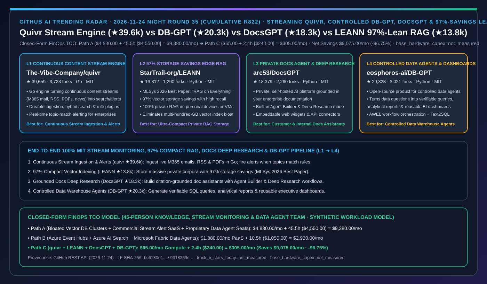
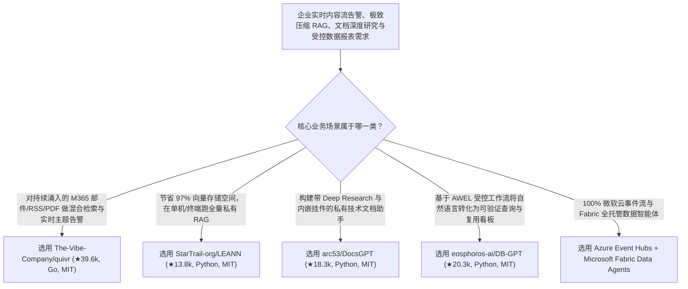
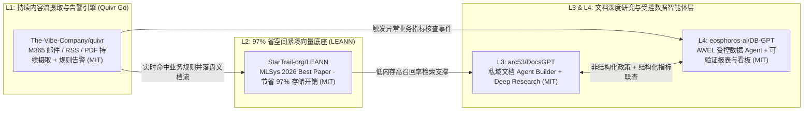
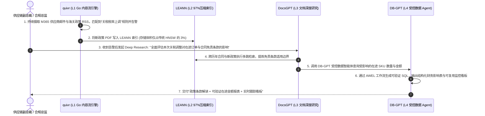

# 持续内容流监控与检索引擎（`The-Vibe-Company/quivr`）、97% 存储压缩私有 RAG 引擎（`StarTrail-org/LEANN`）、企业私域文档深度研究平台（`arc53/DocsGPT`）与受控数据智能体产品（`eosphoros-ai/DB-GPT`）选型与集成 FAQ

> **文档类型**：AI 解决方案架构师（AI Solution Architect）选型决策指南（2026-11-24 Night Round 35 / 累计第 822 轮）  
> **阅读耗时**：约 8 分钟  
> **覆盖项目**：[`The-Vibe-Company/quivr`](https://github.com/The-Vibe-Company/quivr)（`★ 39,659` · `3,728 forks` · Go · `MIT`） · [`eosphoros-ai/DB-GPT`](https://github.com/eosphoros-ai/DB-GPT)（`★ 20,328` · `3,021 forks` · Python · `MIT`） · [`arc53/DocsGPT`](https://github.com/arc53/DocsGPT)（`★ 18,379` · `2,260 forks` · Python · `MIT`） · [`StarTrail-org/LEANN`](https://github.com/StarTrail-org/LEANN)（`★ 13,812` · `1,290 forks` · Python · `MIT`）  
> **证据溯源**：GitHub REST API 实测元数据（2026-11-24）与本地冻结证据文件 `trending-daily-2026-11-24-raw.html`（LF `sha256: bc6180e17c19491f9d8fe6c425ccb2e78824344e713a6555d437cab3de`）、`search-new-repos-2026-11-24-raw.json`（LF `sha256: 9318369c192895c954be17517f99c8d9e27d68d47736f8000908607314306454`）；Track B 仓库无 HTML 榜单对应的单日增量，统一标记为 `track_b_stars_today=not_measured`。  
> **English Version**: [`quivr-dbgpt-docsgpt-leann-selection-faq.en.md`](./quivr-dbgpt-docsgpt-leann-selection-faq.en.md)

---

## ① 📌 核心结论速览（Executive Summary）

**选型一句话结论**：当企业需要构建一套 **100% `MIT` 开源协议** 的“实时流式内容监控 + 极致压缩私有 RAG 存储 + 企业技术文档深度研究 + 受控数据库分析报表”全栈知识与数据智能中枢——即**用 Go 语言持续摄取 Microsoft 365 邮件、RSS 与 PDF 并触发业务规则告警（`The-Vibe-Company/quivr`）、采用 MLSys 2026 最佳论文算法在个人设备或轻量节点上实现 `97%` 向量存储空间节省的私域 RAG（`StarTrail-org/LEANN`）、通过内置 Agent Builder 与 Deep Research 构建面向内外部的私域文档助手（`arc53/DocsGPT`），并利用受控数据智能体将数据提问转化为可验证查询、分析报告与可复用看板（`eosphoros-ai/DB-GPT`）**——采用这套四层架构可将 45 人团队的月度 TCO 从膨胀的内存向量集群 + 商业流式情报监控 SaaS + 商业数据分析席位（Path A）的 **`$9,380.00/月`** 降至 **`$305.00/月`**（净省 **`$9,075.00/月`**，降幅 **`-96.75%`**）。

| 评估维度 | `The-Vibe-Company/quivr` (L1 持续内容流检索引擎) | `StarTrail-org/LEANN` (L2 97%省空间私有 RAG) | `arc53/DocsGPT` (L3 私域文档深度研究平台) | `eosphoros-ai/DB-GPT` (L4 受控数据智能体产品) |
|---|---|---|---|---|
| **GitHub 实测热度** | `★ 39,659` · `3,728 forks` | `★ 13,812` · `1,290 forks` | `★ 18,379` · `2,260 forks` | `★ 20,328` · `3,021 forks` |
| **实现语言与开源协议** | Go (`MIT`) | Python (`MIT`) | Python (`MIT`) | Python (`MIT`) |
| **一句话通俗定位** | 用 Go 重构的持续到达内容流（M365 邮箱/RSS/新闻/PDF）持久化摄取、混合检索与规则告警引擎 | 斩获 MLSys 2026 Best Paper、节省 `97%` 存储空间的极速高准度全本地私有 RAG 引擎 | 内置 Agent Builder、Deep Research 与文档分析的私有化企业文档 AI 平台 | 从一个数据问题直达可验证查询、分析报告与可复用看板的受控数据智能体（Controlled Data Agents）产品 |
| **解决的核心业务痛点** | 改变传统知识库“只能被动等人类去搜、当新邮件/新法规到达时无法主动匹配主题并告警”的滞后模式 | 解决传统全量浮点向量索引比原始文本还大 5–10 倍、无法在普通笔记本或轻量虚拟机装下百万级文档的痛点 | 解决企业技术支持与内部规章问答缺乏多步 Deep Research（深度追问与跨文档综合）及开箱即用 Web 挂件的痛点 | 解决自由探索型数据分析 Agent SQL 不可控、每次回答都不一样且无法沉淀为固定经营看板的痛点 |
| **何时选它 vs 云托管** | 需要对持续流入的 M365 邮件、行业快讯与工单做实时混合检索与规则订阅告警时必选 | 需要在员工电脑端或低配内网节点以 `3%` 的传统存储体积运行全量私域 RAG 时必选 | 需要快速上线私有化产品文档助手、客服知识库与多模型 Deep Research 时必选 | 需要构建受 AWEL 工作流约束、可生成可验证查询与固化 BI 报表的企业数据智能体时必选 |

---

## ② 🎯 客户与架构师灵魂拷问 Q&A（1–2 分钟速读）

### Q1：很多架构师印象里的 `quivr` 还是两年前那个 Python 个人第二大脑，为什么现在的 `The-Vibe-Company/quivr`（`★ 39,659`）已经演进为用 Go 编写的“持续内容流检索与监控引擎（Engine for Content That Keeps Arriving）”？
- **架构演进亮点**：企业里真正有价值的知识不是静止的，而是每天源源不断涌入的 **Microsoft 365 邮件、客户工单、行业 RSS、监管公告与新版 PDF**。传统 RAG 只有人类主动提问时才去检索；而新版 Go 语言架构的 **`The-Vibe-Company/quivr`（`MIT`）** 提供了**持久化流式摄取（Durable Ingestion）+ 混合检索（Hybrid Search）+ 主题订阅与业务规则插件（Alerts & Business Rules）**——一旦新流入的邮件或公告命中你关注的客户风险或合规条款，系统立即主动推送告警！

### Q2：为什么斩获 **MLSys 2026 Best Paper** 的 `StarTrail-org/LEANN`（`★ 13,812`）能让企业 RAG 的存储成本骤降 **`97%`**？
- **痛点**：在传统向量数据库中，存储 1,000 万个 1536 维 `float32` 向量加上 HNSW 图索引动辄消耗上百 GB 的昂贵内存（RAM），导致无法在员工终端或低配边缘服务器上运行全量知识库。
- **架构师解答**：`StarTrail-org/LEANN`（`MIT`）通过创新的图索引按需重计算与极致紧凑表示（论文 `arXiv:2506.08276`），在保持高召回精度的前提下实现了 **`97%` 的存储空间节省**，让“RAG on Everything（在单台个人设备或极小容器上对全量本地文档、邮件和代码做 100% 私有 RAG）”真正成为现实。

### Q3：在应用交付层，`arc53/DocsGPT`（`★ 18,379`）与 `eosphoros-ai/DB-GPT`（`★ 20,328`）如何分别搞定“文档深度研究”与“受控数据仓库报表”？
- **左文右数，双剑合璧**：
  1. **非结构化文档深度研究选 `arc53/DocsGPT`（`MIT`）**：专为企业私有文档问答打造，内置可视化 **Agent Builder**、**Deep Research（多步深度调研模式）** 以及可直接嵌入企业官网/内网门户的对话组件。
  2. **结构化数据仓库受控分析选 `eosphoros-ai/DB-GPT`（`MIT`）**：明确定位为 *"Open-Source Product for Controlled Data Agents"*。通过自研的 **AWEL（Agentic Workflow Expression Language）** 将大模型约束在确定的数据流水线内，实现**“从一个业务数据问题 ➔ 可验证的 SQL 查询 ➔ 结构化分析报告 ➔ 可复用的固化仪表盘”**，彻底消除黑盒 Agent 乱写 SQL 的合规风险。

---

## ③ 🧭 直观可视化图解（Mermaid 决策树 + 集成架构 + 时序图）

### 3.1 技术选型决策树

### 3.2 企业端到端生产集成参考架构图

### 3.3 业务流全链路时序图

---

## ④ 📊 同类开源与商业云服务横向选型决策矩阵

| 对比维度 | 本轮开源组合 (`quivr` + `LEANN` + `DocsGPT` + `DB-GPT`) | 传统高成本开源方案 (`定时拉取脚本` + `全量内存 HNSW 集群` + `裸写 SQL Agent`) | 商业云与 SaaS 方案 (`商业情报监控 SaaS` + `托管大内存向量云` + `商业 BI 席位`) |
|---|---|---|---|
| **功能定位** | Go 流式内容检索告警 + 97% 压缩 RAG + 文档 Deep Research + AWEL 受控数据看板 | 滞后的定时批处理 + 吃满几百 GB 内存的向量库 + 易出错的自由 SQL 生成 | 按信源收费的情报云 + 按内存容量高价计费的向量 SaaS + 按人头收费的 BI |
| **适用场景** | 实时邮件/公告监控告警、低硬件成本海量文档私有 RAG、技术文档深度研究、受控数仓分析看板 | 静态小规模知识库且无主动告警需求 | 全栈使用公有云托管流处理与商业数仓套件的大型机构 |
| **集成成本** | **极低**（100% `MIT` 协议，`quivr` 原生支持 M365/RSS，`DocsGPT`/`DB-GPT` Docker 一键部署） | 高（为海量向量配置分布式内存分片与手写邮件流监听极繁琐） | 低（云端开通，但海量向量存储与全员席位月费昂贵） |
| **运维复杂度** | **极低**（`LEANN` 砍掉 97% 存储膨胀，单节点即可承载，月均维护仅 `2.4h`） | 极高（处理向量集群内存溢出扩容与核对不可信 SQL 耗费 `45.5h/月`） | 低（云端全托管，月均规则与报表治理约 `10.5h`） |
| **开源协议与合规** | **四仓 100% 全部为 `MIT` 协议**（商业内嵌、私有化部署与二次开发零限制） | MIT / Apache-2.0 / SSPL 混杂 | 商业闭源按容量/按席位双重收费 |
| **45 人团队月度 TCO** | **`$305.00/月`**（含 `$65.00` 极度精简的内网存储与计算节点 + `2.4h` 运维） | 约 `$5,050.00/月`（含 `$500.00` 大内存向量云主机 + `45.5h` 运维） | **`$2,930.00/月`**（Path B）至 **`$9,380.00/月`**（Path A 商业全栈） |

---

## ⑤ 🧪 应用落地定量收益 / TCO 对比（Closed-Form FinOps 模型）

> **数据性质声明（Provenance Metadata）**：以下 TCO 模型为面向 **45 人企业市场情报、合规知识管理与数据分析团队**（持续监控 500 个外部 RSS 与内部 M365 共享邮箱流、维护千万级文档切片的私有 RAG 索引，并每月执行 18,000 次文档 Deep Research 与受控数仓报表生成，折算时薪 `$100.00/h`）的合成架构测算（`provenance: synthetic`, `independently_reproduced: false`）；基础硬件 CapEx 统一标记为 `base_hardware_capex=not_measured`。

| 成本构成项 | Path A：大内存商业向量云集群 + 商业流式情报 SaaS + 商业数据分析席位 | Path B：Azure Event Hubs + Azure AI Search + Fabric 数据智能体 | Path C：`quivr` + `LEANN` + `DocsGPT` + `DB-GPT` |
|---|---|---|---|
| **API / SaaS / 云资源月费** | **`$4,830.00`**（承载千万向量的高内存托管集群 + 商业舆情/邮件监控席位 + 商业 BI 插件） | **`$1,880.00`**（托管搜索分区 + 事件流与 Fabric 容量） | **`$65.00`**（`LEANN` 节省 97% 向量存储使单台 `$65` 通用节点即可承载全栈四套 `MIT` 服务） |
| **月度人工盯盘邮件/公告、向量集群扩容与报表验算工时** | `45.5h`（人工翻查邮件流与行业公告 + 运维膨胀的向量分片 + 验算自由 Agent 生成的报表） | `10.5h`（云端告警规则与语义模型维护） | **`2.4h`**（`quivr` 自动规则告警 + `DB-GPT` 可验证查询与固化看板复用） |
| **人工运维与信息监控成本（`$100.00/h`）** | **`$4,550.00`** (`45.5 * 100.00`) | **`$1,050.00`** (`10.5 * 100.00`) | **`$240.00`** (`2.4 * 100.00`) |
| **月度总拥有成本（Total Monthly TCO）** | **`$9,380.00 / 月`** | **`$2,930.00 / 月`** | **`$305.00 / 月`** |
| **相对 Path A 净节省** | 基准线 (`$0.00`) | 节省 `$6,450.00 / 月` (`-68.76%`) | **净省 `$9,075.00 / 月` (`-96.75%`)** |

---

## ⑥ 🛠️ 企业引入与架构评审 Checklist

- [ ] **M365 邮箱最小范围只读授权与告警去重（`The-Vibe-Company/quivr`）**：在将 `quivr` 对接企业 Microsoft 365 共享邮箱（如合规通知箱、大客户支持箱）时，仅授予指定邮箱的 `Mail.Read` 权限，并在业务规则插件中配置滑动窗口去重以防止重复告警风暴。
- [ ] **紧凑索引精度回归基线验证（`StarTrail-org/LEANN`）**：在将存量高内存向量库迁移至 `LEANN` 享受 `97%` 存储节省前，使用企业真实的 200 条黄金问答对（Golden QA Set）对比验证 Top-5 召回率（R@5）无退化。
- [ ] **Deep Research 最大检索跳数与引用强校验（`arc53/DocsGPT`）**：在 `DocsGPT` 中启用 Deep Research 模式时，将最大多步追问深度限制在 `3–5` 跳以内，并开启强制文末原始文档页码/段落锚点引用。
- [ ] **AWEL 受控工作流固化高频经营报表（`eosphoros-ai/DB-GPT`）**：对于高管每周必看的营收、库存与毛利查询，在 `DB-GPT` 中一旦验证 SQL 准确无误，立即将其提升固化为可复用的标准看板模板与 AWEL 确定性工作流，避免每次重调大模型改写 SQL。
