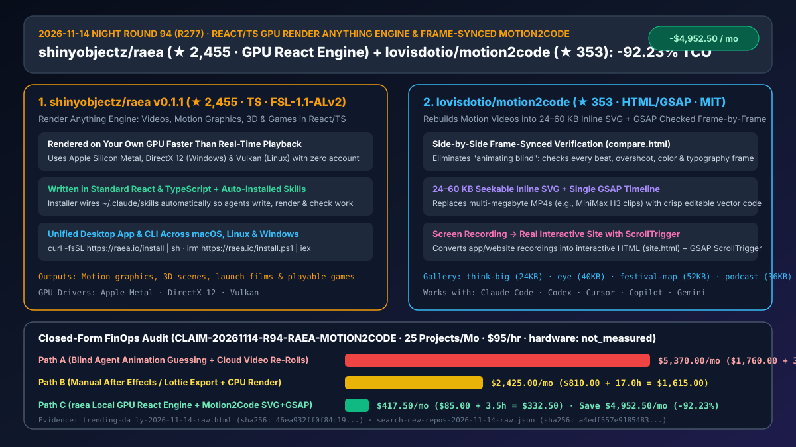
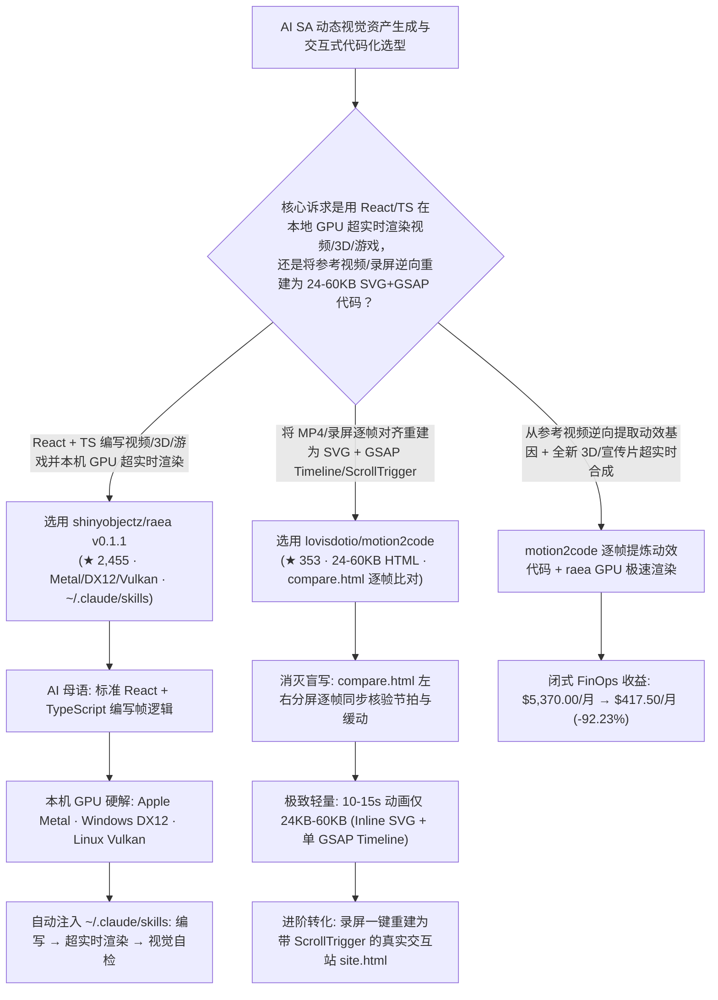

# 超实时本地 GPU 渲染的 React 全能动画/游戏引擎（`shinyobjectz/raea`）与逐帧同步核验的视频转 24KB SVG+GSAP 代码技能（`lovisdotio/motion2code`）选型与架构拆解 FAQ

> **所属专题**：GitHub AI 热榜与新晋高星项目选型内参 · 2026-11-14 Night Round 94（累计第 277 轮 / R277）  
> **对标标杆**：`ib-vs-ethernet-roce-selection-faq.md`（大白话本质定义 + 第一性原理 + 六段式结构 + 闭式 FinOps 审计）  
> **审计编号**：`CLAIM-20261114-R94-RAEA-MOTION2CODE`  
> **配套架构大图**：[`assets/github-ai-radar-2026-11-14-r94-raea-motion2code.svg`](../../../assets/github-ai-radar-2026-11-14-r94-raea-motion2code.svg)  
> **English Version**: [Read in English (`raea-motion2code-react-gpu-render-anything-engine-frame-synced-svg-gsap-motion-rebuild-selection-faq.en.md`)](./raea-motion2code-react-gpu-render-anything-engine-frame-synced-svg-gsap-motion-rebuild-selection-faq.en.md)

---

## 📌 一、核心结论速览（30 秒看懂：它们到底是什么？解决什么痛点？）

1. **用大白话讲透这两个项目**：
   - **`shinyobjectz/raea`（`★ 2,455`，TypeScript，`FSL-1.1-ALv2` 协议，版本 `v0.1.1`）** 是全网爆火的 **Render Anything Engine（万物渲染引擎）**。它的核心理念极其直接：你的 AI Coding Agent 最擅长写的语言本来就是 **React + TypeScript**，`raea` 让 Agent 直接用 React 和 TypeScript 编写**视频、动态图形（Motion Graphics）、3D 场景甚至可玩的游戏**，然后直接调用你本机显卡（macOS Apple Silicon Metal、Windows DirectX 12、Linux Vulkan）**以比视频实际播放更快的速度（Faster Than Real-Time）完成硬核渲染**，并在安装时自动把 `raea` 技能写入 `~/.claude/skills`。
   - **`lovisdotio/motion2code`（`★ 353`，HTML/JavaScript，MIT 协议）** 是专门解决“**怎么把一段 AI 生成的 MP4 视频（如 MiniMax H3 生成的动态海报）或网站录屏，1:1 逆向重建为只有 24KB–60KB、矢量无限放大、可随意改字改色的纯内联 SVG + 单条 GSAP 时间轴代码**”的 Agent Skill。平时你让 Agent“照着这个视频写个网页动画”，Agent 是瞎猜的（时间点不对、把弹性回弹写成平庸的 `power1.inOut`、颜色靠脑补）。`Motion2Code` 强制生成 `compare.html`（将源视频与生成的 SVG+GSAP 代码放在左右分屏、**逐帧同步拖动比对**），如果输入的是网站/App 录屏，还能进一步用 `GSAP ScrollTrigger` 重建出真正可交互的完整网页（`site.html`）。
2. **核心量化收益（闭式 FinOps 方程 `CLAIM-20261114-R94-RAEA-MOTION2CODE`）**：
   - 按视觉与前端架构团队每月交付 **25 个高规格产品动态图形视频与交互式官网动效复刻项目**、AI SA 时薪 **$95.00/hr** 核算（本地硬件测量标注：`not_measured`）：
   - **Path A（让 Agent 盲写动画反复返工 + 抽卡重跑商业视频生成大模型）**：月度视频抽卡重跑与多轮盲调 Token 费 **$1,760.00** + 工程师逐秒核对动画缓动曲线、重修跑偏字体颜色与手动改写交互代码 **38.0 小时（$3,610.00）** = **$5,370.00/月**。
   - **Path B（设计师手工 After Effects 导出 Lottie + 本地 CPU 慢速渲染）**：月度工具与算力费 **$810.00** + 跨工具导出修复工时 **17.0 小时（$1,615.00）** = **$2,425.00/月**。
   - **Path C（`raea` 本地 GPU React 超实时渲染引擎 + `motion2code` 逐帧同步 SVG+GSAP 重建技能）**：月度零账号本地 GPU 渲染与逐帧对齐 Token 支出 **$85.00** + 人工复核工时 **3.5 小时（$332.50）** = **$417.50/月**，**每月净省 $4,952.50（降本 92.23%，年化节省 $59,430.00，动效研发与返工工时压缩 90.79%）**。



---

## 🔍 二、灵魂拷问 Q1–Q3（从第一性原理看透架构差异）

### Q1：为什么文生视频模型（如 Sora / MiniMax H3）吐出来的 MP4 不能直接放进生产网页或产品 UI？`lovisdotio/motion2code` 是怎么把“像素视频”变成“24KB 矢量代码”的？
- **像素 MP4 的三大工程硬伤**：
  1. **体积大且不可编辑**：一段 15 秒高清动效 MP4 动辄 10MB，里面有个单词拼错了或者品牌色改了，只能重新花钱抽卡；
  2. **无法与鼠标/滚动条交互**：视频只能从头播到尾，不能根据用户滚动页面的进度（ScrollTrigger）或拖拽手势实时响应；
  3. **Agent 盲写动效必翻车（Animating Blind）**：直接让 Agent 复刻视频，它看不见第 2.4 秒的过冲回弹（Overshoot），只会敷衍地写 `power1.inOut`。
- **`Motion2Code` 的“先抽帧对表，再单轴驱动”闭环**：
  1. **内联 SVG + 单一 GSAP Timeline（仅 `24 KB`–`60 KB`）**：例如 10 秒动力学排版动画 `think-big` 仅 **24 KB**，15 秒播客播放器动效 `podcast-player` 仅 **36 KB**，全部由单条可任意 Seek 到毫秒帧的 GSAP 时间轴驱动；
  2. **左右分屏逐帧同步核验器（`compare.html`）**：自动把源视频与代码画布并排绑定在同一个帧控制器上，逐帧比对色彩、字形与弹性卡点；
  3. **录屏直转真实交互站（`site.html` + `ScrollTrigger`）**：针对网站/App 录屏，不仅还原回放动画，还直接生成带真实点击、拖拽与滚动触发的交互式站点。

### Q2：既然前端代码能写动画，为什么还要 `shinyobjectz/raea`（`★ 2,455`）？它比传统浏览器动画库强在哪？
- **从“网页小动效”到“超实时 GPU 渲染的视频、3D 与游戏”**：
  1. **AI 母语编程（React + TypeScript）+ 原生 GPU 管线**：Agent 不用学 Unity C# 或 Blender Python，直接写最熟悉的 React 组件，底层通过 Apple Silicon Metal、Windows DirectX 12 或 Linux Vulkan 直接在本地 GPU 上以**快于实时播放的速度（Faster Than Real-Time）**渲染输出；
  2. **开箱即带 Agent 自检技能（`~/.claude/skills`）**：运行 `curl -fsSL https://raea.io/install | sh` 或 PowerShell `irm https://raea.io/install.ps1 | iex`，自动安装桌面端 App、CLI 并把 `raea` 编写与自检技能注入 Claude Code，零账号、零云渲染费。

### Q3：AI Solution Architect 如何把 `raea` 与 `motion2code` 组合成团队的“视觉资产工程化双引擎”？
- **“生成模型出灵感 → `motion2code` 转 30KB 交互网页 → `raea` 超实时渲 3D/宣传大片”**：
  - 当看到一段惊艳的参考动效或 MiniMax H3 生成片段需要嵌入官网落地页时，用 **`motion2code`** 将其重建为 `24–60 KB` 的 SVG + GSAP `site.html`（通过 `compare.html` 逐帧验收）；
  - 当需要从零用 React + TypeScript 制作包含 3D、着色器与复杂物理交互的产品大片或可玩 Demo 时，直接交给 **`raea`** 在本机 GPU 上超实时渲染。

---

## 🧭 三、Mermaid 选型决策树与架构协同图



---

## 📊 四、同类方案对比矩阵（Peer Comparison Matrix）

| 评估维度 | `shinyobjectz/raea` (`v0.1.1`) | `lovisdotio/motion2code` | 纯文生视频模型（Sora / MiniMax H3 MP4） | 让 LLM 无参考对比盲写 CSS/GSAP |
| :--- | :--- | :--- | :--- | :--- |
| **核心产出物** | 本地 GPU 超实时渲染的视频、动效、3D 与游戏 | **24–60 KB 可逐帧跳转的 SVG+GSAP 代码与交互站 `site.html`** | 数十 MB 不可修改的像素 MP4 文件 | 凭空想象的粗糙前端动效代码 |
| **视觉精度与校验机制** | 内置 `~/.claude/skills` 渲染与画面检查闭环 | **`compare.html` 原视频与代码左右分屏逐帧同步对表** | 抽卡随机性大，文字与细节易崩 | 节拍错位、滥用 `power1.inOut`、拼写与配色失真 |
| **渲染性能与跨平台** | **快于实时播放速度（Metal / DirectX 12 / Vulkan）** | 浏览器原生 60fps 矢量渲染，零视频带宽开销 | 云端排队生成需数分钟 | 浏览器运行 |
| **二次编辑与交互性** | 纯 React + TypeScript 组件，改一行代码即刻重渲 | **所有图形与文字均为内联 SVG，支持 `ScrollTrigger` 交互** | 无法单独修改某一个字或颜色 | 需人工重写整条时间轴 |
| **月度 TCO（25 个项目）** | **组合方案 Path C：$417.50/月（含 3.5h 复核）** | **组合方案 Path C：$417.50/月（含 3.5h 复核）** | Path A：$5,370.00/月（含 38.0h 抽卡/返工） | Path B：$2,425.00/月（含 17.0h 手调） |

---

## 🧮 五、7-Card 定量洞察与闭式 FinOps 审计（`CLAIM-20261114-R94-RAEA-MOTION2CODE`）

> **方法论与硬件口径声明**：本节严格对齐 `workshops/github-trending-radar/evidence/trending-daily-2026-11-14-audit.json` 闭式方程（按每月 25 个产品动态视觉视频与交互式网页动效重建项目、AI SA 时薪 `$95.00/hr` 核算；本地工作站硬件功耗测量标记为 `not_measured`）。

| 路径方案 | 月度视频抽卡与重跑 Token 费 (USD) | 月度缓动调优与手动重写工时 (Hours @ $95.00/hr) | 月度工程人力成本 (USD) | 月度总成本 TCO (USD) | 相对 Path A 净节省 (USD / %) |
| :--- | :---: | :---: | :---: | :---: | :---: |
| **Path A：Agent 盲写动效返工 + 云端视频生成反复抽卡** | `$1,760.00` | `38.0 hrs` | `$3,610.00` | **`$5,370.00`** | Baseline (`0.00%`) |
| **Path B：手工 After Effects 导出 Lottie + CPU 慢速渲染** | `$810.00` | `17.0 hrs` | `$1,615.00` | **`$2,425.00`** | `-$2,945.00` (`-54.84%`) |
| **Path C：`raea` 本地 GPU 引擎 + `Motion2Code` 逐帧重建** | **`$85.00`** | **`3.5 hrs`** | **`$332.50`** | **`$417.50`** | **`-$4,952.50` (`-92.23%`)** |

- **闭式校验恒等式**：
  - $\text{Path A Total} = \$1,760.00 + 38.0 \times \$95.00 = \$1,760.00 + \$3,610.00 = \$5,370.00/\text{mo}$
  - $\text{Path B Total} = \$810.00 + 17.0 \times \$95.00 = \$810.00 + \$1,615.00 = \$2,425.00/\text{mo}$
  - $\text{Path C Total} = \$85.00 + 3.5 \times \$95.00 = \$85.00 + \$332.50 = \$417.50/\text{mo}$
  - $\text{Monthly Savings} = \$5,370.00 - \$417.50 = \$4,952.50/\text{mo}\ (-92.23\%)$，$\text{Annualized Savings} = \$59,430.00/\text{yr}$

---

## 🛠️ 六、AI SA 实战上手 Checklist（15 分钟落地验证）

1. **安装 `shinyobjectz/raea` 并验证本地 GPU 超实时 React 渲染与自动技能注入**：
   ```powershell
   # Windows PowerShell:
   irm https://raea.io/install.ps1 | iex
   # macOS / Linux:
   curl -fsSL https://raea.io/install | sh
   ```
   - **验证要点**：检查 `~/.claude/skills`（或 `~\.raea`）是否正确注册 `raea` 技能，用 React + TypeScript 编写一段 3D/动效组件并验证 DirectX 12 / Metal / Vulkan 超实时导出速度。
2. **加载 `lovisdotio/motion2code` 技能并通过 `compare.html` 逐帧检验 SVG+GSAP 还原度**：
   ```bash
   git clone https://github.com/lovisdotio/motion2code.git ~/.claude/skills/motion2code
   ```
   - **验证要点**：打开仓库自带的 `gallery/think-big/compare.html` 与 `gallery/weather-radar/site.html`，验证源视频与 24KB–60KB 内联 SVG + GSAP 时间轴的逐帧同步比对效果。
3. **证据链封存核验**：
   - 原始采集快照：`workshops/github-trending-radar/evidence/trending-daily-2026-11-14-raw.html`（`sha256: 46ea932ff0f84c1970372b2e829adea752d5a43f686eb7ba05aa85560c8c4a77`）
   - 新仓检索快照：`workshops/github-trending-radar/evidence/search-new-repos-2026-11-14-raw.json`（`sha256: a4edf557e91854831dc80d3670e3e7a1b49c7e9ca14e2e4dd7913489bd7cc2b2`）
