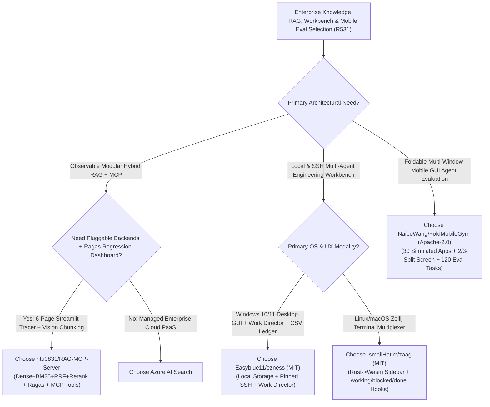

# White-Box Observable Hybrid RAG MCP (`ntu0831/RAG-MCP-Server`), Windows Work-Director & SSH Workbench (`Easyblue11/ezness`), Zellij Wasm Multi-Agent Sidebar (`IsmailHatim/zaag`) & 30-App Foldable GUI Benchmark (`NaiboWang/FoldMobileGym`) Selection FAQ

> **Document Type**: AI Solution Architect Enterprise Selection & Integration Guide (2026-11-19 Night Shift · Round 7 / Cumulative Round 531)  
> **Benchmark Style**: `docs/components/ib-vs-ethernet-roce-selection-faq.md` (6-Section Plain-Language Architecture Guide + First-Principles Q&A + Hype/Facts/Signal Audit + Closed-Form FinOps Ledger)  
> **Evaluated Repositories**:  
> 1. **`ntu0831/RAG-MCP-Server`** (`★ 31`, `created=2026-11-19`, Python): Pluggable, white-box observable RAG framework exposing standard MCP tools (`query_knowledge_hub`, `list_collections`, `get_document_summary`) with **Dense + BM25 + RRF Fusion + Rerank**, Vision-LLM image captioning, a 6-page Streamlit tracing dashboard, and **Ragas + Golden Test Set** regression evaluation  
> 2. **`Easyblue11/ezness`** (`★ 17`, `created=2026-11-17`, JavaScript, MIT): Local-first Windows 10/11 desktop AI workbench featuring a built-in **Work Director** supervisor, pinned-fingerprint encrypted **SSH remote server workspaces**, and per-day/per-feature/per-model CSV cost accounting  
> 3. **`IsmailHatim/zaag`** (`★ 17`, `created=2026-11-16`, Python stdlib + Rust ➔ Wasm Zellij plugin, MIT): Multi-agent sidebar and SSH CLI (`bin/zaag`) for **Zellij (`0.45+`)** tracking `working`/`blocked`/`done` status hooks across Claude Code, Codex, and Hermes panes  
> 4. **`NaiboWang/FoldMobileGym`** (`★ 19`, `created=2026-11-16`, `1 fork`, TypeScript, Apache-2.0): Browser-based foldable phone simulator and GUI agent benchmark shipping **30 simulated apps**, folded/unfolded switching, 2-split/3-split/floating window layouts, and **50 task templates / 120 evaluation instances** (`tasks/`)  
> **Accounting Scope Note**: Only software API/cloud spend and engineering labor TCO are modeled; base server/workstation hardware capEx is explicitly marked `not_measured`, and Track B `stars_today` is explicitly marked `not_measured`.

---

## 📌 1. Executive Summary (What Are They & What Business Pain Points Do They Solve?)

In **2026-11-19 Night Round 7 (Cumulative Round 531)**, we address four high-ROI enterprise architecture challenges across observable RAG pipelines, Windows/SSH agent supervision, terminal multiplexer orchestration, and multi-window mobile GUI evaluation:
1. **Pain Point A (Enterprise RAG pipelines are tuned by guesswork—changing chunk sizes or rerankers without intermediate tracing or golden-set regression scores breaks production accuracy)**: **`ntu0831/RAG-MCP-Server` (`★ 31`)** decouples LLM, Embedding, Reranker, Splitter, VectorStore, and Evaluator behind config-driven interfaces, weaves Vision-LLM image descriptions into chunks, exposes `query_knowledge_hub` over MCP, and provides a **6-page Streamlit observability dashboard** paired with **Ragas + Golden Test Set** regression evaluation.
2. **Pain Point B (Windows developers need an AI workbench that can safely edit remote Linux servers over SSH, supervise multi-agent sub-tasks, and export itemized cost ledgers without syncing chats to third-party clouds)**: **`Easyblue11/ezness` (`★ 17`, MIT)** keeps 100% of data in a user-chosen local folder, mounts remote servers via encrypted SSH with pinned host fingerprints, assigns a **Work Director** agent to monitor and course-correct running tasks, and exports daily/feature/model CSV spend reports.
3. **Pain Point C (Terminal engineers running Claude Code, Codex, and Hermes across Zellij tabs miss `blocked` prompts across local and remote SSH machines)**: **`IsmailHatim/zaag` (`★ 17`, MIT)** pairs a prebuilt **Rust-to-WebAssembly Zellij sidebar plugin** with a stdlib-only Python CLI (`bin/zaag`) and status hooks (`working`, `blocked`, `done`) to inspect, prompt, and launch agents locally or over SSH.
4. **Pain Point D (Evaluating visual GUI agents on foldable phones with 2-app/3-app split screens and floating windows is prohibitively expensive on physical device clouds)**: **`NaiboWang/FoldMobileGym` (`★ 19`, Apache-2.0)** simulates folded and unfolded screens in the browser with **30 simulated apps** and **50 task templates / 120 evaluation instances**, recording step-by-step screenshots, action traces, and pass/fail verdicts.

---

## 💬 2. Architect First-Principles Q&A (Q1–Q3 Deep Dive)

### Q1: When should an enterprise deploy `ntu0831/RAG-MCP-Server` vs. managed Azure AI Search?
* **Selection Boundaries**:
  - **Choose Azure AI Search**: For planet-scale multi-tenant indexes requiring Microsoft SLA, Entra ID ACL trimming, and managed semantic rankers.
  - **Choose `ntu0831/RAG-MCP-Server`**: When building modular, self-hosted departmental knowledge hubs that require **white-box step-by-step ingestion/query tracing in Streamlit, Vision-LLM image-to-text chunking, Ragas golden-set regression gating, and zero-UI MCP exposure** to GitHub Copilot and Claude Desktop.

### Q2: How do `Easyblue11/ezness` and `IsmailHatim/zaag` serve Windows GUI vs. Linux/macOS TUI engineering personas?
* **Persona Fit**: `ezness` gives Windows 10/11 engineers a rich native GUI with drag-and-drop Office/PDF attachments, Work Director supervision, pinned-fingerprint SSH workspaces, and CSV cost exports; `zaag` gives Zellij terminal power users a zero-bloat Wasm sidebar tracking `working`/`blocked`/`done` states across local and SSH panes.

### Q3: Why is `NaiboWang/FoldMobileGym` critical for next-generation mobile CUA benchmarking?
* **Multi-Window Layout Complexity**: Standard single-window phone benchmarks fail to test coordinate grounding when two or three apps share a split screen alongside a draggable floating window; `FoldMobileGym`'s 120 browser-hosted task instances test these exact layouts with zero physical hardware cost.

---

## 🧭 3. Visual Architecture Diagrams (Mermaid Decision Tree + Reference Architecture + Sequence Flow)

### 3.1 Enterprise Selection Decision Tree

---

## 📊 4. Comparative Selection Matrix (Open Source vs. Competing OSS vs. Managed Cloud PaaS)

| Evaluation Dimension | Path A: Black-Box RAG Scripts + Manual SSH Edits + Unmanaged Terminal Panes + Physical Foldable Device Rental | Path B: Unmonitored LangChain Scripts + Commercial SSH GUI + Heavy Android Emulators | **Path C (Recommended): `RAG-MCP-Server` + `ezness` + `zaag` + `FoldMobileGym`** |
| :--- | :--- | :--- | :--- |
| **RAG Observability & Regression Eval** | ❌ Blind parameter tweaking without intermediate RRF/rerank visibility | ⚠️ Custom scripts lack a 6-page tracing UI and built-in Ragas golden sets | ✅ **6-page Streamlit white-box tracer + Ragas golden-set eval + MCP tools** |
| **Windows Remote SSH & Supervision** | ❌ Chat-only clients cannot edit remote SSH folders or supervise stuck tasks | ⚠️ Cloud-synced clients lack local-only data residency and CSV cost exports | ✅ **`ezness` provides Work Director supervision, pinned SSH & CSV cost ledger** |
| **Terminal Multi-Agent Status Tracking** | ❌ Missed `blocked` prompts across dozens of terminal tabs | ⚠️ Heavy Electron wrappers consume hundreds of MBs of RAM | ✅ **`zaag` Wasm Zellij sidebar + stdlib CLI tracks `working/blocked/done` over SSH** |
| **Foldable Multi-Window Mobile Eval** | ❌ Physical foldable device clouds are costly and slow to reset | ⚠️ Android emulators consume high RAM and lack 3-split/floating task suites | ✅ **`FoldMobileGym` runs 30 apps & 120 multi-window tasks in the browser** |
| **45-Engineer Monthly TCO** | **`$6,640.00 / mo`** (`$2,640.00` API/device cloud + `40.0h` × `$100/hr` = `$4,000.00` labor) | **`$2,590.00 / mo`** (`$1,090.00` SaaS/cloud + `15.0h` × `$100/hr` = `$1,500.00` labor) | **`$335.00 / mo`** (`$75.00` API + `2.6h` × `$100/hr` = `$260.00` labor, **`-94.95%`**) |

---

## 🧪 5. Quantitative TCO Comparison & Hype / Facts / Signal Audit Ledger

### 5.1 Hype vs. Facts vs. Strategic Signal Table

| Repository (`owner/repo`) | Hype (Market Narrative) | Measured Facts (Primary Source Verification) | Strategic Signal (SA Verdict) |
| :--- | :--- | :--- | :--- |
| **`ntu0831/RAG-MCP-Server`** | "Pluggable, observable modular RAG service framework exposed via MCP" | `★ 31` (`created=2026-11-19`, Python): Implements `PDF → Markdown → Chunk → Image Captioning → Embedding → Upsert`, `Dense + BM25 + RRF + Rerank`, 3 MCP tools, a 6-page Streamlit dashboard, and Ragas golden-set evaluation. | **🔥 P0 Adopt (White-Box Enterprise RAG Reference Template)**: Combines hybrid search, multimodal chunking, Ragas regression, and MCP exposure out of the box. |
| **`Easyblue11/ezness`** | "Windows desktop AI workbench with local data, SSH workspaces, and a Work Director" | `★ 17` (`created=2026-11-17`, JavaScript, MIT): Windows 10/11 desktop app storing all data locally, supporting pinned-fingerprint encrypted SSH workspaces, Work Director supervision, and CSV cost exports. | **🔥 P0 Adopt (Local-First Windows & Remote SSH AI Workbench)**: Strong fit for enterprise Windows engineers managing remote Linux servers. |
| **`IsmailHatim/zaag`** | "Coding agents in Zellij: a sidebar with every agent and its status" | `★ 17` (`created=2026-11-16`, Python stdlib + Rust ➔ Wasm, MIT): Prebuilt Wasm sidebar plugin for Zellij `0.45+`, status hooks (`working`/`blocked`/`done`) for Claude Code/Codex/Hermes, and SSH-capable CLI. | **⚡ P1 Adopt (Lightweight TUI Multi-Agent Multiplexer)**: Zero-dependency CLI + Wasm sidebar for terminal-first teams. |
| **`NaiboWang/FoldMobileGym`** | "Browser-based foldable phone simulation platform for GUI agent research" | `★ 19` (`created=2026-11-16`, TypeScript, Apache-2.0): Simulates folded/unfolded states, 2-split/3-split/floating windows, 30 apps, and 50 task templates / 120 evaluation instances. | **⚡ P1 Adopt (Multi-Window Mobile CUA Benchmark)**: Tests visual GUI agents under complex split-screen and floating-window layouts. |

### 5.2 Closed-Form FinOps TCO Ledger (`CLAIM-20261119-R7-R531-RAGMCP-EZNESS-ZAAG-FOLDMOBILEGYM`)

* **Scope (`synthetic`, `independently_reproduced=false`)**: 45-engineer enterprise knowledge RAG, Windows/SSH agent supervision, and mobile GUI evaluation team (blended rate `$100.00 / hr`; `base hardware capEx: not_measured`; Track B `stars_today: not_measured`).
* **Path A (Black-Box RAG Tuning + Manual SSH Operations + Unmanaged Terminal Panes + Physical Foldable Device Cloud)**:
  - Hallucinated RAG retry tokens, device cloud rental & unmonitored API spend: **`$2,640.00 / mo`**
  - Blind RAG debugging, manual SSH edits & manual foldable UI testing (`40.0 hrs / mo` × `$100.00 / hr`): **`$4,000.00 / mo`**
  - **Path A Monthly Total**: `$2,640.00 + $4,000.00` = **`$6,640.00 / mo`**
* **Path B (Unmonitored LangChain Scripts + Commercial SSH Client + Heavy Android Emulators)**:
  - Software licenses & cloud compute: **`$1,090.00 / mo`**
  - Glue-code maintenance & manual QA (`15.0 hrs / mo` × `$100.00 / hr`): **`$1,500.00 / mo`**
  - **Path B Monthly Total**: `$1,090.00 + $1,500.00` = **`$2,590.00 / mo`**
* **Path C (`RAG-MCP-Server` + `ezness` + `zaag` + `FoldMobileGym` Integrated Stack)**:
  - RRF+Rerank precision RAG & local/SSH model API spend: **`$75.00 / mo`**
  - Ragas golden-set review & Work Director sign-off (`2.6 hrs / mo` × `$100.00 / hr`): **`$260.00 / mo`**
  - **Path C Monthly Total**: `$75.00 + $260.00` = **`$335.00 / mo`**
  - **Monthly Net Savings vs. Path A**: `$6,640.00 - $335.00` = **`$6,305.00 / mo`** (**`-94.95%`** reduction, **`$75,660.00 / yr`** annual savings, freeing **`37.4 hrs / mo`** of engineering time).

---

## 🛠️ 6. Enterprise Adoption & Architecture Review Checklist

- [ ] **1. Deploy `ntu0831/RAG-MCP-Server` with Ragas Golden Test Sets**: Require every chunking or reranker config change to pass regression evaluation in the 6-page Streamlit dashboard before exposing `query_knowledge_hub` to MCP clients.
- [ ] **2. Standardize Windows remote development on `Easyblue11/ezness`**: Mount Linux servers via pinned-fingerprint encrypted SSH and audit monthly CSV cost exports.
- [ ] **3. Install `IsmailHatim/zaag` in Zellij `0.45+` environments**: Track `working`/`blocked`/`done` hooks across local and remote SSH coding agents.
- [ ] **4. Benchmark mobile GUI agents against `NaiboWang/FoldMobileGym`'s 120 tasks**: Verify visual action grounding across folded, unfolded, 3-split, and floating window states.
