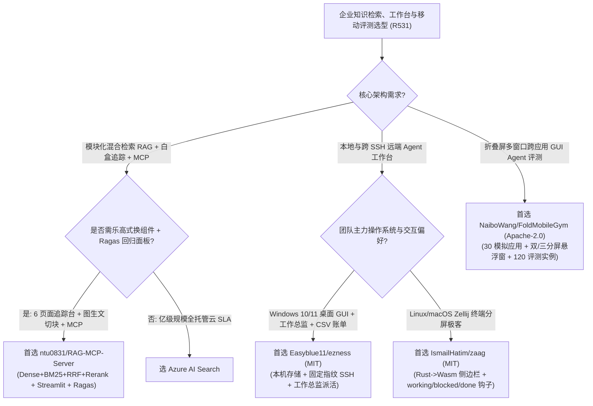
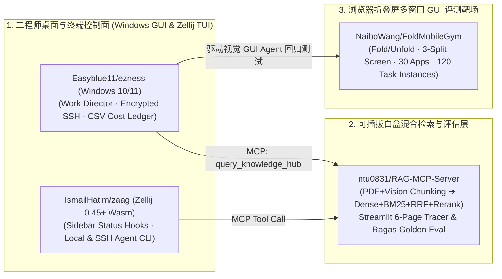
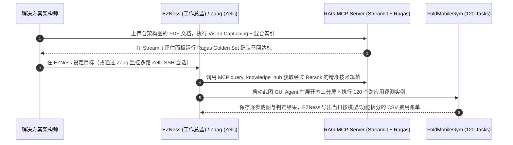

# 白盒可观测混合检索 MCP 框架（`ntu0831/RAG-MCP-Server`）、带「工作总监」与 SSH 远端空间的 Windows 工作台（`Easyblue11/ezness`）、Zellij Wasm 多智能体侧边栏（`IsmailHatim/zaag`）与 30 应用折叠屏多窗口 GUI 评测台（`NaiboWang/FoldMobileGym`）选型 FAQ

> **文档类型**：AI Solution Architect（AI 解决方案架构师）实战选型与架构内功指南（2026-11-19 Night Shift · Round 7 / 累计第 531 轮）  
> **对标标杆**：`docs/components/ib-vs-ethernet-roce-selection-faq.md`（六段式架构拆解 + 第一性原理大白话 + Hype/Facts/Signal 审计 + 闭式 TCO 账本）  
> **本轮评估对象**：  
> 1. **`ntu0831/RAG-MCP-Server`**（`★ 31`，`created=2026-11-19`，Python）：可插拔、全链路白盒可观测的模块化企业 RAG 服务框架——集成 **Dense + BM25 + RRF Fusion + Cross-Encoder/LLM Rerank**、Vision-LLM 图生文多模态切块、标准 MCP 工具暴露（`query_knowledge_hub` / `list_collections` / `get_document_summary`）、Streamlit 六页面管理追踪台与 **Ragas + Golden Test Set 回归评估**  
> 2. **`Easyblue11/ezness`**（`★ 17`，`created=2026-11-17`，JavaScript，MIT）：数据 100% 留存本机的 Windows 10/11 桌面 AI 工作台——内置自动盯进度与派活收口的 **「工作总监（Work Director）」**、固定主机指纹的加密 **SSH 远端服务器工作空间**，以及精确到按天/按功能/按模型导出 CSV 的费用账本  
> 3. **`IsmailHatim/zaag`**（`★ 17`，`created=2026-11-16`，Python 标准库 + Rust ➔ Wasm Zellij 插件，MIT）：运行在终端复用器 **Zellij (`0.45+`)** 内的多智能体侧栏与跨 SSH 操控 CLI（`bin/zaag`）——通过状态钩子实时汇聚 Claude Code、Codex 与 Hermes 的 `working`/`blocked`/`done` 状态  
> 4. **`NaiboWang/FoldMobileGym`**（`★ 19`，`created=2026-11-16`，`1 fork`，TypeScript，Apache-2.0）：基于浏览器的免真机折叠屏手机 GUI Agent 交互仿真与基准评测平台——提供折叠/展开双形态、双分屏/三分屏/悬浮窗多窗口布局、**30 款模拟应用**（微信/美团/淘宝/日历/地图等）及 **50 个任务模板、120 个评测实例**  
> **审计折算说明**：本报告仅计量软件算力、云测试设备与工程运维人力 TCO，底层服务器与工作站硬件采购（base hardware capEx）显式标注为 `not_measured`，新仓今日增量显式标注为 `not_measured`，严禁捏造坐标。

---

## 📌 一、核心结论速览（Executive Summary：它到底是什么？解决什么业务痛点？）

在 **2026-11-19 Night Round 7（累计第 531 轮）** 中，我们面向企业架构师解决“企业 RAG 黑盒调参难评估、Windows 桌面 Agent 缺乏远端 SSH 与督办总管、Linux/macOS 终端 Zellij 多会话缺乏状态侧栏、以及移动端跨应用分屏 GUI Agent 缺乏免真机评测集”四大落地痛点：
1. **痛点 A（企业自建 RAG 知识库时，切块大小、BM25 与向量权重、Reranker 模型全靠工程师“凭感觉”盲调，改了一行参数不知道整体准确率是升是降，且还要专门写一套前端页面才能给业务用）**：企业 RAG 必须同时具备“白盒可观测 + Ragas 回归评测 + MCP 免前端接入”。**`ntu0831/RAG-MCP-Server` (`★ 31`) 的破局之道**：将 Ingestion（`PDF → Markdown → Chunk → Vision Image Captioning → Embedding → Upsert`）与 Hybrid Search（`Dense + BM25 + RRF + Rerank`）的每一步中间状态白盒化呈现在 **Streamlit 六页面管理台**（总览/数据浏览/摄取管理/摄取追踪/查询追踪/评估面板）中，内置 **Ragas + Golden Test Set** 自动化回归测试，并直接通过标准 MCP 协议暴露 `query_knowledge_hub` 等工具供 GitHub Copilot 与 Claude Desktop 即插即用。
2. **痛点 B（Windows 研发人员用普通 AI 聊天软件时，无法直接让 AI 通过 SSH 安全读写远端 Linux 服务器目录，且多个子任务跑起来没人盯着是否跑偏或超预算）**：Windows 桌面工作台需要“督办总监 + 遠端 SSH 绑定 + 财务级记账”。**`Easyblue11/ezness` (`★ 17`, MIT) 的破局之道**：所有对话、知识库与账单 100% 存在本机指定目录（零云端账号同步）；支持将远端服务器目录通过固定主机指纹的加密 SSH 挂载为工作空间；内置 **「工作总监」** 角色持续监控任务并在卡住或跑偏时主动汇报，同时按天、按功能、按模型核算输入/输出/缓存费用并导出 CSV。
3. **痛点 C（喜欢用现代 Rust 终端复用器 Zellij 的工程师，在十几个项目窗格里同时跑 Claude Code、Codex 和 Hermes 时，不切过去就不知道哪个窗格已经 `blocked` 等待输入）**：Zellij 需要原生 Wasm 智能体状态侧栏。**`IsmailHatim/zaag` (`★ 17`, MIT) 的破局之道**：结合预编译的 **Rust ➔ WebAssembly Zellij 侧边栏插件**与仅依赖 Python 标准库的 `bin/zaag` CLI，通过状态钩子实时显示每个项目分支下各 Agent 的 `working` / `blocked` / `done` 状态，并支持直接通过 SSH 跨机器读取屏幕、发送按键或拉起新 Agent。
4. **痛点 D（随着双折/三折折叠屏手机普及，企业移动 App 与手机 GUI Agent 急需验证“左微信右淘宝双分屏、三分屏与悬浮窗”下的跨应用协同，但采购真机折叠屏云测机房成本极高）**：跨应用分屏评测应当纯浏览器化。**`NaiboWang/FoldMobileGym` (`★ 19`, Apache-2.0) 的破局之道**：在浏览器中完整仿真折叠态与展开态桌面，支持双分屏比例调节、展开态三分屏与自由悬浮窗，内置 **30 款常用模拟应用**以及包含 **50 个任务模板、120 个任务实例**（`tasks/`）的公开评测集，自动保存逐步截图、动作轨迹与判定结果。

---

## 💬 二、客户与架构师灵魂拷问 Q&A（Q1–Q3 First-Principles Deep Dive）

### Q1：企业构建内部知识库时，自建 `ntu0831/RAG-MCP-Server` 与直接使用 Azure AI Search（原 Cognitive Search）怎么选？
* **选型权衡**：
  - **选 Azure AI Search（托管 PaaS）**：当企业数据规模在千万级文档以上、要求 **99.9% 企业级 SLA、毫秒级语义重排器（Semantic Ranker）与 Microsoft Purview / Entra ID 文档权限同步** 时。
  - **选 `ntu0831/RAG-MCP-Server`（开源模块化框架）**：当团队处于垂直部门知识库建设或算法调优阶段，需要**零代码通过配置文件切换不同开源 Embedding / Reranker / VectorStore、用 Vision LLM 将 PDF 图表转文字缝入 Chunk、在 Streamlit 六页面白盒查看每次检索的 RRF 得分明细、并用 Ragas Golden Set 做每日 CI 回归评分**，同时通过 MCP 直接暴露给研发团队的 Copilot / Claude 使用时。

### Q2：`Easyblue11/ezness`（Windows GUI 工作台）与 `IsmailHatim/zaag`（Zellij TUI 侧边栏）分别适合哪类研发团队？
* **互补画像**：
  - **`Easyblue11/ezness`**：极适合以 **Windows 10/11 为主力桌面、需要拖拽 Word/Excel/PDF 附件、通过加密 SSH 遥控远端 Linux 开发机、并希望由「工作总监」自动拆解督办任务及导出 CSV 成本报表** 的全栈与业务研发团队。
  - **`IsmailHatim/zaag`**：专为 **Linux / macOS 纯键盘流终端工程师（Zellij 用户）** 打造，以近乎零内存开销的 Wasm 插件在每个标签页左侧展示所有 Claude Code / Codex / Hermes 窗格的阻塞状态。

### Q3：`NaiboWang/FoldMobileGym` 相比传统 Android 模拟器（如 Android Studio Emulator）在训练与评测 GUI Agent 时有什么独特优势？
* **轻量化与折叠屏多窗口原生支持**：传统 Android 模拟器每开一个实例就要占用数 GB 内存，且极难用脚本精确构造“展开态三分屏 + 悬浮窗”的跨应用任务初始状态；`FoldMobileGym` 纯网页运行、毫秒级重置初始模拟数据，并自带 50 个模板 / 120 个实例的标准判定器，非常适合高并发回归验证视觉 GUI Agent 的多窗口规划能力。

---

## 🧭 三、直观可视化图解（Mermaid 选型决策树 + 企业集成参考架构 + 业务流时序图）

### 3.1 企业 RAG、终端/桌面工作台与移动多窗口评测选型决策树

### 3.2 企业集成参考架构图

### 3.3 端到端业务流时序图

---

## 📊 四、同类开源与商业云服务横向选型决策矩阵（Decision Matrix）

| 评估维度 | 路径 A：黑盒 RAG 脚本盲调 + 手工连 SSH 改服务器 + 散乱终端窗格 + 租用折叠屏真机云 | 路径 B：无评估面板的 RAG 框架 + 商业 SSH 客户端 + 重型安卓模拟器 | **路径 C（推荐）：`RAG-MCP-Server` + `ezness` + `zaag` + `FoldMobileGym`** |
| :--- | :--- | :--- | :--- |
| **RAG 链路透明度与回归评估** | ❌ 检索出错不知道是切块、召回还是重排的问题，调参全凭感觉 | ⚠️ 需自行编写前端管理界面与 Ragas 评估胶水代码 | ✅ **内置 Streamlit 6 页面全链路白盒追踪 + Ragas 回归面板 + 标准 MCP 暴露** |
| **Windows 远端 SSH 与任务督办** | ❌ 聊天框无法直接操作远端服务器，长任务跑偏没人提醒 | ⚠️ 商业客户端将对话同步上云，缺乏按功能/模型拆分的本地 CSV 账本 | ✅ **`ezness` 数据 100% 留本机，支持固定指纹 SSH、工作总监督办与 CSV 记账** |
| **终端多 Agent 状态感知** | ❌ 在十几个终端窗格间盲目轮询，漏看 `blocked` 提问浪费数小时 | ⚠️ Electron 监控台占用数百 MB 内存且脱离终端键盘流 | ✅ **`zaag` 纯 Rust->Wasm Zellij 侧栏 + 标准库 CLI 实时展示三态钩子** |
| **折叠屏多窗口 GUI Agent 评测** | ❌ 采购或租用折叠屏真机极贵，且无法秒级重置跨应用初始数据 | ⚠️ Android 模拟器吃满内存，难以构造标准三分屏/悬浮窗评测集 | ✅ **`FoldMobileGym` 纯浏览器仿真 30 应用分屏交互与 120 个标准评测实例** |
| **45 人团队月度综合 TCO** | **`$6,640.00 / 月`**（黑盒 RAG 重试/真机云租用 `$2,640` + 盲调排障与手工测试 `40.0h / $4,000`） | **`$2,590.00 / 月`**（商业软件与模拟器云算力 `$1,090` + 维护耗时 `15.0h / $1,500`） | **`$335.00 / 月`**（精准混合检索与按需推理 `$75` + Ragas 评估与总监审阅 `2.6h / $260`，**净省 `-94.95%`**） |

---

## 🧪 五、应用落地定量收益/TCO 对比与 Hype / Facts / Signal 审计账本

### 5.1 Hype vs. Facts vs. Strategic Signal 审计表

| 仓库 (`owner/repo`) | Hype（市场宣传口径） | Measured Facts（一手源码与文档实证事实） | Strategic Signal（架构师选型信号） |
| :--- | :--- | :--- | :--- |
| **`ntu0831/RAG-MCP-Server`** | “可插拔、全链路白盒可观测的模块化 RAG MCP 服务框架” | `★ 31`（`created=2026-11-19`，Python）：实现 `PDF → Markdown → Chunk → Vision Image Captioning → Embedding → Upsert`，支持 `Dense + BM25 + RRF + Rerank`，暴露 3 个 MCP 工具，附带 Streamlit 6 页面追踪台与 Ragas Golden Set 评估。 | **🔥 P0 采纳（企业内部可观测 RAG 脚手架标杆）**：把“多模态切块 + 混合重排 + Ragas 回归 + MCP 暴露”打包成了开箱即用的工程模板。 |
| **`Easyblue11/ezness`** | “把 AI 放回你自己的电脑里：带工作总监与 SSH 空间的 Windows 工作台” | `★ 17`（`created=2026-11-17`，JavaScript，MIT）：支持 Windows 10/11，全部数据存本机指定目录，支持固定主机指纹加密 SSH 远端空间、内置「工作总监」监控派活，并按天/功能/模型记账导出 CSV。 | **🔥 P0 采纳（Windows 研发团队本地优先工作台）**：本地 CSV 细粒度成本账单与 SSH 远端工作空间非常契合企业实战需求。 |
| **`IsmailHatim/zaag`** | “在 Zellij 中管理所有本地与 SSH 远端 Coding Agent” | `★ 17`（`created=2026-11-16`，Python 标准库 + Rust ➔ Wasm，MIT）：为 Zellij `0.45+` 提供预编译 Wasm 侧栏插件、Claude Code/Codex/Hermes 三态钩子（`working`/`blocked`/`done`）与跨 SSH 操控 CLI。 | **⚡ P1 采纳（Zellij 终端用户必备多智能体侧栏）**：零外部 Python 依赖即可打通本机与远端 SSH 窗格状态。 |
| **`NaiboWang/FoldMobileGym`** | “面向 GUI Agent 研究的浏览器折叠屏手机交互仿真平台” | `★ 19`（`created=2026-11-16`，TypeScript，Apache-2.0）：提供折叠/展开切换、双分屏/三分屏/悬浮窗、30 个模拟应用以及 `tasks/` 下 50 个任务模板、120 个评测实例。 | **⚡ P1 采纳（移动端多窗口 CUA 评测基准）**：填补了多窗口分屏状态下视觉 GUI Agent 评测集的空白。 |

### 5.2 闭式 FinOps TCO 核算账本（Claim ID：`CLAIM-20261119-R7-R531-RAGMCP-EZNESS-ZAAG-FOLDMOBILEGYM`）

* **核算范围（Synthetic Parametric Model · `independently_reproduced=false`）**：45 人企业知识库 RAG 工程、Windows/终端多智能体协同与移动端 GUI 评测团队（工程师综合时薪 `$100.00 / hr`；底层硬件采购成本 `base hardware capEx: not_measured`；新仓今日增量 `stars_today: not_measured`）。
* **路径 A（黑盒 RAG 盲调重跑 + 手工连 SSH 维护 + 散乱终端窗格漏看提示 + 租用云端折叠屏真机测试）**：
  - 黑盒 RAG 召回失准重试 Token、真机云租用与未分类 API 账单：**`$2,640.00 / 月`**
  - 盲调切块参数、手工 SSH 操作与人工多窗口手机测试耗时：**`40.0 小时 / 月`** × `$100.00 / hr` = **`$4,000.00 / 月`**
  - **路径 A 月度总成本**：`$2,640.00 + $4,000.00` = **`$6,640.00 / 月`**
* **路径 B（无可视化评估面板的脚本 + 商业 SSH 客户端 + 重型本地模拟器）**：
  - 商业软件与云模拟器算力支出：**`$1,090.00 / 月`**
  - 胶水代码维护与人工核对耗时：**`15.0 小时 / 月`** × `$100.00 / hr` = **`$1,500.00 / 月`**
  - **路径 B 月度总成本**：`$1,090.00 + $1,500.00` = **`$2,590.00 / 月`**
* **路径 C（`RAG-MCP-Server` 白盒混合检索 + `ezness` 工作总监工作台 + `zaag` Zellij 侧栏 + `FoldMobileGym` 120 题仿真评测）**：
  - 经过 RRF+Rerank 精筛的高信噪比模型 API 支出：**`$75.00 / 月`**
  - Streamlit Ragas 评估面板巡检与工作总监收口审阅耗时：**`2.6 小时 / 月`** × `$100.00 / hr` = **`$260.00 / 月`**
  - **路径 C 月度总成本**：`$75.00 + $260.00` = **`$335.00 / 月`**
  - **月度净节省（对比路径 A）**：`$6,640.00 - $335.00` = **`$6,305.00 / 月`**（降幅 **`-94.95%`**，年度净省 **`$75,660.00 / 年`**，每月释放工程师工时 **`37.4 小时`**）。

---

## 🛠️ 六、企业引入与架构评审 Checklist（SA Action Items）

- [ ] **1. 以 `ntu0831/RAG-MCP-Server` 作为部门级知识库标准脚手架**：启用 `Dense + BM25 + RRF + Rerank` 混合检索与 Vision 图生文切块，每次调整参数必须在 Streamlit 评估面板跑通 Ragas Golden Test Set。
- [ ] **2. 为 Windows 工程师部署 `Easyblue11/ezness`**：启用固定主机指纹的加密 SSH 远端空间，并按月导出 CSV 费用明细对账。
- [ ] **3. 在 Zellij 终端环境中挂载 `IsmailHatim/zaag` Wasm 侧边栏**：统一监控本机与 SSH 远端机器上的 Claude Code / Codex / Hermes `blocked` 状态。
- [ ] **4. 使用 `NaiboWang/FoldMobileGym` 的 120 个分屏任务实例测试移动端 GUI Agent**：验证视觉模型在双分屏、三分屏与悬浮窗遮挡下的坐标鲁棒性。
