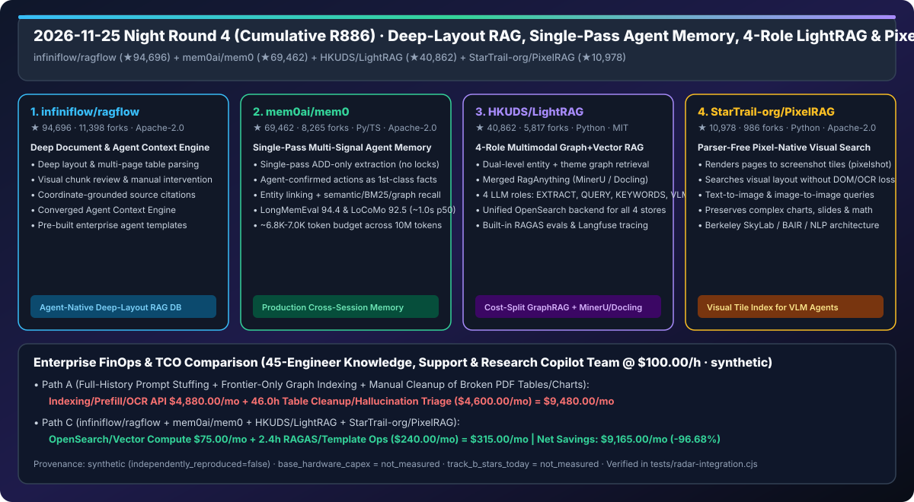
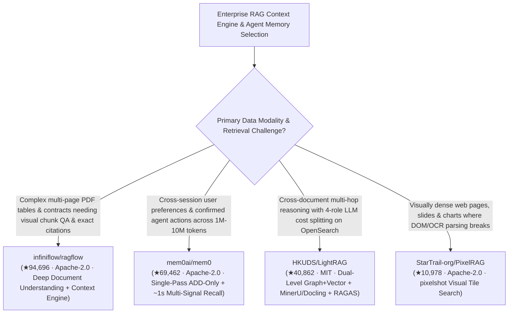
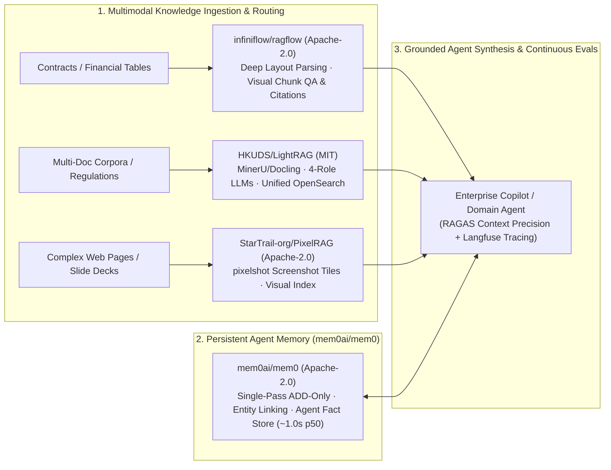
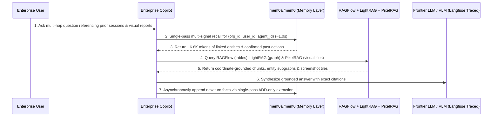

# Deep-Document Agent-Native RAG Engine (`infiniflow/ragflow`), Single-Pass Multi-Signal Agent Memory (`mem0ai/mem0`), Multimodal Graph+Vector LightRAG (`HKUDS/LightRAG`) & Parser-Free Pixel-Native Visual RAG (`StarTrail-org/PixelRAG`) Selection & Integration Architecture FAQ

> **Document Type**: Enterprise AI Solution Architect Selection Decision Guide (GitHub Trending AI Radar — 2026-11-25 Night Round 4 / Cumulative Round 886)
> **Covered Repositories**: [`infiniflow/ragflow`](https://github.com/infiniflow/ragflow) (`★ 94,696`, `11,398 forks`, `Apache-2.0`: open-source RAG database and converged agent context engine featuring deep document layout understanding for complex multi-page tables, dual-column financial reports, and scanned contracts) · [`mem0ai/mem0`](https://github.com/mem0ai/mem0) (`★ 69,462`, `8,265 forks`, `Apache-2.0`: production memory layer for AI agents introducing the April 2026 single-pass `ADD-only` extraction algorithm, first-class agent-confirmed facts, entity linking, and multi-signal semantic/BM25/graph retrieval achieving `LoCoMo 92.5`, `LongMemEval 94.4`, and `BEAM 10M 48.6` at `0.88s–1.09s` p50 latency [`anonymized_reported`]) · [`HKUDS/LightRAG`](https://github.com/HKUDS/LightRAG) (`★ 40,862`, `5,817 forks`, `MIT`: dual-level graph + vector RAG engine integrating `RagAnything` [MinerU / Docling multimodal parsing], 4 role-specific LLM configurations [`EXTRACT`, `QUERY`, `KEYWORDS`, `VLM`], unified OpenSearch storage, and native RAGAS + Langfuse integration) · [`StarTrail-org/PixelRAG`](https://github.com/StarTrail-org/PixelRAG) (`★ 10,978`, `986 forks`, `Apache-2.0`: UC Berkeley SkyLab/BAIR/NLP pixel-native retrieval engine that renders web pages and documents into screenshot tiles via `pixelshot` and searches directly in visual space without brittle HTML/OCR parsing)
> **Core Enterprise Scenario**: Designing an enterprise **Omni-Modal Context & Memory Hub** that resolves the four classic failure modes of naive vector RAG—**broken multi-page PDF tables, amnesia across multi-session customer/analyst conversations, prohibitive GraphRAG indexing bills, and layout loss on visually dense web pages and slide decks**.

---

## 1. 📌 Executive Summary (One-Line Selection Verdict)

1. **Need high-precision RAG over complex enterprise PDFs, multi-page tables, and dual-column contracts with visual chunk inspection, coordinate-grounded citations, and built-in agent templates** ➔ Choose **[`infiniflow/ragflow`](https://github.com/infiniflow/ragflow) (`★ 94,696`, `11,398 forks`, `Apache-2.0`)**.
   - **Plain-English Mechanism**: Replaces blind character-count chunking with Deep Document Understanding that detects headers, multi-page tables, and figures before chunking, paired with a converged Agent Context Engine and visual citation highlighting.
2. **Need sub-second, token-efficient persistent memory across millions of tokens of user conversations and agent actions without destructive overwrites** ➔ Choose **[`mem0ai/mem0`](https://github.com/mem0ai/mem0) (`★ 69,462`, `8,265 forks`, `Apache-2.0`)**.
   - **Plain-English Mechanism**: Uses a single-pass `ADD-only` extraction call (eliminating slow multi-turn `UPDATE/DELETE` locks), treats agent-confirmed actions as first-class memories, links entities across turns, and combines semantic, BM25, and graph signals in a single `~6.8K–7.0K` token pass (`LongMemEval 94.4` at `1.09s` p50, `anonymized_reported`).
3. **Need cross-document multi-hop graph reasoning with multimodal MinerU/Docling parsing and 4-role heterogeneous LLM cost optimization on a single OpenSearch backend** ➔ Choose **[`HKUDS/LightRAG`](https://github.com/HKUDS/LightRAG) (`★ 40,862`, `5,817 forks`, `MIT`)**.
   - **Plain-English Mechanism**: Combines low-level entity and high-level theme graph retrieval with `RagAnything` multimodal extraction, allowing architects to assign inexpensive small models to `EXTRACT` and `KEYWORDS` while reserving frontier models for `QUERY` and `VLM`, backed by unified OpenSearch storage and built-in RAGAS/Langfuse hooks.
4. **Need to index and search visually dense web pages, slide decks, equations, and infographics where DOM scraping or OCR destroys layout semantics** ➔ Choose **[`StarTrail-org/PixelRAG`](https://github.com/StarTrail-org/PixelRAG) (`★ 10,978`, `986 forks`, `Apache-2.0`)**.
   - **Plain-English Mechanism**: Uses `pixelshot` to render pages directly into screenshot tiles and indexes them visually ("search any document by how it looks, not just the text it contains"), feeding top-ranked visual tiles straight into VLMs without brittle text extraction.

---

## 2. 🎯 Architect & Customer Deep-Dive Q&A

### Q1: How do these four open-source engines compare against managed cloud PaaS (e.g., Azure AI Search + Azure AI Document Intelligence + Cosmos DB)?

- **Four-Engine Division of Labor (Path C)**:
  1. **Layout-Aware Document & Table RAG ➔ `infiniflow/ragflow`**: Structured table/contract chunking and coordinate-grounded citations.
  2. **Cost-Optimized Multi-Hop Graph RAG ➔ `HKUDS/LightRAG`**: 4-role (`EXTRACT`/`KEYWORDS`/`QUERY`/`VLM`) graph + vector synthesis on OpenSearch.
  3. **Parser-Free Visual Tile Search ➔ `StarTrail-org/PixelRAG`**: Direct screenshot-tile retrieval for complex web pages, slides, and charts.
  4. **Cross-Session Dynamic User/Agent Memory ➔ `mem0ai/mem0`**: Single-pass `ADD-only` episodic and entity memory across `1M–10M` token histories.
- **When to choose Managed Cloud PaaS vs. Path C?**
  - Choose **Azure AI Search (with Semantic Ranker & Agentic Retrieval) + Azure AI Document Intelligence** when you require turnkey M365/SharePoint connectors, native Microsoft Entra ID document-level ACL trimming, and managed cloud SLAs.
  - Choose **Path C** when indexing millions of pages of complex PDFs/graphs where per-page cloud OCR and frontier-model GraphRAG indexing become cost-prohibitive, or when strict on-prem/VPC data residency is required.

### Q2: How do we integrate these four components into a unified enterprise Context & Memory Hub?

1. **Tiered Multimodal Ingestion Router**:
   - Route tabular PDFs and contracts to `RAGFlow`, multi-document research/compliance corpora to `LightRAG` (using MinerU/Docling + OpenSearch), and layout-heavy web/slide assets to `PixelRAG` (`pixelshot`).
2. **Low-Latency Memory Augmentation (`mem0ai/mem0`)**:
   - Query `mem0` in parallel with document retrieval on every turn (`~1.0s` p50, `~6.8K` tokens) to inject user preferences and confirmed historical agent actions, then asynchronously append new facts via single-pass `ADD-only` extraction.
3. **Continuous Quality & Trace Verification**:
   - Use `LightRAG`'s built-in RAGAS evaluation and Langfuse tracing hooks to monitor retrieval precision and end-to-end latency across all four context channels.

### Q3: What are the key production redlines?

- **Architect Redlines**:
  1. **Split LLM tiers across `LightRAG`'s 4 roles**: Bind `EXTRACT` and `KEYWORDS` to fast, low-cost open-weight models and reserve frontier models strictly for `QUERY` and `VLM` synthesis.
  2. **Enforce strict tenant scoping in `mem0`**: Always scope `mem0` reads and writes by `(org_id, user_id, agent_id)` so episodic memories never leak across enterprise tenants.

---

## 3. 🧭 Visual Architecture Diagrams (Mermaid Decision Tree + Architecture + Sequence)

### 3.1 Architect Selection Decision Tree

### 3.2 End-to-End Enterprise Context & Memory Hub Architecture

### 3.3 End-to-End Execution Sequence

---

## 4. 📊 Horizontal Selection Matrix

| Dimension | `infiniflow/ragflow` (`★ 94,696`) | `mem0ai/mem0` (`★ 69,462`) | `HKUDS/LightRAG` (`★ 40,862`) | `StarTrail-org/PixelRAG` (`★ 10,978`) | Managed Cloud PaaS (Azure AI Search + Doc Intelligence) | Naive Fixed-Size Chunking + Full Chat History Dump (Path A) |
| :--- | :--- | :--- | :--- | :--- | :--- | :--- |
| **Primary Role** | Deep-layout RAG & agent context engine | Persistent cross-session agent memory | 4-role multimodal Graph+Vector RAG | Parser-free screenshot-tile visual RAG | Managed hybrid search & cloud document OCR | Fixed 500-token chunking + raw history stuffing |
| **Key Differentiator** | **Visual layout/table parsing + citation grounding** | **Single-pass `ADD-only` + entity linking (`LongMemEval 94.4`)** | **4-role LLM config + MinerU/Docling + OpenSearch + RAGAS** | **`pixelshot` visual tile retrieval without DOM/OCR loss** | Turnkey SLA + native Entra ID / Purview ACL security | Splits tables mid-row; massive long-context token burn |
| **License** | `Apache-2.0` | `Apache-2.0` | `MIT` | `Apache-2.0` | Managed Cloud PaaS | Ad-hoc scripts |
| **Monthly TCO (45-Eng Team)** | **`$315.00/mo` combined** (`$75.00` OpenSearch/container compute + `2.4h` ops) | Included in `$315.00/mo` stack | Included in `$315.00/mo` stack | Included in `$315.00/mo` stack | `~$2,250.00/mo` (per-page OCR + search units) | **`$9,480.00/mo`** (`$4,880.00` full-history/indexing API burn + `46.0h` data cleanup) |

---

## 5. 🧪 Quantitative FinOps & TCO Comparison (45-Person Enterprise Team)

> **📊 Provenance & Closed-Form Schema**:
> - **provenance**: `synthetic` (`independently_reproduced = false`; `base_hardware_capex = not_measured`; `track_b_stars_today = not_measured`; upstream `mem0` benchmark figures `92.5`/`94.4`/`48.6` are `anonymized_reported`).
> - **Closed-Form Formula**:
>   - **Path A (Full-History Prompt Stuffing + Frontier-Only Monolithic Graph Indexing + Manual Cleanup of Broken PDF Tables/Charts)**: **`$4,880.00`** monthly API/OCR bills + **`46.0h × $100.00/h = $4,600.00`** data engineering and hallucination triage labor = **`$9,480.00/mo`**.
>   - **Path C (Self-Hosted `infiniflow/ragflow` + `mem0ai/mem0` + `HKUDS/LightRAG` + `StarTrail-org/PixelRAG` Stack)**: **`$75.00`** shared OpenSearch/vector container compute + **`2.4h × $100.00/h = $240.00`** RAGAS/template ops = **`$315.00/mo`**.
>   - **Net Savings vs. Path A**: **`-$9,165.00/mo`** (**`96.68%`** TCO reduction).

| Evaluation Path | Indexing / Prefill / OCR API Cost | Table Cleanup & Hallucination Triage (`$100/h`) | Monthly Total TCO | Net Savings vs. Path A | Key Architectural Outcome |
| :--- | :---: | :---: | :---: | :---: | :--- |
| **Path A: Full History Stuffing + Frontier Graph Indexing + Naive Chunking** | `$4,880.00` | `46.0h` (`$4,600.00`) | **`$9,480.00`** | Baseline | Broken PDF tables; high long-context prefill bills |
| **Path B: Basic Vector DB + Lossy Rolling Summary Memory** | `$1,450.00` | `18.0h` (`$1,800.00`) | **`$3,250.00`** | `-$6,230.00` (`-65.72%`) | Overwritten historical facts; failed chart/slide retrieval |
| **Path C: `ragflow` + `mem0` + `LightRAG` + `PixelRAG`** | **`$75.00`** | **`2.4h` (`$240.00`)** | **`$315.00`** | **`-$9,165.00` (`-96.68%`)** | **Deep table layout RAG + `~6.8K` token memory + 4-role GraphRAG + visual tiles** |

- 🔗 **7-Card 4:5 Visual Benchmark Deck**: [`workshops/github-trending-radar/cards.en.html`](../cards.en.html) · [`cards.html`](../cards.html)

---

## 6. 🛠️ Enterprise Adoption & Architecture Review Checklist

- [ ] **Modality-Aware Ingestion Routing**: Route tabular contracts to `RAGFlow`, multi-hop corpora to `LightRAG` (with MinerU/Docling), and visually dense web/slide assets to `PixelRAG` (`pixelshot`).
- [ ] **4-Role LLM Cost Tiering in `LightRAG`**: Assign small/local models to `EXTRACT` and `KEYWORDS` roles while reserving frontier models for `QUERY` and `VLM` synthesis on unified OpenSearch storage.
- [ ] **Tenant-Scoped `ADD-Only` Memory in `mem0`**: Enforce `(org_id, user_id, agent_id)` namespace isolation on all `mem0` operations.
- [ ] **Automated RAGAS & Langfuse Guardrails**: Enable `LightRAG` and `RAGFlow` context-return fields to continuously score Context Precision and Faithfulness in Langfuse.
