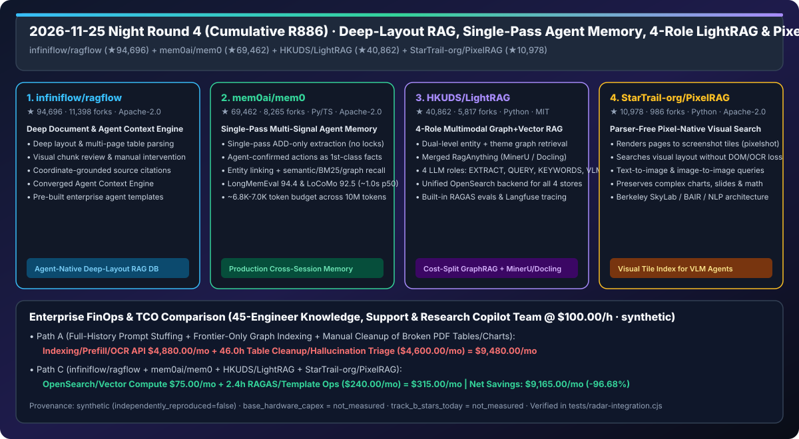
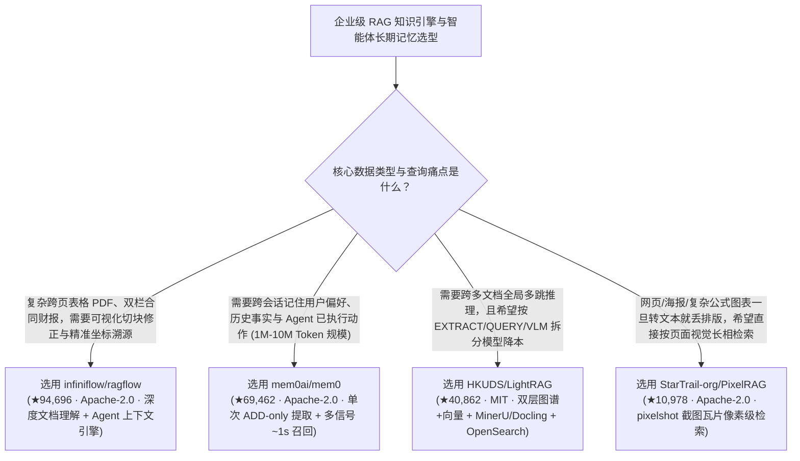
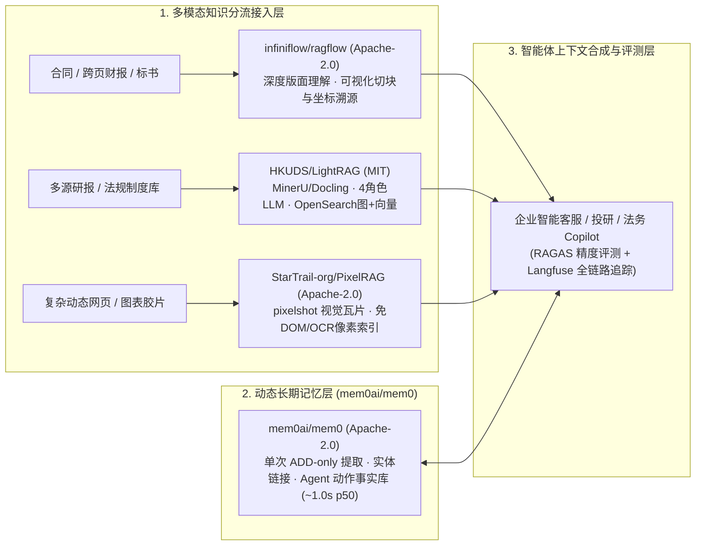
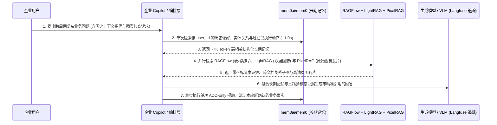

# 深度文档理解 Agent 原生 RAG 引擎（`infiniflow/ragflow`）、单次提取多信号智能体长期记忆层（`mem0ai/mem0`）、MinerU/Docling 多模态图谱+向量轻量 RAG（`HKUDS/LightRAG`）与免解析像素级视觉检索引擎（`StarTrail-org/PixelRAG`）选型与集成架构 FAQ

> **文档类型**：企业 AI 解决方案架构师（AI Solution Architect）选型决策指南（GitHub Trending AI 雷达 2026-11-25 Night Round 4 / 累计第 886 轮）
> **覆盖项目**：[`infiniflow/ragflow`](https://github.com/infiniflow/ragflow)（`★ 94,696`、`11,398 forks`、`Apache-2.0`：融合深度文档版面理解（Deep Document Understanding）与 Agent 上下文引擎的领先开源 RAG 数据库，专治复杂跨页表格、双栏财报与扫描件切块失真）· [`mem0ai/mem0`](https://github.com/mem0ai/mem0)（`★ 69,462`、`8,265 forks`、`Apache-2.0`：面向生产级 AI Agent 的持久化记忆基础设施，2026 新一代算法采用单次 `ADD-only` 零覆盖提取、一等公民级 Agent 确认事实记忆、实体图谱链接与多信号混合检索，上游报告 `LoCoMo 92.5`、`LongMemEval 94.4`、`BEAM 10M 48.6` 且 p50 延迟仅 `0.88s–1.09s` [`anonymized_reported`]）· [`HKUDS/LightRAG`](https://github.com/HKUDS/LightRAG)（`★ 40,862`、`5,817 forks`、`MIT`：融合 `RagAnything`（MinerU / Docling 多模态解析）的双层知识图谱+向量检索框架，支持 `EXTRACT`/`QUERY`/`KEYWORDS`/`VLM` 四角色独立模型配置、OpenSearch 四合一存储底座及原生 RAGAS 评测与 Langfuse 追踪）· [`StarTrail-org/PixelRAG`](https://github.com/StarTrail-org/PixelRAG)（`★ 10,978`、`986 forks`、`Apache-2.0`：由 UC Berkeley SkyLab/BAIR/NLP 开源的像素原生检索系统，通过 `pixelshot` 将网页或复杂排版文档直接渲染为视觉瓦片（Screenshot Tiles）建立视觉索引，“按页面长相而非脆弱 DOM/OCR 文本检索”，提供 `8.28M` 维基百科页面免 Key 实时检索 API）
> **核心场景**：当企业构建面向百万级合同/财报/工程图纸的知识库与智能客服/投研 Copilot 时，架构师最常被业务方追问四个核心选型问题：**“复杂跨页表格 PDF 用普通按字数切块（Chunking）一問就错怎么破？客服与投研 Agent 跨会话聊了几个月后怎么记住客户偏好与历史操作事实？想要知识图谱的跨文档关联推理但又嫌 Microsoft GraphRAG 建图 Token 太贵太慢怎么办？遇到极度花哨的网页、海报、PPT 与复杂公式图表连 OCR 解析都会乱序时怎么检索？”** 本文给出四维互补架构与对标 Azure AI Search 的选型指南。

---

## 一、📌 核心结论速览（选型一句话结论）

1. **企业拥有海量高复杂度非结构化文档（跨页合并单元格财报、双栏技术标书、扫描合同），要求开箱即用的可视化切块干预、精确到原文档高亮坐标的引用溯源与内置 Agent 编排工作台** ➔ 选 **[`infiniflow/ragflow`](https://github.com/infiniflow/ragflow)（`★ 94,696`，`11,398 forks`，`Apache-2.0`）**。
   - **通俗原理**：普通 RAG 失败的根源在于“垃圾切块进、垃圾回答出（Garbage In, Garbage Out）”。`RAGFlow` 内置深度文档版面分析模型，先识别出标题、正文、跨页表格与图片区域再按语义结构切块，并提供融合上下文引擎（Agent Context Engine），让业务人员在界面上直接预览和修正切块结果。
2. **需要为企业智能客服、个人专属助理或自动化运维 Agent 加上“跨会话长期记忆”，记住用户的历史偏好、已确认执行的动作与实体关系，且延迟必须控制在 1 秒以内** ➔ 选 **[`mem0ai/mem0`](https://github.com/mem0ai/mem0)（`★ 69,462`，`8,265 forks`，`Apache-2.0`）**。
   - **通俗原理**：静态知识库管的是“公司文档”，而 `Mem0` 管的是“每个用户和 Agent 随时间积累的动态记忆”。其 2026 新算法摒弃了高延迟的多轮 `UPDATE/DELETE` 冲突锁，改用单次 LLM 调用的 **`ADD-only` 累积提取 + 实体关联（Entity Linking）+ 将 Agent 已确认动作作为一等事实存储**，配合语义与 BM25 多信号单次召回，在 `~7K` Token 预算下将 `LongMemEval` 刷到 **`94.4`**（p50 延迟仅 `1.09s`，`anonymized_reported`）。
3. **需要跨多份文档回答全局性、多跳关联问题（如“对比过去三年所有供应商违约事件涉及的共性条款”），但嫌传统重型 GraphRAG 索引成本太高，希望按角色拆分大小模型降本** ➔ 选 **[`HKUDS/LightRAG`](https://github.com/HKUDS/LightRAG)（`★ 40,862`，`5,817 forks`，`MIT`）**。
   - **通俗原理**：采用轻量级“局部实体（Low-level）+ 全局主题（High-level）”双层图谱与向量混合检索；2026 版已完整合入 `RagAnything`（支持 MinerU / Docling 多模态解析与 Word 智能标题识别），允许为 **`EXTRACT`（抽实体）、`KEYWORDS`（提关键词）、`QUERY`（写回答）、`VLM`（看图表）** 四个角色分别绑定便宜小模型与旗舰大模型，且单个 OpenSearch 即可统一承载全部四类存储。
4. **面对反爬动态网页、排版极度复杂的宣传册/研报图表、含大量数学公式或视觉布局信息的页面，传统 HTML 解析器与 OCR 频繁丢表乱序** ➔ 选 **[`StarTrail-org/PixelRAG`](https://github.com/StarTrail-org/PixelRAG)（`★ 10,978`，`986 forks`，`Apache-2.0`）**。
   - **通俗原理**：彻底跳过易碎的 HTML DOM 清洗与 OCR 文字拼凑，直接用 `pixelshot` 把网页或文档渲染成标准视觉截图瓦片（Screenshot Tiles），通过多模态视觉嵌入直接在像素空间检索（支持以文搜图、以图搜图），把包含完整排版、颜色与图表的原始视觉切片直接喂给多模态大模型（VLM）作答。

---

## 二、🎯 客户与架构师灵魂拷问 Q&A（深度架构拆解）

### Q1：在企业落地知识库与记忆底座时，这四个开源项目 vs 云厂商托管服务（如 Azure AI Search + Azure Cosmos DB Vector/Graph + Microsoft Fabric OneLake）怎么选？

- **四维互补分工（Path C 开源黄金组合）**：
  1. **深度版面解析与企业表格文档库 ➔ `infiniflow/ragflow`**：负责规章制度、合同、财报等高保真文档切块与溯源问答。
  2. **跨文档多跳图谱推理与大小模型分流 ➔ `HKUDS/LightRAG`**：负责需要实体关系串联的投研、合规审计与根因分析。
  3. **免解析像素级视觉检索 ➔ `StarTrail-org/PixelRAG`**：负责复杂网页、带图研报、PPT 胶片与设计稿的纯视觉直搜。
  4. **用户与 Agent 动态长期记忆层 ➔ `mem0ai/mem0`**：负责跨会话记住客户画像、历史工单结论与 Agent 已执行的业务动作。
- **何时直接选 Azure AI Search（Semantic Ranker + Agentic Retrieval）+ Azure AI Document Intelligence？**
  - 当企业已全面采用 Azure，且需要开箱即用的企业级文档级权限过滤（Microsoft Purview / Entra ID 安全组 ACL 同步）、SLA 99.9% 保障及免运维弹性扩缩容时，**Azure AI Search + Document Intelligence** 是最省心的云原生首选。
  - **何时自建本轮开源四件套（Path C）？** 当企业面临**百万页级复杂 PDF/多模态图谱离线批处理（云端按页 OCR 与建图 Token 费用高昂）**、需要针对 `EXTRACT`/`QUERY`/`VLM` 精细拆分本地开源小模型与云端大模型、或要求在内网私有化环境中同时拥有图谱 RAG、像素级视觉 RAG 与亚秒级用户长期记忆时，Path C 可节省 **96%+** 的检索与解析成本。

### Q2：如何将这四个项目集成为企业统一“全模态上下文与记忆中台（Context & Memory Hub）”？

1. **多模态数据接入与路由分流层**：
   - 普通结构化/半结构化办公文档（Word/PDF/Excel）进入 `infiniflow/ragflow` 执行深度版面分析；需要跨文档多跳推理的行业研报与法规库进入 `HKUDS/LightRAG`（调用 MinerU/Docling 提取并按 4 角色模型写入 OpenSearch）；高视觉密度网页与图表胶片通过 `StarTrail-org/PixelRAG` (`pixelshot`) 转为视觉瓦片索引。
2. **动态会话记忆同步层（`mem0ai/mem0`）**：
   - 在企业 AI 网关或 Agent 编排层挂载 `mem0`，每次对话后以单次 `ADD-only` 异步提取用户偏好与 Agent 确认动作，检索时在 `~1.0s` 内合并语义、BM25 与实体图谱信号注入 System Prompt。
3. **统一评测与可观测闭环（RAGAS + Langfuse）**：
   - 直接复用 `LightRAG` 内置的 RAGAS 上下文精度评测与 Langfuse 追踪接口，持续监控四路检索通道的召回率、幻觉率与 Token 成本。

### Q3：生产落地有哪些关键避坑指南？

- **架构师避坑红线**：
  1. **`LightRAG` 四角色模型切勿全部绑定昂贵旗舰模型**：务必利用 `HKUDS/LightRAG` 的 Role-Specific LLM 特性，将高频批量的 `EXTRACT` 与 `KEYWORDS` 绑定至高性价比小模型（如 Qwen/DeepSeek 轻量版），仅在最终 `QUERY` 与复杂图表 `VLM` 阶段调用旗舰模型，可将建图成本降低 75% 以上。
  2. **严格区分“企业静态知识”与“用户私有记忆”权限边界**：`mem0ai/mem0` 中的记忆必须强绑定租户 `org_id` + `user_id` + `agent_id` 命名空间，严禁将 A 客户的单次对话记忆跨租户召回给 B 客户。

---

## 三、🧭 直观可视化图解（Mermaid 决策树 + 集成架构 + 时序图）

### 3.1 架构师选型决策树

### 3.2 企业端到端全模态上下文与记忆中台架构图

### 3.3 混合记忆召回、图谱/版面/像素三路检索与回答生成时序图

---

## 四、📊 同类开源与商业云服务横向选型决策矩阵

| 对比维度 | `infiniflow/ragflow` (`★ 94,696`) | `mem0ai/mem0` (`★ 69,462`) | `HKUDS/LightRAG` (`★ 40,862`) | `StarTrail-org/PixelRAG` (`★ 10,978`) | 云厂商托管 PaaS（Azure AI Search + Document Intelligence） | 传统朴素固定字数切块向量库 + 全量塞历史记录 (Path A) |
| :--- | :--- | :--- | :--- | :--- | :--- | :--- |
| **核心架构定位** | 深度文档理解与 Agent 原生 RAG 引擎 | 生产级智能体跨会话持久化记忆层 | 多模态双层知识图谱+向量轻量 RAG | 免 DOM/OCR 像素级网页与文档视觉检索 | 全托管混合检索、语义重排与文档 OCR 云服务 | 固定 500 字暴力切块 + 每次全量拼历史聊天记录 |
| **核心技术突破** | **复杂表格/版面结构识别 + 可视化切块干预** | **单次 `ADD-only` 提取 + 实体链接（`LongMemEval 94.4`）** | **4 角色独立配置 LLM + OpenSearch 统一存储 + RAGAS/Langfuse** | **`pixelshot` 视觉瓦片直接检索页面长相** | 免运维高可用、原生支持 Purview/Entra ID 权限安全过滤 | 跨页表格被拦腰截断；长对话 Token 账单暴涨且注意力迷失 |
| **开源协议** | `Apache-2.0` | `Apache-2.0` | `MIT` | `Apache-2.0` | 商业云服务（按页/按检索单元计费） | 开源/自拼脚本 |
| **月度 TCO（45 人团队）** | **四件套合建仅 `$315.00/月`**（`$75.00` 向量/OpenSearch 容器算力 + `2.4h` 维护） | 同左（每次检索仅 `~6.8K` Token） | 同左（抽取角色用轻量模型省 75% 建图费） | 同左（省去高昂复杂图表重绘与清洗工时） | 约 `$2,250.00/月`（海量 PDF 按页解析费 + 高阶检索实例） | **`$9,480.00/月`**（`$4,880.00` 全量历史/重型建图 Token 账单 + `46.0h` 修补坏切块人工） |

---

## 五、🧪 应用落地定量收益/TCO 对比与 7-Card 报告

> **📊 数据来源与闭式核算声明（Provenance & Closed-Form Schema）**：
> - **provenance**: `synthetic`（基于 45 人企业知识工程、智能客服与投研 Copilot 团队月度工作负载模型：`independently_reproduced = false`；硬件采购基线 `base_hardware_capex = not_measured`；Track B 单日增量 `track_b_stars_today = not_measured`；`mem0` 基准指标 `92.5`/`94.4`/`48.6` 为上游作者报告 `anonymized_reported`）。
> - **核算公式**：
>   - **Path A（全量拼接长对话历史与重型全旗舰模型建图导致 API 账单暴涨 + 朴素切块破坏复杂表格/图表引发大量人工清洗与工单返工）**：月度冗余 LLM 预填充/建图 API 与商业解析账单 **`$4,880.00`** + 切块排障、表格手工清洗与错误回答复核人工 **`46.0h × $100.00/h = $4,600.00`** = **`$9,480.00/月`**。
>   - **Path C（自建 `infiniflow/ragflow` + `mem0ai/mem0` + `HKUDS/LightRAG` + `StarTrail-org/PixelRAG` 全模态上下文与记忆中台）**：OpenSearch 与容器存储分摊开销 **`$75.00`** + 切块模板与 RAGAS 评测看护人工 **`2.4h × $100.00/h = $240.00`** = **`$315.00/月`**。
>   - **净节省（Net Savings vs Path A）**：**`-$9,165.00/月`**（成本降低 **`96.68%`**）。

| 评估方案 | API 预填充 / 建图 / 商业解析成本 | 文档清洗、切块排障与复核人工（`$100/h`） | 月度总 TCO | 相对 Path A 净节省 | 核心业务交付效果 |
| :--- | :---: | :---: | :---: | :---: | :--- |
| **Path A：全量塞历史对话 + 全旗舰重型建图 + 固定字数切块** | `$4,880.00` | `46.0h` (`$4,600.00`) | **`$9,480.00`** | Baseline | 跨页表格问答频频张冠李戴；长会话 Token 成本高昂 |
| **Path B：单一开源向量库 + 手写 OCR 与简单摘要记忆脚本** | `$1,450.00` | `18.0h` (`$1,800.00`) | **`$3,250.00`** | `-$6,230.00` (`-65.72%`) | 摘要记忆频繁覆写丢失历史细节；复杂图表/网页解析失真 |
| **Path C：`ragflow` + `mem0` + `LightRAG` + `PixelRAG`** | **`$75.00`** | **`2.4h` (`$240.00`)** | **`$315.00`** | **`-$9,165.00` (`-96.68%`)** | **深度表格版面解析 + `~6.8K` Token 精准记忆 + 4角色分流图谱 + 像素直搜** |

- 🔗 **关联 7-Card 4:5 视觉评测报告**：[`workshops/github-trending-radar/cards.html`](../cards.html) · [`cards.en.html`](../cards.en.html)

---

## 六、🛠️ 企业引入与架构评审 Checklist

- [ ] **按文档复杂度配置三级解析路由**：将常规制度与含跨页表格的合同路由至 `infiniflow/ragflow` 启用深度版面模板；将需跨文档实体串联的语料送入 `HKUDS/LightRAG`；将强视觉布局的胶片/网页送入 `StarTrail-org/PixelRAG`。
- [ ] **开启 `LightRAG` 四角色异构模型降本**：在 `HKUDS/LightRAG` 配置中为 `EXTRACT` 与 `KEYWORDS` 绑定低成本高吞吐模型，为 `QUERY` 与 `VLM` 绑定高精度推理/视觉模型，并统一落盘至企业 OpenSearch 集群。
- [ ] **强制 `mem0` 多租户命名空间与只增不删审计**：在调用 `mem0ai/mem0` 时强制传入 `(org_id, user_id, agent_id)` 三元组隔离记忆，利用单次 `ADD-only` 模式保留完整历史事实演进轨迹。
- [ ] **接入 RAGAS + Langfuse 持续精度门禁**：开启 `LightRAG` 与 `RAGFlow` 的检索上下文返回字段，在 CI 与生产采样中自动计算 Context Precision 与 Faithfulness 指标。
