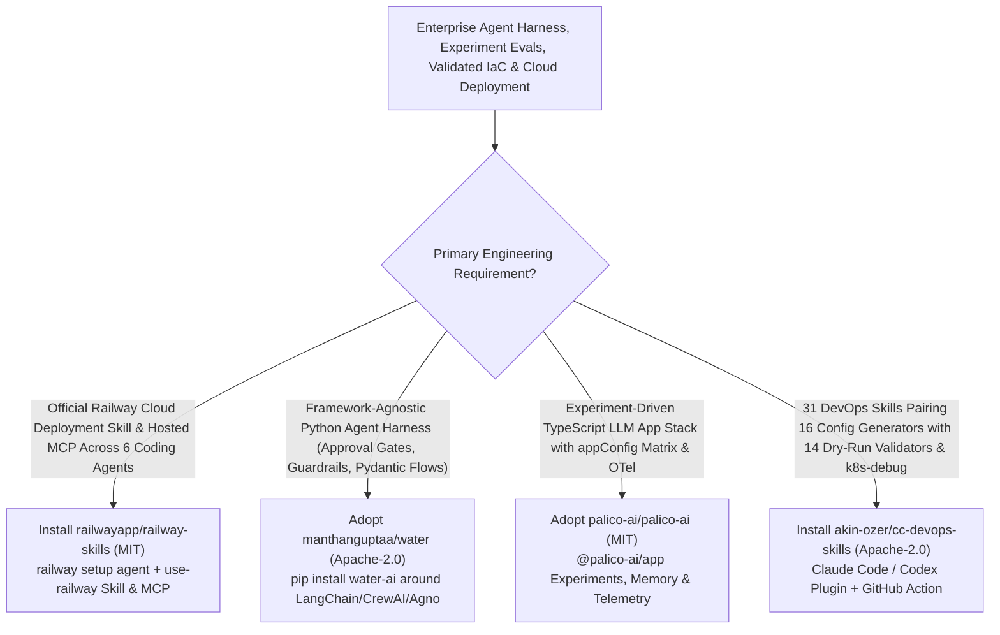
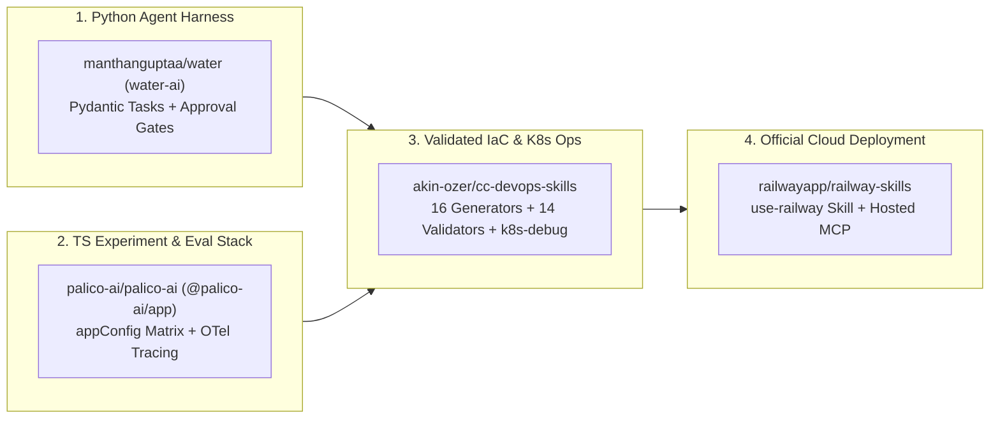
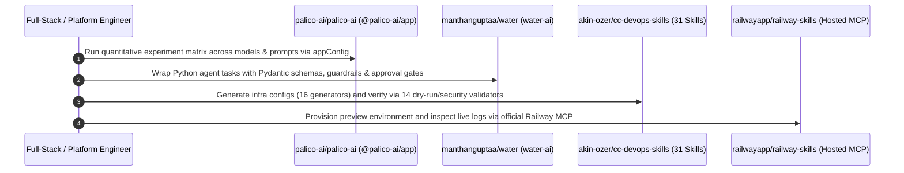

# Official Railway Cloud Skills (`railwayapp/railway-skills`), Production Python Agent Harness (`manthanguptaa/water`), Experiment-Driven TypeScript LLM Stack (`palico-ai/palico-ai`) & 31-Skill DevOps Generator/Validator Pack (`akin-ozer/cc-devops-skills`) Selection & Architecture FAQ

> **2026-11-21 Nightly Continuous Research Shift · Night Round 83 (Cumulative Round 683)**  
> **Audit Claim ID**: `CLAIM-20261121-R83-R683-RAILWAYSKILLS-WATER-PALICOAI-CCDEVOPSSKILLS`  
> **Linked Daily Digests**: [`2026-11-21.en.md`](../daily/2026-11-21.en.md) · [`2026-11-21.md`](../daily/2026-11-21.md)  
> **Architecture Visual**: [`assets/github-ai-radar-2026-11-21-r83-r683-railwayskills-water-palicoai-ccdevopsskills.svg`](../../../assets/github-ai-radar-2026-11-21-r83-r683-railwayskills-water-palicoai-ccdevopsskills.svg)

---

## ① 📌 Executive Summary (One-Sentence Selection Verdict)

> **One-Sentence Verdict**: To take Python and TypeScript AI applications from prototype to production with deterministic harness guardrails, quantitative experiment evaluations, validated DevOps manifests, and one-command cloud deployment, combine **`railwayapp/railway-skills` (MIT, `★ 345` official Railway `use-railway` skill and hosted MCP server packaged for ChatGPT, Codex, Claude Code, Grok Build, Cursor, and Antigravity) + `manthanguptaa/water` (Apache-2.0, `★ 343` `water-ai` Python agent harness providing Pydantic task contracts, approval gates, guardrails, and sandboxing around LangChain/CrewAI/Agno/OpenAI/Anthropic) + `palico-ai/palico-ai` (MIT, `★ 343` `@palico-ai/app` TypeScript stack for experiment-driven LLM development, hot-swappable `appConfig`, memory, and OpenTelemetry tracing) + `akin-ozer/cc-devops-skills` (Apache-2.0, `★ 343` 31 DevOps skills pairing 16 config generators with 14 dry-run/security validators and `k8s-debug`)**—cutting 45-engineer monthly TCO from **`$8,270.00/mo` to `$310.00/mo` (`-$7,960.00/mo`, `-96.25%`)**.

---

## ② 🎯 Solution Architect & Enterprise Buyer Q&A

### Q1: Why do enterprise AI teams pair these four permissive repositories across app development and DevOps?
- **Four Production Delivery Pillars**:
  1. **Official Multi-Harness Cloud Deployment Skills (`railwayapp/railway-skills`, `★ 345`, `53 forks`, MIT, Python)**: Maintained by **Railway**. Follows the `agentskills.io` open standard and ships ready-to-install plugin packages for ChatGPT, OpenAI Codex, Claude Code, Grok Build, Cursor, and Google Antigravity—bundling the `use-railway` skill and Railway's hosted MCP server via `railway setup agent`.
  2. **Framework-Agnostic Python Agent Harness (`manthanguptaa/water`, `★ 343`, `42 forks`, Apache-2.0, Python)**: Published on PyPI as `water-ai`. Provides the production infrastructure *around* any Python agent (LangChain, CrewAI, Agno, OpenAI, Anthropic, or custom): typed Pydantic `create_task` contracts, `Flow` orchestration, retry resilience, observability, guardrails, human approval gates, and sandboxing.
  3. **Experiment-Driven TypeScript AI Application Stack (`palico-ai/palico-ai`, `★ 343`, `31 forks`, MIT, TypeScript)**: Published on npm as `@palico-ai/app`. Enables systematic iteration across models, prompts, and RAG pipelines via hot-swappable `appConfig` parameters, built-in quantitative experiment runners, conversation state management, and OpenTelemetry tracing.
  4. **31-Skill DevOps Generator + Validator Suite (`akin-ozer/cc-devops-skills`, `★ 343`, `37 forks`, Apache-2.0, Python)**: Prevents agents from shipping unverified infrastructure configs by pairing **16 production config generators** with **14 mandatory validators** (linting, security scanning, and dry-run verification) plus **1 `k8s-debug` cluster troubleshooter** and a native GitHub Action (`action.yml`).

### Q2: How do these four components integrate into a unified CI/CD and cloud release pipeline?
- **Application & Eval Layer**: Python services wrap agent logic in `manthanguptaa/water` (`water-ai`) for Pydantic validation and approval gates, while TypeScript services use `palico-ai/palico-ai` to benchmark prompt/model combinations before release.
- **Infrastructure Validation & Cloud Release Layer**: Coding agents invoke `akin-ozer/cc-devops-skills` to generate and dry-run validate Docker/K8s/CI configs, then deploy preview and staging stacks via `railwayapp/railway-skills` (`use-railway` + hosted Railway MCP).

### Q3: What governance controls should Solution Architects enforce in production?
- **Scoped Cloud Tokens (`railwayapp/railway-skills`)**: Scope `railway setup agent` credentials to isolated preview/staging environments and require human approval gates for production environment variable mutations.
- **Mandatory Validator Execution (`akin-ozer/cc-devops-skills`)**: Enforce the 14 validator skills in CI (`action.yml`) so no generated Terraform, Dockerfile, or Kubernetes manifest merges without passing dry-run and security checks.

---

## ③ 🧭 Visual Architecture & Decision Diagrams

### 3.1 Selection Decision Tree

### 3.2 End-to-End Enterprise Integration Architecture

### 3.3 Operational Sequence Diagram

---

## ④ 📊 Cross-Option Selection Matrix

| Dimension | `railwayapp/railway-skills` (`★ 345`) | `manthanguptaa/water` (`★ 343`) | `palico-ai/palico-ai` (`★ 343`) | `akin-ozer/cc-devops-skills` (`★ 343`) | Proprietary LLMOps Evals + Commercial DevSecOps SaaS |
| :--- | :--- | :--- | :--- | :--- | :--- |
| **Primary Role** | Official Railway cloud deployment skill & MCP pack | Production Python agent harness (`water-ai`) | TypeScript experiment-driven LLM app framework | 31 DevOps skills (16 generators, 14 validators, `k8s-debug`) | Metered commercial LLMOps & IaC scanning SaaS |
| **Best Fit** | Automated cloud provisioning across 6 agent IDEs | Adding guardrails & approval gates to Python agents | Iterative model/prompt benchmarking in TypeScript | Preventing broken or insecure AI-generated infra configs | Teams locked into single-vendor enterprise cloud suites |
| **Integration Cost** | Very Low (`railway setup agent` one-liner) | Low (`pip install water-ai` with Pydantic models) | Low (`@palico-ai/app` npm workspace & CLI) | Very Low (Claude/Codex plugin + `action.yml`) | High (per-seat SaaS contracts + custom CI glue) |
| **License** | **MIT** | **Apache-2.0** | **MIT** | **Apache-2.0** | Proprietary |
| **45-Eng Monthly TCO** | **Included in `$310.00/mo` stack** | **Included in `$310.00/mo` stack** | **Included in `$310.00/mo` stack** | **Included in `$310.00/mo` stack** | **`$8,270.00/mo`** (`$3,920` SaaS + `$4,350` labor) |

---

## ⑤ 🧪 Quantitative FinOps & TCO Comparison

> **Provenance Metadata**: Synthetic enterprise FinOps model for a 45-engineer organization (`provenance: synthetic`, `independently_reproduced: false`); `base_hardware_capex = not_measured` (excludes underlying cloud workload compute), `track_b_stars_today = not_measured` (sealed in [`trending-daily-2026-11-21-audit.json`](../evidence/trending-daily-2026-11-21-audit.json)).

| Cost Path | Monthly Commercial LLMOps Eval & IaC Security SaaS | Monthly Manual Harness Coding, Spreadsheet Evals & Broken YAML Triage (`$100/hr`) | Total Monthly TCO | Net Savings vs Path A |
| :--- | :--- | :--- | :--- | :--- |
| **Path A: Commercial LLMOps Eval Cloud + Proprietary IaC Scanner + Manual Triage** | `$3,920.00` | `43.5h` (`$4,350.00`) | **`$8,270.00`** | — |
| **Path C: `railway-skills` + `water-ai` + `palico-ai` + `cc-devops-skills`** | `$70.00` | `2.4h` (`$240.00`) | **`$310.00`** | **`-$7,960.00/mo` (`-96.25%`)** |

---

## ⑥ 🛠️ Enterprise Architecture Review Checklist

- [ ] **Environment-Scoped Railway MCP Tokens (`railwayapp/railway-skills`)**: Bind `use-railway` MCP tokens to non-production projects by default and require explicit PR promotion for production deployments.
- [ ] **Pydantic Schema & Approval Enforcement (`manthanguptaa/water`)**: Wrap all state-mutating Python agent tools in `water-ai` tasks with strict Pydantic schemas and human approval gates.
- [ ] **Pre-Release Experiment Thresholds (`palico-ai/palico-ai`)**: Gate prompt and model changes in CI on `Palico AI` evaluation suites meeting accuracy and latency SLAs.
- [ ] **Mandatory Generator-Validator Pairing (`akin-ozer/cc-devops-skills`)**: Configure `cc-devops-skills` so every generated Kubernetes, Docker, or CI manifest runs its corresponding validator skill before commit.
