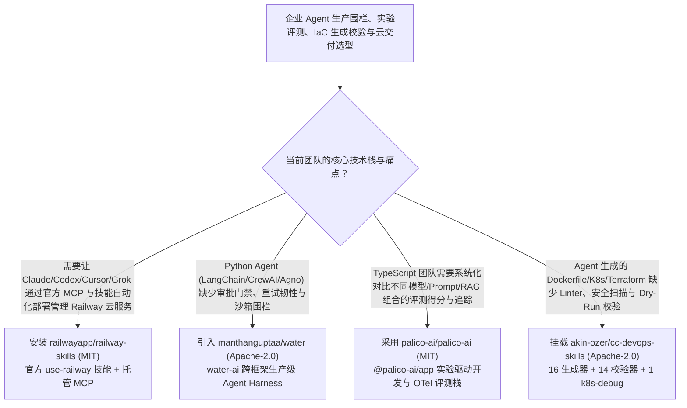
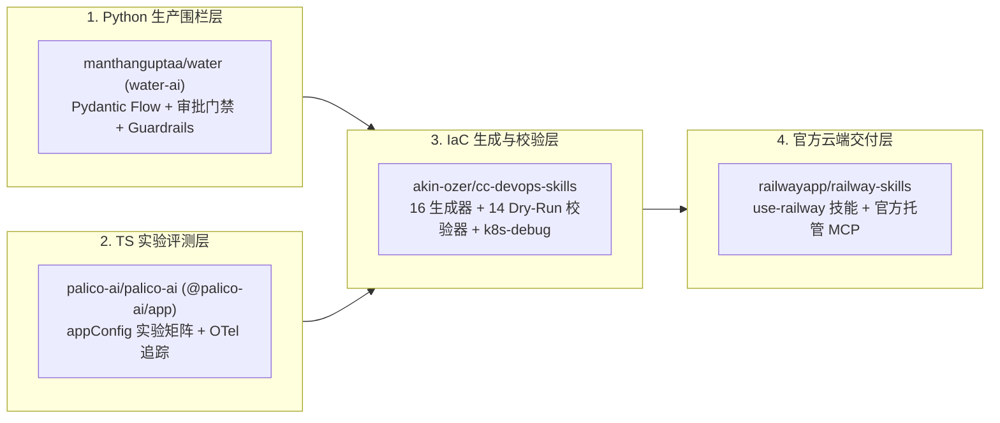
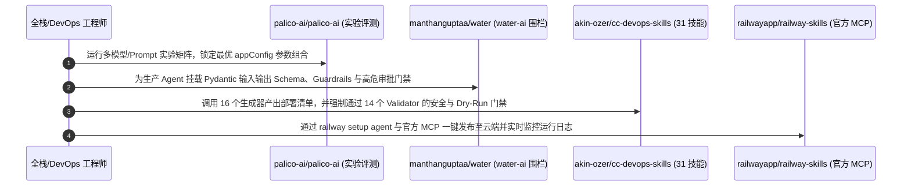

# Railway 官方云部署技能包（`railwayapp/railway-skills`）、Python 生产级智能体围栏框架（`manthanguptaa/water`）、实验驱动 TypeScript 应用脚手架（`palico-ai/palico-ai`）与 31 项 DevOps 生成校验技能集（`akin-ozer/cc-devops-skills`）架构选型与落地 FAQ

> **2026-11-21 夜间持续研究班次 · Night Round 83（累计 Round 683）**  
> **审计凭据**：`CLAIM-20261121-R83-R683-RAILWAYSKILLS-WATER-PALICOAI-CCDEVOPSSKILLS`  
> **关联日刊**：[`2026-11-21.md`](../daily/2026-11-21.md) · [`2026-11-21.en.md`](../daily/2026-11-21.en.md)  
> **可视化架构图**：[`assets/github-ai-radar-2026-11-21-r83-r683-railwayskills-water-palicoai-ccdevopsskills.svg`](../../../assets/github-ai-radar-2026-11-21-r83-r683-railwayskills-water-palicoai-ccdevopsskills.svg)

---

## ① 📌 核心结论速览（选型一句话结论）

> **一句话选型结论**：当企业研发团队需要打通“**TypeScript/Python 智能体应用的实验驱动评测与生产围栏（Harness）➔ 31 项基础设施配置生成与 Dry-Run 安全校验 ➔ 一键自动化云端部署运维**”的完整交付闭环时，推荐采用 100% 宽松协议（MIT / Apache-2.0）的四件套：**“`railwayapp/railway-skills`（MIT，`★ 345` Railway 官方出品、同时兼容 Claude Code / Codex / ChatGPT / Cursor / Grok Build / Google Antigravity 的 `use-railway` 技能与托管 MCP）+ `manthanguptaa/water`（Apache-2.0，`★ 343` 专为 Python 打造的跨框架生产级 Agent Harness `water-ai`，内置 Pydantic 契约、审批门禁、安全围栏与沙箱）+ `palico-ai/palico-ai`（MIT，`★ 343` 面向 TypeScript 的实验驱动 AI 应用开发栈 `@palico-ai/app`，集成多模型热切换、会话记忆、OpenTelemetry 追踪与定量评测）+ `akin-ozer/cc-devops-skills`（Apache-2.0，`★ 343` 含 16 个生成器 + 14 个安全校验器 + 1 个 `k8s-debug` 排障器的 31 项 DevOps 技能集）”**。在 45 人企业全栈与平台工程团队基准下，可将月度总拥有成本（TCO）从 **`$8,270.00/月`** 降至 **`$310.00/月`**（净省 **`$7,960.00/月`**，降幅 **`-96.25%`**）。

---

## ② 🎯 客户与架构师灵魂拷问 Q&A

### Q1：为什么大多数企业 PoC 阶段的 Agent 代码一上生产就会因缺少 Harness、评测和 IaC 校验而翻车？
- **四大工程短板与对应开源利器**：
  1. **告别手写部署脚本与跨平台插件割裂 —— `railwayapp/railway-skills`（`★ 345`，`53 forks`，MIT，Python）**：由现代云平台 **Railway** 官方维护。遵循 `agentskills.io` 标准，一次性打包了适配 ChatGPT、OpenAI Codex、Claude Code、Grok Build、Cursor 与 Google Antigravity 六大主流工具的官方插件（内置 `use-railway` 技能与 Railway 托管 MCP 服务），只需一行 `railway setup agent` 即可让 Agent 受控管理云端环境、数据库、日志与发布。
  2. **不绑架底层框架的 Python 生产级 Agent 外骨骼（Harness）—— `manthanguptaa/water`（`★ 343`，`42 forks`，Apache-2.0，Python）**：提供 PyPI 包 `water-ai`。它不強迫你重写现有 Agent，而是作为包裹在 LangChain、CrewAI、Agno、OpenAI 或 Anthropic 原生 Agent 外围的**生产级运行围栏（Harness）**：通过 `Flow` 与 Pydantic 强类型 `create_task` 统一提供弹性重试、可观测性、输入输出护栏（Guardrails）、人工审批门禁（Approval Gates）与隔离沙箱。
  3. **让 TypeScript 团队用科学实验而非“拍脑袋”调优大模型应用 —— `palico-ai/palico-ai`（`★ 343`，`31 forks`，MIT，TypeScript）**：开发 LLM 应用需要不断尝试不同模型、Prompt 与 RAG 策略组合。`@palico-ai/app` 将 `appConfig` 参数化，内置实验矩阵评测（Experiments & Evaluations）、会话状态记忆（Conversation State）与 OpenTelemetry 遥测，让架构师在每次修改 Prompt 后跑出定量准确率/延迟对比报表。
  4. **坚持“生成必带校验（Generate + Validate）”的 31 项 DevOps 技能库 —— `akin-ozer/cc-devops-skills`（`★ 343`，`37 forks`，Apache-2.0，Python）**：大模型极易生成能看但跑不通或有安全漏洞的 Dockerfile/Terraform/K8s YAML。该项目将 **31 个技能**严格拆为 **16 个生成器（Generators）**、**14 个验证器（Validators，强制执行 Linter、安全扫描与 Dry-Run）** 以及 **1 个 `k8s-debug` 集群排障器**，并自带 GitHub Action（`action.yml`）无缝接入 CI。

### Q2：如何在企业双栈（Python + TypeScript）研发团队中组合使用这四套开源工具？
- **应用构建与实验评测层**：Python 侧使用 `manthanguptaa/water` 为多框架 Agent 套上审批门禁与 Pydantic 护栏；TypeScript 侧使用 `palico-ai/palico-ai` 管理多模型实验矩阵与 OpenTelemetry 追踪。
- **基础设施校验与云交付层**：通过 `akin-ozer/cc-devops-skills` 的 16 个生成器 + 14 个校验器编写并验证容器与 K8s 配置，最后通过 `railwayapp/railway-skills` 的官方 MCP 与 `use-railway` 技能一键推向云端环境并由 `k8s-debug` 辅助线上排障。

### Q3：对比全套商业 DevOps Copilot 与闭源 LLMOps 平台，何时选择本开源组合？
- **选择云厂商全托管 PaaS（如 Azure AI Foundry + GitHub Actions 托管套件）**：当企业全部工作负载深度绑定单一公有云且拥有充足企业协议（EA）预算时。
- **选择本四件套开源组合**：当团队同时使用 Claude Code、Codex、Cursor、Grok Build 等多种编码助手、需要跨 LangChain/CrewAI/Agno 统一加装审批围栏、且希望在本地 Docker/CI 中免费跑完实验评测与 IaC 安全 Dry-Run 时。

---

## ③ 🧭 直观可视化图解（Mermaid 选型决策树 + 企业集成架构 + 业务流时序图）

### 3.1 选型决策树

### 3.2 企业集成参考架构图

### 3.3 业务流时序图

---

## ④ 📊 同类开源与商业云服务横向选型决策矩阵

| 维度 | `railwayapp/railway-skills` (`★ 345`) | `manthanguptaa/water` (`★ 343`) | `palico-ai/palico-ai` (`★ 343`) | `akin-ozer/cc-devops-skills` (`★ 343`) | 商业 LLMOps 评测云 + 商业 IaC 安全扫描 SaaS |
| :--- | :--- | :--- | :--- | :--- | :--- |
| **核心定位** | Railway 官方六大平台插件与托管 MCP 技能集 | Python 跨框架生产级 Agent Harness (`water-ai`) | TypeScript 实验驱动 LLM 开发与评测全栈框架 | 31 项（16 生成+14 校验+1 排障）DevOps 技能包 | 按席位计费的闭源 LLMOps 与 DevSecOps 平台 |
| **适用场景** | Agent 驱动的一键云应用、数据库与环境变量管理 | 为存量 LangChain/CrewAI/Agno 补齐审批与护栏 | 全栈 TS 团队开展 A/B 实验、记忆管理与 OTel 追踪 | 确保 AI 编写的 K8s/Terraform 100% 通过校验 | 预算充裕、完全依赖商业 SaaS 面板的企业 |
| **集成成本** | 极低（`railway setup agent` 自动识别并配置） | 低（`pip install water-ai` 装饰包装现有函数） | 低（`@palico-ai/app` 标准 npm 工作区） | 极低（Claude/Codex 插件 + GitHub Action） | 高（多套商业 SaaS 采购与 CI 凭据外发风险） |
| **开源许可** | **MIT** | **Apache-2.0** | **MIT** | **Apache-2.0** | 商业专有 |
| **45 人团队月均 TCO** | **包含于 `$310.00/月` 联合栈** | **包含于 `$310.00/月` 联合栈** | **包含于 `$310.00/月` 联合栈** | **包含于 `$310.00/月` 联合栈** | **`$8,270.00/月`**（`$3,920` SaaS + `$4,350` 人工） |

---

## ⑤ 🧪 应用落地定量收益 / TCO 对比与 7-Card 报告锚点

> **数据来源说明（Provenance Metadata）**：以下 TCO 模型为面向 45 人全栈与 DevOps 工程团队的合成架构测算（`provenance: synthetic`, `independently_reproduced: false`）；硬件资本开支 `base_hardware_capex = not_measured`（不含基础云服务器实例费），单日热榜增量 `track_b_stars_today = not_measured`（审计账本锚定于 [`trending-daily-2026-11-21-audit.json`](../evidence/trending-daily-2026-11-21-audit.json)）。

| 成本路径 | 月度商业 LLMOps 实验平台与商业 IaC 安全扫描 SaaS 席位费 | 人工手写 Agent 审批重试逻辑、手动跑评测表格与排查错误 YAML 配置 (`$100/h`) | 月度总成本 (Total Monthly TCO) | 相对 Path A 净节省 |
| :--- | :--- | :--- | :--- | :--- |
| **Path A：商业 LLMOps 实验云 + 商业 IaC 扫描 SaaS + 人工手写围栏与排障** | `$3,920.00` | `43.5h` (`$4,350.00`) | **`$8,270.00`** | — |
| **Path C：`railway-skills` + `water-ai` + `palico-ai` + `cc-devops-skills`** | `$70.00` | `2.4h` (`$240.00`) | **`$310.00`** | **`-$7,960.00/月` (`-96.25%`)** |

---

## ⑥ 🛠️ 企业引入与架构评审 Checklist

- [ ] **云平台环境隔离授权（`railwayapp/railway-skills`）**：为 Coding Agent 配置的 Railway Token 仅授予 Staging / Preview 环境写权限，生产环境变更仅开放只读日志巡检。
- [ ] **跨框架统一审批与 Schema 围栏（`manthanguptaa/water`）**：要求所有外部工具调用任务必须使用 `water-ai` 的 Pydantic `input_schema`/`output_schema` 与 Approval Gate 封装后方可上线。
- [ ] **发版前强制实验回归基线（`palico-ai/palico-ai`）**：在升级底层大模型或修改核心 Prompt 时，必须通过 `Palico AI` 的 Experiment Runner 跑完基准测试集且得分不低于上一版本。
- [ ] **生成器与校验器成对绑定（`akin-ozer/cc-devops-skills`）**：在 CI 流水线中启用 `cc-devops-skills` 的 14 个 Validator，禁止任何未经 Dry-Run 与 Linter 校验的 AI 生成配置合入主干。
