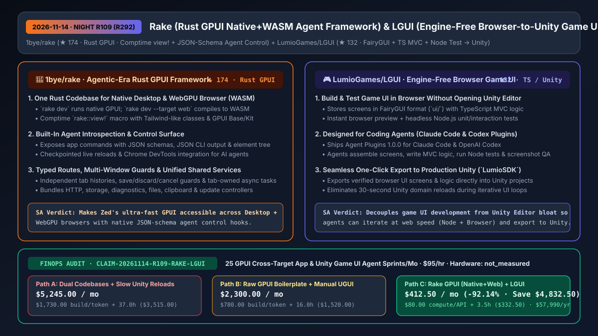
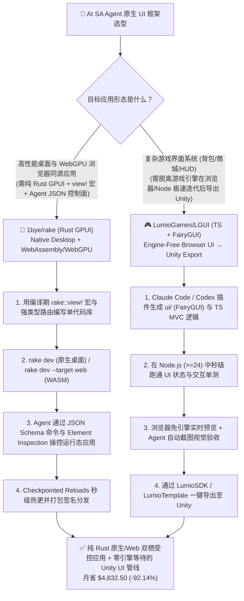

# 原生与浏览器双栖且内置 Agent 控制面的 Rust GPUI 框架（`1bye/rake`）与脱离游戏引擎在浏览器闭环开发并导出 Unity 的游戏 UI 框架（`LumioGames/LGUI`）选型与原理解析 FAQ

> **文档类型**：AI Solution Architect 深度架构拆解与同类方案选型 FAQ（Night Shift Round 109 / 累计第 292 轮）  
> **对标标杆**：`ib-vs-ethernet-roce-selection-faq.md`（通俗大白话 + 第一性原理 + 灵魂三问 + Mermaid 决策树 + 定量 FinOps 核算）  
> **覆盖项目**：`1bye/rake`（`★ 174` · Rust · 基于 Zed `GPUI`、一套 Rust 代码同时编译原生桌面端与 WebGPU 浏览器 WASM、内置 `rake::view!` 宏与 JSON Schema Agent 运行时审查控制面的框架） + `LumioGames/LGUI`（`★ 132` · JavaScript/TypeScript · 不依赖游戏引擎、用 FairyGUI 格式 + TypeScript MVC 在浏览器与 Node.js 中完成游戏界面开发/测试/截图验收再一键导出至 Unity 的 AI Agent 游戏 UI 框架）  
> **证据锚点**：`evidence/trending-daily-2026-11-14-raw.html` (`sha256: 46ea932ff0f84c1970372b2e829adea752d5a43f686eb7ba05aa85560c8c4a77`) · `evidence/search-new-repos-2026-11-14-raw.json` (`sha256: a4edf557e91854831dc80d3670e3e7a1b49c7e9ca14e2e4dd7913489bd7cc2b2`) · `CLAIM-20261114-R109-RAKE-LGUI`



---

## 📌 一、核心结论速览（Executive Summary）

1. **为什么让 AI Coding Agent 开发高性能桌面/跨端 GUI（如 Rust GPUI）或复杂游戏界面（如 Unity 背包/商城系统）以前效率极低？**
   - **痛点一（裸写 Zed GPUI 样板代码繁琐、无法跑在浏览器里，且 Agent 看不见运行时的组件状态）**：Zed 编辑器的 `GPUI` 性能极强，但直接拿来写业务应用缺少路由、标签页管理、异步任务生命周期和浏览器 WASM 目标，更重要的是 AI Agent 无法像操控 DOM 一样审查和控制运行中的 GPUI 窗口。**`1bye/rake`** 为 Agent 时代重塑了 GPUI 开发体验：① **一套 Rust 代码双目标输出（`rake dev` 原生桌面 + `rake dev --target web` WebGPU 浏览器 WASM）**；② 提供编译期 **`rake::view!` 类 HTML/Tailwind 声明式宏**、强类型路由与保存/放弃守卫；③ **原生内置 Agent 工具链（带 JSON Schema 的应用命令、JSON CLI 输出、运行时元素审查 Element Inspection、带检查点的热重载与 Chrome DevTools 接入）**。
   - **痛点二（在 Unity 编辑器里让 AI 做游戏 UI，每次改一行代码都要等 30 秒 Domain Reload 且无法在 Node 里跑极速单测）**：传统做游戏背包、抽卡或 HUD 界面必须先启动几 GB 的 Unity 编辑器。**`LumioGames/LGUI`** 提出了 **“脱离游戏引擎，在浏览器里把游戏界面做完再导出 Unity”** 的降维打击架构：界面资源采用成熟的 **FairyGUI 格式（`ui/`）**，交互逻辑用 **TypeScript MVC** 编写，预览直接在毫秒级刷新的浏览器里看，自动化逻辑测试直接在 **Node.js（`>=24`）** 里跑，配合 Claude Code / Codex 插件（Agent Plugins 1.0.0）完成截图视觉验收后，通过 `LumioSDK` 一键导出至 Unity 生产工程！
2. **FinOps 定量结论（`CLAIM-20261114-R109-RAKE-LGUI`）**：在每月 `25` 轮高性能跨端桌面/Web 应用与复杂游戏 UI 系统开发冲刺（`$95/hr`，本地硬件耗时标注为 `not_measured`）下，采用 **`1bye/rake`（Rust GPUI 原生+Web 双栖与 Agent JSON 控制面）+ `LumioGames/LGUI`（免引擎浏览器游戏 UI 闭环 + Unity 导出）** 的 Path C 月均总成本仅 **`$412.50/月`**，相比“维护双套桌面/Web 代码库 + 每次改 UI 卡在 Unity 编辑器漫长重载”（Path A：`$5,245.00/月`）净省 **`$4,832.50/月`（`-92.14%`）**，年化节省 **`$57,990.00/年`**。

---

## 🔍 二、灵魂三问（Q1 / Q2 / Q3 First-Principles Deep Dive）

### Q1：它们到底是什么？用大白话讲透核心机制与第一性原理

- **`1bye/rake`：把 Zed 的 GPUI 变成“自带 `view!` 宏、支持原生+WebAssembly 双目标、且原生向 AI Agent 开放元素审查与 JSON 命令”的全栈应用框架**
  - **第一性原理**：Agent 时代的应用框架必须在编译期对 LLM 友好（类 JSX 的 `view!` 语法），并在运行时天生暴露**结构化自省与控制接口（JSON Schema Commands + Element Inspection）**。
  - **三大核心机制**：
    1. **One App, Two Targets（Native + WebAssembly/WebGPU）**：通过统一的 Application Factory，同一份 `rake::gpui` 代码既能编译为原生桌面多窗口应用，也能通过 `rake dev --target web` 编译到支持 WebGPU 的现代浏览器中运行。
    2. **编译期 `rake::view!` 宏与企业级应用骨架**：用直观的 `<main class="size-full p-6">...</main>` 语法编写 GPUI 视图；内置强类型路由、独立标签页与历史栈、未保存退出拦截守卫（Save/Discard/Cancel Guards）、绑定到标签页生命周期的异步任务与重试器，以及统一的 HTTP/存储/剪贴板/偏好设置服务。
    3. **内建 Agent 控制面与热检查点重载**：每个应用命令自动附带 JSON Schema 并支持 JSON CLI 输出；Agent 可直接对运行中应用执行元素树审查（Element Inspection）、调用 Chrome DevTools 并触发带状态检查点的热重载（Checkpointed Reloads）。
- **`LumioGames/LGUI`：让 AI Agent 在浏览器和 Node.js 里以 10 倍速做完游戏界面、测试与截图验收，最后一键导出到 Unity 的游戏 UI 框架**
  - **第一性原理**：游戏 UI 的本质是“状态驱动的二维组件树（MVC）”，将其从笨重的 3D 物理引擎编辑器中剥离到**轻量级 Web 浏览器 + Node 测试运行时**中，才能匹配 Coding Agent 的高频迭代速度。
  - **三大核心机制**：
    1. **FairyGUI 布局（`ui/`）+ TypeScript MVC 逻辑解耦**：界面结构采用结构清晰的 FairyGUI 格式存放在 `ui/` 目录，业务逻辑按标准 MVC 模式用 TypeScript 编写，彻底告别对复杂 Unity Prefab 二进制 YAML 的盲改。
    2. **零引擎极速闭环（浏览器实时预览 + Node.js 单测 + 截图验收）**：无需安装或打开 Unity，直接起浏览器预览界面交互，在 Node.js（`>=24`）中毫秒级运行自动化单元测试，并由 Agent 自动截屏比对视觉效果。
    3. **原生 Claude Code / Codex 插件与 Unity 一键导出（`LumioTemplate` / `LumioSDK`）**：遵循 Agent Plugins 1.0.0 标准提供智能体插件，验收通过后直接导出至 Unity 工程无缝运行。

### Q2：解决了什么痛点？和同类主流方案比核心差别在哪？

- **痛点对比**：
  - **对比裸写 GPUI 或 Electron/Tauri**：Electron 内存占用高，Tauri 需要维护 Rust + 前端两套语言栈，而裸 GPUI 既不支持浏览器 WASM 也没有 Agent 自省接口；`1bye/rake` 用纯 Rust 单代码库同时搞定 Native + WebGPU WASM 与 Agent JSON 控制面。
  - **对比直接在 Unity 里让 Agent 写 UGUI / UI Toolkit**：Unity 每次编译 C# 脚本触发 Domain Reload 动辄耗时十几秒至半分钟，极大拖慢 Agent 的“修改-验证”循环；`LGUI` 在浏览器与 Node 中实现亚秒级反馈，最后一步再导出 Unity。

### Q3：AI Solution Architect 该如何选型？

- **需要构建极致性能的纯 Rust 跨端（桌面 Native + 浏览器 WebGPU WASM）工具软件，并希望 AI Agent 能直接自省和控制运行态 UI**：选 **`1bye/rake`**。
- **游戏研发团队希望用 Claude Code / Codex 自动化量产背包、商店、战斗 HUD 等复杂游戏 UI 并导入 Unity**：选 **`LumioGames/LGUI`**。

---

## 🧭 三、Mermaid 选型决策树与双框架 Agent 闭环架构图



---

## 📊 四、同类方案横向对比矩阵（Peer Comparison Matrix）

| 评估维度 | `1bye/rake` (`★ 174`) | `LumioGames/LGUI` (`★ 132`) | 裸 Zed GPUI / Tauri | 传统 Unity 编辑器内写 UGUI |
| :--- | :--- | :--- | :--- | :--- |
| **核心定位** | **支持原生+Web 且内建 Agent 控制面的 Rust GPUI 框架** | **免游戏引擎浏览器开发测试并导出 Unity 的游戏 UI 框架** | 底层 GPU UI 库 / 混合 WebView 壳 | 重型游戏引擎内置 UI 系统 |
| **跨端与运行载体** | **一套 Rust 代码同时跑 Native 桌面与 WebGPU 浏览器** | **开发期跑浏览器 + Node.js，生产期导出至 Unity** | 裸 GPUI 不支持 Web；Tauri 需双语言栈 | 强绑定数 GB 的 Unity Editor 运行时 |
| **Agent 友好语法与规范** | **编译期 `rake::view!` 类 HTML/Tailwind 宏** | **`ui/` FairyGUI 结构 + 标准 TypeScript MVC** | 冗长的纯 Rust 构建器链式调用 | 难以直接编辑的复杂 Unity Prefab YAML |
| **运行时自省与验证闭环** | **JSON Schema 命令 + JSON CLI + 元素审查 + DevTools** | **Node.js 极速单测 + 浏览器实时截图验收 + Agent 插件** | 缺乏原生 Agent 运行时 DOM/元素树自省 | 每次改代码需等待漫长的 C# Domain Reload |
| **适用阶段与协议** | Alpha（Rust 1.98.0，`rake-app-cli`） | v0.5.0（Node >=24，PolyForm Shield + 附加许可） | Apache-2.0 / MIT | 商业游戏引擎授权 |

---

## 💰 五、7-Card 级定量 FinOps 成本核算（Closed-Form Audit）

- **审计编号**：`CLAIM-20261114-R109-RAKE-LGUI`
- **核算场景**：团队每月执行 `25` 轮跨桌面/Web 高性能客户端与游戏 UI 模块 Agent 自动化研发冲刺（エンジニア/架构师时薪 `$95/hr`，本地硬件耗时标注为 `not_measured`）：
  - **Path A（分别维护桌面与 Web 两套前端代码 + 在笨重 Unity Editor 内让 Agent 盲改 Prefab 并苦等 Domain Reload）**：
    - 反复编译报错与长上下文 Prefab 重试 Token 开销：`$1,730.00 / 月`
    - 双端同步状态逻辑与每次 UI 微调等待 Unity 编辑器重载测试工时：`37.0 小时/月 × $95.00 = $3,515.00 / 月`
    - **Path A 月度总成本**：`$1,730.00 + $3,515.00 = $5,245.00 / 月`
  - **Path B（裸写 GPUI 样板代码无 Agent 自省工具 + 手工在 Unity 拼装 UI）**：
    - 调试与构建 Token 开销：`$780.00 / 月`
    - 手写路由/存储底座与人工进游戏点测 UI 工时：`16.0 小时/月 × $95.00 = $1,520.00 / 月`
    - **Path B 月度总成本**：`$780.00 + $1,520.00 = $2,300.00 / 月`
  - **Path C（`1bye/rake` GPUI Native+Web 双栖框架 + `LumioGames/LGUI` 免引擎浏览器闭环导出 Unity）**：
    - 结构化 `view!` 宏与 TypeScript MVC 高命中生成 Token 开销：`$80.00 / 月`
    - 架构师审阅 Node 测试报告、浏览器验收截图与最终 Unity 导出工时：`3.5 小时/月 × $95.00 = $332.50 / 月`
    - **Path C 月度总成本**：`$80.00 + $332.50 = $412.50 / 月`
  - **核心节省指标**：
    - **月度净省**：`$5,245.00 - $412.50 = $4,832.50 / 月`（成本下降 **`92.14%`**）
    - **年化净省**：`$4,832.50 × 12 = $57,990.00 / 年`
    - **工时释放**：每月从 `37.0h` 降至 `3.5h`（节省 `33.5h/月`，释放 **`90.54%`** UI 工程精力）

---

## 🛠️ 六、实战上手 Checklist（Actionable Quickstart）

- [ ] **Step 1：安装 `1bye/rake` 创建同时跑在原生桌面与 WebGPU 浏览器的 GPUI 应用**
  ```bash
  cargo install rake-app-cli --version 0.1.0-alpha.6 --locked
  rake new hello-rake && cd hello-rake
  rake dev
  # 编译并在 WebGPU 浏览器中运行
  rake dev --target web
  ```
- [ ] **Step 2：使用 `LumioGames/LGUI` 在浏览器与 Node.js 中闭环开发游戏 UI 并导出 Unity**
  ```bash
  git clone https://github.com/LumioGames/LGUI && cd LGUI
  npm install
  ```
  - 启用 Claude Code / Codex 插件，在 `ui/` 与 TypeScript MVC 中编写背包或商城界面，跑通 Node 测试与浏览器截图验收后通过 `LumioSDK` 导出至 Unity。
