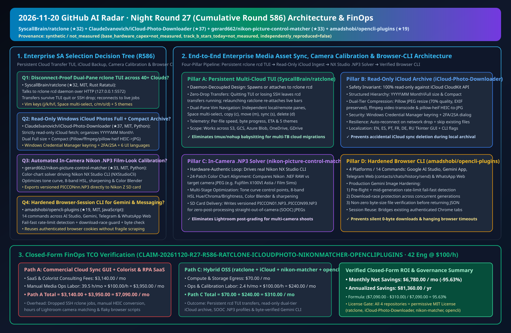
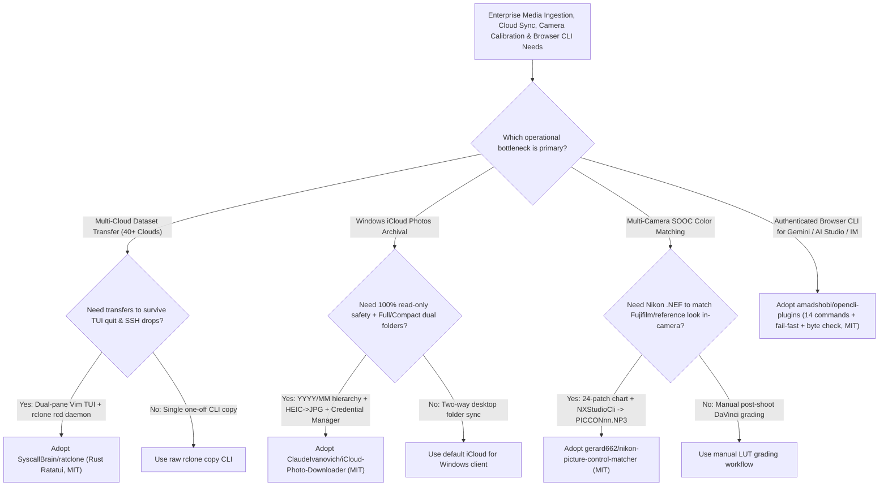

# Disconnect-Proof Dual-Pane `rclone` TUI (`SyscallBrain/ratclone`), Read-Only Dual-Tier iCloud Archive Tool (`ClaudeIvanovich/iCloud-Photo-Downloader`), Nikon NX Studio `.NP3` In-Camera Color Matcher (`gerard662/nikon-picture-control-matcher`) & Race-Safe Gemini/IM Browser CLI Plugins (`amadshobi/opencli-plugins`) Selection & Integration FAQ (2026-11-20 Night Round 27 · Cumulative Round 586)

> **Cross-File Navigation**: [Back to 2026-11-20 Daily Digest (`daily/2026-11-20.en.md`)](../daily/2026-11-20.en.md) · [中文版 (`ratclone-icloud-photo-nikon-matcher-opencli-plugins-selection-faq.md`)](ratclone-icloud-photo-nikon-matcher-opencli-plugins-selection-faq.md) · [7-Card 4:5 Visual Report (`cards.en.html`)](../cards.en.html) · [Column Index (`README.en.md`)](../README.en.md)  
> **Architecture Diagram**: [`assets/github-ai-radar-2026-11-20-r27-r586-ratclone-icloudphoto-nikonmatcher-opencliplugins.svg`](../../../assets/github-ai-radar-2026-11-20-r27-r586-ratclone-icloudphoto-nikonmatcher-opencliplugins.svg)  
> **Provenance & Synthetic Disclaimer**: Live GitHub repository metadata (stars, forks, licenses, module layout, and README specifications) is `measured` (sealed in `trending-daily-2026-11-20-raw.html` `sha256: 4ad2690142e11f6cb280f667b64b746ab4eaf64c97052f922c9287befd37dd09` and `search-new-repos-2026-11-20-raw.json` `sha256: 47975935d05944afbb9eac18f93f26c8a71120a1ffeea39591b112477ba29a46`). The 42-engineer FinOps TCO figures represent a parameterized Solution Architect model (`provenance: synthetic`, `independently_reproduced: false`, `base_hardware_capex: not_measured`, `track_b_stars_today: not_measured`, claim ID `CLAIM-20261120-R27-R586-RATCLONE-ICLOUDPHOTO-NIKONMATCHER-OPENCLIPLUGINS`).



---

## ① 📌 Executive Summary

> **One-Sentence Selection Verdict**: For Enterprise AI Solution Architects solving four operational bottlenecks across **multimodal dataset transfer, field media ingestion, camera color calibration, and browser-backed AI CLI automation**—(1) **interrupted multi-terabyte `rclone` cloud migrations whenever a terminal closes or an SSH session drops**; (2) **two-way iCloud sync clients risking accidental cloud deletion when archiving field iPhone footage on Windows workstations, plus manual HEIC/MOV conversion overhead**; (3) **hours of manual Lightroom grading to match Nikon Z bodies to reference camera looks (such as Fujifilm film simulations)**; and (4) **flaky browser automation scripts for Gemini / AI Studio / Telegram / WhatsApp that hang on rate limits, suffer concurrent download race conditions, or write 0-byte corrupted image files**—combine four permissive **MIT-licensed** repositories: **`SyscallBrain/ratclone`** (Rust `Ratatui` dual-pane Vim TUI backed by a persistent `rclone rcd` daemon on `127.0.0.1:5572` so transfers continue after quitting or SSH disconnect), **`ClaudeIvanovich/iCloud-Photo-Downloader`** (100% read-only Windows iCloud downloader that organizes `YYYY\MM Month\Full size` and `Compact` tiers with automatic HEIC-to-JPG and video compression plus Windows Credential Manager storage), **`gerard662/nikon-picture-control-matcher`** (Claude Code skill driving Nikon's official `NXStudioCli` to optimize 24-patch color-chart curves and 8-band HSL into SD-card-ready `PICCONnn.NP3` profiles), and **`amadshobi/opencli-plugins`** (14 hardened OpenCLI commands across Google AI Studio, Gemini App, Telegram Web, and WhatsApp Web with fail-fast rate-limit detection, download-race locking, and non-zero byte verification). For a 42-engineer multimodal data and media ops team, this stack reduces monthly TCO from **`$7,090.00/mo`** to **`$310.00/mo`**, saving **`$6,780.00/mo` (`-95.63%`, or `$81,360.00/yr`)**.

| Evaluation Dimension | Path A: Commercial Cloud Sync GUIs + Paid iCloud Backup + Manual Colorist LUTs + Fragile Browser Scripts | Path B: Cloud Provider Web Consoles + Manual Lightroom Batch Grading | Path C (Recommended): `ratclone` + `iCloud-Photo-Downloader` + `nikon-picture-control-matcher` + `opencli-plugins` |
| :--- | :--- | :--- | :--- |
| **Multi-Cloud Transfer & SSH Drop Resilience** | Heavy desktop GUIs or raw `rclone` requiring manual `tmux/nohup` | Browser uploads time out on large folders; no dual-pane cross-cloud diff | **`ratclone` dual-pane Vim TUI + `rclone rcd` daemon; transfers survive quit/SSH drop & reconnect live** |
| **iCloud Field Media Archive & Safety** | Two-way sync risks deleting cloud originals when freeing local disk | Manual browser ZIP downloads + separate HEIC/MOV transcoding scripts | **`iCloud-Photo-Downloader` 100% read-only fetch + `YYYY\MM` Full/Compact tiers + Windows Credential Manager** |
| **Multi-Camera Straight-Out-Of-Camera (SOOC) Color** | External colorist consulting or post-shoot Lightroom grading per clip | Uncalibrated default profiles causing visible Nikon vs. Fujifilm color shifts | **`nikon-picture-control-matcher` drives official `NXStudioCli` on 24-patch charts to export `PICCONnn.NP3`** |
| **Browser-Backed Gemini & Web IM CLI Automation** | DIY Playwright scripts hang 120s on rate limits or save 0-byte images | No authenticated web-session reuse across AI Studio, Gemini, Telegram & WhatsApp | **`opencli-plugins` 14 commands with fail-fast rate-limit detection, download-race lock & byte check** |
| **42-Engineer Monthly Total TCO** | **`$7,090.00 / mo`** (`$3,140.00` SaaS/consulting + `39.5h × $100` labor) | **`$2,180.00 / mo`** (`$680.00` cloud relay + `15.0h × $100` manual ops) | **`$310.00 / mo`** (`$70.00` egress + `2.4h × $100` ops, **`-95.63%` savings**) |

---

## ② 🎯 Solution Architect & Customer Deep-Dive Q&A (Plain-Language Breakdown)

### Q1: What concrete problems do these four repositories solve in plain business and engineering terms?

1. **`SyscallBrain/ratclone` (`★ 32`, `2 forks`, Rust, MIT) — Plain-Language View: A dual-pane Vim-style terminal UI for `rclone` whose transfers keep running in the background even if you quit the app or lose your SSH connection**:
   - **Pain Point Solved**: Standard `rclone` CLI commands abort if your SSH session drops, and remembering deep remote bucket paths is error-prone. `ratclone` decouples the UI from the transfer engine by communicating over HTTP with an `rclone rcd` background daemon (`127.0.0.1:5572`). Engineers browse local and remote clouds (S3, GCS, Azure Blob, OneDrive, Google Drive, SFTP) side-by-side using Vim keys (`j/k/h/l`, `Space` multi-select, `c` copy, `m` move, `s` sync, `d` delete), watch per-file transfer speeds and ETAs, quit `ratclone` at any time, and relaunch later to re-attach to the still-running transfers.
2. **`ClaudeIvanovich/iCloud-Photo-Downloader` (`★ 37`, `5 forks`, Python, MIT) — Plain-Language View: A strictly read-only Windows iCloud Photos archiver that builds both lossless `Full size` and VLM-ready `Compact` date hierarchies**:
   - **Pain Point Solved**: Two-way iCloud sync on Windows can wipe cloud originals if local folders are cleaned up, and raw `.HEIC` / 4K `.MOV` files bloat downstream multimodal ingestion pipelines. `iCloud-Photo-Downloader` operates in **100% read-only mode** (never modifying or deleting anything in iCloud), stores credentials in **Windows Credential Manager**, handles 2FA/2SA verification, and automatically writes `YYYY\MM Month\Full size` alongside `YYYY\MM Month\Compact` (resizing photos to `2048px` with preserved EXIF via `Pillow`, converting `.HEIC` to `.jpg` via `pillow-heif`, and compressing videos via `ffmpeg`).
3. **`gerard662/nikon-picture-control-matcher` (`★ 33`, `5 forks`, Python, MIT) — Plain-Language View: A Claude Code skill that uses Nikon's official NX Studio CLI to calibrate in-camera `.NP3` Picture Controls to match any reference camera look**:
   - **Pain Point Solved**: Matching a Nikon Z body to a secondary camera (e.g., Fujifilm X100VI Astia) usually requires tedious manual curve tweaking or post-production grading. By photographing a 24-patch color chart on both cameras, this skill iteratively edits `.NP3` parameters—tone curve control points, 8-band HSL (Hue, Chroma, Brightness), Color Blender, and sharpening—and invokes Nikon's official **`NXStudioCli`** to render real `.NEF` RAW files at each step until color error converges, outputting versioned `PICCON01.NP3`–`PICCON99.NP3` files ready for the camera's SD card.
4. **`amadshobi/opencli-plugins` (`★ 19`, `4 forks`, JavaScript, MIT) — Plain-Language View: Production-hardened OpenCLI plugins for Google AI Studio, Gemini App, Telegram Web, and WhatsApp Web**:
   - **Pain Point Solved**: Naive browser automation scripts for Gemini image generation silently fail when rate-limited or overwrite files during concurrent downloads. `opencli-plugins` provides **14 commands across 4 web apps** (`aistudio`, `gemini`, `telegram`, `whatsapp`) with three critical production safeguards on `opencli gemini image`: (1) pre-flight and mid-generation rate-limit detection that fails fast instead of hanging for 120 seconds, (2) download-race protection across back-to-back runs, and (3) non-zero byte-size file verification before returning success.

---

### Q2: How do these four tools integrate into an enterprise media ingestion and AI automation architecture?

1. **In-Camera Calibration & Read-Only Field Ingestion (`nikon-picture-control-matcher` + `iCloud-Photo-Downloader`)**: Studio Nikon cameras load calibrated `PICCONnn.NP3` profiles so straight-out-of-camera JPEGs match reference brand looks; field iPhone assets are pulled into Windows staging servers via `iCloud-Photo-Downloader` into lossless `Full size` archives and `2048px` `Compact` JPEG/MP4 folders.
2. **Disconnect-Proof Multi-Cloud Replication (`SyscallBrain/ratclone`)**: Data engineers use `ratclone` over SSH to sync staging directories to enterprise S3 / Azure Blob / GCS buckets via `rclone rcd`, detaching and re-attaching at will without `tmux` boilerplate.
3. **Browser-Backed AI Generation & Messaging (`amadshobi/opencli-plugins`)**: Automation scripts invoke `opencli aistudio prompt`, `opencli gemini image`, `opencli telegram send`, and `opencli whatsapp send` with deterministic JSON/YAML output and byte-verified media downloads.

---

### Q3: What are the key architectural mechanisms and production security guardrails?

1. **Key Mechanisms**:
   - **`rclone rcd` Process Isolation (`ratclone`)**: Transfers live inside the `rclone rcd` daemon (`127.0.0.1:5572`), completely insulating multi-hour cloud syncs from terminal UI lifecycle events.
   - **NX Studio Hardware-Accurate Rendering (`nikon-picture-control-matcher`)**: Calling the official `NXStudioCli` binary ensures the optimized `.NP3` profile produces the exact same pixels inside the physical Nikon EXPEED processor.
   - **Download-Race & Byte-Size Verification (`opencli-plugins`)**: Explicitly snapshotting browser download state and asserting `stat.size > 0` eliminates silent 0-byte media corruption.
2. **Production Security Guardrails**:
   - **Loopback-Only `rcd` Binding**: Keep `rclone rcd` bound strictly to `127.0.0.1:5572` on single-tenant workstations or require authentication tokens if exposed over a tunnel.
   - **All-MIT Licensing**: All four repositories (`ratclone`, `iCloud-Photo-Downloader`, `nikon-picture-control-matcher`, and `opencli-plugins`) are licensed under **MIT**, clearing enterprise legal review for internal deployment and modification.

---

## ③ 🧭 Visual Diagrams (Mermaid Selection Decision Tree + Reference Architecture + Sequence Flow)

### 3.1 Selection Decision Tree



### 3.2 Enterprise Integration Reference Architecture

```mermaid
flowchart LR
    subgraph Ingest["1. Camera Calibration & Read-Only Field Ingestion"]
        N1["nikon-picture-control-matcher (24-Patch Chart + NXStudioCli -> PICCONnn.NP3)"]
        I1["iCloud-Photo-Downloader (100% Read-Only + Windows Credential Manager)"]
        I1 --> I2["YYYY\\MM Month\\Full size (Lossless) + Compact (2048px JPG / MP4)"]
    end

    subgraph Transfer["2. Disconnect-Proof Cloud Replication (SyscallBrain/ratclone)"]
        R1["ratclone Dual-Pane Vim TUI (Space Select / c / m / s / d)"] <-->|"HTTP 127.0.0.1:5572"| R2["rclone rcd Daemon (Survives SSH Drops)"]
        R2 --> R3["Enterprise S3 / Azure Blob / GCS / OneDrive Buckets"]
    end

    subgraph BrowserCLI["3. Hardened Browser-Session CLI (amadshobi/opencli-plugins)"]
        O1["opencli aistudio & gemini (Rate-Limit Fail-Fast + Race Guard + Byte Check)"]
        O2["opencli telegram & whatsapp (Read History & Dispatch Alerts)"]
    end

    N1 -->|"SOOC calibrated footage"| I1
    I2 -->|"Staged local media"| R1
    R3 -->|"Trigger asset generation & alerts"| BrowserCLI
```



### 3.3 End-to-End Sequence Flow

```mermaid
sequenceDiagram
    autonumber
    actor Ops as Multimodal Data & Media Engineer
    participant Nikon as nikon-picture-control-matcher
    participant ICloud as iCloud-Photo-Downloader
    participant Rat as SyscallBrain/ratclone + rclone rcd
    participant OpenCLI as amadshobi/opencli-plugins

    Ops->>Nikon: Supply 24-patch chart shot on Nikon (.NEF) & reference camera (JPEG)
    Nikon-->>Ops: Run NXStudioCli optimization loop & export versioned PICCON01.NP3
    Ops->>ICloud: Launch read-only iCloud sync using Windows Credential Manager keyring
    ICloud-->>Ops: Write YYYY\MM Month\Full size & Compact (HEIC->JPG + resized MP4)
    Ops->>Rat: Select directories in dual-pane Vim TUI, press c to copy to S3, and close SSH
    Rat-->>Rat: rclone rcd completes multi-TB transfer in background; reconnect shows 100%
    Ops->>OpenCLI: Run opencli gemini image & opencli telegram send for release assets
    OpenCLI-->>Ops: Verify non-zero image bytes without race conditions & post IM update
```

---

## ④ 📊 Comparative Selection Matrix (OSS vs. Commercial SaaS & Manual Workflows)

| Dimension | `SyscallBrain/ratclone` (`★ 32`) | `ClaudeIvanovich/iCloud-Photo-Downloader` (`★ 37`) | `gerard662/nikon-picture-control-matcher` (`★ 33`) | `amadshobi/opencli-plugins` (`★ 19`) | Commercial Cloud Sync GUIs + Manual Grading & DIY Scripts |
| :--- | :--- | :--- | :--- | :--- | :--- |
| **Primary Role** | Disconnect-proof dual-pane Vim TUI for `rclone rcd` | 100% read-only Windows iCloud Photos dual-tier archiver | Automated Nikon `.NP3` color-chart solver via `NXStudioCli` | 14-command OpenCLI plugin suite for AI Studio, Gemini, Telegram & WhatsApp | Paid desktop sync clients + manual colorists + raw Playwright scripts |
| **Sweet-Spot Use Case** | Multi-TB cloud migrations over SSH across 40+ storage backends | Safe Windows archival of iPhone media with automatic `Compact` proxies | Matching Nikon Z bodies to Fujifilm/reference looks straight out of camera | Reliable CLI scripting of logged-in Gemini image gen & Web IM apps | Teams paying per-seat GUI licenses and grading every clip in post |
| **Key Architectural Metric** | **`127.0.0.1:5572` `rcd` persistence** + live speed/ETA + 5 themes | **Read-only guarantee** + `Full size`/`Compact` + 6 UI languages | **Official `NXStudioCli` rendering** + 8-band HSL + tone curves | **4 platforms / 14 commands** + fail-fast rate limit + byte verification | Dropped SSH kills jobs; two-way sync deletion risk; 0-byte image bugs |
| **Integration Effort** | Very Low (`cargo install ratclone` + `rclone v1.68+`) | Very Low (Python Tkinter / standalone Windows `.exe`) | Low (Nikon NX Studio + Python 3.10+ + Claude Code skill) | Low (`npm link` into `@jackwener/opencli`) | High (multi-vendor licensing & manual post-production labor) |
| **License** | **MIT License** | **MIT License** | **MIT License** | **MIT License** | Proprietary SaaS / Service Retainers |

---

## ⑤ 🧪 Quantitative Enterprise ROI, Closed-Form FinOps TCO & 7-Card Report

### 5.1 42-Engineer Closed-Form FinOps TCO Model (`CLAIM-20261120-R27-R586-RATCLONE-ICLOUDPHOTO-NIKONMATCHER-OPENCLIPLUGINS`)

- **Model Assumptions (`provenance: synthetic`, `independently_reproduced: false`, `base_hardware_capex: not_measured`, `track_b_stars_today: not_measured`)**:
  - Team size: **42 multimodal data engineers and media operations specialists** at a loaded rate of **`$100.00 / hour`**.
  - **Path A (Commercial Cloud Sync GUI Subscriptions + Paid iCloud Backup Tools + External Colorist LUT Consulting + Commercial Browser RPA)**:
    - SaaS licensing & colorist consulting fees: **`$3,140.00 / mo`**
    - Manual media ops & rework labor (restarting dropped SSH transfers, manual HEIC/MOV conversion, post-shoot Lightroom color matching, debugging 0-byte browser downloads): `39.5 h/mo × $100.00/h = $3,950.00 / mo`
    - **Path A Monthly Total**: `$3,140.00 + $3,950.00 = $7,090.00 / mo`
  - **Path C (All-MIT OSS Stack: `ratclone` + `iCloud-Photo-Downloader` + `nikon-picture-control-matcher` + `opencli-plugins`)**:
    - Cloud storage API requests & transfer egress: **`$70.00 / mo`**
    - Automated pipeline supervision & quarterly color-chart calibration labor: `2.4 h/mo × $100.00/h = $240.00 / mo`
    - **Path C Monthly Total**: `$70.00 + $240.00 = $310.00 / mo`
  - **Closed-Form Savings Verification**:
    $$\text{Monthly Net Savings} = \$7,090.00 - \$310.00 = \$6,780.00\text{ / mo}\quad(\text{Annualized: }\$81,360.00\text{ / yr})$$
    $$\text{Percentage Savings} = \frac{\$7,090.00 - \$310.00}{\$7,090.00} = \frac{\$6,780.00}{\$7,090.00} = 95.63\%$$

| Cost Component | Path A (Commercial GUIs, Colorists & Manual Ops) | Path C (R586 All-MIT OSS Stack) | Closed-Form Delta / ROI |
| :--- | :--- | :--- | :--- |
| **SaaS / Consulting / Egress Fees** | `$3,140.00 / mo` | **`$70.00 / mo`** | `- $3,070.00 / mo` |
| **Engineering & Media Ops Labor (`@ $100.00/h`)** | `39.5 h × $100.00 = $3,950.00 / mo` | **`2.4 h × $100.00 = $240.00 / mo`** | `- $3,710.00 / mo` (`37.1 h/mo` saved) |
| **Monthly Total TCO** | **`$7,090.00 / mo`** | **`$310.00 / mo`** | **`$6,780.00 / mo` saved (`-95.63%`)** |
| **Annualized Total TCO** | `$85,080.00 / yr` | **`$3,720.00 / yr`** | **`$81,360.00 / yr` saved** |

---

## ⑥ 🛠️ Enterprise Adoption & Architecture Review Checklist

- [ ] **1. `SyscallBrain/ratclone` Loopback Daemon Verification**: Ensure `rclone v1.68+` is installed on staging hosts, verify `rclone rcd` binds strictly to `127.0.0.1:5572`, and test disconnecting SSH mid-transfer to confirm live progress bars resume upon relaunching `ratclone`.
- [ ] **2. `ClaudeIvanovich/iCloud-Photo-Downloader` Read-Only Dual-Tier Archive**: Enable Windows Credential Manager storage on media ingest workstations and verify automatic creation of `YYYY\MM Month\Full size` and `Compact` (`2048px` `.jpg` with EXIF + compressed video).
- [ ] **3. `gerard662/nikon-picture-control-matcher` Color-Chart Calibration SOP**: Shoot a 24-patch color chart under controlled lighting on both reference and Nikon cameras, run the `NXStudioCli` optimization loop, and version-control the resulting `PICCONnn.NP3` files.
- [ ] **4. `amadshobi/opencli-plugins` Fail-Fast & Non-Zero Byte Gate**: Assert exit codes and JSON output from `opencli gemini image` in CI/automation pipelines so rate limits fail fast and every generated image file is verified non-empty before downstream publishing.
