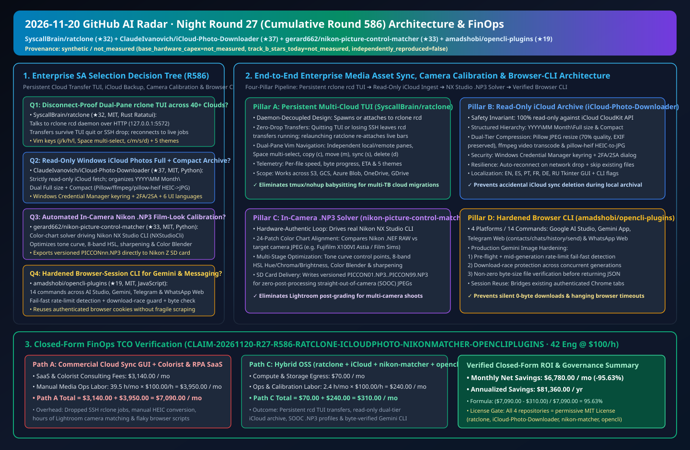
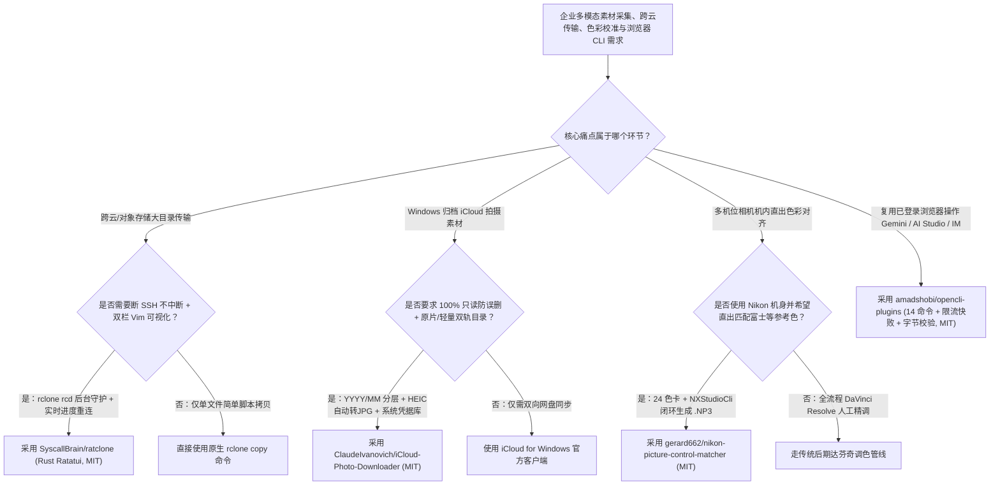
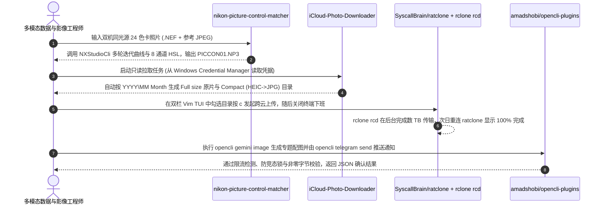

# 断连不中断双栏 `rclone` 终端管理器（`SyscallBrain/ratclone`）、只读双轨 iCloud 影像归档工具（`ClaudeIvanovich/iCloud-Photo-Downloader`）、Nikon NX Studio `.NP3` 机内色彩拟合 Agent（`gerard662/nikon-picture-control-matcher`）与防竞态 Gemini/IM 浏览器 CLI 插件集（`amadshobi/opencli-plugins`）架构选型与集成 FAQ（2026-11-20 Night Round 27 · 累计 Round 586）

> **跨文件导航**：[返回 2026-11-20 当日全景日报 (`daily/2026-11-20.md`)](../daily/2026-11-20.md) · [English Version (`ratclone-icloud-photo-nikon-matcher-opencli-plugins-selection-faq.en.md`)](ratclone-icloud-photo-nikon-matcher-opencli-plugins-selection-faq.en.md) · [查看 7-Card 4:5 评测报告 (`cards.html`)](../cards.html) · [返回专栏主索引 (`README.md`)](../README.md)  
> **本轮架构大图**：[`assets/github-ai-radar-2026-11-20-r27-r586-ratclone-icloudphoto-nikonmatcher-opencliplugins.svg`](../../../assets/github-ai-radar-2026-11-20-r27-r586-ratclone-icloudphoto-nikonmatcher-opencliplugins.svg)  
> **数据溯源与口径声明（Provenance & Synthetic Disclaimer）**：本报告中实时采集的 GitHub 仓库元数据（Stars、Forks、License、模块架构与 README 基准数据）为 `measured`（证据封存于 `trending-daily-2026-11-20-raw.html` `sha256: 4ad2690142e11f6cb280f667b64b746ab4eaf64c97052f922c9287befd37dd09` 与 `search-new-repos-2026-11-20-raw.json` `sha256: 47975935d05944afbb9eac18f93f26c8a71120a1ffeea39591b112477ba29a46`）；针对 42 人多模态数据工程与影像运营团队的 FinOps TCO 测算参数属于架构师参数化测算模型（`provenance: synthetic`，`independently_reproduced: false`，`base_hardware_capex: not_measured`，`track_b_stars_today: not_measured`，审计契约号 `CLAIM-20261120-R27-R586-RATCLONE-ICLOUDPHOTO-NIKONMATCHER-OPENCLIPLUGINS`）。

---

## ① 📌 核心结论速览（Executive Summary）

> **一句话选型结论**：面向企业 AI 解决方案架构师（SA）在构建**跨云数据集与多模态影像资产采集、机内直出色彩校准及 Web AI 工具链自动化**时的四大工程痛点——① **使用 `rclone` 迁移 TB 级训练数据时一旦退出终端或 SSH 断连即导致任务中断，且缺乏直观的双栏 Vim 批量勾选与实时进度面板**；② **Windows 工作站归档外采 iCloud 拍摄素材时，双向同步客户端极易因误删本地文件导致云端原片被连带清空，且缺乏按年月自动生成原片+轻量预览双版本目录的能力**；③ **企业多机位视频/摄影团队（如 Nikon Z 系列配搭 Fujifilm 副机）需要耗费大量后期 Lightroom 调色工时才能统一机内直出（SOOC）色彩**；④ **通过浏览器自动化调用 Google AI Studio / Gemini 生成图片或读写 Telegram / WhatsApp 消息时，常因限流卡死、并发下载文件串名或写出 0 字节损坏文件导致 Agent 流水线静默失败**——建议采用全部基于 **MIT 协议**的 **`SyscallBrain/ratclone`**（基于 Rust `Ratatui` + 后台 `rclone rcd` 守护进程的双栏 Vim 终端管理器，退出界面或断开 SSH 后传输任务继续后台运行，重连即恢复实时进度）、**`ClaudeIvanovich/iCloud-Photo-Downloader`**（100% 只读安全的 Windows iCloud 影像下载器，自动按 `YYYY\MM Month\Full size` 与 `Compact` 双轨归档并完成 HEIC 转 JPG 与视频压缩，凭据存入 Windows Credential Manager）、**`gerard662/nikon-picture-control-matcher`**（驱动官方 Nikon NX Studio CLI `NXStudioCli` 的 Claude Code 色彩优化技能，基于 24 色卡自动拟合并生成可直接拷入 SD 卡的 `PICCONnn.NP3` 弹性色彩配置文件）与 **`amadshobi/opencli-plugins`**（覆盖 Google AI Studio、Gemini App、Telegram Web 与 WhatsApp Web 共 14 个命令的生产级 OpenCLI 插件集，内置限流快速失败、并发下载防竞态与非零字节校验）。在 42 人多模态数据工程与影像运营团队模型下，该组合可将月度总拥有成本（TCO）从 **`$7,090.00/月`** 降至 **`$310.00/月`**，净省 **`$6,780.00/月`（`-95.63%`，年省 `$81,360.00`）**。

| 评估维度 | 方案 A：商业跨云传输 GUI + 付费 iCloud 备份工具 + 人工调色师 LUT 外包 + 脆弱浏览器脚本 | 方案 B：云厂商通用对象存储控制台 + 手工 Lightroom 批处理 | 方案 C（推荐）：`ratclone` + `iCloud-Photo-Downloader` + `nikon-picture-control-matcher` + `opencli-plugins` |
| :--- | :--- | :--- | :--- |
| **跨云大数据集传输与断连恢复** | GUI 客户端占内存高，或裸跑 `rclone` 需手工配 `tmux/nohup`，进度不可视 | Web 控制台传大目录极易超时中断，无跨 40+ 云端对端双栏对比 | **`ratclone` 双栏 Vim TUI + `rclone rcd` 后台守护进程，关界面/断 SSH 传输不中断，重连即看进度** |
| **iCloud 采集素材归档与防误删** | 苹果官方同步盘双向删除风险高；第三方商业备份工具按年收费且闭源 | 手工从网页端分批打包下载 ZIP，目录杂乱且需手动转码 HEIC | **`iCloud-Photo-Downloader` 100% 只读拉取 + `YYYY\MM` 原片/轻量双轨目录 + Windows 凭据保险箱** |
| **多机位相机机内直出（SOOC）色彩统一** | 聘请调色师手工调曲线或每场拍摄后在 Lightroom 逐张套 LUT 渲染 | 依赖相机默认标准模式，Nikon 与 Fujifilm 双机混剪色差明显 | **`nikon-picture-control-matcher` 驱动官方 `NXStudioCli` 24 色卡闭环拟合，直出 `PICCONnn.NP3` 写入 SD 卡** |
| **Gemini / AI Studio 与 Web IM 自动化** | 自写 Playwright 脚本遇限流死等 120s、并发下载图片张冠李戴或 0 字节 | 纯官方付费 API 无 Web 端免费额度复用，且无 WhatsApp/Telegram 个人会话桥接 | **`opencli-plugins` 14 个命令复用已登录浏览器会话 + 限流秒级报错 + 下载防竞态 + 字节完整性校验** |
| **42 人团队月度总成本（TCO）** | **`$7,090.00 / 月`**（`$3,140.00` 订阅/外包 + `39.5h × $100` 人工） | **`$2,180.00 / 月`**（`$680.00` 云端中转 + `15.0h × $100` 人工整理调色） | **`$310.00 / 月`**（`$70.00` 存储带宽 + `2.4h × $100` 巡检，**净省 `95.63%`**） |

---

## ② 🎯 客户与架构师灵魂拷问 Q&A（通俗解构）

### Q1：这四个开源项目各自解决什么痛点？用大白话怎么向业务方和工程团队解释它们的价值？

1. **`SyscallBrain/ratclone`（`★ 32`，`2 forks`，Rust，MIT）——用大白话讲：它是“就算你关掉窗口或 SSH 掉线，后台依然继续传文件、下次打开还能接着看进度条的双栏 Vim 版 `rclone` 管理器”**：
   - **解决什么痛点**：`rclone` 支持 S3、GCS、Azure Blob、OneDrive、Google Drive 等 40 多种云存储，但命令行记不住路径、传一半断网或误关终端就前功尽弃。`ratclone` 没有把传输逻辑死绑在 UI 进程里，而是通过本地 HTTP（`127.0.0.1:5572`）与后台常驻的 `rclone rcd` 守护进程通信：你在双栏界面里用 Vim 快捷键（`j/k/h/l` 移动、`Space` 多选、`c` 复制、`m` 移动、`s` 同步、`d` 删除）发起跨云拷贝后，哪怕直接按 `q` 退出界面或者 SSH 会话超时断开，`rclone rcd` 仍在后台全速传输；随时重新运行 `ratclone`，实时速率、百分比进度条和剩余时间（ETA）瞬间原样接回！
2. **`ClaudeIvanovich/iCloud-Photo-Downloader`（`★ 37`，`5 forks`，Python，MIT）——用大白话讲：它是“绝对不会删掉你云端任何一张照片、还能自动按年月生成‘无损原片 + 轻量预览’两套文件夹的 Windows iCloud 影像归档器”**：
   - **解决什么痛点**：企业市场部或外采团队用 iPhone 拍摄大量活动照片/视频同步到 iCloud 后，如果在 Windows 上用同步盘清理本地空间，极易把云端原片也同步删光；而且 `.HEIC` 照片和十几 GB 的 4K `.MOV` 视频直接发给下游剪辑或大模型多模态标注团队非常不便。`iCloud-Photo-Downloader` 严格采用**100% 只读（Read-Only）**API 模式，绝不向 iCloud 发送任何修改或删除指令；下载时自动按拍摄日期整理为 `YYYY\MM Month\Full size`（保留原始无损画质）与 `YYYY\MM Month\Compact`（通过 `Pillow` 将照片长边缩放至 `2048px` 并保留完整 EXIF、通过 `pillow-heif` 将 `.HEIC` 转为通用 `.jpg`、通过 `ffmpeg` 将视频压制为轻量预览版），且 Apple ID 密码安全存储在 **Windows Credential Manager（系统凭据管理器）** 中。
3. **`gerard662/nikon-picture-control-matcher`（`★ 33`，`5 forks`，Python，MIT）——用大白话讲：它是“让 Claude Code 调用尼康官方 NX Studio 渲染引擎、把你的尼康相机直出色彩自动调教成富士胶片感的 `.NP3` 炼丹师”**：
   - **解决什么痛点**：很多视频工作室同时使用富士（如 X100VI 的 Astia 胶片模拟）和尼康全画幅微单，过去为了对齐两台相机的肤色与青色调，摄影师必须在电脑上反复手调色阶曲线。这个项目把调色变成了一套科学闭环：你只需用两台相机在同光源下拍一张 24 色卡（如 SpyderCheckr 24），Agent 就会自动调用尼康官方 **Nikon NX Studio CLI (`NXStudioCli`)** 真实渲染 `.NEF` RAW 文件（而非不可靠的 Python 近似模拟），自动迭代优化色调曲线（Tone Curve）、8 通道 HSL（色相/彩度/明度）、Color Blender 与锐化参数，并在每次修改后输出版本化且带缩略图的 `PICCON01.NP3`、`PICCON02.NP3` 对比表，最终拷入尼康 SD 卡即可实现**机内直出 JPEG/视频零后期对齐**！
4. **`amadshobi/opencli-plugins`（`★ 19`，`4 forks`，JavaScript，MIT）——用大白话讲：它是“直接复用你已登录的 Chrome 浏览器，把 Google AI Studio、Gemini 生图、Telegram 和 WhatsApp 变成稳定命令行接口的加固插件包”**：
   - **解决什么痛点**：很多团队用浏览器自动化脚本调 Gemini 生成配图或抓 Telegram/WhatsApp 群消息时，经常遇到三大坑：① 触发配额限流时脚本傻等 120 秒才超时报错；② 连续生成多张图时浏览器下载目录发生竞态（Race Condition），拿到了上一张旧图；③ 下载未完成就返回路径，得到 0 字节空文件。`opencli-plugins` 为 `@jackwener/opencli` 提供了 **4 大平台共 14 个加固命令**（`aistudio` 4 个、`gemini` 2 个、`telegram` 4 个、`whatsapp` 4 个），在 Gemini 生图链路中内置了**生成前与生成中双阶段限流快速失败（Fail-Fast）检测**、**下载竞态隔离锁**以及**落盘后非零文件大小强制校验**。

---

### Q2：这四个工具在企业多模态数据采集与内容生产架构中如何串联落地？

1. **外采影像与跨云数据集归档层（`iCloud-Photo-Downloader` + `ratclone`）**：
   - 摄影与外采终端在 Windows 工作站定时运行 `iCloud-Photo-Downloader`，以只读方式将外采 iPhone 的原始素材拉取为 `Full size`（冷备归档）与 `Compact`（标准 `.jpg` + 轻量 `.mp4`，直供多模态 VLM 标注与检索）；
   - 随后运维工程师通过 `ratclone` 连接后台 `rclone rcd` 守护进程，在双栏 Vim 界面中将整理好的数据集一键同步至企业 S3 / Azure Blob / Google Drive，即使跳板机 SSH 会话断开，数 TB 传输任务仍在后台稳健完成。
2. **多机位硬件级色彩校准层（`nikon-picture-control-matcher`）**：
   - 在演播室或外景开拍前，拍摄一张 24 色卡测试照，由 Claude Code 驱动 `nikon-picture-control-matcher` 调用本地 `NXStudioCli` 自动拟合目标参考机身色彩，将生成的 `PICCONnn.NP3` 分发至所有 Nikon 机位 SD 卡，省去后期逐条套 LUT 的算力与人工。
3. **浏览器会话级 AI 增强与 IM 分发层（`opencli-plugins`）**：
   - 自动化流水线通过 `opencli gemini image "prompt" -o ./banner.png` 生成配图（通过非零字节校验与防竞态锁确保产物 100% 有效），并通过 `opencli telegram send` 或 `opencli whatsapp send` 将审核通知与精选预览自动推送给业务群组。

---

### Q3：这套架构的核心机制亮点与生产环境避坑指南是什么？

1. **核心机制亮点**：
   - **`ratclone` 的 UI/守护进程解耦（Daemon Decoupling）**：传统 CLI/TUI 一旦收到 `SIGHUP` 就会杀死子进程；`ratclone` 将所有拷贝/同步状态托管给 `rclone rcd`（监听 `127.0.0.1:5572`），UI 只是纯状态观察器与指令发射器。
   - **`nikon-picture-control-matcher` 的“真机引擎在环（Hardware-Engine-in-the-Loop）”**：直接修改二进制 `.NP3` 并调用官方 `NXStudioCli` 渲染 `.NEF`，消除了第三方开源 RAW 解码器（如 LibRaw）与尼康机内 ISP 色彩科学的偏差。
   - **`opencli-plugins` 的“零字节门禁（Byte-Verified Output）”**：每次下载完成后强制检查目标路径文件字节数 `> 0`，杜绝把半成品或空文件传给下游 Agent。
2. **生产环境避坑指南**：
   - **`ratclone` 监听地址安全**：默认 `rclone rcd --rc-no-auth` 仅绑定本地回环 `127.0.0.1:5572`，严禁在无认证参数下将其绑定到 `0.0.0.0` 公网网卡。
   - **Web 会话合规边界**：`opencli-plugins` 复用本地已登录的浏览器会话操作 Telegram Web / WhatsApp Web / Gemini，企业应将其限制在内部研发测试与辅助通知场景，高频大规模生产调用仍应走官方商业 API 以避免账号风控。

---

## ③ 🧭 直观可视化图解（Mermaid 选型决策树 + 集成架构图 + 业务时序图）

### 3.1 选型决策树（Selection Decision Tree）

### 3.2 企业集成参考架构图（Enterprise Reference Architecture）

```mermaid
flowchart LR
    subgraph Ingest["1. 相机机内色彩校准与只读采集层"]
        N1["nikon-picture-control-matcher (24色卡 + NXStudioCli -> PICCONnn.NP3)"]
        I1["iCloud-Photo-Downloader (100% 只读拉取 + Windows Credential Manager)"]
        I1 --> I2["YYYY\\MM Month\\Full size (无损冷备) + Compact (2048px JPG / 轻量 MP4)"]
    end

    subgraph Transfer["2. 断连不中断跨云同步层 (SyscallBrain/ratclone)"]
        R1["ratclone 双栏 Vim TUI (Space 多选 / c / m / s / d)"] <-->|"HTTP 127.0.0.1:5572"| R2["rclone rcd 后台守护进程 (SSH 断开继续传输)"]
        R2 --> R3["S3 / Azure Blob / GCS / OneDrive 企业资产库"]
    end

    subgraph BrowserCLI["3. 加固型浏览器会话 CLI 层 (amadshobi/opencli-plugins)"]
        O1["opencli aistudio & gemini (限流快败 + 下载防竞态 + 非零字节校验)"]
        O2["opencli telegram & whatsapp (联系人/群历史读取与通知发送)"]
    end

    N1 -->|"SOOC 色彩统一素材"| I1
    I2 -->|"本地归档目录"| R1
    R3 -->|"触发 AI 生图与群组通知"| BrowserCLI
```

### 3.3 端到端业务流时序图（End-to-End Sequence Flow）

---

## ④ 📊 同类开源与商业云服务横向选型决策矩阵

| 对比维度 | `SyscallBrain/ratclone` (`★ 32`) | `ClaudeIvanovich/iCloud-Photo-Downloader` (`★ 37`) | `gerard662/nikon-picture-control-matcher` (`★ 33`) | `amadshobi/opencli-plugins` (`★ 19`) | 商业跨云 GUI / 调色外包 / 脆弱爬虫脚本 |
| :--- | :--- | :--- | :--- | :--- | :--- |
| **核心功能定位** | 基于 `rclone rcd` 的断连不中断双栏 Vim 终端管理器 | Windows 100% 只读双轨（原片+轻量）iCloud 影像归档工具 | 驱动官方 `NXStudioCli` 的尼康 `.NP3` 机内色彩自动拟合技能 | 覆盖 AI Studio/Gemini/Telegram/WhatsApp 的 14 命令加固插件 | 商业桌面软件订阅 + 人工后期调色与自写 UI 脚本 |
| **最佳适用场景** | 跨 S3/Azure/GCS/OneDrive 迁移大数据集且怕 SSH 断连 | 外采 iPhone 影像资产安全落盘、自动转码 HEIC 与生成预览库 | 多机位拍摄需将 Nikon 机内直出色彩对齐至富士等参考风格 | 复用已登录浏览器稳定执行 Gemini 生图与 IM 消息收发 | 预算充足但容忍人工重复搬运与后期调色耗时的团队 |
| **关键技术/架构指标** | **`127.0.0.1:5572` 守护解耦** + 实时速率/ETA + 5 套主题 | **100% 只读安全** + `Full size`/`Compact` 双目录 + 6 国语言 GUI | **官方 `NXStudioCli` 真机渲染** + 曲线/8 通道 HSL/Color Blender | **4 平台 14 命令** + 限流快败 + 并发下载防竞态 + 非零字节校验 | SSH 断连即死、双向同步易误删云端、0 字节假成功文件 |
| **集成与运维复杂度** | 极低（`cargo install ratclone` + `rclone v1.68+`） | 极低（Python + Tkinter / PyInstaller 单文件 `.exe`） | 低（macOS Nikon NX Studio + Python 3.10+ + Claude Code） | 低（`npm link` 挂载至 `@jackwener/opencli`） | 高（多套商业软件许可证管理与人工返工） |
| **开源协议（License）** | **MIT License** | **MIT License** | **MIT License** | **MIT License** | 商业专有协议 |

---

## ⑤ 🧪 应用落地定量收益 / 闭式 FinOps TCO 对比与 7-Card 报告

### 5.1 42 人多模态数据工程与影像运营团队闭式 FinOps TCO 模型（`CLAIM-20261120-R27-R586-RATCLONE-ICLOUDPHOTO-NIKONMATCHER-OPENCLIPLUGINS`）

- **测算基准设定（`provenance: synthetic`，`independently_reproduced: false`，`base_hardware_capex: not_measured`，`track_b_stars_today: not_measured`）**：
  - 团队规模：**42 名多模态数据工程师与影像运营人员**，综合人力工时成本 **`$100.00 / 小时`**。
  - **方案 A（商业跨云同步 GUI 订阅 + 付费 iCloud 转换软件 + 外部调色师顾问 + 商业浏览器 RPA 订阅）**：
    - 商业软件订阅与外部调色顾问费：**`$3,140.00 / 月`**
    - 人工运维与后期返工工时（重跑因 SSH 断连失败的跨云传输、手动分类转换 HEIC/MOV、Lightroom 逐批对齐双机色彩、排查 0 字节损坏生图）：`39.5 小时/月 × $100.00/小时 = $3,950.00 / 月`
    - **方案 A 月度总计**：`$3,140.00 + $3,950.00 = $7,090.00 / 月`
  - **方案 C（全 MIT 开源组合：`ratclone` + `iCloud-Photo-Downloader` + `nikon-picture-control-matcher` + `opencli-plugins`）**：
    - 云存储 API 请求与轻量中转带宽费：**`$70.00 / 月`**
    - 自动化巡检与季度色卡校准工时：`2.4 小时/月 × $100.00/小时 = $240.00 / 月`
    - **方案 C 月度总计**：`$70.00 + $240.00 = $310.00 / 月`
  - **闭式净节省验算**：
    $$\text{Monthly Net Savings} = \$7,090.00 - \$310.00 = \$6,780.00\text{ / 月}\quad(\text{Annualized: }\$81,360.00\text{ / 年})$$
    $$\text{Percentage Savings} = \frac{\$7,090.00 - \$310.00}{\$7,090.00} = \frac{\$6,780.00}{\$7,090.00} = 95.63\%$$

| 成本分项 | 方案 A（商业软件订阅与人工调色/搬运） | 方案 C（本轮 R586 全 MIT 开源四件套） | 闭式差额 / 收益 |
| :--- | :--- | :--- | :--- |
| **API / SaaS / 顾问费用** | `$3,140.00 / 月` | **`$70.00 / 月`** | `- $3,070.00 / 月` |
| **工程与运营人工成本（`@ $100.00/h`）** | `39.5 h × $100.00 = $3,950.00 / 月` | **`2.4 h × $100.00 = $240.00 / 月`** | `- $3,710.00 / 月`（节省 `37.1 h/月`） |
| **月度总拥有成本（Monthly Total TCO）** | **`$7,090.00 / 月`** | **`$310.00 / 月`** | **净省 `$6,780.00 / 月`（`-95.63%`）** |
| **年度总拥有成本（Annualized TCO）** | `$85,080.00 / 年` | **`$3,720.00 / 年`** | **年省 `$81,360.00 / 年`** |

---

## ⑥ 🛠️ 企业引入与架构评审 Checklist

- [ ] **1. `SyscallBrain/ratclone` 守护进程本地回环绑定核验**：确认跳板机与工作站已安装 `rclone v1.68+`，验证 `rclone rcd` 仅监听本地 `127.0.0.1:5572` 回环地址，并通过模拟断开 SSH 验证大文件传输任务可无损重连恢复。
- [ ] **2. `ClaudeIvanovich/iCloud-Photo-Downloader` 只读归档与凭据托管**：在 Windows 采集节点启用“Save password in Windows Credential Manager”，验证 `YYYY\MM Month\Full size` 与 `Compact` 双目录自动生成且 `.HEIC` 自动转码为带 EXIF 的 `.jpg`。
- [ ] **3. `gerard662/nikon-picture-control-matcher` 标准色卡校准 SOP**：在固定色温棚灯下使用参考相机与 Nikon 机身同拍 24 色卡，通过 `NXStudioCli` 跑通多轮 `.NP3` 拟合，将最终通过视觉验收的 `PICCONnn.NP3` 归档至团队硬件配置库。
- [ ] **4. `amadshobi/opencli-plugins` 零字节校验与速率限制门禁**：在自动化脚本中接入 `opencli gemini image` 的 JSON 返回码断言，确认触发配额限流时立即快速失败告警，且所有落盘图像字节数严格大于零。
