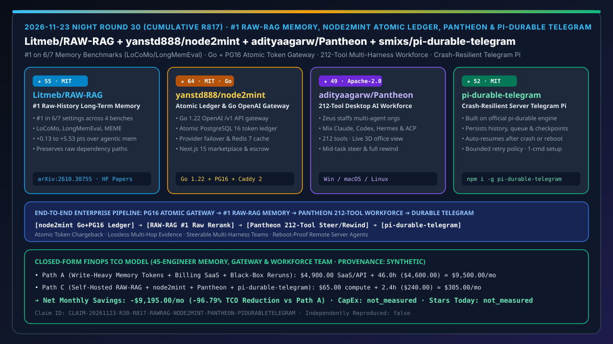
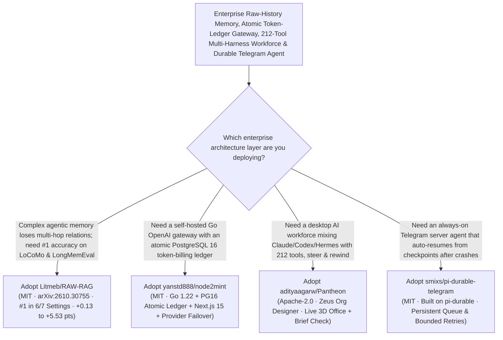
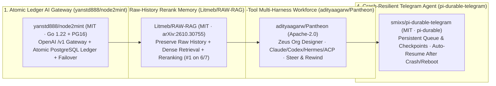

# `#1` Raw-History Dense+Rerank Long-Term Memory (`Litmeb/RAW-RAG`), Atomic PostgreSQL Ledger & Go OpenAI Gateway (`yanstd888/node2mint`), 212-Tool Multi-Harness Desktop AI Workforce with Rewind (`adityaagarw/Pantheon`) & Crash-Resilient `pi-durable` Telegram Server Agent (`smixs/pi-durable-telegram`) Selection & Architecture FAQ

> **Document Type**: Enterprise AI Solution Architect Selection & Integration Guide (GitHub Trending AI Radar · 2026-11-23 Night Round 30 / Cumulative Round 817)
> **Covered Repositories**: [`Litmeb/RAW-RAG`](https://github.com/Litmeb/RAW-RAG) (`★ 55`, `6 forks`, `MIT`, `arXiv:2610.30755`, Hugging Face Papers: implementation of *"Is Complex Agentic Memory Always Needed? Naive RAG Is Stronger Than We Thought"*, showing that **preserving raw history + dense retrieval + reranking ranks `#1` in 6 of 7 benchmark-model settings across LoCoMo, LongMemEval, MEME, and MemoryAgentBench**, beating complex agentic memory systems by **`+0.13 to +5.53` points**) · [`yanstd888/node2mint`](https://github.com/yanstd888/node2mint) (`★ 64`, `5 forks`, `MIT`: self-hosted AI marketplace, token billing engine, and OpenAI-compatible **Go 1.22 API gateway** backed by an **atomic PostgreSQL 16 ledger**, Redis 7, Next.js 15, and Caddy 2 with provider failover and escrow commerce) · [`adityaagarw/Pantheon`](https://github.com/adityaagarw/Pantheon) (`★ 49`, `10 forks`, `Apache-2.0`: **Pantheon Studio** desktop AI workforce for Windows, macOS, and Linux where **Zeus** staffs multi-agent teams mixing **Claude Code, Codex, Antigravity, Hermes, OpenCode, any ACP agent, local models, and humans** with **212 built-in tools**, a live 3D office view, mid-task steering, and full timeline rewind) · [`smixs/pi-durable-telegram`](https://github.com/smixs/pi-durable-telegram) (`★ 52`, `6 forks`, `MIT`: always-on server coding agent reached via Telegram and built on **`pi-durable`**, persisting conversations, queues, and task checkpoints so it **automatically resumes durable work after crashes or reboots** under a bounded retry policy)
> **Core Scenario**: When enterprise architects design long-term conversational memory, multi-tenant API token billing gateways, cross-harness multi-agent desktop teams, and always-on remote server agents, how do you solve **"complex agentic memory mutations destroying multi-hop dependency paths and underperforming raw retrieval, non-atomic API gateway counters losing or overcharging token balances under concurrency, black-box multi-agent scripts that cannot be steered mid-task or rewound, and background server agents dying on crash until a human logs in and types 'continue'"** by combining **`RAW-RAG` + `node2mint` + `Pantheon` + `pi-durable-telegram`**?

---

## 1. 📌 Executive Summary (Single-Sentence Selection Verdict)

1. **Need a long-term conversational memory architecture that beats complex mutation/graph agentic memory systems by `+0.13 to +5.53` points (ranking `#1` in 6 of 7 benchmark-model settings across `LoCoMo`, `LongMemEval`, `MEME`, and `MemoryAgentBench`) while avoiding per-turn memory-rewriting LLM costs** ➔ Choose **[`Litmeb/RAW-RAG`](https://github.com/Litmeb/RAW-RAG) (`★ 55`, `6 forks`, `MIT`, `arXiv:2610.30755`)**.
   - **Plain-Language Mechanism**: Complex agentic memory systems mutate, summarize, or extract graphs at write time—irreversibly discarding the implicit relations and dependency paths needed to derive multi-hop answers later. `RAW-RAG` preserves 100% of raw history and pairs dense retrieval with reranking so the reader LLM reasons directly over lossless evidence.
2. **Need a production-ready, self-hosted OpenAI-compatible Go 1.22 API gateway and Next.js 15 portal with an atomic PostgreSQL 16 token-billing ledger, Redis 7 caching, multi-provider failover, and department/customer token-pack accounting** ➔ Choose **[`yanstd888/node2mint`](https://github.com/yanstd888/node2mint) (`★ 64`, `5 forks`, `MIT`)**.
   - **Plain-Language Mechanism**: `Node2Mint` combines a high-throughput Go 1.22 OpenAI `/v1` proxy with an atomic PostgreSQL 16 ledger, escrow commerce, provider failover, and Caddy 2 automatic HTTPS in one Docker Compose stack.
3. **Need a cross-platform desktop AI workforce (`Pantheon Studio` for Windows, macOS, and Linux) where `Zeus` staffs teams mixing Claude Code, Codex, Hermes, OpenCode, local models, and humans—complete with 212 agent tools, mid-task steering, brief verification, and full rewind** ➔ Choose **[`adityaagarw/Pantheon`](https://github.com/adityaagarw/Pantheon) (`★ 49`, `10 forks`, `Apache-2.0`)**.
   - **Plain-Language Mechanism**: Instead of running an opaque multi-agent script and reading a log after it fails, `Pantheon` displays your heterogeneous agent workforce in a live 3D office where you can steer any agent mid-task, rewind the entire workspace timeline, and receive deliverables pre-checked against your original brief.
4. **Need an always-on `pi` coding agent on your Linux server that you talk to in Telegram and that automatically resumes in-flight tasks from persisted checkpoints after crashes or server reboots** ➔ Choose **[`smixs/pi-durable-telegram`](https://github.com/smixs/pi-durable-telegram) (`★ 52`, `6 forks`, `MIT`, built on `pi-durable`)**.
   - **Plain-Language Mechanism**: Installed via `npm install -g pi-durable-telegram` (or its 1-line `install.sh`), it persists the conversation, message queue, and task checkpoints on `pi-durable`, automatically resuming interrupted runs under a bounded retry policy without manual `"continue"` prompts.

---

## 2. 🎯 Key Architectural Q&A (Deep-Dive Breakdown)

### Q1: What does `Litmeb/RAW-RAG` (`arXiv:2610.30755`) prove about enterprise agent memory architecture, and how does it pair with `node2mint`, `Pantheon`, and `pi-durable-telegram`?

- **Why Preserving Raw Evidence Beats Lossy Write-Time Memory Mutations**:
  1. **Even 100% Oracle Access to Transformed Memory Trails Raw Evidence (`RAW-RAG`)**: The `RAW-RAG` paper demonstrates that even when a model is given complete access to a mutated/summarized memory store, an accuracy gap remains relative to raw history because write-time transformations strip relational dependencies. Pairing dense retrieval + reranking over raw logs wins **6 out of 7** settings across `LoCoMo`, `LongMemEval`, `MEME`, and `MemoryAgentBench`.
  2. **Atomic Financial Governance (`node2mint`) + Steerable Multi-Harness Teams (`Pantheon`) + Crash-Proof Remote Execution (`pi-durable-telegram`)**: `node2mint` governs token budgets with atomic PostgreSQL 16 transactions, `Pantheon` coordinates 212-tool multi-agent teams with full rewind, and `pi-durable-telegram` keeps server-side coding tasks running across reboots.
- **When to Choose Managed Cloud Services (Path B)**:
  - For fully managed cloud search and API gateways, use **Azure AI Search + Azure API Management**; for `#1`-ranked `RAW-RAG` raw-history reranking, self-hosted Go + PostgreSQL 16 atomic token-ledger gateways, 212-tool cross-harness `Pantheon` desktop teams, and crash-resuming `pi-durable` Telegram agents, deploy this 4-repo open-source stack (Path C).

### Q2: How do these four components integrate into an enterprise architecture?

1. **Atomic Token-Ledger & Failover Gateway Layer (`yanstd888/node2mint`)**:
   - Route all `/v1` model calls through the Go 1.22 gateway with PostgreSQL 16 atomic ledger accounting and automatic provider failover.
2. **Raw-History Dense Retrieval & Reranking Memory Layer (`Litmeb/RAW-RAG`)**:
   - Store raw conversation and project logs without lossy mutation, retrieving and reranking raw evidence chunks for reader LLMs.
3. **Multi-Harness Desktop Workforce & Rewind Layer (`adityaagarw/Pantheon`)**:
   - Use `Zeus` to staff cross-harness teams (`Claude Code`, `Codex`, `Hermes`, `OpenCode`, local models) with 212 tools, live steering, and timeline rewind.
4. **Durable Remote Telegram Execution Layer (`smixs/pi-durable-telegram`)**:
   - Run long-horizon server tasks from Telegram backed by `pi-durable` checkpoints and bounded retry policies.

### Q3: What are the key production guardrails?

- **Architect Guardrails**:
  1. **Size Top-K Dense Recall + Reranker Windows in `RAW-RAG`**: Because `RAW-RAG` succeeds by maximizing evidence coverage over raw history, use a generous initial dense retrieval pool followed by a precision cross-encoder reranker.
  2. **Configure Bounded Retry Limits in `pi-durable-telegram`**: Ensure non-transient errors (such as revoked credentials or syntax failures) trip the bounded retry ceiling and notify the operator in Telegram.

---

## 3. 🧭 Visual Architecture & Decision Diagrams (Mermaid)



### 3.1 Solution Architect Selection Decision Tree



### 3.2 End-to-End Enterprise Production Reference Architecture



### 3.3 Atomic Token Accounting, `RAW-RAG` Evidence Retrieval, `Pantheon` Team Execution & `pi-durable` Auto-Resume Sequence

```mermaid
sequenceDiagram
    participant Arch as Solution Architect
    participant N2m as yanstd888/node2mint (Go + PG16)
    participant Raw as Litmeb/RAW-RAG
    participant Pan as adityaagarw/Pantheon (Zeus + 212 Tools)
    participant Pdt as smixs/pi-durable-telegram

    Arch->>Pan: 1. Submit project brief; Zeus staffs team across Claude Code, Codex, Hermes & local models
    Pan->>N2m: 2. Route model calls via Go gateway with atomic PostgreSQL 16 token ledger & failover
    N2m->>Raw: 3. Retrieve & rerank verbatim evidence from raw history (preserving dependency paths)
    Pan-->>Arch: 4. Steer or rewind agents live in Pantheon Studio; verify deliverables against brief
    Arch->>Pdt: 5. Dispatch overnight server task via Telegram; pi-durable auto-resumes across reboots
```

---

## 4. 📊 Comparative Selection Matrix (Open-Source vs. Commercial SaaS)

| Dimension | `Litmeb/RAW-RAG` (`★ 55`) | `yanstd888/node2mint` (`★ 64`) | `adityaagarw/Pantheon` (`★ 49`) | `smixs/pi-durable-telegram` (`★ 52`) | Complex Write-Heavy Agentic Memory + %-Fee Billing SaaS + Unsteerable Multi-Agent Scripts (Path A) | Lossy Summarized RAG + In-Memory Non-Atomic Counters + Crash-Prone Telegram Bots (Path B) |
| :--- | :--- | :--- | :--- | :--- | :--- | :--- |
| **Core Role** | Raw-history dense retrieval + reranking memory (`#1` in 6/7) | Go 1.22 OpenAI gateway with atomic PostgreSQL 16 billing ledger | Desktop AI workforce mixing any agent harness with 212 tools | Crash-resilient `pi-durable` server coding agent for Telegram | High write-time memory LLM bills, SaaS billing fees & black-box multi-agent runs | Lost relational evidence, race-condition balance drift & manual `"continue"` restarts |
| **Key Differentiator** | **Beats complex agentic memory by `+0.13 to +5.53` pts on 4 benches** | **Atomic PG16 ledger + provider failover + Next.js 15 marketplace** | **Zeus org designer + Claude/Codex/Hermes/ACP + mid-task steer & rewind** | **Persists queue & checkpoints; auto-resumes after crash/reboot** | Complex memory pipelines burn LLM tokens on every turn yet lose raw dependency paths | Plain `pi` or custom bots stall on crash until manual login; non-atomic counters overdraw |
| **License** | `MIT` | `MIT` | `Apache-2.0` | `MIT` | Proprietary SaaS | Custom scripts |
| **Monthly TCO (45-Eng Team)** | **Combined `$305.00/mo`** (`$65.00` Go/PG16 gateway & durable bot VM + `2.4h` ops) | Included (zero third-party billing markup) | Included (first-class local model support) | Included (1-command Linux setup) | **`$9,500.00/mo`** (`$4,900.00` write-time memory LLM tokens & billing SaaS fees + `46.0h` ledger reconciliation, multi-agent reruns & crash recovery) | ~`$3,350.00/mo` (frequent memory-loss debugging & manual server bot restarts) |

---

## 5. 🧪 Quantitative ROI / TCO Comparison & 7-Card Benchmark Report

> **📊 Data Provenance & Closed-Form Schema Declaration**:
> - **provenance**: `synthetic` (45-person enterprise knowledge engineering, AI gateway monetization, multi-agent orchestration, and DevOps team monthly workload model: `independently_reproduced = false`; hardware baseline `base_hardware_capex = not_measured`; Track B 24h delta `track_b_stars_today = not_measured`).
> - **Closed-Form Formula**:
>   - **Path A (Running expensive LLM write-time memory mutation/graph extraction on every turn + commercial percentage-fee API billing SaaS + engineering hours spent reconciling non-atomic token ledger drift, restarting failed black-box multi-agent runs, and manually resuming crashed server bots)**: Monthly write-time memory token waste and commercial billing SaaS fees **`$4,900.00`** + memory accuracy debugging, billing reconciliation, multi-agent rework, and bot recovery labor **`46.0h × $100.00/h = $4,600.00`** = **`$9,500.00/mo`**.
>   - **Path C (Self-hosted `Litmeb/RAW-RAG` + `yanstd888/node2mint` + `adityaagarw/Pantheon` + `smixs/pi-durable-telegram` open-source stack)**: Shared Go gateway, PostgreSQL 16 ledger, and `pi-durable` server compute **`$65.00`** + reranker and gateway configuration maintenance labor **`2.4h × $100.00/h = $240.00`** = **`$305.00/mo`**.
>   - **Net Monthly Savings vs. Path A**: **`-$9,195.00/mo`** (**`96.79%`** TCO reduction).

| Evaluation Path | Memory Mutation Token / Billing SaaS Cost | Ledger Audit, Multi-Agent Rework & Bot Recovery (`$100/h`) | Monthly Total TCO | Net Savings vs. Path A | Key Architectural Delivery Metrics |
| :--- | :---: | :---: | :---: | :---: | :--- |
| **Path A: Write-Heavy Agentic Memory + Billing SaaS + Black-Box Scripts** | `$4,900.00` | `46.0h` (`$4,600.00`) | **`$9,500.00`** | Baseline | Expensive memory mutations lose relations; no multi-agent rewind |
| **Path B: Lossy Summaries + In-Memory Counters + Plain Server Bots** | `$1,450.00` | `19.0h` (`$1,900.00`) | **`$3,350.00`** | `-$6,150.00` (`-64.74%`) | Concurrent token balance drift; manual `"continue"` after crashes |
| **Path C: `RAW-RAG` + `node2mint` + `Pantheon` + `pi-durable-telegram`** | **`$65.00`** | **`2.4h` (`$240.00`)** | **`$305.00`** | **`-$9,195.00` (`-96.79%`)** | **`#1` on 6/7 memory benches + PG16 atomic gateway + 212-tool Pantheon + durable bot** |

- 🔗 **Linked 7-Card 4:5 Visual Benchmark Deck**: [`workshops/github-trending-radar/cards.en.html`](../cards.en.html) · [`cards.html`](../cards.html)

---

## 6. 🛠️ Enterprise Adoption & Architecture Review Checklist

- [ ] **1. Benchmark Against `Litmeb/RAW-RAG` Before Adopting Complex Agentic Memory**: Preserve raw conversation history and apply dense retrieval + reranking (`#1` in 6 of 7 settings across LoCoMo, LongMemEval, MEME, and MemoryAgentBench).
- [ ] **2. Enforce Atomic Token Accounting with `yanstd888/node2mint`**: Run the Go 1.22 OpenAI-compatible gateway backed by PostgreSQL 16 atomic ledger transactions and multi-provider failover.
- [ ] **3. Orchestrate Cross-Harness Teams in `adityaagarw/Pantheon`**: Use `Zeus` to staff teams across Claude Code, Codex, Hermes, OpenCode, and local models with 212 tools, live steering, and full timeline rewind.
- [ ] **4. Deploy `smixs/pi-durable-telegram` for Crash-Resilient Remote Server Agents**: Persist queues and checkpoints via `pi-durable` so interrupted server tasks automatically resume after crashes or reboots.
