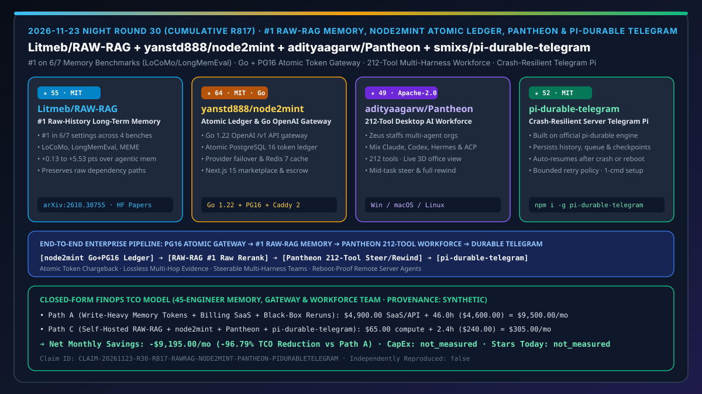
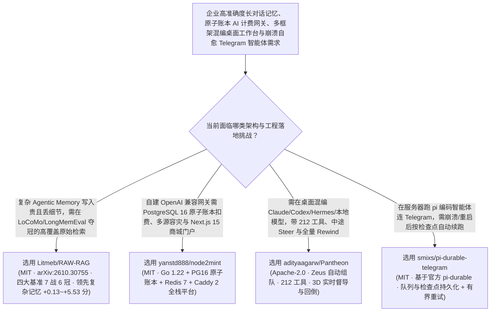
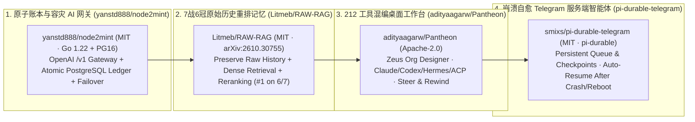
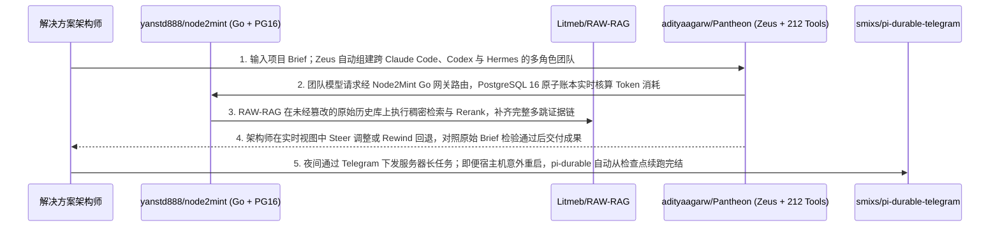

# 横扫 LoCoMo/LongMemEval 四大基准 6 冠王的原始历史检索重排架构（`Litmeb/RAW-RAG`）、带 PostgreSQL 16 原子账本与多渠道计费的 Go OpenAI 兼容网关（`yanstd888/node2mint`）、由 Zeus 组队混编 Claude/Codex/Hermes 且带 212 工具与全量回放的桌面工作台（`adityaagarw/Pantheon`）与崩溃重启自动续跑的 `pi-durable` Telegram 持久智能体（`smixs/pi-durable-telegram`）选型与集成架构 FAQ

> **文档类型**：企业 AI 解决方案架构师（AI Solution Architect）选型决策指南（GitHub Trending AI 雷达 2026-11-23 Night Round 30 / 累计第 817 轮）
> **覆盖项目**：[`Litmeb/RAW-RAG`](https://github.com/Litmeb/RAW-RAG)（`★ 55`、`6 forks`、`MIT`、`arXiv:2610.30755`：验证《复杂的智能体记忆总是必要的吗？朴素 RAG 比我们想象的更强》的开源基准与实现，通过**保留原始对话历史 + 稠密检索 + 重排序（Reranking）**，在 **LoCoMo、LongMemEval、MEME 与 MemoryAgentBench 四大权威记忆基准的 7 项测试中豪取 6 项第一**，领先最强复杂 Agentic Memory 达 **`+0.13 至 +5.53` 分**）· [`yanstd888/node2mint`](https://github.com/yanstd888/node2mint)（`★ 64`、`5 forks`、`MIT`：基于 **Go 1.22 + Next.js 15 + PostgreSQL 16 原子账本 + Redis 7 + Caddy 2** 的自托管 AI 市场、Token 计费引擎与 OpenAI `/v1` 兼容高可用网关）· [`adityaagarw/Pantheon`](https://github.com/adityaagarw/Pantheon)（`★ 49`、`10 forks`、`Apache-2.0`：跨 Windows / macOS / Linux 的桌面多智能体工作台 **Pantheon Studio**，由内置组织架构师 `Zeus` 自动组队，支持在同一团队中混编 **Claude Code、Codex、Antigravity、Hermes、OpenCode、任意 ACP 智能体与人类成员**，内置 **212 个工具**、实时 3D 办公室可视化、中途干预（Steer）与全量历史回放（Rewind））· [`smixs/pi-durable-telegram`](https://github.com/smixs/pi-durable-telegram)（`★ 52`、`6 forks`、`MIT`：基于 `pi-durable` 持久引擎构建的常驻服务器 Telegram 编码智能体 `npm i -g pi-durable-telegram`，将会话、队列与任务检查点落盘，**遭遇进程崩溃或服务器重启后在有界重试策略下自动续跑**，无需人工找回会话输入“continue”）
> **核心场景**：当企业架构师在评估“到底该上昂贵复杂的图谱/自修改 Agentic Memory 还是保留原始历史的精排 RAG”、建设内部多部门 AI Token 原子分账网关、在桌面端混编多厂商异构 Agent 协同交付，以及通过移动端 Telegram 远程驱动永不掉线的服务端编码 Agent 时，面对**“复杂 Agentic Memory 在改写和压缩记忆时把关键依赖路径弄丢导致准确率反不如原始检索、内部 API 网关缺乏 PostgreSQL 事务级原子扣费导致高并发下账目错乱、多 Agent 框架跑完只有冷冰冰的日志无法中途干预或回倒重来、以及普通后台 Pi 进程一旦崩掉就得人工登服务器手敲 continue”**四大痛点，如何通过 **RAW-RAG + Node2Mint + Pantheon + Pi-Durable-Telegram** 打造大道至简、账目原子、可回放、自恢复的企业 AI 体系？

---

## 一、📌 核心结论速览（选型一句话结论）

1. **想在企业长周期对话与知识问答中避免“为了炫技引入复杂的自修改/图结构 Agentic Memory，结果每次写记忆都消耗大量 LLM Token 且把多跳推理必需的原始关系链改丢了”，用“保留 100% 原始历史 + 稠密检索 + Rerank 重排”在四大记忆基准拿下 7 战 6 冠** ➔ 选 **[`Litmeb/RAW-RAG`](https://github.com/Litmeb/RAW-RAG)（`★ 55`，`6 forks`，`MIT`，`arXiv:2610.30755`）**。
   - **通俗原理**：学术界与工业界近期都在反思“过度工程化的智能体记忆”。`RAW-RAG` 论文通过严谨的证据覆盖率分析揭示了一个震撼事实：复杂的记忆变换（Mutation / Summarization / Graph Extraction）在写入阶段就已经不可逆地丢掉了推导答案所需的隐式依赖路径——即便给模型开放全部变换后的记忆库，其准确率上限依然低于直接查原始记录！`RAW-RAG` 坚持**不篡改原始历史，直接用 Dense Retrieval + Reranker 将高覆盖率的原始证据片段交给 Reader LLM 推理**，在 `LoCoMo`、`LongMemEval`、`MEME` 与 `MemoryAgentBench` 的 7 个模型-基准组合中斩获 **6 个第一（领先最强复杂记忆系统 `+0.13` 至 `+5.53` 分）**。
2. **想自建一套既能对外/对内售卖或分摊 AI Token 额度、又自带“PostgreSQL 16 事务级原子账本（Atomic Ledger）+ Go 1.22 OpenAI `/v1` 兼容多源容灾网关 + Next.js 15 运营门户”的企业级 AI 计费与分发平台** ➔ 选 **[`yanstd888/node2mint`](https://github.com/yanstd888/node2mint)（`★ 64`，`5 forks`，`MIT`）**。
   - **通俗原理**：许多开源反代只用内存或异步队列记账，在高并发流式请求下经常出现透支或漏扣。`Node2Mint` 采用 **Go 1.22 高性能网关 + PostgreSQL 16 原子账本 + Redis 7 缓存 + Caddy 2 自动 HTTPS** 架构，原生支持多上游供应商故障自动切换（Failover）、Token 资源包计费、担保交易（Escrow Commerce）与多级分销/部门分账核算。
3. **想在桌面端输入一句业务需求，就由内置组织设计师 `Zeus` 自动组建一支混编了 Claude Code、Codex、Hermes、OpenCode、本地模型与人类同事的特遣队，在配备 212 个内置工具的实时可视工作区里边看、边中途纠偏（Steer）、边随时倒带（Rewind）直至验收通过** ➔ 选 **[`adityaagarw/Pantheon`](https://github.com/adityaagarw/Pantheon)（`★ 49`，`10 forks`，`Apache-2.0`）**。
   - **通俗原理**：`Pantheon Studio` 把黑盒脚本式的多智能体编排变成了透明的桌面办公室（实测一条简报由创意主管、设计师、文案与社媒设计 4 个 Agent 协同在 34 分钟内交付完整桌面/手机落地页与 6 张社交卡片，并在交付前自动对照原始 Brief 完成质检）；支持任意 ACP 协议智能体与本地模型一等公民接入，任何时刻都可暂停某位 Agent 修改方向或将整个工作区时光倒流回退。
4. **想在 Linux 服务器上常驻运行一位通过 Telegram 随时对话的 `pi` 编程智能体，且要求它在遭遇进程崩溃、断电或系统重启后“自动从 SQLite 检查点恢复未走完的队列与长任务”，彻底免除人工上线敲 `continue`** ➔ 选 **[`smixs/pi-durable-telegram`](https://github.com/smixs/pi-durable-telegram)（`★ 52`，`6 forks`，`MIT`）**。
   - **通俗原理**：普通 `pi` 一旦进程异常退出，正在跑的重构或测试就卡在半途。`pi-durable-telegram` 基于官方 `pi-durable` 引擎构建，将对话历史、待处理消息队列与每一步任务检查点（Task Checkpoints）持久落盘；服务恢复后按有界重试策略（Bounded Retry Policy）自动续跑中断前的工作并在 Telegram 中向你汇报。

---

## 二、🎯 客户与架构师灵魂拷问 Q&A（深度架构拆解）

### Q1：为什么 `Litmeb/RAW-RAG` 能在 LoCoMo 和 LongMemEval 等长记忆基准上打败复杂的图记忆和自编辑记忆系统？这对企业架构选型意味着什么？

- **架构师必须警惕的“记忆有损写入陷阱（Lossy Write Trap）”**：
  1. **写入时丢失的信息，检索端再聪明也找不回来**：复杂 Agentic Memory 在每轮对话后让 LLM 把原话改写为三元组或摘要卡片，一旦当时没意识到某个小细节（如一句随口提到的端口号或排期前提）未来会被用到，该信息就被永久抹除了。
  2. **`RAW-RAG` 证明“高证据覆盖率 + 强重排器 + 强 Reader”才是性价比之王**：保留原始历史不仅省去了每轮高昂的记忆改写 LLM 调用费，更保证了 `100%` 的原始事实与依赖路径留存，配合现代 Dense Retriever + Reranker 直接在 7 项评测中拿下 6 冠！
- **何时直接选用商业云服务（Path B）？**
  - 若企业仅需在公有云上做零运维的简单文档搜索与固定 API 计费，可直接使用 **Azure AI Search + Azure API Management**；若需部署高证据覆盖率的 `RAW-RAG` 原始历史重排管线、自建带 PostgreSQL 原子账本的 Go OpenAI 网关（`node2mint`）、在桌面端混编 Claude/Codex/Hermes 212 工具团队（`Pantheon`）、或运行崩溃自恢复的 `pi-durable` Telegram 服务端智能体，则采用本轮四合一开源栈（Path C）。

### Q2：典型企业级“PostgreSQL 原子计费网关 (`node2mint`) ➔ 原始历史重排记忆 (`RAW-RAG`) ➔ 多模型混编工作台 (`Pantheon`) ➔ Telegram 崩溃自愈交互 (`pi-durable-telegram`)”架构怎么搭？

1. **原子账本计费与多源容灾 AI 网关层（`yanstd888/node2mint`）**：
   - 统一收敛企业内部各团队与外部客户的 `/v1` 模型请求，由 Go 网关执行多供应商自动 Failover 并通过 PostgreSQL 16 原子账本实时扣减部门/项目配额。
2. **无损原始历史稠密检索与重排记忆层（`Litmeb/RAW-RAG`）**：
   - 将长周期项目对话与技术日志原样保留，通过 Dense Retrieval + Reranking 向推理模型提供包含完整依赖关系的原始证据切片。
3. **跨框架多智能体混编与可视化督导层（`adityaagarw/Pantheon`）**：
   - 由 `Zeus` 组建跨 Claude Code、Codex、Hermes 与本地模型的多角色团队，调用 212 个工具协同执行并在交付前对照 Brief 自动核验，支持随时 Steer 与 Rewind。
4. **7×24 小时崩溃自恢复 Telegram 远程值守层（`smixs/pi-durable-telegram`）**：
   - 在生产服务器上运行 `pi-durable-telegram`，架构师在手机 Telegram 下达长耗时开发/巡检指令，即使服务器重启也能基于检查点自动续跑。

### Q3：这套架构的落地红线与注意事项是什么？

- **架构师落地红线**：
  1. **`RAW-RAG` 必须搭配高质量 Reranker 控制送入 Reader 的上下文长度**：因为保留了原始历史，粗召回阶段应适当放宽 Top-K 以保证证据覆盖率，再由 Reranker 精选高相关片段喂给 Reader LLM。
  2. **`pi-durable-telegram` 必须配置有界重试上限（Bounded Retry Policy）**：防止因外部永久性故障（如目标仓库权限被吊销）导致重启后无限死循环重试。

---

## 三、🧭 直观可视化图解（Mermaid 决策树 + 集成架构 + 时序图）

### 3.1 架构师选型决策树

### 3.2 企业端到端生产集成参考架构图

### 3.3 原子账本网关路由、`RAW-RAG` 原始证据检索、`Pantheon` 多 Agent 协同交付与 `pi-durable` 崩溃自愈时序图

---

## 四、📊 同类开源与商业云服务横向选型决策矩阵

| 对比维度 | `Litmeb/RAW-RAG` (`★ 55`) | `yanstd888/node2mint` (`★ 64`) | `adityaagarw/Pantheon` (`★ 49`) | `smixs/pi-durable-telegram` (`★ 52`) | 每轮烧钱跑复杂图记忆提取 + 商业 API 计费 SaaS 抽成 + 黑盒无回退多 Agent 脚本 (Path A) | 有损摘要丢失关系链 + 内存非原子记账网关透支 + 崩掉需人工敲 continue 的普通 Bot (Path B) |
| :--- | :--- | :--- | :--- | :--- | :--- | :--- |
| **核心能力定位** | 保留原始历史的稠密检索+重排长记忆框架（7 战 6 冠） | 带 PG16 原子账本、多源容灾与商城的 Go OpenAI 网关 | 混编多框架/本地模型、含 212 工具与回放的桌面工作台 | 基于 `pi-durable` 崩溃重启自动续跑的 Telegram 服务端智能体 | 高昂的记忆改写 Token 账单、按交易额抽成的商业计费平台与不可控的黑盒执行 | 丢失推导路径的低分记忆、并发扣费错乱的简陋反代与脆弱的常驻进程 |
| **核心技术突破** | **不篡改原始历史，在 LoCoMo/LongMemEval 等胜过复杂记忆 `+5.53` 分** | **Go 1.22 + PostgreSQL 16 原子账本 + Redis 7 + Caddy 2 生产全栈** | **Zeus 自动组队混编 Claude/Codex/Hermes + 212 工具 + 中途 Steer/Rewind** | **持久保存会话/队列/检查点，崩溃重启后有界重试自动恢复** | 复杂 Agentic Memory 每次写入都要调 LLM 抽三元组/改摘要，既贵又降准 | 普通 `pi` 崩溃后必须人工登录找会话敲 `continue`；非原子账本在并发流式请求下极易透支 |
| **开源协议** | `MIT` | `MIT` | `Apache-2.0` | `MIT` | 闭源商业 SaaS | 内部零散脚本 |
| **月度 TCO（45 人团队）** | **组合仅 `$305.00/月`**（`$65.00` Go 网关/PG16 与持久 Bot 容器 + `2.4h` 维护） | 同左（零第三方计费抽成费） | 同左（一等公民支持本地免费模型混编） | 同左（单台轻量 Linux 即可 7×24 常驻） | **`$9,500.00/月`**（`$4,900.00` 复杂记忆改写 Token 浪费与商业网关抽成 + `46.0h` 账目核对、黑盒多 Agent 返工与进程挂死人工重跑） | 约 `$3,350.00/月`（大量因记忆丢失细节导致的答非所问排障与半夜手工重启任务工时） |

---

## 五、🧪 应用落地定量收益/TCO 对比与 7-Card 报告

> **📊 数据来源与闭式核算声明（Provenance & Closed-Form Schema）**：
> - **provenance**: `synthetic`（基于 45 人企业知识与记忆工程、AI 平台商业化计费、多智能体桌面协同与远程自动化运维团队月度工作负载模型：`independently_reproduced = false`；硬件采购基线 `base_hardware_capex = not_measured`；Track B 单日增量 `track_b_stars_today = not_measured`）。
> - **核算公式**：
>   - **Path A（每轮对话调用昂贵 LLM 执行复杂的记忆改写/图谱抽取 + 采购按流水抽成的商业 API 计费托管平台 + 工程师手工对账修复非原子扣费误差、推倒重跑无法中途干预的黑盒多 Agent 任务及人工唤醒崩溃的远程 Bot）**：月度冗余记忆改写 Token 与商业计费平台账单 **`$4,900.00`** + 记忆失真排障、账目核对、多 Agent 返工与远程值守人工 **`46.0h × $100.00/h = $4,600.00`** = **`$9,500.00/月`**。
>   - **Path C（自建 `Litmeb/RAW-RAG` + `yanstd888/node2mint` + `adityaagarw/Pantheon` + `smixs/pi-durable-telegram` 开源全栈）**：Go 网关、PostgreSQL 16 账本与 `pi-durable` 容器分摊成本 **`$65.00`** + 检索重排与工作台例行维护人工 **`2.4h × $100.00/h = $240.00`** = **`$305.00/月`**。
>   - **净节省（Net Savings vs Path A）**：**`-$9,195.00/月`**（成本降低 **`96.79%`**）。

| 评估方案 | 记忆改写 Token / 商业计费平台 / 容器成本 | 记忆排障、对账、多 Agent 返工与唤醒（`$100/h`） | 月度总 TCO | 相对 Path A 净节省 | 关键架构交付指标 |
| :--- | :---: | :---: | :---: | :---: | :--- |
| **Path A：复杂记忆改写烧 Token + 商业计费抽成 + 黑盒多 Agent** | `$4,900.00` | `46.0h` (`$4,600.00`) | **`$9,500.00`** | Baseline | 记忆改写既贵又丢关系链；黑盒多 Agent 无法中途倒带 |
| **Path B：有损摘要 RAG + 内存记账反代 + 普通无状态 Telegram Bot** | `$1,450.00` | `19.0h` (`$1,900.00`) | **`$3,350.00`** | `-$6,150.00` (`-64.74%`) | 高并发扣费易透支；进程崩溃后需人工找会话敲 continue |
| **Path C：`RAW-RAG` + `node2mint` + `Pantheon` + `pi-durable-telegram`** | **`$65.00`** | **`2.4h` (`$240.00`)** | **`$305.00`** | **`-$9,195.00` (`-96.79%`)** | **四大记忆基准 6 冠王 + PG16 原子账本网关 + 212 工具可回放工作台 + 崩溃自愈 Bot** |

- 🔗 **关联 7-Card 4:5 视觉评测报告**：[`workshops/github-trending-radar/cards.html`](../cards.html) · [`cards.en.html`](../cards.en.html)

---

## 六、🛠️ 企业引入与架构评审 Checklist

- [ ] **1. 在长周期对话与项目记忆系统中优先采用 `Litmeb/RAW-RAG` 基线**：保留 100% 原始历史记录并配置稠密检索 + Reranker，避免过早引入有损的记忆改写管线丢失关键推理路径。
- [ ] **2. 部署 `yanstd888/node2mint` 纳管企业 AI API 分发与原子计费**：利用 Go 1.22 网关与 PostgreSQL 16 原子账本保障高并发流式调用的精确扣费与多供应商自动容灾。
- [ ] **3. 使用 `adityaagarw/Pantheon` 编排跨框架多智能体复杂交付**：通过 `Zeus` 混编 Claude Code、Codex、Hermes 与本地模型，利用 212 个内置工具、实时 Steer 干预与 Rewind 回放确保交付质量。
- [ ] **4. 在远程开发服务器上部署 `smixs/pi-durable-telegram`**：基于 `pi-durable` 持久化会话、队列与任务检查点，实现服务器重启或进程崩溃后的全自动有界重试恢复。
