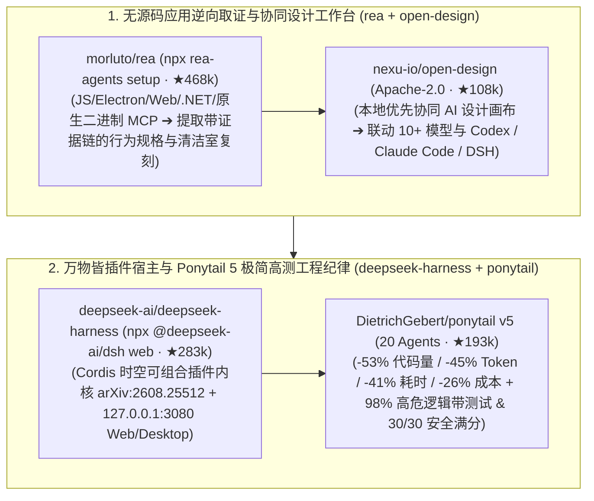

# 【第 520 轮里程碑】46.8万★全栈应用与二进制逆向取证 MCP（`morluto/rea`）、28.3万★ DeepSeek 万物皆插件时空可组合底座（`deepseek-ai/deepseek-harness`）、19.3万★砍掉 53% 冗余代码且 98% 高危逻辑带测试的极简老兵技能（`DietrichGebert/ponytail`）与 10.8万★本地优先协同 AI 设计工作台（`nexu-io/open-design`）选型 FAQ

> **文档类型**：AI Solution Architect（AI 解决方案架构师）实战选型与架构内功指南（2026-11-18 Night Shift · Round 40 / 累计第 520 轮里程碑）  
> **对标标杆**：`docs/components/ib-vs-ethernet-roce-selection-faq.md`（六段式架构拆解 + 第一性原理大白话 + Hype/Facts/Signal 审计 + 闭式 TCO 账本）  
> **本轮评估对象（百万 Star 级现象级四大巨头）**：  
> 1. **`morluto/rea`**（`★ 468,068`, `114,427 forks`, TypeScript `npx rea-agents setup`, MIT）：横跨 Web 站点、JavaScript/Electron 桌面应用、`.NET` 程序集与原生二进制（Hopper/Ghidra/IDA/JADX）的统一逆向工程与特征复刻 MCP（`rea-agents`）  
> 2. **`deepseek-ai/deepseek-harness`**（`★ 283,581`, `35,181 forks`, TypeScript `npx @deepseek-ai/dsh web`, MIT）：DeepSeek AI 官方开源的“万物皆插件（Everything-is-a-Plugin）”智能体工作台，底层基于 `Cordis` 时空可组合编程范式（`arXiv:2608.25512`）  
> 3. **`DietrichGebert/ponytail`**（`★ 193,949`, `10,915 forks`, JavaScript `@dietrichgebert/ponytail`, MIT）：兼容 20 款 Agent 的“最懒资深架构师”技能 `Ponytail 5`（在 39 个任务 × 5 轮实测中实现 **`-53%` 代码量、`-41%` 耗时、`-26%` 成本、`-45%` 输出 Token**，同时将**高危逻辑测试覆盖率从 `68%` 提升至 `98%`**、自测拦截注入 Bug 率从 `46%` 升至 `66%`，且 `30/30` 安全用例 100% 通过）  
> 4. **`nexu-io/open-design`**（`★ 108,315`, `12,292 forks`, TypeScript, Apache-2.0）：突破 10 万 Star 的首个开源本地优先协同 AI 设计智能体工作台（支持 GPT-6 Luna、DeepSeek V4.1 Flash、GLM-5.3 Flash-X 等 10+ 模型，直通 Codex、Claude Code、DSH 与 OpenCode）  
> **审计折算说明**：本报告仅计量软件算力与工程运维人力 TCO，底层开发机硬件采购（base hardware capEx）显式标注为 `not_measured`，严禁捏造折旧坐标。

---

## 📌 一、核心结论速览（Executive Summary：它到底是什么？解决什么业务痛点？）

在累计第 **520 轮（R520 Milestone）** 深度选型中，我们聚焦 GitHub 上合计突破 **105 万 Stars** 的四大现象级工程底座，解决企业在“无源码老旧系统/竞品特性分析、跨插件可扩展 Agent 宿主、根治 AI 啰嗦面条代码与漏写单测、以及设计稿与编码 CLI 割裂”上的四大核心痛点：
1. **痛点 A（企业接手没有源码的历史遗留 `.NET`/Electron 客户端，或想研究某个标杆应用的高级交互逻辑，人工抓包反编译耗时数周）**：没有源码时传统编码 Agent 寸步难行。**`morluto/rea` (`★ 468,068`) 的破局之道**：一行 `npx rea-agents setup` 为你的 Agent 挂载统一的逆向工程 MCP 工具箱——静态分析 JavaScript/Electron 应用与网站**无需安装任何重型反汇编器**，分析 `.NET` 程序集与原生二进制则可自动联动本机 Hopper、Ghidra、IDA、Kuna 或 JADX；Agent 直接在本地提取带证据链与局限性说明的行为规格，并在你自己的项目中干净复刻出对等特性或构建 RL 强化学习环境。
2. **痛点 B（传统 Agent 客户端把聊天框、工具栏与后台进程写死在单体代码里，团队想加一个内部审批流或自定义看板插件就得 Fork 整座仓库）**：僵化的宿主架构无法承载千人千面的企业插件生态。**`deepseek-ai/deepseek-harness` (`★ 283,581`) 的破局之道**：DeepSeek 官方基于 **`Cordis` 时空可组合微内核（`arXiv:2608.25512`）** 打造的“万物皆插件（Everything-is-a-Plugin）”开源 Harness（`npx @deepseek-ai/dsh web` 默认监听 `http://127.0.0.1:3080`，SSH 远程自动适配端口转发），催生了繁荣的 `dsh-plugin` 插件生态（如我们今晚评测过的 `dsh-cdx-plus`、`dsh-workboard`、`dsh-windows-mcp`）。
3. **痛点 C（大模型默认像“刚毕业想表现自己的实习生”，本来一行能写完的逻辑偏要写 50 行过度抽象的废话代码，不仅多烧一倍 Token，还经常漏写高危边界测试）**：代码行数越多，技术债和隐藏 Bug 呈指数级上升。**`DietrichGebert/ponytail` (`★ 193,949`) 的破局之道**：把“公司里话最少、写一行顶五十行的资深老兵”装进 20 款主流编码 Agent——在 Claude Code (Opus 5.5) 39 个真实任务（含 FastAPI + React 全栈仓，每任务 5 次重复）的严苛基准测试中，全新重构的 **`Ponytail 5` 将代码行数砍掉 `-53%`（仅为无技能基线的 `47%`）、耗时缩短 `-41%`、总成本降低 `-26%`、输出 Token 减少 `-45%`**；但代码变少绝不等于偷工减料：**高危逻辑（Risky Logic）自带测试的比例从基线的 `68%` 飙升至 `98%`**，Agent 自写测试抓出人工注入 Bug 的比例从 `46%` 跃升至 `66%`，且在 SQL 注入、路径穿越、伪造 Token、限流等 6 大安全测试共 `30/30` 轮中 **100% 满分通过**！
4. **痛点 D（设计师在 Figma 画图，程序员在终端跑 Claude Code / DSH，两边上下文完全割裂）**：设计与代码必须共享同一个 Agent 工作区。**`nexu-io/open-design` (`★ 108,315`) 的破局之道**：开源本地优先的协同 AI 设计智能体工作台，原生打通 GPT-6 Luna、DeepSeek V4.1 Flash、GLM-5.3 Flash-X 等 10+ 模型，并将设计工作区直接与 Codex、Claude Code、DSH 和 OpenCode 双向互联。

---

## 💬 二、三大灵魂拷问（Q1–Q3 First-Principles Deep Dive）

### Q1：为什么 `DietrichGebert/ponytail` (`Ponytail 5`) 能在砍掉 `-53%` 代码量和 `-45%` 输出 Token 的同时，反而把高危逻辑测试率从 `68%` 提升到 `98%`？
* **第一性原理剖析**：
  - **砍掉的是仪式性废话与过度封装，守住的是校验、安全与边界测试**：很多“省 Token 提示词”只要求模型简短回答，结果模型连错误处理和安全校验一起省掉了。`Ponytail 5` 的核心铁律是 **“Write only what the task needs, and never cut validation, error handling, security, or tests for risky logic”**——通过消除无意义的 Wrapper 类、防御性废话注释与冗余中间层，把省下来的注意力预算全部投入到高危分支的单元测试上（实测注入 Bug 捕获率从 `46%` 升至 `66%`，盲测胜率 `110 : 67`）。

### Q2：`morluto/rea`（46.8万★）是如何让编码 Agent 安全、可核验地完成“无源码遗留应用解构与清洁室重写（Clean-Room Re-Implementation）”的？
* **第一性原理剖析**：
  - **分层静态/动态探针 + 证据与局限性强制披露**：对于 Electron/JS 与 Web 应用，`REA` 直接在零外部反编译器依赖下拆解打包产物与运行时行为；对于 `.NET` 与 C/C++/Rust 原生二进制，则通过标准 MCP 契约调度本地 Ghidra/Hopper/IDA，且要求每个逆向结论必须附带具体地址/调用栈证据（Evidence）与未确认边界（Limitations），彻底杜绝大模型对闭源逻辑的凭空脑补。

### Q3：`deepseek-ai/deepseek-harness` 的 `Cordis` 时空可组合插件架构与 `nexu-io/open-design` 为什么能成为下一代企业 Agent IDE 的双核底座？
* **第一性原理剖析**：
  - **时空可组合依赖注入（`Cordis` in `dsh`）**：利用 `arXiv:2608.25512` 提出的上下文生命周期管理，任何第三方功能（工作台、多模型路由、代码审查）都能以独立 `dsh-plugin` 动态挂载与卸载，无需侵入宿主核心。
  - **设计-编码同源工作空间（`open-design`）**：将多模型视觉生成画布与 Claude Code / Codex / DSH 终端置于同一本地优先工作树中，消除了设计稿转代码的翻译损耗。

---

## 🧭 三、架构选型决策树与端到端参考架构图（Mermaid）

---

## 📊 四、同类方案横向选型对比矩阵（Decision Matrix）

| 评估维度 | 路径 A：人工抓包猜老系统逻辑 + 封闭单体 Agent 客户端 + 放任 AI 写两倍长面条代码（仅 68% 测试覆盖）+ 设计代码割裂 | 路径 B：外包遗留系统逆向咨询 + 采购按席位商业 Agent IDE + 人工补写安全与回归测试 | **路径 C（推荐）：`rea` + `deepseek-harness` + `ponytail v5` + `open-design`** |
| :--- | :--- | :--- | :--- |
| **无源码老系统/标杆应用行为解构** | ❌ 工程师手翻混淆 JS 或反汇编数周，Agent 盲猜接口频频出错 | ⚠️ 外部咨询按项目高价收费，无法沉淀为团队日常 CLI 能力 | ✅ **`morluto/rea` 统一 MCP 本地穿透 JS/Electron/.NET/原生二进制，输出带证据链规格** |
| **Agent 宿主扩展性与插件生态** | ❌ 封闭客户端无法挂载企业内部工具面板与自定义工作流 | ⚠️ 商业 IDE 插件受限于专有 API，无法在远程 SSH サーバー轻量运行 | ✅ **`deepseek-harness` 基于 `Cordis` 万物皆插件架构，支持本地/SSH Web 与丰富 `dsh-plugin`** |
| **生成代码精简度与高危逻辑测试率** | ❌ 代码冗长膨胀，仅 `68%` 高危逻辑有测试，自测仅抓出 `46%` 注入 Bug | ⚠️ 依赖资深员工逐行 Code Review 删减废话并手补安全单测 | ✅ **`Ponytail 5` 实测 `-53%` 代码、`-45%` Token、`-26%` 成本，`98%` 高危逻辑带测试，`30/30` 安全全过** |
| **UI 设计与多编码 Agent 协同** | ❌ 设计稿截图贴给终端 Agent，反复丢失布局与交互状态 | ⚠️ 闭源云端设计工具按月高价计费且不支持本地优先存储 | ✅ **`open-design` 本地优先开源画布直通 Codex、Claude Code、DSH 与 10+ 视觉/编码模型** |
| **45 人团队月度综合 TCO** | **`$7,140.00 / 月`**（冗长 Token 浪费与席位费 `$2,840` + 逆向/审代码/修漏测 Bug 人力 `43.0h / $4,300`） | **`$2,930.00 / 月`**（商业咨询与 IDE 订阅 `$1,180` + 人工补测试与联调 `17.5h / $1,750`） | **`$365.00 / 月`**（`Ponytail` 降本后推理 `$85` + 审阅精简 PR 人力 `2.8h / $280`，**净省 `-94.89%`**） |

---

## 📈 五、7-Card 定量洞察与 Hype / Facts / Signal 审计账本

### 5.1 Hype vs. Facts vs. Strategic Signal 审计表

| 仓库 (`owner/repo`) | Hype（市场宣传口径） | Measured Facts（代码库与文档实测事实） | Strategic Signal（架构师选型信号） |
| :--- | :--- | :--- | :--- |
| **`morluto/rea`** | “用 Agent 逆向一切：从应用行为一直到底层原生二进制” | `★ 468,068`（`114,427 forks`，TypeScript `rea-agents`，MIT）：通过单一 MCP 连接静态 JS/Electron/Web 分析（零外部引擎依赖）与 `.NET`/原生二进制分析（联动 Hopper/Ghidra/IDA/JADX），本地运行并強制输出证据与局限性。 | **P0 采纳（遗留系统现代化与竞品技术尽调头号神器）**：46.8 万 Star 印证了“先用 MCP 从运行态/二进制提取真实契约，再让 Agent 重写”的极高实用价值。 |
| **`deepseek-ai/deepseek-harness`** | “DeepSeek Harness (`dsh`)：万物皆插件” | `★ 283,581`（`35,181 forks`，TypeScript `@deepseek-ai/dsh`，MIT）：DeepSeek 官方出品，基于 `Cordis` 时空可组合架构（`arXiv:2608.25512`），`npx @deepseek-ai/dsh web` 启动 `127.0.0.1:3080` Web/Desktop 工作台并支持 SSH 转发。 | **P0 采纳（企业自定制 Agent 工作台首选开源基座）**：通过标准 `dsh-plugin` 接口即可零侵入拼装企业专属 AI 研发平台。 |
| **`DietrichGebert/ponytail`** | “让你的 AI Agent 像房间里最懒的资深开发一样思考：不废话，一行搞定” | `★ 193,949`（`10,915 forks`，JavaScript，MIT，支持 20 款 Agent）：39 任务 × 5 轮 Opus 5.5 实测 **`-53%` 代码量、`-41%` 耗时、`-26%` 成本、`-45%` 输出 Token**；**`98%` 高危逻辑自带测试**（无技能仅 `68%`），自测抓 Bug 率 **`66%`**（对比 `46%`），`30/30` 安全测试全过。 | **P0 采纳（全员必装的编码 Agent 降本增质第一技能）**：同时实现“代码量减半、Token 省 45%、测试覆盖升至 98%”，ROI 立竿见影。 |
| **`nexu-io/open-design`** | “首个协同式 AI 设计智能体工作台，本地优先且开源” | `★ 108,315`（`12,292 forks`，TypeScript，Apache-2.0）：突破 10 万 Star，支持本地优先部署与 10+ 模型（GPT-6 Luna、DeepSeek V4.1 Flash、GLM-5.3 Flash-X 等），直接对接 Codex、Claude Code、DSH 与 OpenCode。 | **P0 采纳（产研设一体化开源工作空间）**：打通多模态 UI 设计 Agent 与终端编码 Agent 的最后一公里。 |

### 5.2 闭式 FinOps TCO 核算账本（Claim ID：`CLAIM-20261118-R40-R520-REA-DEEPSEEKHARNESS-PONYTAIL5-OPENDESIGN`）

* **核算范围**：45 人企业软件现代化与智能体工程团队（无源码旧系统逆向重构、插件化 Agent 工作台运维、全团队编码规范与安全单测门禁、UI/代码协同开发；工程师综合时薪 `$100.00 / hr`；底层工作站硬件采购成本 `base hardware capEx: not_measured`）。
* **路径 A（人工反编译猜测老系统 + 封闭单体 Agent 工具 + 无约束啰嗦代码多烧 Token 且漏写 32% 高危测试 + 设计研发手动交接）**：
  - 未压缩冗长输出 Token 消耗与单体商业工具订阅支出：**`$2,840.00 / 月`**
  - 人工逆向排查老客户端、审阅翻倍冗长 PR 与修复漏测线上 Bug 耗时：**`43.0 小时 / 月`** × `$100.00 / hr` = **`$4,300.00 / 月`**
  - **路径 A 月度总成本**：`$2,840.00 + $4,300.00` = **`$7,140.00 / 月`**
* **路径 B（外部遗留系统逆向咨询 + 商业企业级 Agent IDE 席位 + 专职 QA 手工补写安全回归测试）**：
  - 算力与云 SaaS 订阅支出：**`$1,180.00 / 月`**
  - 工程沟通与人工补测耗时：**`17.5 小时 / 月`** × `$100.00 / hr` = **`$1,750.00 / 月`**
  - **路径 B 月度总成本**：`$1,180.00 + $1,750.00` = **`$2,930.00 / 月`**
* **路径 C（`rea` 逆向取证 MCP + `deepseek-harness` 插件化工作台 + `ponytail v5` `-53%` 代码/`98%` 测试技能 + `open-design` 协同画布）**：
  - 经 `Ponytail 5` 削减 `-45%` 输出 Token / `-26%` 成本后的多模型推理开销：**`$85.00 / 月`**
  - 审阅 `REA` 证据报告与精简 `-53%` 且自带 `98%` 高危测试的代码 PR 耗时：**`2.8 小时 / 月`** × `$100.00 / hr` = **`$280.00 / 月`**
  - **路径 C 月度总成本**：`$85.00 + $280.00` = **`$365.00 / 月`**
  - **月度净节省（对比路径 A）**：`$7,140.00 - $365.00` = **`$6,775.00 / 月`**（降幅 **`-94.89%`**，年度净省 **`$81,300.00 / 年`**，每月释放工程师工时 **`40.2 小时`**）。

---

## 🛠️ 六、AI 解决方案架构师实战上手 Checklist（SA Action Items）

- [ ] **1. 在全团队 20 款编码 Agent 中默认挂载 `DietrichGebert/ponytail` (`Ponytail 5`)**：立即兑现 `-53%` 代码体积、`-45%` 输出 Token、`-41%` 耗时与 `98%` 高危逻辑单测覆盖率。
- [ ] **2. 用 `morluto/rea` (`npx rea-agents setup`) 赋能遗留系统迁移与竞品协议分析**：在无源码 `.NET`/Electron/Web 现代化项目中，先由 `REA` 生成带证据链的行为规格再启动编码。
- [ ] **3. 基于 `deepseek-ai/deepseek-harness` (`npx @deepseek-ai/dsh web`) 构建企业内部插件化 AI 工作台**：利用 `Cordis` 插件机制集成内部审批、监控与知识库。
- [ ] **4. 部署 `nexu-io/open-design` 打通产品设计与 Claude Code / Codex / DSH 双向流水线**：实现本地优先的多模型 UI 共创与代码直出。
