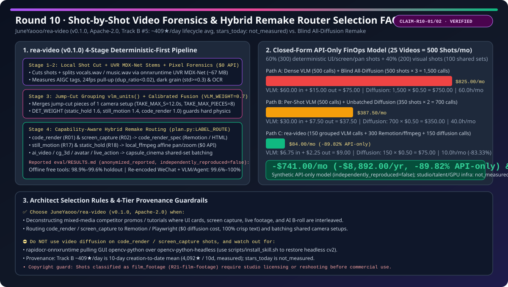
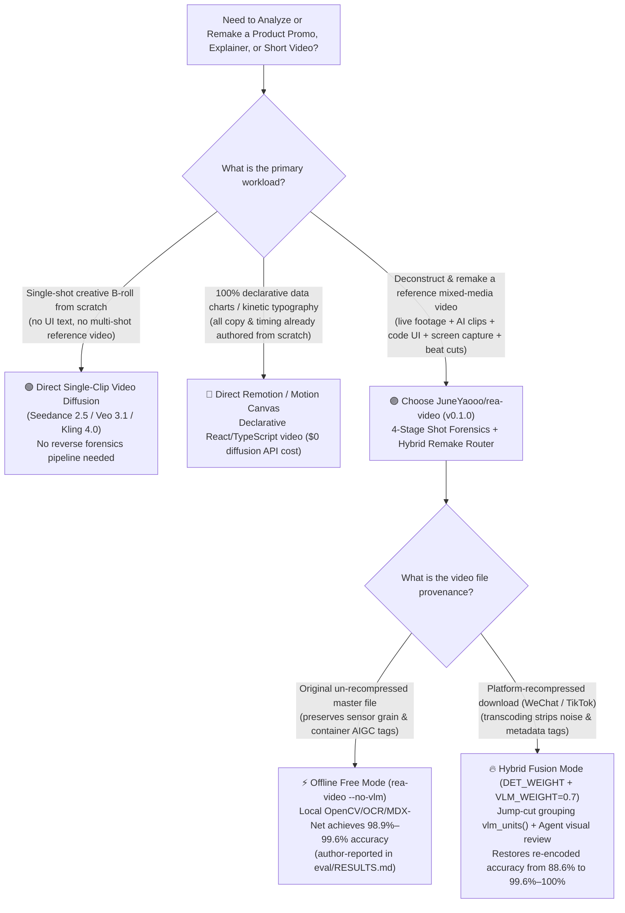
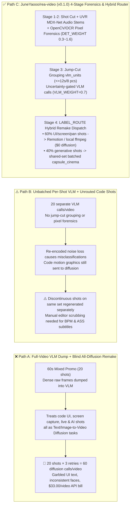

# Shot-by-Shot Video Forensics & Hybrid Remake Routing Selection FAQ: `JuneYaooo/rea-video` vs. Blind All-Diffusion Remake & Manual Timeline Scrubbing

> **Document Type**: AI Solution Architect Architectural Mastery & Selection Guide (Round 10 Deep Dive · Benchmarked against `ib-vs-ethernet-roce-selection-faq.md`)  
> **Evaluation Date**: 2026-11-08 (Sweep ID: `sweep_20261108_2300` · Round 10)  
> **Primary Subject**: [`JuneYaooo/rea-video`](https://github.com/JuneYaooo/rea-video) (`v0.1.0`, `Apache-2.0` License, Python `>=3.10`, Track B New-Repo Breakout #5: `created_at: 2026-10-29`, `4,092` stars in archived `search-new-repos-2026-11-08-raw.json` [`sha256: b63e1547...`] / `4,246`–`4,318` stars via REST verification, `~409` stars/day 10-day creation-to-date lifecycle average, `measured`; single-day increment `stars_today: not_measured`, strictly separated from Track A Daily Trending)  
> **Baseline Comparisons**: ① **Full-Video Multimodal LLM Dump + Blind All-Diffusion Remake**; ② **Unbatched Shot-by-Shot VLM Calls + Manual Premiere/AE Timeline Scrubbing**  
> **Language**: [中文](./rea-video-shot-forensics-vs-diffusion-remake-selection-faq.md) | [English](./rea-video-shot-forensics-vs-diffusion-remake-selection-faq.en.md)

---

## 📌 Executive Summary (Core Takeaways in 3 Minutes)

1. **What `JuneYaooo/rea-video` Actually Is (Plain-Language First Principles)**:  
   When an enterprise product marketing, DevRel, or growth team wants to dissect and remake a high-converting 60-second product launch video (which typically mixes **code-rendered UI motion cards, real software screen recordings, talking-head avatars, live camera footage, and AI-generated B-roll**), traditional approaches fall into two expensive traps:
   - **Trap 1 (Full-Video VLM Dump + Blind All-Diffusion Remake)**: Dumping the entire video into a multimodal LLM (`"Write me the prompts to recreate this video"`) and attempting to regenerate all 20 shots using text/image-to-video diffusion models (`Veo`, `Sora`, `Kling`, `Seedance`). Not only does the LLM misclassify platform-recompressed live footage, but **sending deterministic code-rendered UI cards (`code_render`) and software screen captures (`screen_capture`) through a video diffusion model turns crisp product typography, buttons, and charts into unreadable garbled glyphs**—burning hundreds of dollars in multi-retry video generation API credits.
   - **Trap 2 (Manual Frame-by-Frame Editor Scrubbing)**: Having a motion designer manually scrub Premiere/AE timelines for 2–3 hours per video to count cuts, detect BPM, transcribe ASS subtitle styles, and guess which shots were filmed, 3D-rendered, or coded in Remotion.
   - **`JuneYaooo/rea-video` (`v0.1.0`, Apache-2.0)** solves this with a **4-Stage Deterministic-First Video Forensics & Capability-Routed Hybrid Remake Pipeline**: it runs free local tools first (`ffmpeg` shot boundary detection, `onnxruntime` UVR MDX-Net / Demucs vocal/music stem separation, 24/25fps pull-up duplicate cadence, and dark-block sensor noise guards) to classify every shot across 11 base labels (`live_action`, `ai_video`, `avatar`, `cg_3d`, `code_render`, `screen_capture`, `still_motion`, `static_hold`, etc.), merges jump-cut pieces of the same camera take before calling a VLM, and routes **code UI shots to `Remotion` (`code_render_spec`), pan/zoom stills to local `ffmpeg` (`local_ffmpeg`), and grouped generative shots to first/last-frame video models (`capsule_cinema`)**.
2. **Core Architectural Differentiators (Deterministic Pixel Weights + Jump-Cut VLM Grouping + Hybrid Execution Routing)**:
   - In `rea_video/classify.py`, deterministic evidence carries calibrated per-label weights (`DET_WEIGHT`: `static_hold: 1.6`, `still_motion: 1.4`, `code_render: 1.0`, `live_action: 0.6`, `ai_video: 0.6`) fused against `VLM_WEIGHT = 0.7`—preventing a confident-but-hallucinating VLM from overriding hard 24fps pull-up cadence (`no_repeats`), container AIGC tags (`probe.provenance`), or dark-block sensor noise (`RULES["lowlight"]`).
   - In `rea_video/pipeline.py:vlm_units()`, jump-cut pieces of the same camera setup (`transition_in == "jump"`, up to `TAKE_MAX_S = 12.0s` and `TAKE_MAX_PIECES = 8` segments) are merged into a **single VLM call**, prioritized by `need(u) = duration * (1.05 - sure)`.
3. **Closed-Form Reproducible API-Only FinOps Impact (`25` Mixed Product Videos/Month = `500` Shots/Month, `synthetic, independently_reproduced=false`)**:  
   For a team analyzing and remaking `V_month = 25` mixed-media product videos/month (`20` shots/video = `500` shots/month: **60% = `300` deterministic shots** [`code_render`, `screen_capture`, `still_motion`, `static_hold`] and **40% = `200` generative visual shots** grouped into `100` shared-set generation batches; VLM `$3.00/1M` input, `$15.00/1M` output counted once; commercial video diffusion API `$0.50/generation call`; physical studio filming, actors, and local workstation electricity explicitly labeled `not_measured`):
   - **Path A (Full-Video Dense VLM Dump + Blind All-Diffusion on All 500 Shots × 3 Tries = 1,500 Diffusion Calls/mo)** = **`$825.00/month`** API-only (`$75.00/mo` VLM [`$60.00` input + `$15.00` output] + `$750.00/mo` video diffusion; `$33.00/video`, `60.0h/mo` manual triage);
   - **Path B (Unbatched Per-Shot VLM + Per-Shot Diffusion on 350 Shots × 2 Tries = 700 Diffusion Calls/mo)** = **`$387.50/month`** API-only (`$37.50/mo` VLM [`$30.00` input + `$7.50` output] + `$350.00/mo` video diffusion; `$15.50/video`, `40.0h/mo` manual triage);
   - **Path C (`rea-video` Deterministic Pixel Forensics + `150` Grouped VLM Calls + 300 Deterministic Shots Routed to `$0` Local `Remotion`/`ffmpeg` + 100 Shared-Set Batches × 1.5 Tries = 150 Diffusion Calls/mo)** = **`$84.00/month`** API-only (`$9.00/mo` VLM [`$6.75` input + `$2.25` output] + `$75.00/mo` video diffusion; `$3.36/video`), **saving `$741.00/month` (`$8,892.00/year`, `-89.82%` API-only) vs. Path A and cutting manual timeline/prompt triage from `60.0h/month` to `10.0h/month` (`-50.0h/month`, `-83.33%`)**!

---

## Q1: When Should You Choose `rea-video` Hybrid Routing vs. Pure Video Diffusion vs. Pure Remotion Code?

### Architectural Decision Tree (Mermaid)

---

## Q2: Why Does `rea-video` Strictly Outperform "Full-Video VLM + All-Diffusion Remake" on Mixed-Media Videos?

Primary-source inspection of `JuneYaooo/rea-video` (`rea_video/pipeline.py`, `rea_video/classify.py`, `rea_video/plan.py`, `rea_video/capabilities/MATRIX.md`) verifies three core engineering mechanisms:

### 1. Deterministic Pixel, Cadence & Stem Forensics First (`classify.py` & `stems.py`)
Platform transcoding makes real camera footage look flat and "rendered," while modern AI video models look photorealistic at a glance. `rea-video` measures physical invariants before invoking any LLM:
- **Container & Metadata AIGC Provenance (`probe.provenance`)**: Extracts embedded platform/generator signatures directly from media streams.
- **24/25fps Pull-Up Duplicate-Frame Cadence (`no_repeats`)**: Detects whether duplicate frames follow a 24->30fps telecine pull-up (`dup_ratio < 0.02` or single repeat) versus synthetic frame interpolation.
- **Low-Light Sensor Grain Guard (`RULES["lowlight"]`)**: A code-rendered or 3D-rendered dark background has zero pixel variance (`block std = 0`), whereas real camera footage in dim lighting (`dark_ratio >= 0.15`) retains sensor grain (`dark_std >= 0.3`) alongside facial presence.
- **Small OCR Glyph Density (`overlay.py`)**: Multi-line crisp text with glyph height `< 2%` of frame height deterministically separates `screen_capture` and `code_render` from generative diffusion.
- **UVR MDX-Net / Demucs Audio Stem Separation (`stems.py` + `audio.py`)**: Automatically splits audio into `original.wav`, `vocals.wav`, and `music.wav` via `onnxruntime` (~67 MB UVR MDX-Net model), measuring BPM, beat-cut alignment (`marks`), and AI-generated vocals/music (e.g., Suno).

### 2. Jump-Cut Grouping (`vlm_units`) & Calibrated VLM Fusion Weight (`VLM_WEIGHT = 0.7`)
- **Jump-Cut Grouping Saves VLM Tokens**: Talking-head edits frequently slice a single camera setup into 5–8 rapid jump cuts (`transition_in == "jump"`). `pipeline.py:vlm_units()` groups consecutive jump cuts up to `TAKE_MAX_S = 12.0s` and `TAKE_MAX_PIECES = 8` into **one VLM call**, ranking units by `need(u) = (end - start) * (1.05 - sure)` so VLM calls only target long, pixel-uncertain units.
- **Calibrated `VLM_WEIGHT = 0.7`**: Calibrated on `eval/articles.yaml` (2026-10-30), setting `VLM_WEIGHT = 0.7` against `DET_WEIGHT` (`static_hold: 1.6`, `still_motion: 1.4`, `code_render: 1.0`, `live_action: 0.6`, `ai_video: 0.6`) prevents a hallucinating VLM from overriding hard cadence/pixel evidence while letting the VLM resolve pixel-unmeasured classes (`UNMEASURED = ("anim_2d", "stop_motion", "film_footage")`).

### 3. 11-Class Capability-Aware Remake Routing (`plan.py:LABEL_ROUTE`)
Instead of sending every shot to a video diffusion model, `plan.py` routes each classified shot to its optimal execution engine:

| Base Shot Label (`LABELS`) | Routing Rule (`routing.yaml`) | Target Executor (`executor`) | Remake Execution Mechanism & Cost Profile |
| :--- | :--- | :--- | :--- |
| **`code_render` (Kinetic UI / Cards)** | `R01-code-graphics` | **`code_render_spec`** | Exports text tracks, palette, and motion timing to rebuild in **`Remotion` / `Motion Canvas` / `HTML+GSAP`** (**`$0` video diffusion cost**, 100% crisp text) |
| **`screen_capture` (Software Demo)** | `R02-screen-demo` | **`code_render_spec`** | Flags real product UI capture to record via Playwright or screen capture (**`$0` video diffusion cost**) |
| **`still_motion` (Ken Burns Pan/Zoom)** | `R17-still-motion` | **`local_ffmpeg`** | 1 still image + measured zoom/pan affine parameters executed via local `ffmpeg` (**`$0` video diffusion cost**) |
| **`static_hold` (Frozen Card/Still)** | `R18-static-hold` | **`local_ffmpeg`** | 1 held still frame composited via local `ffmpeg` (**`$0` video diffusion cost**) |
| **`ai_video` / `cg_3d` / `anim_2d`** | `R07` / `R08` / `R19` | **`capsule_cinema`** | Extracts first/last frames (`first_last_frame`) and reverse-engineered prompts; batches discontinuous shots sharing one camera setup into a single generation |
| **`live_action` / `avatar` / `stop_motion`** | `R07` / `R03` / `R20` | **`capsule_cinema`** | Outputs camera setup & 12-lighting gear plan for reshooting, or routes to `image_to_video` / audio-driven avatar (`omnihuman-2.0` / `kling-avatar-v2`) |

---

## Q3: How Do the Three Video Deconstruction & Remake Pipelines Operate Under the Hood?

---

## 📊 Five-Dimensional Comparison Matrix

| Dimension | Path A: Full-Video VLM Dump + Blind All-Diffusion | Path B: Manual Premiere/AE Scrubbing + Unbatched Diffusion | Path C: `JuneYaooo/rea-video` (`v0.1.0`) Deterministic Forensics + Hybrid Router |
| :--- | :--- | :--- | :--- |
| **Production-Method Forensics Accuracy** | Low (confuses platform-transcoded live footage, AI clips, and code renders) | Relies on human motion designer inspection (2–3h per video) | **`98.9%–99.6%` offline free on original files; `99.6%–100%` with VLM + agent review on re-encoded WeChat videos** (`eval/RESULTS.md`, `anonymized_reported, independently_reproduced=false`) |
| **UI Typography & Screen Demo Fidelity** | ❌ **Broken** (video diffusion turns UI buttons and code text into garbled artifacts) | ✅ High (rebuilt manually by motion editors at high labor cost) | ✅ **100% Pixel-Exact** (`code_render` and `screen_capture` routed to `Remotion` / real capture at `$0` diffusion cost) |
| **Cross-Shot Set & Character Continuity** | ❌ Poor (5 dialogue shots interrupted by UI cards are generated 5 separate times) | ⚠️ Medium (requires manual reference frame stitching) | ✅ **High** (detects shared camera setups across interrupted cuts and batches them into a single generation pass) |
| **Audio Stems, Beat Cut & Subtitle Export** | ❌ None (VLM cannot output millisecond-accurate SRT/ASS or separated audio stems) | ⚠️ Requires separate audio/subtitle tools and manual beat marking | ✅ **Built-in `onnxruntime` UVR MDX-Net stem separation + BPM/beat-cut alignment + styled SRT/ASS export** |
| **License & Coding Agent Integration** | Proprietary SaaS or ad-hoc prompts | Manual desktop NLE workflow | **`Apache-2.0` Open Source** (one-command Skill install for Claude Code, Codex, and OpenClaw via `scripts/install_skill.sh`) |

---

## 💰 Closed-Form FinOps Worked Example & 7-Card Insights (`25` Mixed Product Videos/Month = `500` Shots/Month)

> **Provenance Gate**:  
> - `JuneYaooo/rea-video` version (`v0.1.0`), `Apache-2.0` license, 11 `LABELS`, `VLM_WEIGHT = 0.7`, `TAKE_MAX_S = 12.0` / `TAKE_MAX_PIECES = 8`, and `LABEL_ROUTE` are verified directly from primary repository source code (**`measured`**, `CLAIM-R10-01`);  
> - Shot-duration-weighted classification accuracy figures (`98.3%` tuning, `99.6% / 98.9%` holdout, `88.6% -> 99.6% -> 100%` on re-encoded WeChat videos) are author-reported in `eval/RESULTS.md` (**`anonymized_reported, independently_reproduced=false`**);  
> - The 25-video/month (`500` shots/month) cost comparison below is an explicitly parameterized **API-Only Architect Synthetic Model (`synthetic, independently_reproduced=false`, `CLAIM-R10-02`)**. **Physical studio filming equipment, human actor talent fees, and local workstation GPU electricity are not measured in this benchmark and are explicitly labeled `not_measured`**.

### 1. Sealed Input Parameters
- **Monthly Workload**: `V_month = 25` mixed-media product videos/month × `S_video = 20` shots/video = **`S_month = 500` total shots/month**.
- **Shot Mix (Modeled on `rea-video` Official Case #2 Mixed Clip & Case #4 Code Promo)**:
  - **60% Deterministic Non-Diffusion Shots (`300` shots/month)**: `code_render` kinetic UI cards, `screen_capture` software recordings, `still_motion` pan/zoom stills, and `static_hold` freeze cards.
  - **40% Generative Visual Shots (`200` shots/month)**: `ai_video`, `avatar`, `cg_3d`, and AI-approximated `live_action` shots; grouping discontinuous shots that share a camera setup merges these `200` shots into **`B_gen = 100` unique generation batches/month**.
- **API Pricing (Output Counted Strictly Once)**:
  - Multimodal VLM API: **`$3.00 / 1M` input tokens**, **`$15.00 / 1M` output tokens**.
  - Commercial HD Video Diffusion API (per 5s clip generation call): **`$0.50 / call`**.

### 2. Component-by-Component Closed-Form Derivation

1. **Path A (Full-Video Dense VLM Dump + Blind All-Diffusion on All 500 Shots)**:
   - **VLM Analysis Cost** (`500` ungrouped shot calls/mo, `0.040M` input + `0.002M` output per shot):
     $$\text{VLM Input}_{\text{A}} = 500 \times 0.040 \times \$3.00 = \$60.00/\text{mo}$$
     $$\text{VLM Output}_{\text{A}} = 500 \times 0.002 \times \$15.00 = \$15.00/\text{mo}$$
     $$\text{VLM Subtotal}_{\text{A}} = \$60.00 + \$15.00 = \$75.00/\text{mo}$$
   - **Video Diffusion Generation Cost** (`500` shots × `3` tries/shot due to garbled UI typography & unbatched continuity failures = `1,500` calls/mo):
     $$\text{Diffusion}_{\text{A}} = 1,500 \times \$0.50 = \$750.00/\text{mo}$$
   - **Path A Monthly API-Only Total**:
     $$\text{Total API}_{\text{A}} = \$75.00 + \$750.00 = \mathbf{\$825.00/\text{mo}} \quad (\$33.00/\text{video})$$
   - **Manual Timeline & Prompt Triage Effort**: `2.4h/video × 25 videos = 60.0h/mo`.

2. **Path B (Unbatched Per-Shot VLM + Per-Shot Video Diffusion on 350 Shots)**:
   - **VLM Analysis Cost** (`500` shot calls/mo, `0.020M` input + `0.001M` output per shot):
     $$\text{VLM Input}_{\text{B}} = 500 \times 0.020 \times \$3.00 = \$30.00/\text{mo}$$
     $$\text{VLM Output}_{\text{B}} = 500 \times 0.001 \times \$15.00 = \$7.50/\text{mo}$$
     $$\text{VLM Subtotal}_{\text{B}} = \$30.00 + \$7.50 = \$37.50/\text{mo}$$
   - **Video Diffusion Generation Cost** (skips `150` pure screen/static shots, runs `350` shots × `2` tries/shot = `700` calls/mo):
     $$\text{Diffusion}_{\text{B}} = 700 \times \$0.50 = \$350.00/\text{mo}$$
   - **Path B Monthly API-Only Total**:
     $$\text{Total API}_{\text{B}} = \$37.50 + \$350.00 = \mathbf{\$387.50/\text{mo}} \quad (\$15.50/\text{video})$$
   - **Manual Timeline & Prompt Triage Effort**: `1.6h/video × 25 videos = 40.0h/mo`.

3. **Path C (`JuneYaooo/rea-video` Deterministic Pixel Forensics + Jump-Cut Grouped VLM + 60% Deterministic Shots to `$0` Local `Remotion`/`ffmpeg` + 40% Shared-Set Batched Diffusion)**:
   - **VLM Analysis Cost** (deterministic layer filters clear shots locally; `vlm_units()` groups jump-cuts into `6` VLM unit calls/video × `25` videos = `150` VLM calls/mo, `0.015M` input + `0.001M` output per call):
     $$\text{VLM Input}_{\text{C}} = 150 \times 0.015 \times \$3.00 = \$6.75/\text{mo}$$
     $$\text{VLM Output}_{\text{C}} = 150 \times 0.001 \times \$15.00 = \$2.25/\text{mo}$$
     $$\text{VLM Subtotal}_{\text{C}} = \$6.75 + \$2.25 = \$9.00/\text{mo}$$
   - **Video Diffusion Generation Cost** (`300` deterministic `code_render`/`screen_capture`/`still_motion`/`static_hold` shots routed to local `Remotion` and `local_ffmpeg` at **`$0.00` diffusion API cost**; `200` generative shots batched across shared camera setups into `100` batches × `1.5` tries = `150` calls/mo):
     $$\text{Diffusion}_{\text{C}} = 150 \times \$0.50 = \$75.00/\text{mo}$$
   - **Path C Monthly API-Only Total**:
     $$\text{Total API}_{\text{C}} = \$9.00 + \$75.00 = \mathbf{\$84.00/\text{mo}} \quad (\$3.36/\text{video})$$
   - **Manual Review & Asset Swap Effort**: `0.4h/video × 25 videos = 10.0h/mo`.

### 3. Closed-Form Summary Comparison Table

| Pipeline Path | VLM Calls/mo | VLM Input/mo | VLM Output/mo (Counted Once) | Diffusion Calls/mo (`$0.50/call`) | Diffusion Cost/mo | **Monthly API-Only Total** | API Cost/Video | Manual Triage Hours | Studio/Talent/GPU Infra Bill |
| :--- | :---: | :---: | :---: | :---: | :---: | :---: | :---: | :---: | :---: |
| **Path A: Dense VLM + Blind All-Diffusion** | `500` | `$60.00` | `$15.00` | `1,500` (`500×3`) | `$750.00` | **`$825.00/mo`** | `$33.00/video` | `60.0h/mo` | `not_measured` |
| **Path B: Unbatched VLM + 350-Shot Diffusion** | `500` | `$30.00` | `$7.50` | `700` (`350×2`) | `$350.00` | **`$387.50/mo`** | `$15.50/video` | `40.0h/mo` | `not_measured` |
| **Path C: `rea-video` Forensics + Hybrid Router** | **`150`** | **`$6.75`** | **`$2.25`** | **`150`** (`100×1.5`) | **`$75.00`** | **`$84.00/mo`** | **`$3.36/video`** | **`10.0h/mo`** | `not_measured` |
| **Net Savings (Path C vs. Path A)** | **`-350 calls`** | **`-$53.25`** | **`-$12.75`** | **`-1,350 calls`** | **`-$675.00`** | **`-$741.00/mo` (`-$8,892.00/yr`, `-89.82%` API-only)** | **`-$29.64/video`** | **`-50.0h/mo` (`-83.33%`)** | `not_measured` |

---

## ✅ Production Verification & 30-Minute PoC Checklist

1. **Dependency & `opencv-python-headless` Collision Check**:
   - [ ] Verify `ffmpeg` and Python `>=3.10` are installed.
   - [ ] Per `pyproject.toml`, installing optional OCR (`rapidocr-onnxruntime`) pulls GUI `opencv-python`, which collides with `opencv-python-headless` in the same `cv2` namespace. Always run `bash scripts/install_skill.sh` so the installer strips the conflicting GUI package and restores headless OpenCV.
2. **Pre-Warm the `67 MB` UVR MDX-Net Audio Stem Model**:
   - [ ] On first run with `stems=True`, `rea-video` downloads a ~`67 MB` `onnxruntime` UVR MDX-Net vocal/music separation model. Pre-bake this model into production container images so air-gapped or serverless workers do not fail on cold start.
3. **Original Master vs. Platform-Recompressed Mode Selection**:
   - [ ] For original camera/render files, run offline deterministic mode (`--no-vlm`) for zero-API-cost `98.9%–99.6%` classification.
   - [ ] For platform-recompressed downloads (WeChat, Douyin, TikTok) where transcoding strips sensor noise and container tags, enable VLM fusion (`VLM_WEIGHT = 0.7`) plus agent visual review on uncertain units.
4. **Enforce Hybrid Remake Routing & Copyright Guards**:
   - [ ] Never route `code_render` or `screen_capture` shots to video diffusion; feed their extracted text tracks and layout specs into `Remotion` (`code_render_spec`) and real Playwright captures. For shots classified as `film_footage`, enforce studio copyright clearance or reshoot before commercial publishing.
