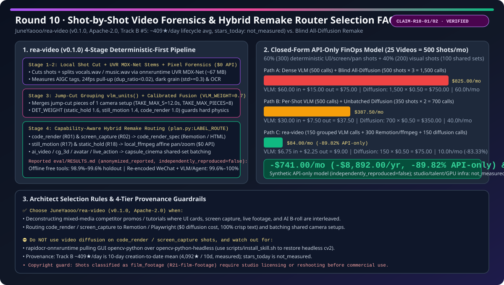
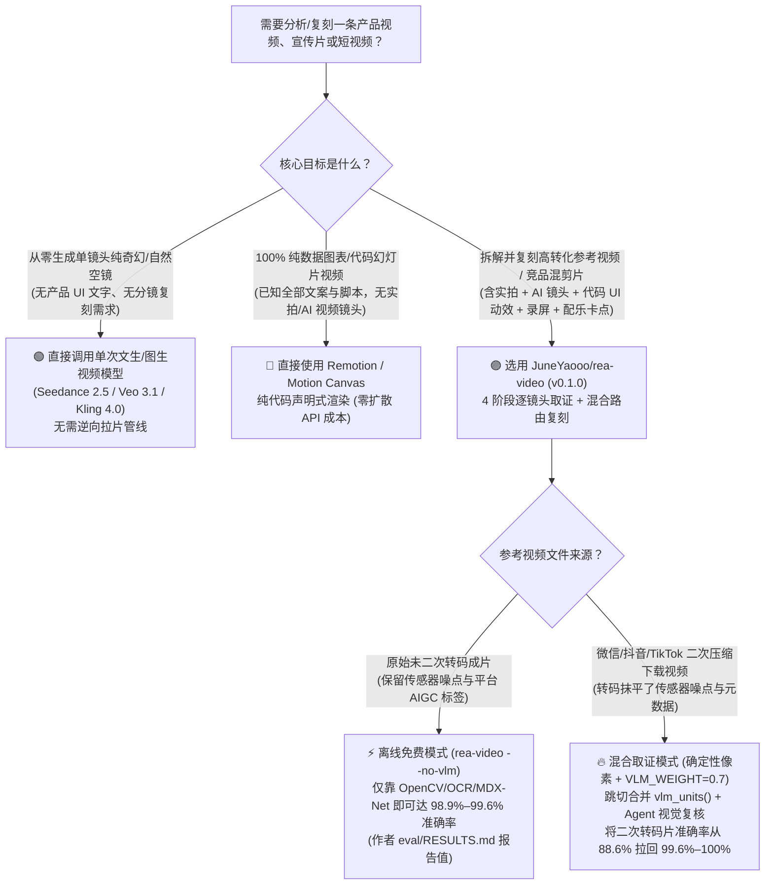
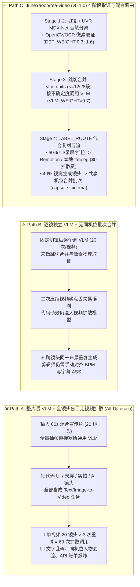

# 逐镜头视频逆向拆解与混合路由复刻选型 FAQ：`JuneYaooo/rea-video` vs 全量视频扩散重生成 & 人工逐帧拉片

> **文档类型**：AI Solution Architect 架构内功与选型指南（Round 10 深度专题 · 对标 `ib-vs-ethernet-roce-selection-faq.md`）  
> **评测日期**：2026-11-08（Sweep ID: `sweep_20261108_2300` · Round 10）  
> **对标主角**：[`JuneYaooo/rea-video`](https://github.com/JuneYaooo/rea-video)（`v0.1.0`，`Apache-2.0` 协议，Python `>=3.10`，Track B 新建黑马榜 #5：`created_at: 2026-10-29`，归档 `search-new-repos-2026-11-08-raw.json` [`sha256: b63e1547...`] 抓获 `4,092` 星 / REST 核验 `4,246`–`4,318` 星，建仓 10 天生命周期日均 `≈409★/天`，`measured`；单日增量 `stars_today: not_measured`，严禁混入 Track A 单日飙升榜）  
> **对标基线**：① **全量视频丢给多模态大模型 + 全镜头视频扩散重生成（Full-Video VLM Dump + Blind All-Diffusion Remake）**；② **逐镜头无分组 VLM 调用 + 人工剪辑师 Premiere/AE 逐帧拉片复刻（Unbatched Shot-by-Shot VLM & Manual Timeline Scrubbing）**  
> **语言版本**：[中文](./rea-video-shot-forensics-vs-diffusion-remake-selection-faq.md) | [English](./rea-video-shot-forensics-vs-diffusion-remake-selection-faq.en.md)

---

## 📌 核心结论速览（Executive Summary — 3 分钟掌握选型精髓）

1. **`JuneYaooo/rea-video` 到底是个什么东西？（大白话第一性原理）**：  
   企业市场部、开发者生态（DevRel）或电商增长团队看到一条高转化的 60 秒产品宣传片（往往混杂了 **代码驱动的 UI 动效卡片、真实软件录屏、数字人口播、实拍镜头与 AI 生成的过场画面**），想快速拆解它的制作配方并复刻成自家产品版本时，传统做法经常踩进两个大坑：
   - **大坑一（全量丢给多模态大模型 + 全镜头用 Sora/Veo/Kling/Seedance 扩散生成）**：把整条视频喂给多模态大模型问“帮我写复刻 Prompt”，然后试图把里面 20 个镜头全部用文生视频/图生视频模型重新“画”一遍。结果不仅平台二次压缩后的实拍画面被大模型误判，更致命的是**原本用代码（Remotion/HTML）渲染的清晰 UI 卡片和真实软件录屏，一旦走视频扩散模型，上面的产品文字、图表和按钮立刻变成扭曲乱码**，单镜头重试 3–5 次依然不可用，白白烧掉几百美元视频生成 API 账单。
   - **大坑二（人工剪辑师在 Premiere/AE 逐帧拉片）**：靠资深动效师肉眼数切镜点、猜 BGM 节拍（BPM）、扒字幕样式、逐个镜头猜是实拍、3D 还是代码做的，拆解一条 60 秒混剪片就要花掉 2–3 小时。
   - **`JuneYaooo/rea-video`（`v0.1.0`，Apache-2.0）** 给出了工业级解法：**“确定性像素/音轨取证优先 + 跳切机位聚合 VLM 复核 + 按镜头生产方式混合路由复刻（Deterministic-First Video Forensics & Capability-Routed Hybrid Remake）”**。它先用本地免费工具完成切镜、UVR MDX-Net/Demucs 人声与配乐分轨、24/25fps 抽帧节律与暗部传感器噪点检测，把全片每一个镜头精准定性为 11 类基底标签（`live_action`、`ai_video`、`avatar`、`cg_3d`、`code_render`、`screen_capture`、`still_motion`、`static_hold` 等），再按 `plan.py:LABEL_ROUTE` 把 **代码 UI 镜头路由给 `Remotion`（`code_render_spec`）、静态推拉路由给本地 `ffmpeg`（`local_ffmpeg`）、同机位 AI/实拍镜头合并后路由给首尾帧/多参考视频模型（`capsule_cinema`）**。
2. **核心架构分野（确定性像素取证权重压舱 + 跳切合并省 VLM + 混合执行路由省 80%+ 视频扩散费）**：
   - 在 `rea_video/classify.py` 中，作者没有盲目迷信多模态大模型，而是设计了 **确定性层权重（`DET_WEIGHT`：`static_hold: 1.6`、`still_motion: 1.4`、`code_render: 1.0`、`live_action: 0.6`、`ai_video: 0.6`）与 VLM 融合权重（`VLM_WEIGHT = 0.7`）**：对于是否静止、是否单张图刚性推拉（Ken Burns）、是否有平台 AIGC 隐式元数据（`probe.provenance`）、是否符合 24->30fps 抽帧节律（`no_repeats`），确定性像素统计拥有一票否决权，防止自信但看走眼的 VLM 推翻硬证据。
   - 在 `rea_video/pipeline.py:vlm_units()` 中，同一机位被剪碎的跳切片段（`transition_in == "jump"`，最长 `TAKE_MAX_S = 12.0s`、最多 `TAKE_MAX_PIECES = 8` 段）被合并为 **1 次 VLM 调用**，且按 `need(u) = duration * (1.05 - sure)` 只把 VLM 预算花在像素统计最不确定的长镜头上。
3. **定量纯 API FinOps 收益（25 条混合产品视频/月 = 500 个镜头/月闭式合成算例，`synthetic, independently_reproduced=false`）**：  
   在月产 `V_month = 25` 条 20 镜头混合产品视频（共 `500` 个镜头/月：其中 **60% = `300` 个确定性镜头**［`code_render` UI 动效、`screen_capture` 录屏、`still_motion` 推拉、`static_hold` 静帧］，**40% = `200` 个生成式视觉镜头**［合并同机位后为 `100` 个独立生成批次］；VLM 输入 `$3.00/1M`、输出 `$15.00/1M`，商用视频扩散 API `$0.50/次生成`；场地实拍、真人演员与本地工作站电费明确标为 `not_measured`）的闭式模型下：
   - **Path A（全量帧丢 VLM + 全镜头盲目走视频扩散重生成，500 镜头 × 3 次重试 = 1,500 次视频扩散）**：月度纯 API 总账单 = **`$825.00/月`**（VLM `$75.00/月`［输入 `$60.00` + 输出 `$15.00` 单次计入］+ 视频扩散 `$750.00/月`；单条视频 `$33.00`，人工拉片与改错工时 `60.0h/月`）；
   - **Path B（逐镜头无聚合 VLM + 除录屏/静帧外 350 镜头逐个走视频扩散，350 × 2 次 = 700 次视频扩散）**：月度纯 API 总账单 = **`$387.50/月`**（VLM `$37.50/月`［输入 `$30.00` + 输出 `$7.50`］+ 视频扩散 `$350.00/月`；单条视频 `$15.50`，人工工时 `40.0h/月`）；
   - **Path C（`rea-video` 像素取证 + 跳切聚合 `150` 次 VLM 调用 + 300 个确定性镜头走 `$0` 本地 `Remotion`/`ffmpeg` + 100 个同机位批次 × 1.5 次 = 150 次视频扩散）**：月度纯 API 总账单 = **`$84.00/月`**（VLM `$9.00/月`［输入 `$6.75` + 输出 `$2.25`］+ 视频扩散 `$75.00/月`；单条视频 `$3.36`），**相比 Path A 纯 API 账单月省 `$741.00/月`（年省 `$8,892.00/年`，降幅 `-89.82%` API-only），人工拉片与复刻排障工时从 `60.0h/月` 降至 `10.0h/月`（月省 `50.0h/月`，降幅 `-83.33%`）**！

---

## Q1：什么时候用 `rea-video` 逐镜头混合路由，什么时候用纯视频扩散模型或纯 Remotion 代码？

用一个最直白的比喻：
- **纯视频扩散模型（Veo 3.1 / Seedance 2.5 / Kling 4.0）** 就像 **“印象派特效画师”**：擅长画流体、光影、人物动作和奇幻场景，但只要让他画一张带精确小字、真实产品界面或数据图表的 SaaS 宣传卡片，字迹立刻糊成乱码。
- **纯代码渲染（Remotion / Motion Canvas）** 就像 **“精准的前端排版引擎”**：字体、字距、曲率 100% 像素级可控且零 API 成本，但它画不出真人手持开箱或水墨光影特效。
- **`JuneYaooo/rea-video`（`v0.1.0`）** 则是站在最前面的 **“总导演拉片台与智能分包路由器”**：先把参考视频按切镜拆开，精准鉴定“第 1、4、5 镜是同一机位拍的真人对话，第 2、3 镜是 Remotion 代码写的 UI 动效，第 6 镜是真实网页录屏，BGM 是 122 BPM 曲库配乐”，然后把代码镜头派给 Remotion、录屏镜头派给 Playwright、同机位真人镜头打包成 1 次多参考视频生成任务。

### 选型决策树（Mermaid）

---

## Q2：在混合媒体视频拆解与复刻中，为什么 `rea-video` 严格优于“整片喂给 VLM + 全镜头视频扩散”？

我们在 `JuneYaooo/rea-video` 的一手源码（`rea_video/pipeline.py`、`rea_video/classify.py`、`rea_video/plan.py`、`rea_video/capabilities/MATRIX.md`）中核验到三个决定性的架构机制：

### 1. 确定性像素与声学取证先行（Hard Evidence Beats "Looks Like"）
很多 AI 视频之所以能骗过肉眼甚至骗过通用 VLM，是因为画面光影很逼真；而社交平台二次压缩（WeChat / TikTok 重编码）又会把真实手机拍摄的画面压得像“塑料感渲染图”。`rea-video` 在 `classify.py` 与 `features.py` 中用数学特征守住了底线：
- **AIGC 元数据与容器指纹（`probe.provenance`）**：直接检测视频容器与流中的隐式 AIGC 签名标签。
- **帧率抽帧节律校验（`no_repeats`）**：电影/实拍 24/25fps 转 30fps 时每 5 帧会出现规律性的帧重复，而特定生成模型具有固定帧节律。
- **暗部传感器颗粒度守卫（`RULES["lowlight"]`）**：代码或 3D 渲染出的纯黑背景像素标准差为 `0`（`block std = 0`），而真实摄像头在暗光下（`dark_ratio >= 0.15`）即便接近全黑依然带有传感器噪点（`dark_std >= 0.3`）。
- **细小 UI 文字密度守卫（`overlay.py`）**：字高小于画面高度 `2%` 的多行密集清晰小字是 `screen_capture` 或 `code_render` 的铁证，绝不可能是常规 3D 或扩散模型直接生成的。
- **UVR MDX-Net / Demucs 音轨剥离（`stems.py` + `audio.py`）**：首次运行自动加载约 `67 MB` 的 `onnxruntime` UVR MDX-Net 模型，将音轨剥离为人声（`vocals.wav`）与伴奏（`music.wav`），精准计算 BPM、调性、切镜是否卡在节拍点（`marks`）以及歌声是否由 Suno 等 AI 音乐模型生成。

### 2. 跳切同机位合并（`vlm_units`）与受控 VLM 融合权重（`VLM_WEIGHT = 0.7`）
- **跳切合并省 Token**：短视频里常把一段 10 秒的真人说话剪成 6 个跳切镜头（`transition_in == "jump"`）。传统脚本会发起 6 次 VLM 调用；`pipeline.py:vlm_units()` 将 `<= 12.0s`（`TAKE_MAX_S`）、`<= 8` 段（`TAKE_MAX_PIECES`）的同机位跳切合并为 **1 个 VLM 单元**，并按不确定度排序公式 `need(u) = (end - start) * (1.05 - sure)` 只把配额（默认 `max_shots_vlm = 60`）分给像素统计拿不准的镜头。
- **受控融合权重（`VLM_WEIGHT = 0.7`）**：源码注释明确记录了作者在 `eval/articles.yaml`（2026-10-30）上的校准发现——当 `VLM_WEIGHT = 1.0` 时，过度自信的 VLM 会错误推翻 24fps 节律和转码证据；压低到 **`0.7`** 并配合高确定性权重（`static_hold: 1.6`、`still_motion: 1.4`、`code_render: 1.0`），既保留了 VLM 识别 2D 动画/定格动画/影视片段（`UNMEASURED`）的优势，又守住了物理像素铁证。

### 3. 11 类镜头到最佳执行引擎的能力路由表（`plan.py:LABEL_ROUTE`）
拆解完每个镜头后，`plan.py` 不会傻瓜式地把所有镜头都发给视频生成模型，而是按 `LABEL_ROUTE` 精准分流：

| 镜头基底类别 (`LABELS`) | 路由规则 (`routing.yaml`) | 目标执行器 (`executor`) | 复刻执行方式与成本特征 |
| :--- | :--- | :--- | :--- |
| **`code_render`（代码/模板动效）** | `R01-code-graphics` | **`code_render_spec`** | 导出文字轨、色板与运动时序，交由 **`Remotion` / `Motion Canvas` / `HTML+GSAP`** 100% 像素级重建，**视频扩散 API 成本 `$0`** |
| **`screen_capture`（真实录屏/截图）** | `R02-screen-demo` | **`code_render_spec`** | 标记为需替换的真实产品界面资产，用 Playwright 或真实录屏替换，**视频扩散 API 成本 `$0`** |
| **`still_motion`（静态图推拉摇移）** | `R17-still-motion` | **`local_ffmpeg`** | 仅生成/替换 1 张静态图 + 用测得的缩放/平移仿射参数在本地 `ffmpeg` 精确复刻，**视频扩散 API 成本 `$0`** |
| **`static_hold`（静帧定格）** | `R18-static-hold` | **`local_ffmpeg`** | 1 张静态图定格合成，**视频扩散 API 成本 `$0`** |
| **`ai_video` / `cg_3d` / `anim_2d`** | `R07` / `R08` / `R19` | **`capsule_cinema`** | 提取原镜头首尾帧（`first_last_frame`）与逆向 Prompt，且将共享同一场景的多段穿插镜头合并批次生成 |
| **`live_action` / `avatar` / `stop_motion`** | `R07` / `R03` / `R20` | **`capsule_cinema`** | 输出景别/机位/12 种打光方案供重拍；无实拍条件时走 `image_to_video` 或音频驱动数字人（`omnihuman-2.0` / `kling-avatar-v2`） |

---

## Q3：三套视频拆解与复刻路径的底层流水线是怎么运作的？

### 架构对比图（Path A 全量盲目扩散 vs Path B 逐镜无路由 vs Path C `rea-video` 确定性取证 + 混合路由）

---

## 📊 同类视频逆向与复刻方案五维选型对比矩阵

| 评估维度 | Path A：通用 VLM 整片提问 + 全镜头视频扩散重生成 | Path B：人工 Premiere/AE 拉片 + 逐镜独立视频生成 | Path C：`JuneYaooo/rea-video` (`v0.1.0`) 确定性取证 + 混合路由 |
| :--- | :--- | :--- | :--- |
| **生产方式鉴定准确率** | 低（无法区分平台二次压缩实拍 vs AI 视频 vs 代码动效） | 依赖资深剪辑师经验（人工拉片耗时长） | **原生视频离线免费工具达 `98.9%–99.6%`；微信二次压缩片加 VLM/Agent 复核达 `99.6%–100%`**（`eval/RESULTS.md` 作者报告，`anonymized_reported, independently_reproduced=false`） |
| **代码 UI 与录屏镜头还原度** | ❌ **极差**（视频扩散模型会把 UI 按钮与代码文字画成乱码） | ✅ 高（人工在 AE/Remotion 重写，但极耗工时） | ✅ **100% 像素级清晰**（自动识别 `code_render`/`screen_capture` 并导出文字轨/时序交由 `Remotion` 或录屏重建） |
| **跨镜头角色与布景一致性** | ❌ 差（被 UI 打断的 5 段同机位对话分 5 次生成导致人物变脸） | ⚠️ 中（需人工手动拼凑首尾参考图） | ✅ **高**（自动识别穿插镜头共享同一机位 Setup，合并为单次生成批次并复用参考图） |
| **音轨、BPM 与字幕级工程导出** | ❌ 无（VLM 无法输出精确毫秒级 SRT/ASS 与分轨音频） | ⚠️ 需人工用第三方工具扒轨打轴 | ✅ **内置 `onnxruntime` UVR MDX-Net 人声/配乐分离 + BPM/节拍卡点检测 + 带样式的 SRT/ASS 字幕导出** |
| **开源协议与 Agent 生态集成** | 闭源商业工作流或零散脚本 | 传统桌面剪辑软件手工流 | **`Apache-2.0` 开源协议**（原生提供 Claude Code / Codex / OpenClaw Skill 一键安装 `scripts/install_skill.sh`） |

---

## 💰 定量算例与 7-Card 洞察：月产 25 条混合产品视频（500 镜头/月）的闭式 FinOps 复算

> **数据来源与口径声明（Provenance Gate）**：  
> - `JuneYaooo/rea-video` 的版本号（`v0.1.0`）、`Apache-2.0` 协议、11 类 `LABELS`、融合权重 `VLM_WEIGHT = 0.7`、跳切阈值 `TAKE_MAX_S = 12.0` / `TAKE_MAX_PIECES = 8` 及路由表 `LABEL_ROUTE` 来自 GitHub 一手源码实测核验（**`measured`**，见 `CLAIM-R10-01`）；  
> - `eval/RESULTS.md` 中的分类准确率（离线工具 `98.3%` / `99.6%` / `98.9%`、微信二次转码片 `88.6% -> 99.6% -> 100%`）来自作者公开评测集报告（**`anonymized_reported, independently_reproduced=false`**）；  
> - 下方月产 `25` 条混合媒体宣传片（`500` 个镜头/月）的对比算例为 **显式参数化的纯 API 架构师合成算例（`synthetic, independently_reproduced=false`，见 `CLAIM-R10-02`）**。**线下摄影棚租赁、真人演员出场费与本地工作站 GPU 电费在本次评测中未做实测，统一显式标注为 `not_measured`**，严禁将纯 API 账单节省冒充包含线下实拍的完整制作总成本。

### 1. 显式密封输入参数（Sealed Input Parameters）
- **月度视频拆解与复刻规模**：`V_month = 25` 条混合产品宣传片/月，每条视频平均 `S_video = 20` 个镜头 → 月度总镜头数 **`S_month = 500` 个镜头/月**。
- **典型 SaaS/产品宣传片镜头结构（对标 `rea-video` 官方 Case #2 混合片 & Case #4 代码动效宣传片）**：
  - **确定性非扩散镜头（占比 60% = `300` 个镜头/月）**：含 `code_render` 代码 UI 动效、[`screen_capture`] 真实界面录屏、[`still_motion`] 静态图推拉、[`static_hold`] 静帧卡片。
  - **生成式视觉镜头（占比 40% = `200` 个镜头/月）**：含 `ai_video`、`avatar`、`cg_3d` 及无实拍条件下的 `live_action` 替代镜头；由于同一机位对话经常被 UI 画面切分成多段（如 Case #2 中 5 段对话共享 1 个机位），通过 `rea-video` 同机位聚合后归并为 **`B_gen = 100` 个独立生成批次/月**。
- **API 计费单价（输出严格单次计入，绝不重复计费）**：
  - 多模态 VLM 分析费率：输入 **`$3.00 / 1M tokens`**，输出 **`$15.00 / 1M tokens`**。
  - 商用高清视频扩散生成 API 费率（单次 5s 镜头生成）：**`$0.50 / 次调用`**。

### 2. 三条路径的分项闭式复算公式（Component-by-Component Closed-Form Derivation）

1. **Path A（整片密集抽帧喂 VLM + 500 个镜头全部盲目走视频扩散重生成）**：
   - **VLM 分析费用**：未做跳切合并，按 `500` 个镜头密集抽帧调用 VLM，单镜头消耗 `0.040M` 输入 Tokens + `0.002M` 输出 Tokens：
     $$\text{VLM Input}_{\text{A}} = 500 \times 0.040 \times \$3.00 = \$60.00/\text{月}$$
     $$\text{VLM Output}_{\text{A}} = 500 \times 0.002 \times \$15.00 = \$15.00/\text{月}$$
     $$\text{VLM Subtotal}_{\text{A}} = \$60.00 + \$15.00 = \$75.00/\text{月}$$
   - **视频扩散生成费用**：将全部 `500` 个镜头（含 UI 代码卡片与录屏）送入视频扩散模型，因画内 UI 文字乱码与跨镜头变脸平均每镜头重试 `3` 次（共 `500 × 3 = 1,500` 次生成调用/月）：
     $$\text{Diffusion}_{\text{A}} = 1,500 \times \$0.50 = \$750.00/\text{月}$$
   - **Path A 月度纯 API 账单**：
     $$\text{Total API}_{\text{A}} = \$75.00 + \$750.00 = \mathbf{\$825.00/\text{月}} \quad (\$33.00/\text{条视频})$$
   - **人工拉片与废片重抽排障工时**：`2.4h/条 × 25 条 = 60.0h/月`。

2. **Path B（逐镜头独立 VLM 调用 + 除静帧/录屏外 350 个镜头逐个走视频扩散）**：
   - **VLM 分析费用**：对 `500` 个镜头逐个调用 VLM（单镜头 `0.020M` 输入 + `0.001M` 输出）：
     $$\text{VLM Input}_{\text{B}} = 500 \times 0.020 \times \$3.00 = \$30.00/\text{月}$$
     $$\text{VLM Output}_{\text{B}} = 500 \times 0.001 \times \$15.00 = \$7.50/\text{月}$$
     $$\text{VLM Subtotal}_{\text{B}} = \$30.00 + \$7.50 = \$37.50/\text{月}$$
   - **视频扩散生成费用**：人工剔除 `150` 个纯录屏/静帧，但仍将其余 `350` 个镜头（含 `code_render` 动效与未合并同机位镜头）逐个送入视频扩散模型，平均每镜头生成 `2` 次（共 `350 × 2 = 700` 次生成调用/月）：
     $$\text{Diffusion}_{\text{B}} = 700 \times \$0.50 = \$350.00/\text{月}$$
   - **Path B 月度纯 API 账单**：
     $$\text{Total API}_{\text{B}} = \$37.50 + \$350.00 = \mathbf{\$387.50/\text{月}} \quad (\$15.50/\text{条视频})$$
   - **人工拉片与时间轴对齐工时**：`1.6h/条 × 25 条 = 40.0h/月`。

3. **Path C（`JuneYaooo/rea-video` 确定性像素取证 + 跳切合并 VLM + 60% 镜头路由至本地 `Remotion`/`ffmpeg` + 40% 镜头同机位批次扩散生成）**：
   - **VLM 分析费用**：确定性层在本地免费拦截高确定性镜头，并通过 `vlm_units()` 将同机位跳切合并，每条视频仅需 `6` 次 VLM 单元调用（月度共 `150` 次 VLM 单元调用/月，单次 `0.015M` 输入 + `0.001M` 输出）：
     $$\text{VLM Input}_{\text{C}} = 150 \times 0.015 \times \$3.00 = \$6.75/\text{月}$$
     $$\text{VLM Output}_{\text{C}} = 150 \times 0.001 \times \$15.00 = \$2.25/\text{月}$$
     $$\text{VLM Subtotal}_{\text{C}} = \$6.75 + \$2.25 = \$9.00/\text{月}$$
   - **视频扩散生成费用**：`300` 个确定性镜头（`code_render`、`screen_capture`、`still_motion`、`static_hold`）按 `LABEL_ROUTE` 路由至本地 `Remotion` 与 `local_ffmpeg`（**视频扩散 API 费用 = `$0.00`**，且 UI 文字 100% 锐利可读）；其余 `200` 个生成式镜头按共享机位合并为 `100` 个 `first_last_frame` / `multi_reference` 批次，平均每批次 `1.5` 次生成（共 `100 × 1.5 = 150` 次生成调用/月）：
     $$\text{Diffusion}_{\text{C}} = 150 \times \$0.50 = \$75.00/\text{月}$$
   - **Path C 月度纯 API 账单**：
     $$\text{Total API}_{\text{C}} = \$9.00 + \$75.00 = \mathbf{\$84.00/\text{月}} \quad (\$3.36/\text{条视频})$$
   - **人工复核与替换实拍录屏素材工时**：`0.4h/条 × 25 条 = 10.0h/月`。

### 3. 汇总对比表（100% 可复算闭式对账）

| 路径方案 | VLM 调用数/月 | VLM 输入费/月 | VLM 输出费/月 (单次计入) | 视频扩散调用数/月 (`$0.50/次`) | 视频扩散费/月 | **月度纯 API 总账单** | 单视频 API 成本 | 人工拉片/排障工时 | 线下实拍/硬件电费 |
| :--- | :---: | :---: | :---: | :---: | :---: | :---: | :---: | :---: | :---: |
| **Path A：整片喂 VLM + 全镜头盲目扩散** | `500` | `$60.00` | `$15.00` | `1,500` (`500×3`) | `$750.00` | **`$825.00/月`** | `$33.00/条` | `60.0h/月` | `not_measured` |
| **Path B：逐镜无聚合 VLM + 350 镜扩散** | `500` | `$30.00` | `$7.50` | `700` (`350×2`) | `$350.00` | **`$387.50/月`** | `$15.50/条` | `40.0h/月` | `not_measured` |
| **Path C：`rea-video` 像素取证 + 混合路由** | **`150`** | **`$6.75`** | **`$2.25`** | **`150`** (`100×1.5`) | **`$75.00`** | **`$84.00/月`** | **`$3.36/条`** | **`10.0h/月`** | `not_measured` |
| **Path C vs Path A 净节省** | **`-350 次`** | **`-$53.25`** | **`-$12.75`** | **`-1,350 次`** | **`-$675.00`** | **月省 `$741.00/月`（年省 `$8,892.00/年`，`-89.82%` API-only）** | **`-$29.64/条`** | **月省 `50.0h/月` (`-83.33%`)** | `not_measured` |

---

## ✅ 架构师生产落地与 30 分钟 PoC 核验清单（Production Checklist）

1. **环境依赖与 `opencv-python-headless` 冲突防坑核验**：
   - [ ] 确认宿主机已安装 `ffmpeg` 与 Python `>=3.10`。
   - [ ] 注意 `pyproject.toml` 中的关键工程警告：可选依赖 `rapidocr-onnxruntime` 会顺带安装带 GUI 的 `opencv-python`，与 `opencv-python-headless` 争抢同一个 `cv2` 目录。务必使用官方 `bash scripts/install_skill.sh` 安装（脚本会自动卸载冲突包并重装 headless 版）。
2. **首次运行音频分轨模型预热核验**：
   - [ ] 首次执行包含音轨的视频拆解（`stems=True`）时，`rea-video` 会通过 `onnxruntime` 自动下载约 `67 MB` 的 **UVR MDX-Net** 人声/伴奏分离模型；生产容器镜像构建时应提前缓存该权重，避免无外网沙箱冷启动失败。
3. **原始视频 vs 社交平台二次转码视频的模式切换核验**：
   - [ ] 若拆解的是创作者导出的原始成片，优先开启离线免费模式（仅用确定性像素/元数据/音轨工具，无需配置 VLM Key）。
   - [ ] 若拆解的是从微信视频号、抖音或 TikTok 下载的二次压缩视频（转码抹平了传感器噪点与平台 AIGC 元数据），必须挂载视觉模型（Gemini / Doubao）或让具备看图能力的 Coding Agent 执行 `review.py` 视觉复核，确保 `VLM_WEIGHT = 0.7` 融合层生效。
4. **混合复刻路由与版权合规核验**：
   - [ ] 检查生成的 `report.html` 与 `plan.py` 输出：凡是被标记为 `code_render` 的镜头，严禁送入视频扩散模型，应直接提取文字轨与色板交由 `Remotion` 渲染；凡是被标记为 `film_footage`（影视剧剪辑片段）的镜头，商用前必须按 `NOTE["film_footage"]` 提示完成片方版权授权或自行实拍替换。
