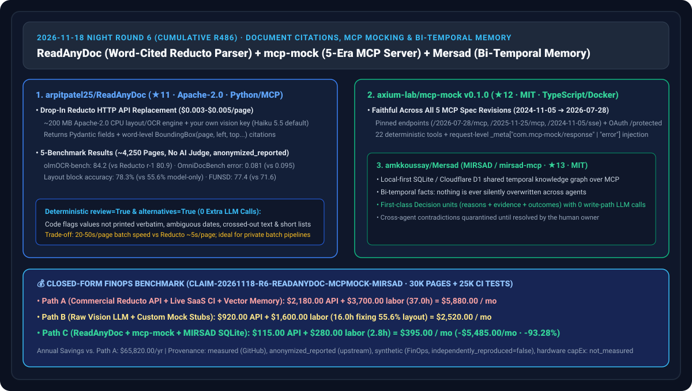
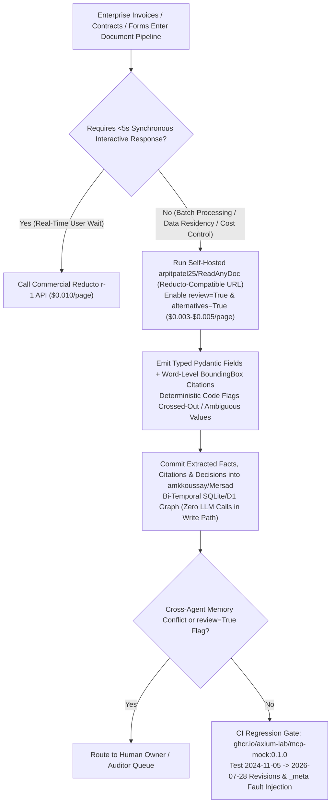

# Word-Cited Reducto-Compatible Document Parser (`arpitpatel25/ReadAnyDoc`), Multi-Revision Deterministic Mock MCP Server (`axium-lab/mcp-mock`) & Bi-Temporal Shared Decision Memory (`amkkoussay/Mersad`) Selection FAQ

> **Document Type**: AI Solution Architect (SA) Practical Selection & Reference Architecture Guide (Round 486 / 2026-11-18 Night R6)  
> **Primary Evaluated Repositories**: [`arpitpatel25/ReadAnyDoc`](https://github.com/arpitpatel25/ReadAnyDoc) (`★ 11`, `2 forks`, Reducto API-compatible vision document parser with word-level bounding-box citations, `Apache-2.0`) + [`axium-lab/mcp-mock`](https://github.com/axium-lab/mcp-mock) (`v0.1.0`, `★ 12`, deterministic mock MCP server spanning `2024-11-05` to `2026-07-28`, `MIT`) + [`amkkoussay/Mersad`](https://github.com/amkkoussay/Mersad) (`MIRSAD` / `mirsad-mcp`, `★ 13`, local-first bi-temporal shared agent memory & decision graph, `MIT`)  
> **Benchmark Standard**: Strictly aligned with [`ib-vs-ethernet-roce-selection-faq.md`](https://github.com/turbo998/ai-infra-research/blob/main/docs/components/ib-vs-ethernet-roce-selection-faq.md) 6-section architecture format (Executive Summary + First-Principles Q&A + Mermaid Decision Tree + Peer Selection Matrix + 7-Card Quantitative Insights + SA Action Checklist)  
> **Data Provenance**: GitHub stars and repository metadata are `measured` from sealed `2026-11-18` evidence; `ReadAnyDoc` 5-benchmark results (`~4,250` pages with benchmark-native graders: `olmOCR-bench 84.2` vs. Reducto `80.9`, `OmniDocBench` text error `0.081` vs. `0.095`, `RD-TableBench 88.2`, `FUNSD 77.4`, and `$0.003–$0.005/page` vs. `$0.010/page`) are `anonymized_reported (independently_reproduced=false)`; the enterprise FinOps TCO model is `synthetic (independently_reproduced=false)` with base hardware CapEx `not_measured`.  
> **Language Editions**: [中文版](./readanydoc-mcp-mock-mersad-word-cited-reducto-doc-parser-multirevision-mcp-mock-bitemporal-decision-memory-selection-faq.md) | [English Version (Current)](./readanydoc-mcp-mock-mersad-word-cited-reducto-doc-parser-multirevision-mcp-mock-bitemporal-decision-memory-selection-faq.en.md)

---

## 📌 1. Executive Summary (30-Second Architect Briefing)

1. **Plain-Language First-Principles Definition**:
   - **What is `arpitpatel25/ReadAnyDoc`?** It is an **open-source, self-hosted, Reducto-compatible vision document parsing and schema extraction engine (`io.github.arpitpatel25/readanydoc`)**. Pairing a local CPU layout/OCR engine (`~200 MB` Apache-2.0 weights + optional `Tesseract`) with your own vision model key (`Claude Haiku 5.5` by default), it extracts Markdown, tables, and Pydantic/JSON schemas with **word-level `BoundingBox` citations** and zero-LLM deterministic `review=True` anomaly flags at **`$0.003–$0.005/page`** (scoring **`84.2` on `olmOCR-bench`** vs. commercial `Reducto r-1` at `80.9` and `$0.010/page`).
   - **What is `axium-lab/mcp-mock (v0.1.0)`?** It is a **deterministic mock Model Context Protocol server (`ghcr.io/axium-lab/mcp-mock:0.1.0`) covering every MCP specification revision from `2024-11-05` (`HTTP+SSE`) through `2025-11-25` (`Streamable HTTP`) to stateless `2026-07-28` (`_meta` envelope) plus OAuth `/protected/…`**. Integration tests force any response or error directly inside the request (`_meta["com.mcp-mock/response"]` / `_meta["com.mcp-mock/error"]`) with zero pre-registration and zero shared state.
   - **What is `amkkoussay/Mersad (MIRSAD / mirsad-mcp)`?** It is a **local-first, SQLite/D1-backed bi-temporal shared memory and decision graph (`io.github.amkkoussay/mersad`) with zero LLM calls in the write path**. Facts are stored bi-temporally (never silently overwritten), decisions are stored as first-class records with their reasons, evidence, and outcomes, and cross-agent conflicts are held for human owner resolution.
2. **Why Enterprise AI Solution Architects Should Combine All Three Tonight**:
   - Financial, legal, and operations AI pipelines require three guarantees: ① document extraction must cite exact page coordinates and flag low-confidence checkboxes instead of guessing (`ReadAnyDoc`); ② extracted facts and approval decisions must never be silently overwritten by another agent (`MIRSAD`); ③ MCP client integrations must be regression-tested deterministically across legacy and `2026-07-28` spec revisions in offline CI (`mcp-mock`).
3. **Closed-Form FinOps Impact (`CLAIM-20261118-R6-READANYDOC-MCPMOCK-MIRSAD`, `synthetic`)**:
   - For an enterprise document-automation & agent engineering team (`30,000` complex pages/mo + `25,000` CI MCP integration test runs/mo, `$100.00/hr` engineer rate): **Path A (Commercial Reducto API + Live SaaS CI Tests + Overwriting Vector Memory)** costs **`$5,880.00/mo`** (`$2,180.00` API/test spend + `37.0 hrs × $100 = $3,700.00` manual citation checking & flaky CI debugging); **Path C (`ReadAnyDoc` + `mcp-mock` + `MIRSAD`)** reduces total monthly TCO to **`$395.00/mo`** (`$115.00` Haiku 5.5 parsing spend + `2.8 hrs × $100 = $280.00` reviewing `review=True` flags), saving **`$5,485.00/mo` (`93.28%` reduction, `$65,820.00/yr` annualized)**.

---

## ❓ 2. Three First-Principles Architect Questions (Q&A)

### Q1: How does `arpitpatel25/ReadAnyDoc` outperform raw vision LLM calls, and what are its exact trade-offs against commercial `Reducto r-1`?
- **Vision Model + Local CPU Layout/Table Engine**:
  1. **5-Benchmark Empirical Comparison (`~4,250` Pages, No AI Judge, `anonymized_reported`)**:
     - Raw `Haiku 5.5` achieves only **`55.6%`** layout block-type accuracy on `OmniDocBench` and `71.6` on `FUNSD`. Adding the `ReadAnyDoc` local CPU engine lifts layout accuracy to **`78.3%`**, `FUNSD` to **`77.4`**, `olmOCR-bench` to **`84.2`** (beating `Reducto r-1` at `80.9`), and `OmniDocBench` text error to **`0.081`** (beating Reducto `0.095`) at **`$0.003–$0.005/page`** vs. Reducto's `$0.010/page`.
  2. **Zero-LLM `review=True` & Word-Level Citations**: `readanydoc.extract("invoice.pdf", schema=Invoice, review=True, alternatives=True)` attaches `BoundingBox(page=1, left=0.81, ...)` citations to every field and uses deterministic code (zero extra model calls) to flag values not printed verbatim, ambiguous dates, crossed-out text, or truncated table rows.
  3. **Honest Architectural Trade-Off**: Commercial `Reducto r-1` remains faster (`~5s/page` vs. `20–50s/page`) and scores ~6 points higher on pure layout classification (`84.6%` vs. `78.3%`). Use `ReadAnyDoc` for asynchronous batch ingestion, strict data-residency, and drop-in Reducto URL replacement.

### Q2: How does `axium-lab/mcp-mock` eliminate flaky MCP integration tests across 5 protocol revisions (`2024-11-05` to `2026-07-28`)?
- **Version-Pinned Endpoints & Request-Scoped Fault Injection**:
  1. **Pinned Era Endpoints + OAuth `/protected/…`**: Exposes `/mcp` (auto-negotiating), `/2026-07-28/mcp` (stateless `_meta`), `/2025-11-25/mcp`, `/2025-06-18/mcp`, `/2025-03-26/mcp`, `/2024-11-05/sse`, and OAuth-gated `/protected/…` in one container (`ghcr.io/axium-lab/mcp-mock:0.1.0`).
  2. **22 Deterministic Tools & Request-Driven Overrides**: Normalizes arguments before hashing so `" madrid "` and `"Madrid"` return identical bytes across machines, provides built-in failure triggers (`city: "Atlantis"`, `path: "/missing"`), and lets tests override any tool response or error via `_meta["com.mcp-mock/response"]` and `_meta["com.mcp-mock/error"]` without shared server state.

### Q3: Why do standard vector memory stores corrupt multi-agent audit trails, and how does `amkkoussay/Mersad (MIRSAD)` prevent it?
- **Bi-Temporal Facts + First-Class Decision Units (Zero Write-Path LLM)**:
  - Instead of overwriting prior facts when a second agent updates an entity, `MIRSAD` records bi-temporal facts in local SQLite or Cloudflare D1 without calling an LLM on write, links every decision to its explicit reasons, evidence, and outcomes, and isolates cross-agent contradictions until resolved by the human owner.

---

## 🧭 3. Architecture Decision Tree & Reference Topology (Mermaid)

---

## 📊 4. Peer Solution Selection Matrix

| Evaluation Dimension | **Path A: Commercial Reducto API + Live CI + Vector Memory** | **Path B: Raw Vision LLM + Hand-Rolled Mock Stubs** | **Path C: `ReadAnyDoc` + `mcp-mock` + `MIRSAD` (Recommended)** |
| :--- | :--- | :--- | :--- |
| **OCR/Extraction Accuracy & Cost** | `olmOCR 80.9`, `$0.010/page` (external SaaS data egress) | Layout accuracy drops to `55.6%`; `FUNSD 71.6` | ✅ **`olmOCR 84.2` (layout `78.3%`), `$0.003–$0.005/page`, BYO key** |
| **Word-Level Citations & Anomaly Gate** | ✅ Supported on paid commercial tiers | ❌ Hallucinates coordinates & guesses checkboxes | ✅ **Word-level `BoundingBox` + zero-LLM `review=True` code checks** |
| **Multi-Revision MCP CI Testing** | ❌ Live SaaS rate limits; cannot pin old MCP revisions | ⚠️ Custom stubs miss `2024-11-05`→`2026-07-28` wire rules | ✅ **All 5 MCP spec revisions + `/protected` OAuth + `_meta` overrides** |
| **Shared Agent Memory Auditability** | ❌ Silently overwrites historical facts | ❌ No bi-temporal decision provenance | ✅ **Bi-temporal facts + Decision/Reason/Evidence graph + 0 write LLM** |
| **License & Sovereignty** | ⛔ Proprietary SaaS | N/A | ✅ **`Apache-2.0` (`ReadAnyDoc`) + `MIT` (`mcp-mock`, `Mersad`)** |
| **Monthly Total Cost (TCO)** | **`$5,880.00 / mo`** | **`$2,520.00 / mo`** | **`$395.00 / mo` (`-$5,485.00/mo` vs. Path A, `-93.28%`)** |

---

## 📈 5. 7-Card Quantitative Insights & Closed-Form FinOps Model (`CLAIM-20261118-R6-READANYDOC-MCPMOCK-MIRSAD`)

> **Provenance Note**: GitHub stars and repository metadata are `measured` from sealed `2026-11-18` evidence; `ReadAnyDoc` benchmark scores (`olmOCR-bench 84.2` vs. `80.9`, `OmniDocBench` text error `0.081` vs. `0.095`, `$0.003–$0.005/page` vs. `$0.010/page`) are `anonymized_reported (independently_reproduced=false)`; the monthly TCO table is a closed-form `synthetic (independently_reproduced=false)` model for **`30,000` parsed pages/mo + `25,000` CI MCP test runs/mo** (`$100.00/hr` engineer rate; base hardware CapEx: `not_measured`).

| Monthly Cost Component (Closed-Form Formula) | Path A: Commercial API + Live CI + Vector Memory | Path B: Raw Vision LLM + Custom Mock Stubs | Path C: `ReadAnyDoc` + `mcp-mock` + `MIRSAD` | Path C vs. Path A Delta |
| :--- | :---: | :---: | :---: | :---: |
| **1. Document Parsing, CI & Memory API Spend** | **`$2,180.00`** *(Reducto API + live CI calls + memory LLM extraction)* | **`$920.00`** *(Vision retries + memory write LLM tokens)* | **`$115.00`** *(`$0.00383/page` Haiku 5.5 + `$0` local mock + `$0` MIRSAD write)* | **`-$2,065.00 / mo`** (`-94.72%`) |
| **2. Citation Audit, Flaky CI & Conflict Labor** (`$100/hr`) | **`$3,700.00`** *(`37.0 hrs` manual verification & debugging flaky CI)* | **`$1,600.00`** *(`16.0 hrs` fixing `55.6%` layout extraction errors)* | **`$280.00`** *(`2.8 hrs` reviewing `review=True` flagged fields only)* | **`-$3,420.00 / mo`** (`-34.2 hrs`, `-92.43%`) |
| **Total Monthly TCO** | **`$5,880.00`** | **`$2,520.00`** | **`$395.00`** | **`-$5,485.00 / mo` (`-93.28%`)** |
| **Annualized TCO** | **`$70,560.00 / yr`** | **`$30,240.00 / yr`** | **`$4,740.00 / yr`** | **`$65,820.00 / yr` saved (`-93.28%`)** |

---

## ✅ 6. AI Solution Architect Action Checklist

1. **Step 1 — Deploy Self-Hosted `arpitpatel25/ReadAnyDoc` with `review=True`**:
   - Install `pip install "readanydoc[engine]"` + `tesseract`, point existing Reducto HTTP clients to your self-hosted endpoint, and enable `review=True, alternatives=True` so only ambiguous or non-verbatim extractions require human review.
2. **Step 2 — Gate MCP Upgrades with `axium-lab/mcp-mock` in CI**:
   - Run `docker run --rm -p 3000:3000 ghcr.io/axium-lab/mcp-mock:0.1.0` in CI to test client compatibility across `/2026-07-28/mcp`, `/2025-11-25/mcp`, `/2024-11-05/sse`, and `/protected/…`, using `_meta["com.mcp-mock/error"]` to verify deterministic fault recovery.
3. **Step 3 — Store Bi-Temporal Facts & Decisions in `amkkoussay/Mersad (mirsad-mcp)`**:
   - Install `pip install mirsad-mcp` and require agents to log extracted document citations as `evidence` alongside every operational decision in the local SQLite/D1 temporal graph.
