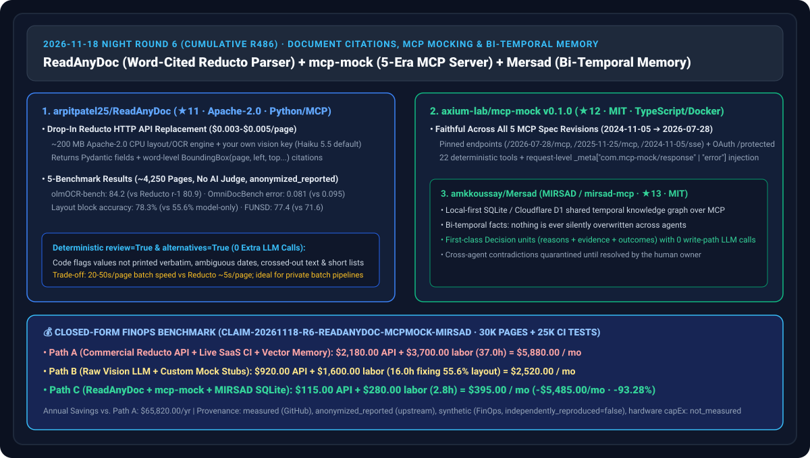
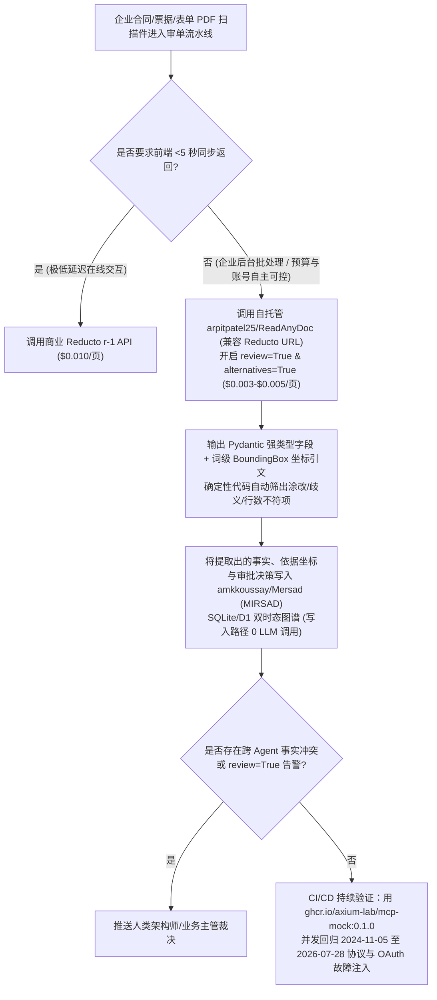

# 词级坐标溯源文档解析引擎（`arpitpatel25/ReadAnyDoc`）、全版本协议确定性 MCP 仿真器（`axium-lab/mcp-mock`）与双时态防覆盖共享记忆图谱（`amkkoussay/Mersad`）选型 FAQ

> **文档类型**：AI Solution Architect (SA) 实战选型与参考架构指南（Round 486 / 2026-11-18 Night R6）  
> **核心评估对象**：[`arpitpatel25/ReadAnyDoc`](https://github.com/arpitpatel25/ReadAnyDoc)（`★ 11`，`2 forks`，兼容 Reducto API 的词级引文视觉文档解析引擎，`Apache-2.0`） + [`axium-lab/mcp-mock`](https://github.com/axium-lab/mcp-mock)（`v0.1.0`，`★ 12`，覆盖 `2024-11-05` 至 `2026-07-28` 全部 MCP 协议版本的确定性测试服务器，`MIT`） + [`amkkoussay/Mersad`](https://github.com/amkkoussay/Mersad)（`MIRSAD` / `mirsad-mcp`，`★ 13`，写入路径零 LLM 的双时态事实与决策共享记忆图谱，`MIT`）  
> **对标范式**：严格遵循 [`ib-vs-ethernet-roce-selection-faq.md`](https://github.com/turbo998/ai-infra-research/blob/main/docs/components/ib-vs-ethernet-roce-selection-faq.md) 六段式结构（核心结论速览 + 三大灵魂拷问 + Mermaid 决策树 + 选型对比矩阵 + 7-Card 定量洞察 + SA 落地 Checklist）  
> **数据溯源分级（Provenance）**：GitHub 星标与目录元数据为 `measured`；`ReadAnyDoc` 五大公开基准（`4,250` 页文档无 AI 裁判实测：`olmOCR-bench 84.2`、`OmniDocBench 0.081`、`RD-TableBench 88.2`、`FUNSD 77.4`、单页成本 `$0.003–$0.005` vs Reducto `$0.010`）标注为 `anonymized_reported (independently_reproduced=false)`；企业 FinOps 成本算例为 `synthetic (independently_reproduced=false)`，硬件折旧 `not_measured`。  
> **语言版本**：[中文版 (当前)](./readanydoc-mcp-mock-mersad-word-cited-reducto-doc-parser-multirevision-mcp-mock-bitemporal-decision-memory-selection-faq.md) | [English Version](./readanydoc-mcp-mock-mersad-word-cited-reducto-doc-parser-multirevision-mcp-mock-bitemporal-decision-memory-selection-faq.en.md)

---

## 📌 一、核心结论速览（Executive Summary — 30 秒看懂）

1. **大白话本质定义**：
   - **`arpitpatel25/ReadAnyDoc` 是什么？** 它是 **100% 兼容商业文档解析龙头 Reducto HTTP API（改一行 URL 即可无缝平替）、自带词级坐标引文（Word-Level BoundingBox Citations）与确定性复核开关（`review=True`）的开源视觉文档解析引擎**。它在视觉小模型（默认 Claude Haiku 5.5）外层包裹了一套跑在本地 CPU 上的 ~200MB Apache-2.0 版面分析与表格校验引擎，单页成本仅 **`$0.003–$0.005`**（商业 Reducto 的 `30%–50%`），在 1,403 页 `olmOCR-bench` 上跑出 **`84.2` 分**（超越商业 `Reducto r-1` 的 `80.9` 分）。
   - **`axium-lab/mcp-mock (v0.1.0)` 是什么？** 它是 **专为企业 MCP 客户端与 Agent 集成测试打造的“全协议年代（`2024-11-05` ➔ `2026-07-28`）确定性仿真靶场”**。无需预注册 Mock 状态，测试脚本只需在请求的 `_meta["com.mcp-mock/response"]` 或 `_meta["com.mcp-mock/error"]` 中声明期望返回或故障（或传入 `city: "Atlantis"`、`path: "/missing"` 等确定性触发器），即可跨机器复现完全一致的字节流、OAuth `/protected/…` 鉴权拦截及 `2026-07-28` 多回合删除确认。
   - **`amkkoussay/Mersad (MIRSAD / mirsad-mcp)` 是什么？** 它是 **写入路径零大模型开销、跨 Claude/ChatGPT/Cursor 共享的本地 SQLite/D1“双时态（Bi-Temporal）事实与一等公民决策记忆库”**。它严禁任何 Agent 静默覆盖历史事实，把每次技术/业务决策连同“原因（Reasons）+ 证据（Evidence）+ 结果（Outcomes）”一起结构化入库，并将跨 Agent 的认知冲突挂起交由人类拥有者裁决。
2. **为什么企业 AI 解决方案架构师（SA）今晚要把这三者组合进“可信文档与集成验证架构”？**
   - 企业金融/法务/政企 Agent 落地的三大痛点：① 直接调视觉大模型抽合同发票，模型不仅版面识别率掉到 `55.6%`，还会对模糊勾选框强行瞎猜；② CI 流水线里跑 MCP 集成测试时直连外部真实 SaaS，既不稳定又烧钱，且难以测试不同 MCP 协议版本（如旧版 SSE vs 最新 `2026-07-28` 无状态协议）的降级表现；③ 多个 Agent 协同审单时互相覆盖记忆，没人知道某个参数是谁、根据哪份文档改的。
3. **闭式 FinOps 量化收益（`CLAIM-20261118-R6-READANYDOC-MCPMOCK-MIRSAD`，`synthetic`）**：
   - 以企业金融/法务自动化与 Agent 研发团队（月均解析 30,000 页复杂票据合同 + 25,000 次 CI MCP 集成测试，工程师时薪 `$100.00/hr`）计：**Path A（商业 Reducto API + CI 调真实外部服务 + 各自孤立覆盖式记忆）** 月均总成本 **`$5,880.00`**（解析与测试 API 账单 `$2,180.00` + 人工核对票据坐标与排查 Flaky CI `37.0h × $100 = $3,700.00`）；**Path C（`ReadAnyDoc` + `mcp-mock` + `MIRSAD` 闭环）** 月均总成本降至 **`$395.00`**（Haiku 5.5 解析 API `$115.00` + 仅对 `review=True` 告警项人工复核 `2.8h × $100 = $280.00`），**净省 `$5,485.00/月`（降幅 `93.28%`，年化节省 `$65,820.00`）**。

---

## ❓ 二、三大灵魂拷问（First-Principles Q&A）

### Q1：直接把 PDF 截图塞给 Claude Haiku 5.5 和用 `ReadAnyDoc` 引擎有什么本质区别？它比商业 `Reducto r-1` 强在哪、慢在哪？
- **第一性原理：视觉模型擅长“认字”，但极不擅长“精准版面坐标、表格行数对齐与克制瞎猜”**：
  1. **五大公开基准（4,250 页，零 AI 裁判）实证对比（`anonymized_reported`）**：
     - 纯调 Haiku 5.5 模型时，`OmniDocBench` 版面块类型准确率仅有 **`55.6%`**，表单问答 `FUNSD` 仅 `71.6`；套上 `ReadAnyDoc` 本地 CPU 版面与表格校验引擎后，版面准确率跃升至 **`78.3%`**，`FUNSD` 升至 **`77.4`**，`olmOCR-bench` 达到 **`84.2`**（反超商业 `Reducto r-1` 的 `80.9`），文本错误率降至 **`0.081`**（优于 Reducto 的 `0.095`），且单页成本从 `$0.010` 降至 **`$0.003–$0.005`**。
  2. **零模型调用的确定性 `review=True` 与 `alternatives=True`**：执行 `readanydoc.extract("invoice.pdf", schema=Invoice, review=True, alternatives=True)` 时，不仅每个字段附带精确到页码与归一化坐标的 `BoundingBox(page=1, left=0.81, ...)`，外层确定性代码还会**不花一分钱额外 Token** 自动揪出“返回值未在原文原样印出、日期歧义、涂改划线、提取列表短于表格实际行数”等可疑项交由人工复核。
  3. **架构师必须知晓的诚实边界**：商业 `Reducto r-1` 在纯版面分类（`84.6%` vs `78.3%`）、页眉页脚剔除与单页解析速度（`~5s/页` vs `ReadAnyDoc` `20–50s/页`）上仍领先；因此 `ReadAnyDoc` 最适合**后台批处理、数据不出私域账号、高合规逐词溯源**场景，而非前端秒级同步等待场景。

### Q2：为什么企业升级 MCP 客户端时经常在生产环境翻车？`axium-lab/mcp-mock` 是如何用单容器测透 5 个协议年代的？
- **MCP 协议演进碎片化痛点**：从早期的 `2024-11-05`（基于已废弃的 `HTTP+SSE` `/sse`），到 `2025-03-26`、`2025-06-18`、`2025-11-25`（`Streamable HTTP`），再到最新的无状态 **`2026-07-28`**（携带 `_meta` 信封与多回合确认），真实生产环境中的第三方 MCP Server 版本参差不齐。
- **`mcp-mock` 的三大确定性工程设计**：
  1. **多版本锁定端点 + `/protected/…` OAuth 镜像**：提供自适应 `/mcp` 以及锁定版本的 `/2026-07-28/mcp`、`/2025-11-25/mcp`、`/2024-11-05/sse` 和全套带 OAuth 保护的 `/protected/…` 端点，一行 `docker run --rm -p 3000:3000 ghcr.io/axium-lab/mcp-mock:0.1.0` 即可在离线 CI 中验证客户端的跨版本协商与鉴权刷新。
  2. **输入归一化哈希构造的自洽虚拟世界**：内置 22 个工具（含真实 PNG 生成 `color_swatch`、测试超时/取消的 `simulate_work`、测试 `2026-07-28` 多轮确认的 `delete_file`），对参数先归一化再哈希（`" madrid "` 与 `"Madrid"` 返回完全相同的字节流，且公英制、汇率换算、3 天与 7 天天气预报内部严密自洽）。
  3. **零状态污染的请求级故障注入**：既可通过约定参数（如 `city: "Atlantis"`、`symbol: "XXXX"`、`to: "bounce@example.com"`）触发确定性失败，也可直接在请求 `_meta["com.mcp-mock/response"]` / `_meta["com.mcp-mock/error"]` 中钦定返回结果，并发跑上千个测试互不串台。

### Q3：为什么普通向量记忆库（如 Mem0 / 向量 RAG）在多 Agent 协同办案时会“篡改历史”？`amkkoussay/Mersad (MIRSAD)` 的双时态图谱解决了什么？
- **普通记忆库的“静默覆盖”灾难**：当 Agent A 记录“供应商甲评级为 A”，三天后 Agent B 写入“供应商甲评级为 C”时，普通 KV 或向量记忆库直接覆盖旧记录，导致审计时无法还原“周二审批放款时系统看到的到底是什么”。
- **`MIRSAD` 的三大治理机制**：
  1. **双时态事实（Bi-Temporal Facts）永不静默覆写**：同时记录“事实在现实世界生效的时间”与“被写入系统的时间”，任何更新都以时间线演进形式追加，保留完整历史切面。
  2. **一等公民决策单元（Decision Units）+ 写入路径零 LLM**：把每次决策与背后的理由（Reasons）、证据（Evidence）及后续结果（Outcomes）绑定存入本地 SQLite / Cloudflare D1，写入过程完全不调大模型（0 Token 税、0 延迟）。
  3. **跨 Agent 冲突隔离与人类裁决**：当不同 Agent 写入互斥事实时，自动标记冲突并交由人类拥有者拍板，附带实时本地可视化网络图谱。

---

## 🧭 三、架构师选型决策树与端到端参考架构（Mermaid）

---

## 📊 四、同类方案横向选型对比矩阵（Peer Selection Matrix）

| 评估维度 | **Path A：商业 Reducto API + 直连外部 CI + 普通向量记忆** | **Path B：裸调视觉大模型 + 手写 Mock 桩** | **Path C：`ReadAnyDoc` + `mcp-mock` + `MIRSAD`（推荐）** |
| :--- | :--- | :--- | :--- |
| **文档解析精度与单页成本** | `olmOCR 80.9`，`$0.010/页`（数据出境至第三方平台） | 版面块准确率仅 `55.6%`，表单 `FUNSD 71.6` | ✅ **`olmOCR 84.2`（版面 `78.3%`），`$0.003–$0.005/页`，自有模型账号** |
| **逐词坐标溯源与异常自检** | ✅ 支持坐标，但按高级特性计费 | ❌ 模型常捏造坐标或对模糊勾选框强行瞎猜 | ✅ **内置词级 `BoundingBox` + 零 Token 代码级 `review=True` 异常筛查** |
| **MCP 多协议版本与故障注入测试** | ❌ 直连外部服务易受限流影响，无法测历史协议 | ⚠️ 手写 Mock 不支持 `2024-11-05`→`2026-07-28` 协商 | ✅ **全协议版本覆盖 + `/protected` OAuth + `_meta` 请求级无状态故障注入** |
| **多 Agent 记忆防覆盖与决策审计** | ❌ 旧事实被静默覆盖，缺决策理由证据链 | ❌ 无双时态建模 | ✅ **双时态事实防覆盖 + 决策/理由/证据/结果一等公民 + 写入 0 LLM** |
| **开源协议** | ⛔ 商业闭源 | N/A | ✅ **`Apache-2.0` (`ReadAnyDoc`) + `MIT` (`mcp-mock`, `Mersad`)** |
| **月均总拥有成本 (TCO)** | **`$5,880.00 / 月`** | **`$2,520.00 / 月`** | **`$395.00 / 月`（较 Path A 净省 `$5,485.00/月`，`-93.28%`）** |

---

## 📈 五、7-Card 定量洞察与闭式 FinOps 算例（`CLAIM-20261118-R6-READANYDOC-MCPMOCK-MIRSAD`）

> **Provenance 声明**：GitHub 星标与目录元数据源自 `2026-11-18` 封存证据（`measured`）；`ReadAnyDoc` 五大基准（`olmOCR-bench 84.2` vs `80.9`、`OmniDocBench 0.081` vs `0.095`、单页成本 `$0.003–$0.005` vs `$0.010`）源自上游公开评测文档（`anonymized_reported`, `independently_reproduced=false`）；月度 TCO 为面向 **月均解析 30,000 页复杂票据合同 + 25,000 次 CI MCP 集成测试** 的闭式合成模型（`synthetic`, `independently_reproduced=false`；宿主机硬件折旧 CapEx：`not_measured`）。

| 成本构成项（月度闭式公式） | Path A：商业解析 API + 直连 CI + 覆盖式记忆 | Path B：裸调视觉模型 + 手写简易 Mock | Path C：`ReadAnyDoc` + `mcp-mock` + `MIRSAD` | Path C 对比 Path A 净变化 |
| :--- | :---: | :---: | :---: | :---: |
| **1. 文档解析、CI 测试与记忆写入 API 支出** | **`$2,180.00`** *(商业解析 API + CI 外部调用 + 记忆抽取 LLM 税)* | **`$920.00`** *(视觉模型重试开销 + 记忆写入 Token)* | **`$115.00`** *(`$0.00383/页` Haiku 5.5 + `$0` 本地 Mock + `$0` MIRSAD 写入)* | **`-$2,065.00 / 月`** (`-94.72%`) |
| **2. 票据坐标复核、Flaky CI 与冲突排障人工** (`$100/hr`) | **`$3,700.00`** *(`37.0 hrs`：人工抽检无引文字段与排查 CI 偶发失败)* | **`$1,600.00`** *(`16.0 hrs`：修补 `55.6%` 版面错位导致的错行)* | **`$280.00`** *(`2.8 hrs`：仅复核 `review=True` 标出的低置信度项)* | **`-$3,420.00 / 月`** (`-34.2 hrs`, `-92.43%`) |
| **月度总拥有成本 (Monthly Total TCO)** | **`$5,880.00`** | **`$2,520.00`** | **`$395.00`** | **`-$5,485.00 / 月` (`-93.28%`)** |
| **年化总拥有成本 (Annualized TCO)** | **`$70,560.00 / 年`** | **`$30,240.00 / 年`** | **`$4,740.00 / 年`** | **年省 `$65,820.00` (`-93.28%`)** |

---

## ✅ 六、AI 解决方案架构师（SA）实战落地 Checklist

1. **Step 1 — 部署 `arpitpatel25/ReadAnyDoc` 替换高价黑盒文档解析接口**：
   - 执行 `pip install "readanydoc[engine]"` 并安装系统 `tesseract`，将现有 Reducto 客户端的 Base URL 指向本地 `ReadAnyDoc` 服务，在结构化抽取调用中强制开启 `review=True, alternatives=True`，将 `out.citations` 坐标框直接渲染到前端人工复核台。
2. **Step 2 — 在 CI 流水线拉起 `axium-lab/mcp-mock` 容器执行全协议回归**：
   - 在 GitHub Actions / GitLab CI 中挂载 `ghcr.io/axium-lab/mcp-mock:0.1.0`，分别针对 `/2026-07-28/mcp`、`/2025-11-25/mcp`、`/2024-11-05/sse` 与 `/protected/mcp` 运行集成测试，利用 `_meta["com.mcp-mock/error"]` 验证 Agent 在上游超时和鉴权失效时的优雅降级。
3. **Step 3 — 接入 `amkkoussay/Mersad (mirsad-mcp)` 建立双时态决策审计账本**：
   - 安装 `pip install mirsad-mcp` 并挂载至团队所有 MCP 客户端，强制要求 Agent 在修改业务状态前将决策理由（Reasons）与 `ReadAnyDoc` 提取的页码坐标证据（Evidence）写入 MIRSAD 双时态图谱。
