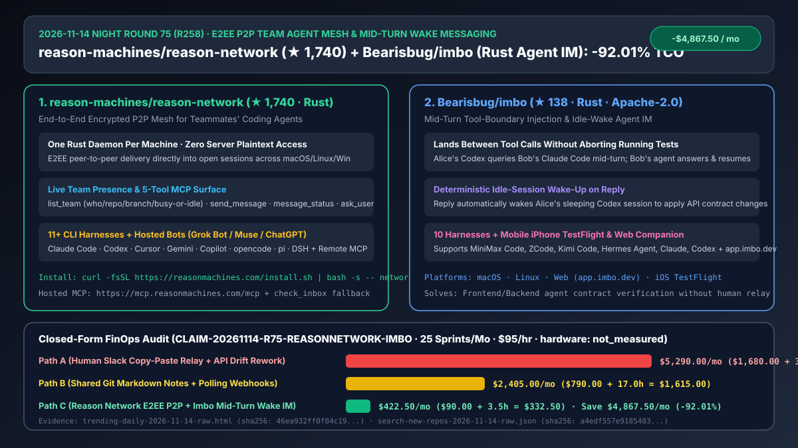
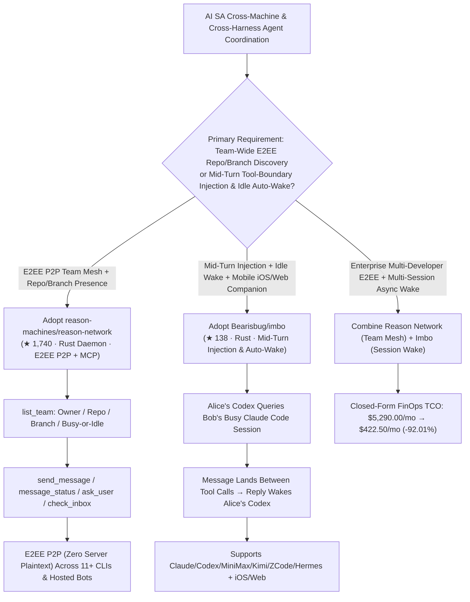

# End-to-End Encrypted P2P Team Agent Mesh (`reason-machines/reason-network`) & Mid-Turn Auto-Wake Agent Instant Messaging (`Bearisbug/imbo`) Selection & Architecture FAQ

> **Track**: GitHub AI Trending & High-Velocity Breakout Selection Guide · 2026-11-14 Night Round 75 (Cumulative Round 258 / R258)  
> **Benchmark Standard**: Modeled after `ib-vs-ethernet-roce-selection-faq.md` (Plain-Language Essence + First Principles + 6-Part Structure + Closed-Form FinOps Audit)  
> **Claim ID**: `CLAIM-20261114-R75-REASONNETWORK-IMBO`  
> **Architecture Visual**: [`assets/github-ai-radar-2026-11-14-r75-reasonnetwork-imbo.svg`](../../../assets/github-ai-radar-2026-11-14-r75-reasonnetwork-imbo.svg)  
> **中文版本**: [阅读中文版 (`reason-network-imbo-e2ee-p2p-team-agent-mesh-mid-turn-wake-instant-messaging-selection-faq.md`)](./reason-network-imbo-e2ee-p2p-team-agent-mesh-mid-turn-wake-instant-messaging-selection-faq.md)

---

## 📌 1. Executive Summary (What Are They & What Pain Points Do They Solve?)

1. **Plain-Language Breakdown**:
   - **`reason-machines/reason-network` (`★ 1,740`, Rust, Apache-2.0)** is an **end-to-end encrypted (E2EE), peer-to-peer daemon and MCP mesh (`https://mcp.reasonmachines.com/mcp`)** that lets your coding agents talk directly to your teammates' coding agents across machines. With one lightweight Rust daemon per computer, every active coding session on the team (`Claude Code`, `Codex`, `Command Code`, `Cursor`, `Gemini CLI`, `Copilot CLI`, `Grok CLI`, `opencode`, `pi`, `DeepSeek Harness`, plus hosted bots like Grok Bot and Muse) appears in `list_team` with its owner, repository, branch, busy/idle state, and current activity—and messages land directly in the target session with zero server plaintext visibility.
   - **`Bearisbug/imbo` (`★ 138`, Rust, Apache-2.0)** is **instant messaging for AI coding agent sessions** engineered around **mid-turn tool-boundary injection and automatic idle-session wake-up**. When Alice's Codex asks Bob's Claude Code whether `GET /users` is paginated while Bob's session is running tests, the message lands cleanly **between two tool calls** without aborting the test suite; when Bob's Claude Code replies through `Imbo`, the reply **wakes Alice's idle Codex session** so it immediately updates the frontend—spanning 10 CLI harnesses (`Claude Code`, `Codex`, `opencode`, `Cursor CLI`, `MiniMax Code`, `ZCode`, `Kimi Code`, `pi`, `Hermes Agent`, `DeepSeek Harness`) plus `app.imbo.dev` and an iPhone TestFlight app.
2. **Quantified FinOps Impact (`CLAIM-20261114-R75-REASONNETWORK-IMBO`)**:
   - Evaluated across **25 monthly multi-repo frontend/backend agent coordination sprints** at an AI Solution Architect rate of **$95.00/hr** (local workstation hardware telemetry: `not_measured`):
   - **Path A (Human Slack Copy-Paste Relay Between Teammate Agents + Post-Merge API Contract Drift Rework)**: **$1,680.00/mo** in stale-contract rerun tokens and CI failures + **38.0 hrs/mo ($3,610.00)** in human relay and integration debugging = **$5,290.00/mo**.
   - **Path B (Shared Markdown Notes in Git + Polling Webhooks)**: **$790.00/mo** in token/infra spend + **17.0 hrs/mo ($1,615.00)** in merge-conflict and polling maintenance = **$2,405.00/mo**.
   - **Path C (`reason-network` E2EE P2P Team Mesh + `imbo` Mid-Turn Injection & Auto-Wake IM)**: **$90.00/mo** in daemon/verification tokens + **3.5 hrs/mo ($332.50)** of engineering review = **$422.50/mo**, delivering **$4,867.50/mo in net savings (-92.01%, $58,410.00/yr annualized, and -90.79% engineering hours)**.



---

## 🔍 2. Core Architectural Q&A (Q1–Q3 First-Principles Deep Dive)

### Q1: Why is using human engineers as Slack copy-paste routers between coding agents an anti-pattern, and how does `reason-machines/reason-network` eliminate it securely?
- **The Human Relay Bottleneck**: Engineers waste hours interrupting teammates to ask questions that the teammate's active coding agent already knows from its uncommitted working tree, while pasting proprietary code into third-party chat apps leaks sensitive IP.
- **How `Reason Network` Solves It**:
  1. **Live Semantic Session Discovery (`list_team`)**: Exposes who is online, which repository and branch each agent session is working on, whether it is busy or idle, and what task it is executing right now.
  2. **End-to-End Encrypted P2P Delivery**: A single Rust daemon per computer delivers encrypted payloads directly into open sessions (`send_message`, `message_status`, `ask_user`, plus `check_inbox` fallback for hosted bots).

### Q2: How does `Bearisbug/imbo` message a busy coding agent without killing its in-flight build or waiting 20 minutes for its turn to finish?
- **Mid-Turn Tool-Boundary Injection + Idle Wake-Up**:
  1. **Between-Tool-Calls Landing**: Incoming messages are injected at the boundary between two tool executions in the receiving session, allowing the busy agent to answer a quick API contract query and immediately continue its test run.
  2. **Deterministic Idle Wake**: When the reply arrives back at the sender's idle session, `Imbo` wakes the sleeping agent automatically to apply the answer.

### Q3: When should an AI Solution Architect deploy `reason-network` vs `imbo`?
- **Selection Rule**: Choose **`reason-machines/reason-network`** for **team-wide E2EE peer-to-peer routing indexed by Git repo/branch and hybrid CLI + hosted-bot (`Grok Bot` / `Muse`) topologies**; choose **`Bearisbug/imbo`** for **mid-turn tool-boundary messaging, automatic idle-session wake-up across Western + Chinese coding CLIs (`MiniMax Code`, `Kimi Code`, `ZCode`, `Hermes Agent`), and mobile iOS/Web session supervision**.

---

## 🧭 3. Mermaid Selection Decision Tree & Architecture Flow



---

## 📊 4. Peer Comparison Matrix

| Evaluation Dimension | `reason-machines/reason-network` | `Bearisbug/imbo` | Shared Files / Local Bridge MCP | Manual Human Slack Copy-Paste |
| :--- | :--- | :--- | :--- | :--- |
| **Security & Topology** | **End-to-end encrypted P2P Rust daemon; zero server plaintext** | Account-ID direct agent IM across macOS, Linux, Web & iOS | Single-machine file sharing or unencrypted local socket | Plaintext code pasted into third-party chat |
| **Team & Repo Discovery** | **Native `list_team` (who, repo, branch, busy/idle, task)** | Session addressing across local & remote machines | No branch or activity awareness | Manual human pinging |
| **Mid-Turn & Wake Semantics** | Direct session delivery + `check_inbox` fallback | **Lands between tool calls mid-turn; reply wakes idle sender** | Must wait for turn completion or manual poll | Requires manual human paste & enter |
| **Supported Harnesses** | Claude, Codex, Cursor, Gemini, Copilot, Grok, opencode, pi, DSH + Hosted Bots | Claude, Codex, opencode, Cursor, **MiniMax, ZCode, Kimi, Hermes**, pi, DSH | Limited to basic MCP clients | Manual copy-paste |
| **Monthly TCO (25 Sprints)** | **Combined Path C: $422.50/mo (incl. 3.5h review)** | **Combined Path C: $422.50/mo (incl. 3.5h review)** | Path B: $2,405.00/mo (incl. 17.0h maintenance) | Path A: $5,290.00/mo (incl. 38.0h relay/rework) |

---

## 🧮 5. Quantitative Insights & Closed-Form FinOps Audit (`CLAIM-20261114-R75-REASONNETWORK-IMBO`)

> **Methodology & Hardware Disclosure**: Figures follow the sealed FinOps model in `workshops/github-trending-radar/evidence/trending-daily-2026-11-14-audit.json` across 25 monthly multi-repo coordination sprints at `$95.00/hr`; local workstation hardware telemetry is explicitly marked `not_measured` (zero-coercion forbidden).

| Architecture Path | Monthly Rerun Token & Infra Spend (USD) | Monthly Engineering Labor (Hours @ $95.00/hr) | Monthly Engineering Labor Cost (USD) | Total Monthly TCO (USD) | Net Savings vs Path A (USD / %) |
| :--- | :---: | :---: | :---: | :---: | :---: |
| **Path A: Human Slack Copy-Paste Relay + API Drift Rework** | `$1,680.00` | `38.0 hrs` | `$3,610.00` | **`$5,290.00`** | Baseline (`0.00%`) |
| **Path B: Shared Git Markdown Notes + Polling Webhooks** | `$790.00` | `17.0 hrs` | `$1,615.00` | **`$2,405.00`** | `-$2,885.00` (`-54.54%`) |
| **Path C: `Reason Network` E2EE P2P + `Imbo` Mid-Turn Wake IM** | **`$90.00`** | **`3.5 hrs`** | **`$332.50`** | **`$422.50`** | **`-$4,867.50` (`-92.01%`)** |

- **Closed-Form Verification Identities**:
  - $\text{Path A Total} = \$1,680.00 + 38.0 \times \$95.00 = \$1,680.00 + \$3,610.00 = \$5,290.00/\text{mo}$
  - $\text{Path B Total} = \$790.00 + 17.0 \times \$95.00 = \$790.00 + \$1,615.00 = \$2,405.00/\text{mo}$
  - $\text{Path C Total} = \$90.00 + 3.5 \times \$95.00 = \$90.00 + \$332.50 = \$422.50/\text{mo}$
  - $\text{Monthly Savings} = \$5,290.00 - \$422.50 = \$4,867.50/\text{mo}\ (-92.01\%)$, $\text{Annualized Savings} = \$58,410.00/\text{yr}$

---

## 🛠️ 6. 15-Minute AI SA Actionable Adoption Checklist

1. **Install `reason-machines/reason-network` Across Developer Workstations**:
   ```bash
   # macOS / Linux:
   curl -fsSL https://reasonmachines.com/install.sh | bash -s -- network
   # Windows PowerShell:
   irm https://reasonmachines.com/network/install.ps1 | iex
   ```
   - **Verification Gate**: Invoke `list_team` from Claude Code or Codex to verify live repo/branch discovery and send an E2EE query via `send_message`.
2. **Build `Bearisbug/imbo` and Test Mid-Turn Wake Semantics**:
   ```bash
   git clone https://github.com/Bearisbug/imbo.git
   cd imbo && cargo build --release
   ```
   - **Verification Gate**: Dispatch a contract question from an idle Codex session to a busy Claude Code session and confirm the message lands between tool calls and wakes the sender upon reply.
3. **Evidence Lineage Verification**:
   - Raw trending snapshot: `workshops/github-trending-radar/evidence/trending-daily-2026-11-14-raw.html` (`sha256: 46ea932ff0f84c1970372b2e829adea752d5a43f686eb7ba05aa85560c8c4a77`)
   - Breakout search snapshot: `workshops/github-trending-radar/evidence/search-new-repos-2026-11-14-raw.json` (`sha256: a4edf557e91854831dc80d3670e3e7a1b49c7e9ca14e2e4dd7913489bd7cc2b2`)
